



<article class="post-entry" data-tags="literature, victorian, realistic, ethereal, cinematic, horror, gothic">
<h2 id="oct-21-26" style="display: flex; flex-wrap: wrap; justify-content: flex-start; align-items: center; gap: 25px;">
<a href="#oct-21-26">Oct 21 // Scenes from Literature #10</a> 
<button onclick="switchDraculaGuest(-1)" class="toggle-btn toggle-prev" style="position: static; border-right: 1px solid #777; border-top-right-radius: 0; border-bottom-right-radius: 0; margin-right: 0;" title="Previous Image">◀</button><button onclick="switchDraculaGuest(1)" class="toggle-btn toggle-next" style="position: static; border-top-left-radius: 0; border-bottom-left-radius: 0; border-left: none; margin-left: 0;" title="Next Image">▶</button>

 

  literature
  victorian
  realistic
  ethereal
  cinematic
  horror
  gothic

</h2>

  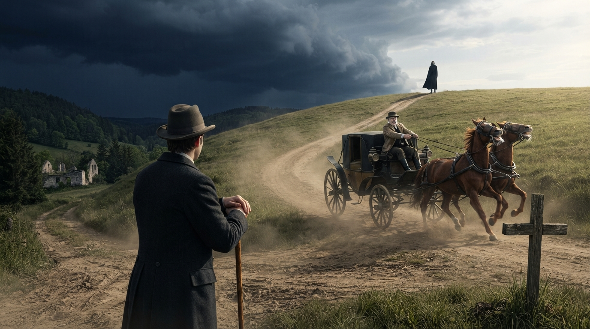
  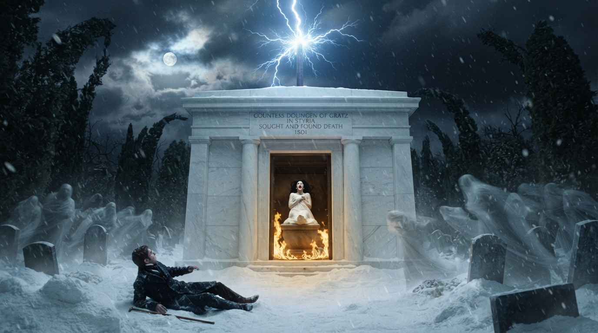
  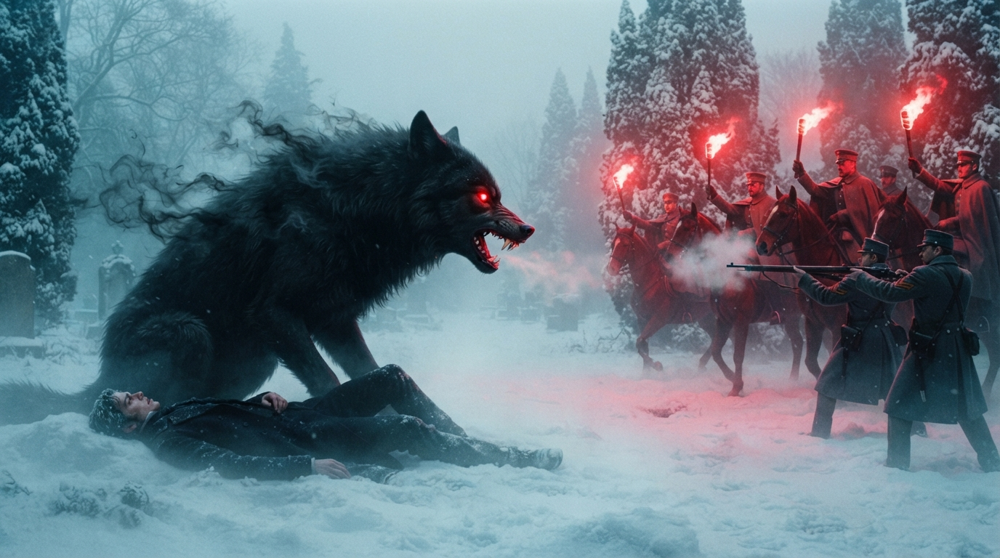

  

    <button type="button">Scenes from Literature #10</button>
    <button type="button" class="discuss-btn" onclick="openDiscussion('oct-21-26')">Comments</button>
  

  
<pre class="highlight"><code>
<strong>1. Crossroads</strong>

<strong>[NEGATIVE]</strong> Unreal Engine, 3D video game render, clinical sharp digital edges, foreground man facing camera, looking at viewer, front-facing foreground man, looking away from road, looking left, standing coachman, coachman standing upright, falling snow, snowdrifts, winter blizzard, turnip, vegetables, modern cars, paved asphalt highway, telephone poles, power lines, streetlights, wristwatches, digital watches, modern clothing, cartoon, anime, low resolution, extra limbs, deformed horse anatomy, extra horse legs, text, watermarks, signature <strong>[MEDIUM]</strong> Haunting 19th-century Dark Romantic & Symbolist nocturne cinematography shot on 35mm silver-halide photochemical film with a Tiffen Black Pro-Mist 1/2 diffusion filter for ethereal light halation, dreamy atmospheric haze, and spectral depth (16:9 widescreen aspect ratio, 8k resolution, misty luminous chiaroscuro directly inspired by Atkinson Grimshaw's moonlit nocturnes, Caspar David Friedrich, and Arnold Böcklin). <strong>[SETTING]</strong> A bleak, windswept Bavarian plateau outside Munich in the uncanny, fading golden twilight and deceptive early-summer warmth of Walpurgis Nacht (April 30), when 'all evil things of earth and air and water held revel.' In the immediate foreground, a rutted 19th-century dirt highway intersects with an overgrown, grass-grown side road that dips down to the left into a deep, desolate valley shut in by dark tree-clad hills, where the crumbling stone foundations of a centuries-abandoned vampire village lie half-swallowed by creeping, ghostly white ground-fog ('lost in misty vagueness'). Coiling tendrils of pale, spectral ground-mist drift up out of the unholy valley road to wrap around the base of a weathered wooden Christian cross marking an old suicide's grave at the crossroads. High overhead, great ominous black storm clouds race rapidly from north to south across the sky, their wind-torn edges forming subtle, eerie pareidolic cloud-wraiths as a sudden icy breath of north wind bends the plateau grass. <strong>[CHARACTERS BASE]</strong> Three distinct subject groups aligned along a single unbroken diagonal sightline from the misty foreground crossroads straight up the Munich hill road to the horizon crest: CHARACTER 1 (Foreground Left — The English Traveler Viewed Over-the-Shoulder Looking Up at the Hill Crest): A young Victorian English gentleman in a tailored dark wool traveling overcoat and felt traveling hat, standing on foot in the curling ground-mist beside the wooden suicide cross; SEEN FROM BEHIND IN A THREE-QUARTER REAR OVER-THE-SHOULDER VIEW WITH HIS BACK TURNED TO THE CAMERA, he leans with both hands atop his stout oak walking-stick and turns his head and eyes directly away from the viewer to stare straight up the hill road at the tall, thin apparition on the horizon crest. CHARACTER 2 (Mid-Ground Center — Johann Seated on the Coachman's Bench & Open Landau Carriage): On the hill road directly in the Englishman's line of sight, the white-faced, perspiring Bavarian coachman Johann—wearing traditional 19th-century collared coachman's livery and hat with a thick, bulbous old-fashioned German silver pocket-watch on a chain at his waistcoat—is SEATED firmly on the elevated front coachman's bench seat of an open four-wheeled landau carriage, leaning back in his seat and pulling desperately with both hands on the leather reins. CHARACTER 3 (Horizon Hill Crest Right — The Tall Thin Spectral Stranger Against the Sun): Standing high on the crest of the hill on the Munich road directly where the Englishman is staring is a solitary, uncanny figure—a man remarkably tall and cadaverously thin, wrapped in a dark wind-whipped cloak whose lower edges fray and dissolve into swirling shadow-mist, starkly silhouetted against blinding crepuscular sunbeams ('the sun was behind him') piercing the black storm clouds. <strong>[EVENT MODIFIERS]</strong> MODIFIER 1 (Crepuscular God-Rays, Locked Gaze & The Rearing, Bolting Horses): As the foreground Englishman's over-the-shoulder gaze locks onto the hill-crest apparition, piercing golden-amber Tyndall sun-rays halo the tall, thin stranger from behind while Johann's two bay carriage horses rear and kick wildly in supernatural terror with flared nostrils, wide eyes, and ghostly steam and foam flying from their mouths as they bolt down the road. MODIFIER 2 (Atkinson Grimshaw Misty Halation & Spectral Twilight Contrast): Ethereal contrast between the warm, blooming golden-amber twilight halation on the foreground suicide cross and rising valley ground-fog versus the freezing, ghostly indigo-and-silver storm shadow enveloping the hill crest and the vanishing stranger.

<strong>2. Intervention</strong>

<strong>[NEGATIVE]</strong> cropped roof, lightning missing the iron rod, background sky lightning only, Unreal Engine, 3D video game render, clinical dry digital look, red shroud, red dress, red gown, red robe, crimson clothing, scarlet fabric, red veil, disembodied giant hand, floating hand, cornstalks, farm crops, modern clothing, flashlights, umbrellas, cartoon, anime, comic book style, flat lighting, sunny sky, green summer leaves, unreadable gibberish text, spelling errors, extra fingers, deformed anatomy, plastic textures, low resolution, watermark, signature <strong>[MEDIUM]</strong> Ethereal 19th-century Symbolist & Gothic nocturne VFX cinematography shot on 35mm photochemical film with a Tiffen Black Pro-Mist 1/2 diffusion filter for glowing moonlit halation, translucent marble subsurface scattering, and spectral snow-fog atmosphere (16:9 widescreen aspect ratio, 8k resolution, shot on a wide 18mm lens framing the ENTIRE square white marble sepulchre with generous storm-sky headroom above its roof so both the tall vertical iron roof-stake at the top and the wide-open Doric doorway below are completely visible, directly inspired by Arnold Böcklin's 'Isle of the Dead' and Atkinson Grimshaw's misty moonlight paintings). <strong>[SETTING]</strong> An ancient, snow-shrouded graveyard at midnight on Walpurgis Nacht inside a depopulated Bavarian valley ('shivering with cold in a shroud of snow'). A straggling flood of eerie, pale silver moonlight breaks through a rift in the black storm clouds to illuminate a straight funerary alley of towering black cypress and yew trees—their dark evergreen boughs bent and stripped by the tempest—leading to a massive square sepulchre built of vast blocks of white marble, glowing as white as the snowdrifts around it. Crowning the exact top-center of the flat marble roof is a TALL, THICK VERTICAL IRON STAKE (like a heavy iron lightning rod driven straight down into the roof stone), and a single massive, jagged bolt of blue-white forked lightning descends vertically from the storm clouds to make DIRECT, SPARKING POINT-TO-POINT CONTACT WITH THE VERY TIP OF THE IRON ROOF-STAKE! Below the roof, carved deeply into the marble entablature above the recessed Doric doorway in crisp, legible capital serif letters is the four-line inscription: "COUNTESS DOLINGEN OF GRATZ / IN STYRIA / SOUGHT AND FOUND DEATH / 1801", while the massive bronze Doric door stands swung wide open inward. <strong>[CHARACTERS BASE]</strong> Three distinct visual elements caught in the split-second the lightning bolt strikes the iron roof-stake: CHARACTER 1 (Inside the Wide-Open Doric Doorway — Countess Dolingen of Gratz Clearly Visible in a Stark White Shroud): Framed clearly and unobstructed inside the wide-open bronze Doric doorway upon a carved stone burial bier is a voluptuous, hauntingly beautiful undead noblewoman draped entirely in a STARK, PURE SNOW-WHITE LINEN 1801 BURIAL SHROUD (bleached white burial garments covering her body, contrasting sharply against the dark tomb interior); caught in the split-second the lightning bolt channels down from the iron roof-stake into her tomb just before the marble crumbles, she rises convulsively from her bier as the first tongues of golden-orange flame lap around the base of the stone bier, her pale luminous face with full rounded cheeks, dark unbound hair, and vivid red lips open in a bitter scream of agony. CHARACTER 2 (Foreground Ground — The English Traveler Hurled into the Shroud of Snow): In the lower-left foreground, the young Victorian Englishman in his snow-plastered dark wool overcoat lies where he was hurled backward off the marble steps onto his back in a billowing drift of snow, looking up at the lightning-struck tomb while his oak walking-stick rests on the ice. CHARACTER 3 (Surrounding Graveyard — The Sheeted Dead Phantoms Closing In Through the White Cloudiness): Rising directly out of the disturbed graves among the tilted headstones on both flanks, the dense, milky-white cloudiness of the driving hail and ground-fog coalesces into a vague, white, moving mass of luminous, translucent, shroud-wrapped weeping phantom figures—'as if all the graves around me had sent out the phantoms of their sheeted dead, and that they were closing in on me through the white cloudiness of the driving hail.' <strong>[EVENT MODIFIERS]</strong> MODIFIER 1 (Direct Lightning Strike on the Tip of the Iron Roof-Stake): A single colossal, blinding blue-white lightning bolt strikes DIRECTLY ONTO THE METAL TIP OF THE VERTICAL IRON STAKE ON TOP OF THE MARBLE ROOF in a brilliant corona of electric sparks and plasma arcs, channeling the current straight down through the translucent white marble veins into the burning bier inside an instant before the marble blasts apart. MODIFIER 2 (Böcklin Moonlight, Milky Hail Vortex & Dual-Kelvin Contrast): Swirling curtains of marble-sized hailstones and luminous white snow-mist envelop the cemetery; the Black Pro-Mist diffusion blooms the 9000K electric blue-white lightning impact on the roof rod and ghostly silver moonlight over the closing-in sheeted phantoms against the warm 1800K flames lapping around the clearly visible white-shrouded Countess inside the open door.

<strong>3. Rescue</strong>

<strong>[NEGATIVE]</strong> Unreal Engine, 3D video game render, clinical dry digital edges, small wolf, normal-sized wolf, dog-sized wolf, medium dog, husky, coyote, wolf looking down at ground, wolf facing away from cavalry, werewolf biped, human-wolf hybrid standing on two legs, puncture wounds, bite marks, torn throat, spurting blood, gore, detached body parts, floating eyelashes, modern tactical gear, flashlights, headlights, modern rifles, daytime, bright sun, cartoon, anime, illustration, low resolution, blurry foreground wolf, deformed wolf anatomy, extra legs, text, watermarks, signature <strong>[MEDIUM]</strong> Ethereal, dreamlike 19th-century dark-gothic nocturne cinematography shot on 35mm silver-halide film with a Tiffen Black Pro-Mist 1/2 diffusion filter and vintage anamorphic glass for glowing crimson torchlight halation and dense ground-fog atmosphere (16:9 widescreen aspect ratio, 8k resolution, shot on a 24mm f/4 wide-macro lens at snow level in front of the pinned traveler and giant wolf, inspired by Atkinson Grimshaw's misty nocturnes). <strong>[SETTING]</strong> A freezing, silent, funeral-white expanse of deep snow ('the white pall which stretched into the darkness around me') just outside the low stone wall and dense snow-weighted black cypress and yew grove of the abandoned cemetery before dawn on Walpurgis Nacht. Heavy, ghostly ground-mist coils across the snowdrifts. Moving around and emerging from the snow-clad cypresses on the right side of the frame is a vivid, volumetric red glare of blazing pitch torches ('a red glare began to move round the grove of cypresses... Nearer came the red glow, over the white pall'), while low on the distant northern horizon glimmers a faint crimson pre-dawn streak 'reflected, like a path of blood, over the waste of snow.' <strong>[CHARACTERS BASE]</strong> Three layered subject groups aligned along a direct sightline between Foreground Left and Mid-Ground Right: CHARACTER 1 (Foreground Left — The Pinned English Traveler Looking Right Through the Mist Toward the Cavalry): Lying flat on his back in the deep, misty snowdrift on the left side of the frame in his dark Victorian wool overcoat, half-swooning in a physical nightmare of icy paralysis, the young Englishman cautiously raises his frost-rimmed head an inch off the snow and looks directly across toward the incoming cavalrymen on the right; his exposed, unbroken pale throat skin is completely intact and free of punctures, but chafed a warm, raw crimson where the wolf's warm rasping tongue has licked it. CHARACTER 2 (Foreground Left-Center — The Colossal Horse-Sized Vampiric Wolf Facing the Incoming Cavalry): Crouching with crushing weight directly upon the Englishman's chest (keeping his blood warm against the lethal frost) is a COLOSSAL, MONSTROUSLY HUGE, HORSE-SIZED SUPERNATURAL BLACK DIRE-WOLF ('A wolf—and yet not a wolf!')—as massive and heavy as a Shire draft horse, its giant broad chest and enormous paws completely spanning and pinning the grown man's entire torso, and its gigantic wolf head wider than the man's entire shoulders; uncanny wisps of dark vampiric shadow-smoke and freezing steam curl off its coal-black fur as it raises its massive head high and faces directly toward the incoming cavalrymen on the right in crisp three-quarter front profile, glaring at the horsemen with two great, bioluminescent ruby-ember FLAMING EYES that cast an eerie red glow across the mist and the Englishman's upturned face, sharp white fangs gleaming in its gaping red mouth, and thick plumes of fierce, acrid hot breath steaming in the icy air. CHARACTER 3 (Mid-Ground Right Cypress Edge — The Torch-Lit Bavarian Cavalry Search Party in Crimson Fog): Emerging at a fast trot out of the volumetric red torch-fog among the snow-laden cypress trees on the right side of the frame and riding directly toward the wolf and the Englishman on the left is a troop of 19th-century Bavarian cavalrymen in peaked military caps and long military cloaks on steaming horses; several troopers hold blazing pitch torches high overhead, while a panicked soldier in the front rank levels his carbine rifle directly toward the Englishman and wolf on the left—and right beside him, a steady-handed petty officer wearing a chevron on his coat sleeve knocks the soldier's arm upward just as the carbine flashes. <strong>[EVENT MODIFIERS]</strong> MODIFIER 1 (Supernatural Gaze Lock & The Deflected Carbine Shot in the Mist): Captured at the exact instant both the colossal shadow-wreathed, flaming-eyed wolf and the pinned Englishman look directly through the swirling snow-mist at the oncoming torch-bearing cavalrymen on the right as the petty officer with the sleeve chevron strikes his comrade's firing carbine barrel skyward in a blooming halo of black-powder smoke. MODIFIER 2 (Path-of-Blood Torch Halation & Bioluminescent Flaming Eyes): Dreamlike atmospheric contrast between the glowing ruby-red bioluminescence of the giant wolf's flaming eyes and steaming breath on the left, the blooming 2000K crimson torch-glare reflecting 'like a path of blood over the white pall' of mist-shrouded snow on the right, and the 7500K spectral ice-blue shadows of the cypresses.
</code></pre>

  

</article>

<article class="post-entry" data-tags="food-drink, historical, infographic">
<h2 id="oct-20-26" style="display: flex; flex-wrap: wrap; justify-content: flex-start; align-items: center; gap: 25px;">
<a href="#oct-20-26">Oct 20 // Some Assembly Required #4</a> 
<button onclick="switchCandyAppleII(-1)" class="toggle-btn toggle-prev" style="position: static; border-right: 1px solid #777; border-top-right-radius: 0; border-bottom-right-radius: 0; margin-right: 0;" title="Previous Image">◀</button><button onclick="switchCandyAppleII(1)" class="toggle-btn toggle-next" style="position: static; border-top-left-radius: 0; border-bottom-left-radius: 0; border-left: none; margin-left: 0;" title="Next Image">▶</button>

 

  food-drink
  historical
  infographic

</h2>

  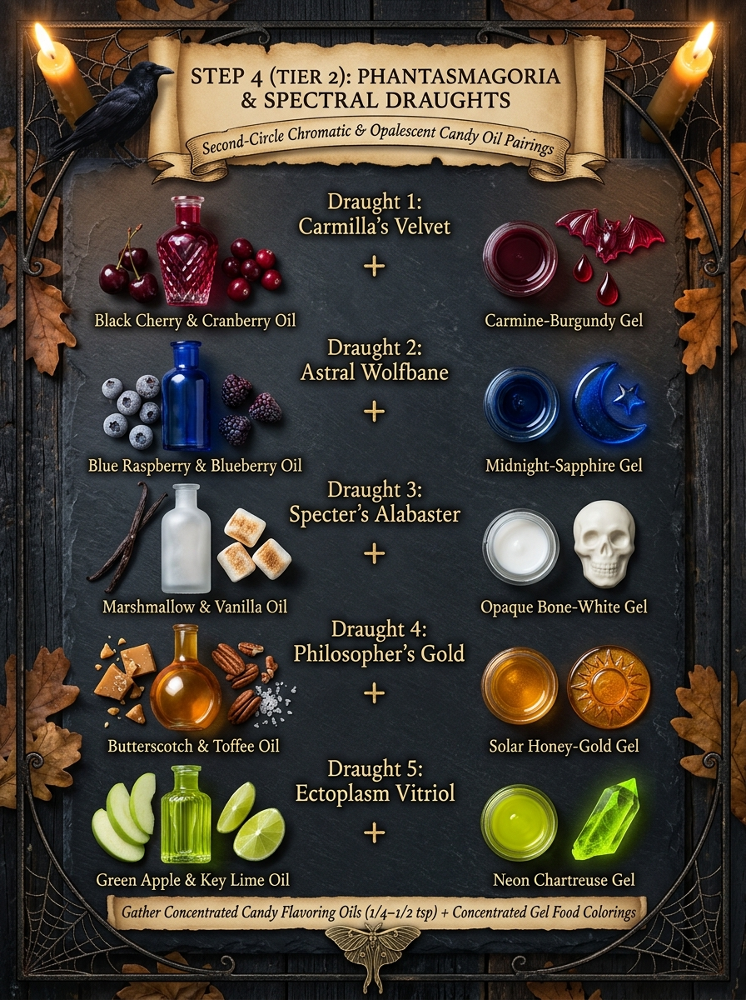
  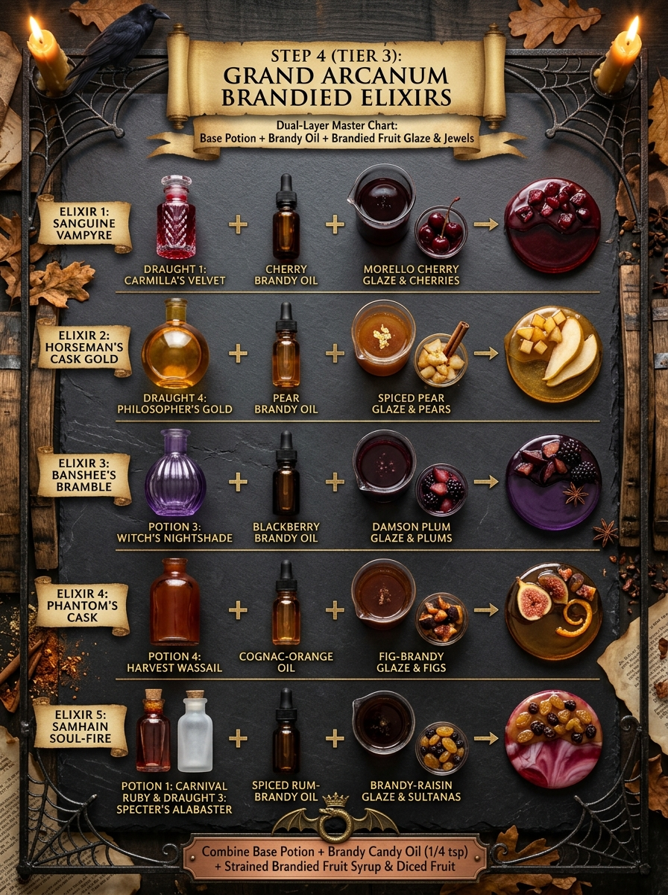
  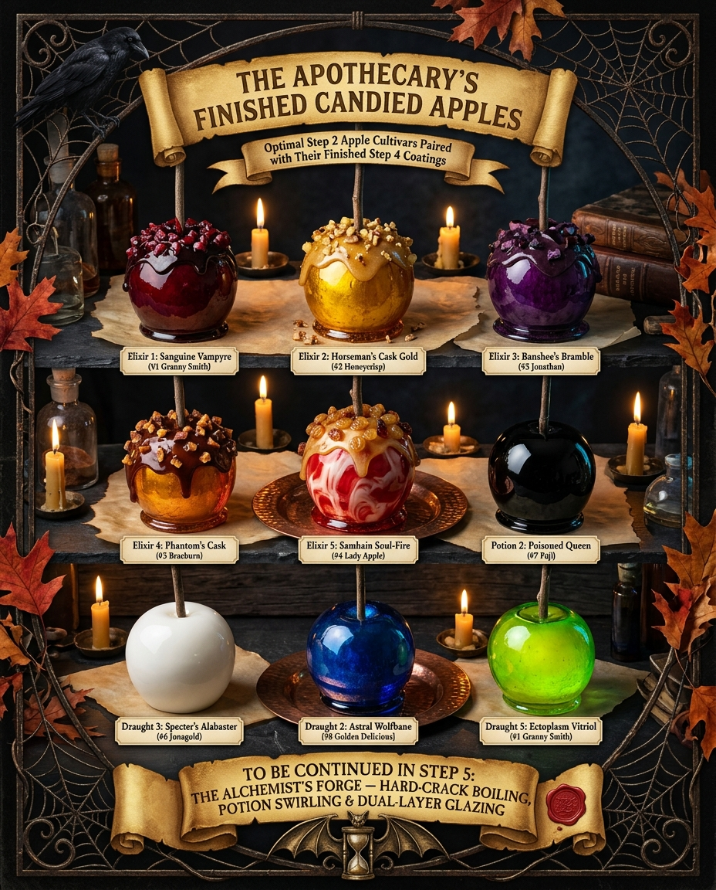

  

    <button type="button">Some Assembly Required #4</button>
    <button type="button" class="discuss-btn" onclick="openDiscussion('oct-20-26')">Comments</button>
  

  
<pre class="highlight"><code>
<strong>Step 4: Apothecary (Tier 2) Draughts Chart</strong>

<strong>[NEGATIVE]</strong> arrows, connector arrows, directional arrows, bulky 3D crosses, gothic crosses, ornate iron cross props, combined flavor-and-color labels, long congealed text boxes, duplicate numbers, repeated numbers, 1. Draught 1, Row 1, Roman numerals, shapeless blobs, puddles, amorphous smears, paint splats, liquid spills, boiling, cooking, stoves, heat, temperature, 300°F, 310°F, hard-crack, pre-boil, off-heat, thermometers, cooking pots, watery grocery extracts, powdered spices, grainy sugar, raw apples, wooden sticks, chocolate, caramel, people, human hands, human faces, blurry illegible gibberish text, spelling errors, modern plastic bottles, bright sterile lighting, cartoon anime style, watermark, signature <strong>[MEDIUM]</strong> High-resolution overhead culinary & apothecary grimoire infographic poster (vertical 3:4 or 4:5 editorial layout, 8k resolution, tack-sharp macro focus across the entire plane). Styled as a dark, atmospheric vintage Halloween apothecary second-circle ingredient pairing chart matching Step 4—combining crisp photorealistic studio macro photography of five uniquely shaped and colored antique glass candy-oil vials on the left, a small, simple gold-foil plus (+) sign in the center of each row, and concentrated gel food-coloring pots with five distinct sculpted Halloween-themed stained-glass and porcelain-glass candy emblems on the right, paired with Victorian Halloween parchment banners and three separate, cleanly spaced cream-and-gold serif typography tags per row (Left Flavor Tag, Center Draught Row Title, and Right Color Tag). <strong>[SETTING]</strong> The same dark, weathered charcoal-slate and aged barn-wood apothecary workbench from Steps 1–4, framed by an ornate wrought-iron cobweb border, dried autumn oak leaves, and warm flickering beeswax taper candles at the top corners. Organized into a 5-Row Second-Circle Phantasmagoria Pairing Matrix from top to bottom are five mouthwatering Halloween flavor-and-color pairings, where the Left Column holds the antique glass Candy Oil vial and its raw culinary ingredient, the Center Column holds the compact Draught row nameplate and a small, simple gold-foil + (plus) sign (with zero arrows), and the Right Column holds the concentrated Gel Food Coloring jar and a distinct sculpted in-theme Halloween sugar-glass shape: TOP ROW (Draught 1: Carmilla's Velvet): On the left, a faceted ruby cut-glass vial of Black Cherry & Cranberry Candy Oil beside plump dark cherries and fresh ruby cranberries; in the center, a simple gold + sign; on the right, a pot of Deep Carmine-Burgundy Gel and a sharply sculpted gothic vampire-bat and faceted blood-drop talisman of translucent carmine-garnet sugar glass. SECOND ROW (Draught 2: Astral Wolfbane): On the left, a tall cobalt-blue apothecary vial of Blue Raspberry & Blueberry Candy Oil beside plump frosted wild blueberries and dark raspberries; in the center, a simple gold + sign; on the right, Luminous Midnight-Sapphire Blue Gel and a sharp crescent-moon and star-faceted shard of glowing midnight-sapphire sugar glass. MIDDLE ROW (Draught 3: Specter's Alabaster): On the left, a frosted white apothecary bottle of Toasted Marshmallow & Vanilla Bean Candy Oil beside split dark vanilla bean pods and golden-toasted marshmallows; in the center, a simple gold + sign; on the right, Opaque Titanium-White Gel and a molded, glossy opaque bone-white porcelain-sugar skull cameo medallion. FOURTH ROW (Draught 4: Philosopher's Gold): On the left, a round golden-amber glass flask of Butterscotch, English Toffee & Maple Candy Oil beside golden butterscotch shards, roasted pecan halves, and flaky sea salt; in the center, a simple gold + sign; on the right, Solar Honey-Gold Gel and an embossed alchemical sun-disc medallion of radiant golden-amber sugar glass. BOTTOM ROW (Draught 5: Ectoplasm Vitriol): On the left, a fluted chartreuse-green glass vial of Tart Green Apple & Key Lime Candy Oil beside crisp green-apple slices and lime wedges; in the center, a simple gold + sign; on the right, Phosphorescent Chartreuse-Lime Gel and a jagged, crystalline prism shard of bioluminescent chartreuse-green sugar glass. <strong>[ANIMALS BASE]</strong> Two subtle, decorative Halloween creature motifs integrated into the border to maintain series continuity: ANIMAL 1 (Upper-Left Border — Perched Black Raven): The same small, glossy jet-black apothecary raven perched on the top-left wrought-iron cobweb frame, looking down at the sculpted sapphire crescent-moon and porcelain skull sugar-glass emblems. ANIMAL 2 (Lower-Center Border — Brass Luna Moth Emblem): An intricate antique-brass luna moth ornament mounted at the bottom-center wrought-iron border. <strong>[EVENT MODIFIERS]</strong> MODIFIER 1 (Title Banner Header): Across the top center of the frame, an aged deckle-edged Halloween parchment scroll banner reads in bold, razor-sharp vintage serif typography: "STEP 4 (TIER 2): PHANTASMAGORIA & SPECTRAL DRAUGHTS" with a subtitle ribbon: "Second-Circle Chromatic & Opalescent Candy Oil Pairings". MODIFIER 2 (Centered Row Nameplates & Simple Gold + Sign — Middle Column Only): Positioned strictly in the center of each row directly above a small, clean, minimalist gold-foil + (plus) sign (never arrows, never bulky 3D crosses, and never combined with the ingredient names) is a compact centered nameplate: "Draught 1: Carmilla's Velvet", "Draught 2: Astral Wolfbane", "Draught 3: Specter's Alabaster", "Draught 4: Philosopher's Gold", and "Draught 5: Ectoplasm Vitriol". MODIFIER 3 (Separate Left Flavor Identifier Tags & Separate Right Color Identifier Tags): Kept completely separate from the centered Draught nameplate, each Left Flavor Oil Vial has its own small label underneath ("Black Cherry & Cranberry Oil", "Blue Raspberry & Blueberry Oil", "Marshmallow & Vanilla Oil", "Butterscotch & Toffee Oil", "Green Apple & Key Lime Oil") and each Right Gel Color Pot has its own small label underneath ("Carmine-Burgundy Gel", "Midnight-Sapphire Gel", "Opaque Bone-White Gel", "Solar Honey-Gold Gel", "Neon Chartreuse Gel"). MODIFIER 4 (Ingredient Prep Footer Note): Along the bottom parchment footer, an engraved copperplate callout plaque reads: "Gather Concentrated Candy Flavoring Oils (1/4–1/2 tsp) + Concentrated Gel Food Colorings". MODIFIER 5 (Split-Tone Backlit Stained-Glass Lighting): Warm 2200K amber candlelight transmits through the four translucent sculpted sugar-glass emblems and glints off the opaque bone-white porcelain skull medallion against cool 6500K moonlight-blue rim shadows.

<strong>Step 4: Apothecary (Tier 3) Brandied Fruit Elixirs Chart</strong>

<strong>[NEGATIVE]</strong> Dual-Layer Elixir Swatch, DUAL-LAYER ELIXIR SWATCH, column header on right column, bulky 3D crosses, gothic crosses, ornate iron cross props, combined labels, long congealed text boxes, duplicate numbers, repeated numbers, 1. Elixir 1, Row 1, Roman numerals, boiling, cooking, stoves, heat, temperature, 300°F, 310°F, hard-crack, pre-boil, off-heat, thermometers, cooking pots, whole apples, wooden sticks, skewers, chocolate, caramel, people, human hands, human faces, blurry illegible gibberish text, spelling errors, modern commercial liquor bottles, plastic containers, bright sterile lighting, cartoon anime style, watermark, signature <strong>[MEDIUM]</strong> High-resolution overhead culinary & apothecary master-grimoire infographic poster (vertical 3:4 or 4:5 editorial layout, 8k resolution, tack-sharp macro focus across the entire plane). Styled as the pinnacle Tier 3 Grand Arcanum 4-column synthesis chart of the dark Victorian Halloween Apothecary series—combining crisp photorealistic studio macro photography across four aligned columns per row: Column 1 (the reused colored glass potion vial from Tier 1 or Tier 2, with Row 5 featuring two paired vials), a simple gold + sign, Column 2 (an amber apothecary dropper bottle of Brandy Candy Oil), a simple gold + sign, Column 3 (a spouted glass beaker of rich brandied fruit jar syrup beside a small bowl of finely diced and whole macerated brandied fruits), a simple gold → arrow, and Column 4 (the finished 2-layer candy sample on the far right: mirror-smooth stained-glass candy matching Column 1's base color topped across its upper half with a thick, glossy brandied fruit compote over-glaze and encrusted fruit jewels, left completely unlabelled), paired with gilded Victorian Halloween parchment banners and clean cream-and-gold serif typography labels. <strong>[SETTING]</strong> The same dark, weathered charcoal-slate and aged barn-wood apothecary workbench from Steps 1–4, framed by an ornate wrought-iron cobweb border, aged oak barrel staves, autumn oak leaves, and warm flickering beeswax taper candles at the top corners. Organized into a 5-Row, 4-Column Grand Arcanum Synthesis Matrix from left to right: TOP ROW (Elixir 1: Sanguine Vampyre): Col 1 shows the faceted ruby cut-glass vial from Draught 1; +; Col 2 shows an amber Cherry Brandy Candy Oil dropper bottle; +; Col 3 shows a spouted beaker of dark Morello cherry jar syrup & a bowl of diced and whole stemmed brandied Morello cherries; →; Col 4 shows an unlabelled deep garnet stained-glass candy disc draped across its upper half with glossy cherry-brandy compote glaze encrusted with diced and whole brandied Morello cherries. SECOND ROW (Elixir 2: Horseman's Cask Gold): Col 1 shows the round golden-amber glass flask from Draught 4; +; Col 2 shows an amber Pear Brandy Candy Oil dropper bottle; +; Col 3 shows a beaker of spiced pear jar syrup & a bowl of diced and sliced brandied pears with a cinnamon quill and 24k gold leaf; →; Col 4 shows an unlabelled golden butterscotch glass disc draped with amber pear-brandy glaze, diced brandied pear morsels, and a fanned pear slice. MIDDLE ROW (Elixir 3: Banshee's Bramble): Col 1 shows the fluted purple vial from Potion 3; +; Col 2 shows an amber Blackberry Brandy Candy Oil dropper bottle; +; Col 3 shows a beaker of plum-berry jar syrup & a bowl of diced brandied damson plums and whole blackberries; →; Col 4 shows an unlabelled deep amethyst-violet stained-glass disc draped with dark berry-plum cordial glaze, diced brandied damson plums, blackberry, and star anise. FOURTH ROW (Elixir 4: Phantom's Cask): Col 1 shows the burnt-amber Blood-Orange bottle from Potion 4; +; Col 2 shows an amber Cognac-Orange Candy Oil dropper bottle; +; Col 3 shows a beaker of fig-brandy jar syrup & a bowl of diced brandied Black Mission figs and candied orange peel; →; Col 4 shows an unlabelled topaz-amber glass disc draped with glossy fig-brandy glaze, diced brandied figs, a seed-jeweled fig half, and candied Seville orange curl. BOTTOM ROW (Elixir 5: Samhain Soul-Fire): Col 1 shows both the amber ruby-cinnamon vial from Potion 1 and the frosted white Marshmallow-Vanilla bottle from Draught 3 side by side; +; Col 2 shows an amber Spiced Rum-Brandy Candy Oil dropper bottle; +; Col 3 shows a beaker of spiced brandy-raisin jar syrup & a bowl of plump brandied golden sultanas and dark currants; →; Col 4 shows an unlabelled ruby-and-ivory marbled glass disc draped with golden brandy-raisin syrup glaze and encrusted with plump brandied golden sultanas and dark currants. <strong>[ANIMALS BASE]</strong> Two subtle, decorative Halloween creature motifs integrated into the border to maintain series continuity: ANIMAL 1 (Upper-Left Border — Perched Black Raven): The same small, glossy jet-black apothecary raven perched on the top-left wrought-iron cobweb frame, gazing down at the 4-column matrix. ANIMAL 2 (Lower-Center Border — Crowned Brass Ouroboros & Bat Crest): An ornate antique-brass alchemical ouroboros and bat crest mounted at the bottom-center wrought-iron border signifying Grand Master completion. <strong>[EVENT MODIFIERS]</strong> MODIFIER 1 (Title Banner Header): Across the top center of the frame, an aged gilded Halloween parchment scroll banner reads in bold, razor-sharp vintage serif typography: "STEP 4 (TIER 3): GRAND ARCANUM BRANDIED ELIXIRS" with a subtitle ribbon: "Dual-Layer Master Chart: Base Potion + Brandy Oil + Brandied Fruit Glaze & Jewels". MODIFIER 2 (Row Elixir Nameplates & Column 1–2 Labels): Each row features its Elixir title ("Elixir 1: Sanguine Vampyre", "Elixir 2: Horseman's Cask Gold", "Elixir 3: Banshee's Bramble", "Elixir 4: Phantom's Cask", "Elixir 5: Samhain Soul-Fire"), with Column 1 vials labelled ("Draught 1: Carmilla's Velvet", "Draught 4: Philosopher's Gold", "Potion 3: Witch's Nightshade", "Potion 4: Harvest Wassail", "Potion 1: Carnival Ruby & Draught 3: Specter's Alabaster") and Column 2 dropper bottles labelled ("Cherry Brandy Oil", "Pear Brandy Oil", "Blackberry Brandy Oil", "Cognac-Orange Oil", "Spiced Rum-Brandy Oil"). MODIFIER 3 (Column 3 Labels — Brandied Fruit Glaze & Jewels, with Column 4 Left Unlabelled): Positioned cleanly under each Column 3 beaker-and-fruit group: "Morello Cherry Glaze & Cherries", "Spiced Pear Glaze & Pears", "Damson Plum Glaze & Plums", "Fig-Brandy Glaze & Figs", and "Brandy-Raisin Glaze & Sultanas", while the finished candy discs in Column 4 on the far right are left completely unlabelled (with a simple gold + sign between Col 1 & Col 2, a simple gold + sign between Col 2 & Col 3, and a simple gold → arrow pointing to the unlabelled Column 4 result). MODIFIER 4 (Ingredient Prep Footer Note): Along the bottom parchment footer, an engraved copperplate plaque reads: "Combine Base Potion + Brandy Candy Oil (1/4 tsp) + Strained Brandied Fruit Syrup & Diced Fruit". MODIFIER 5 (Split-Tone Backlit Stained-Glass Lighting): Warm 2200K amber candlelight transmits through the glass vials, brandy oil droppers, syrup beakers, and five layered candy discs against cool 6500K moonlight-blue rim shadows.

<strong>Step 5: To Be Continued</strong>

<strong>[NEGATIVE]</strong> Potion 2: Obsidian, Draught 3: Alabaster, Draught 2: Sapphire, Draught 5: Ectoplasm, abbreviated potion names, whole cherries on apples, cherry stems on apples, whole pear slices on apples, fanned pear slices, halved figs on apples, whole plums on apples, whole berries on apples, drippy runny pooling liquid, messy puddles, cooking pots, stoves, thermometers, boiling sugar, human hands, people, blurry illegible gibberish text, spelling errors, modern plastic sticks, bright sterile lighting, cartoon anime style, watermark, signature <strong>[MEDIUM]</strong> High-resolution 3/4-angle & overhead editorial culinary showcase poster (vertical 3:4 or 4:5 layout, 8k resolution, tack-sharp macro focus across the entire plane). Styled as a dramatic Victorian Halloween Apothecary "TO BE CONTINUED..." Grand Finale Preview poster bridging Step 4 and Step 5—showcasing nine finished, jewel-like candied apples impaled on rustic pointed wooden branch skewers in a clean 3x3 showcase grid on heavy oiled parchment and hammered copper platters, with every Brandied Elixir apple featuring a mirror-smooth hard-crack stained-glass shell topped across its upper shoulder with a thick, non-drippy, sculpted brandied fruit reduction glaze encrusted strictly with finely diced 1/8-inch brandied fruit morsels (never whole fruits or large slices), paired with clean cream-and-gold vintage serif labels identifying each apple's exact canonical Elixir/Draught/Potion name and its optimal Step 2 apple cultivar. <strong>[SETTING]</strong> The same dark, weathered charcoal-slate and aged barn-wood apothecary workbench from Steps 1–4, framed by an ornate wrought-iron cobweb border, dry scarlet-and-amber autumn oak leaves, and warm flickering beeswax taper candles. Arranged in a balanced 3x3 Confectioner's Pedestal & Parchment Grid are nine finished candied apples: ROW 1 LEFT (Elixir 1: Sanguine Vampyre on #1 Granny Smith): A finished deep garnet stained-glass candied Granny Smith apple with its upper shoulder draped in a thick, non-drippy dark Morello cherry-brandy glaze encrusted strictly with finely diced ruby brandied cherry bits. ROW 1 CENTER (Elixir 2: Horseman's Cask Gold on #2 Honeycrisp): A radiant solar-gold butterscotch stained-glass candied Honeycrisp apple with its upper crown draped in a thick, non-drippy spiced pear-brandy glaze encrusted strictly with finely diced golden brandied pear cubes, minced pecans, and tiny 24k gold leaf flecks. ROW 1 RIGHT (Elixir 3: Banshee's Bramble on #5 Jonathan): A deep amethyst-violet stained-glass candied Jonathan apple with its upper crown draped in a thick, non-drippy damson-plum brandy glaze encrusted strictly with finely diced dark brandied plum and minced blackberry morsels. ROW 2 LEFT (Elixir 4: Phantom's Cask on #3 Braeburn): A glowing topaz-amber stained-glass candied Braeburn apple with its upper shoulder draped in a thick, non-drippy mahogany fig-cognac glaze encrusted strictly with finely diced brandied Black Mission fig bits and finely minced candied orange zest. ROW 2 CENTER HERO (Elixir 5: Samhain Soul-Fire on #4 Lady Apple): A showstopping ruby-red and opaque bone-white ivory marbled sugar-glass candied apple with its upper crown draped in a thick, non-drippy golden rum-brandy glaze encrusted strictly with finely diced brandied golden sultanas and minced currants. ROW 2 RIGHT (Potion 2: Poisoned Queen on #7 Fuji): A mirror-smooth jet-black sugar-glass candied Fuji apple with zero fruit toppings, highlighting pure glass clarity. ROW 3 LEFT (Draught 3: Specter's Alabaster on #6 Jonagold): A glossy opaque bone-white porcelain milk-glass candied Jonagold apple with zero fruit toppings. ROW 3 CENTER (Draught 2: Astral Wolfbane on #8 Golden Delicious): A glowing midnight-sapphire blue stained-glass candied Golden Delicious apple. ROW 3 RIGHT (Draught 5: Ectoplasm Vitriol on #1 Granny Smith): A bioluminescent chartreuse-green stained-glass candied Granny Smith apple. <strong>[ANIMALS BASE]</strong> Two subtle, decorative Halloween creature motifs integrated into the border to maintain series continuity: ANIMAL 1 (Upper-Left Border — Perched Black Raven): The same small, glossy jet-black apothecary raven perched on the top-left wrought-iron cobweb frame, gazing down at the jewel-encrusted candied apples. ANIMAL 2 (Lower-Center Border — Brass Hourglass & Bat Emblem): An ornate antique-brass winged hourglass and bat emblem mounted at the bottom-center border above the "To Be Continued" scroll. <strong>[EVENT MODIFIERS]</strong> MODIFIER 1 (Title Banner Header): Across the top center of the frame, an aged gilded Halloween parchment scroll banner reads in bold, razor-sharp vintage serif typography: "THE APOTHECARY'S FINISHED CANDIED APPLES" with a subtitle ribbon: "Optimal Step 2 Apple Cultivars Paired with Their Finished Step 4 Coatings". MODIFIER 2 (9 Individual Canonical Apple + Coating Nameplates): Beneath each of the 9 finished candied apples sits its own compact cream-and-gold serif nameplate using the exact canonical name: "Elixir 1: Sanguine Vampyre (#1 Granny Smith)", "Elixir 2: Horseman's Cask Gold (#2 Honeycrisp)", "Elixir 3: Banshee's Bramble (#5 Jonathan)", "Elixir 4: Phantom's Cask (#3 Braeburn)", "Elixir 5: Samhain Soul-Fire (#4 Lady Apple)", "Potion 2: Poisoned Queen (#7 Fuji)", "Draught 3: Specter's Alabaster (#6 Jonagold)", "Draught 2: Astral Wolfbane (#8 Golden Delicious)", and "Draught 5: Ectoplasm Vitriol (#1 Granny Smith)". MODIFIER 3 (Prominent "TO BE CONTINUED..." Cliffhanger Banner): Across the bottom of the poster, a dramatic gilded Victorian parchment scroll banner with a wax seal reads in bold vintage serif capitals: "TO BE CONTINUED IN STEP 5: THE ALCHEMIST'S FORGE — HARD-CRACK BOILING, POTION SWIRLING & DUAL-LAYER GLAZING". MODIFIER 4 (Split-Tone Backlit Stained-Glass Lighting): Warm 2200K amber candlelight glints off the mirror-smooth sugar shells and the finely diced brandied fruit jewel crowns against cool 6500K moonlight-blue rim shadows.
</code></pre>

  

</article>

<article class="post-entry" data-tags="character-design, middle-earth, realistic, concept-art, lotro">
<h2 id="oct-19-26" style="display: flex; flex-wrap: wrap; justify-content: flex-start; align-items: center; gap: 25px;">
<a href="#oct-19-26">Oct 19 // Outpainting #3</a>
 

  character-design
  middle-earth
  realistic
  concept-art
  lotro

</h2>

  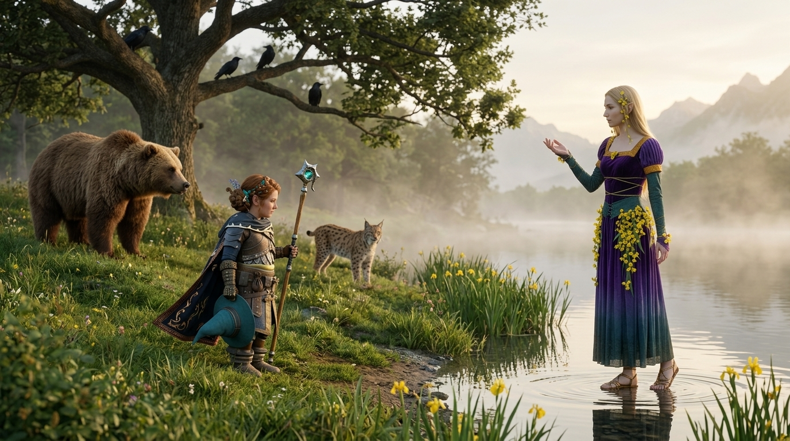

  

    <button type="button">Outpainting #3</button>
    <button type="button" class="discuss-btn" onclick="openDiscussion('oct-19-26')">Comments</button>
  

  
<pre class="highlight"><code>
<strong>Memories of the Vale</strong>

<strong>[NEGATIVE]</strong> stylized, cartoon, anime, oil painting, impasto, illustration, low resolution, messy anatomy, hat on head, wearing hat, missing flowers, hanging braids, loose braids, symmetrical bun, back bun, topknot, human-sized hobbit, tall hobbit, same height characters, equal height characters, miniature river maiden, child-sized river maiden, simple crystal ball staff, man-bear, Beorning, anthropomorphized bear, submerged feet, sunken feet, blurry second character, out-of-focus river maiden, narrow creek, narrow stream, close opposite riverbank, two riverbanks, multiple rivers, collage, split-screen, panels, character turnaround sheet, text, watermarks, signature <strong>[MEDIUM]</strong> Hyper-realistic wide-angle cinematic fantasy photography, Unreal Engine 5 path-traced render with Weta Digital live-action Middle-earth cinematography, 8k resolution, shot on a 35mm anamorphic prime lens with a Tiffen Black Pro-Mist 1/4 diffusion filter, 16:9 widescreen aspect ratio. Seamless wide camera pull-back and outpainting expansion around the first reference image (v2-accessories.png), preserving its soft, dreamlike golden-hour halation, luminous subsurface scattering, and surreal ethereal atmosphere while maintaining a diagonal split-focus plane that keeps BOTH Maereldin on the left-center hillside slope AND Lauresíriellë on the river surface at the right in tack-sharp 8k focus. <strong>[SETTING]</strong> The sunlit, ancestral meadows of the Vales of Anduin in the Third Age, expanded outward around Maereldin from the first reference image (v2-accessories.png). On the left and center, a lush hillside blanketed in wild purple bluebells, pale white-green Niphredil snowdrops, and golden-tipped meadow grass slopes gently downward from left to right beneath the ancient, sun-dappled oak tree from the base image, while the misty, snow-capped peaks of the Misty Mountains rise in the far distance through a dreamy golden-hour haze. Toward the right side of the frame, the sloping wildflower hillside tapers gently down to the water's edge (bordered along the near shore by green reeds and blooming golden-yellow Flag water-irises, <em>Iris pseudacorus</em>), opening directly onto the wide, shimmering waters of the mighty River Anduin, which fills the right side of the frame and extends outward beyond the right edge of the canvas (with no close opposite bank, only distant misty forested hills faintly visible on the far horizon). <strong>[CHARACTERS BASE]</strong> Three reference images are provided to anchor two distinct characters of starkly different heights and three animal companions across the expanded hillside and river edge: CHARACTER 1 (Maereldin — Diminutive 3 ft 6 in Hobbit Loremaster on the Left-Center Hillside Slope, anchored by v2-accessories.png and campsite_master_reference_v2.png): Outpaint and pull back the camera around the Hobbit Loremaster from the first reference image (v2-accessories.png) so her entire small, child-height Hobbit body (roughly half the height of an adult human woman, with compact Halfling proportions and short legs) is fully visible standing on the sloping wildflower hillside facing right in pure side-profile. Strictly preserve her exact youthful remastered face, pointed Hobbit ear, and low-resting asymmetrical braided side-bun resting on her shoulder and collarbone (woven with a vibrant teal silk ribbon, small polished river-stone beads, a carved oak-leaf wooden hair stick, small bluebell flowers, and pale white-green Niphredil snowdrops). She is bare-headed (NOT wearing a hat on her head). Use the second reference image (campsite_master_reference_v2.png) to render her full-body outfit and gear: dark slate-blue shoulder mantle with white-and-gold trim, layered brown leather chest armor with criss-crossing straps over silver scale-mail and a yellow waist sash, belted blue-and-brown leather tassets with pouches, embossed bronze bracers, a flowing dark navy cloak with gold scrollwork, and sturdy cuffed leather boots. In her <strong>nearside (right) hand</strong> she holds her wooden Loremaster's staff—which stands taller than her entire Hobbit body—featuring a polished golden-oak shaft, a central dark steel-wrapped grip, a conical steel butt-spike at the bottom, and <strong>crowned at the top by the exact ornate staff head shown in the enlarged zoom inset of the second reference image: an asymmetric, spiked silver-steel shepherd's-crook spiral head inlaid with raised gold filigree scrollwork, featuring a sharp downward-pointing triangular blade-spike on the lower side, four sharp triangular metal spikes along the outer ridge of the upper spiral curve tapering into a slender curved silver leaf-tendril, and a small faceted glowing cyan-blue crystal orb suspended inside the hollow center of the open metal crook</strong>. In her <strong>farside (left) hand</strong> she holds her wide-brimmed, pointed teal wizard's travel hat down at her side. COMPANION 1 (Nearside Foreground Brown Bear): Positioned on Maereldin's nearside (closer to the foreground on the grassy slope) is a natural wild brown bear whose natural shoulder height reaches or exceeds diminutive Hobbit-sized Maereldin's head and shoulders, standing alertly in the wildflowers looking toward the river. COMPANION 2 (Farside Mid-Ground Tundra Lynx): Positioned farther away than Maereldin on her farside along the meadow slope is a sleek, spotted tundra lynx with tufted ears looking toward the river. COMPANION 3 (Ravens in the Oak Tree): Perched in the branches of the nearby ancient oak tree on the hillside are several glossy black ravens watching the water below. CHARACTER 2 (Lauresíriellë — Full-Sized 5 ft 10 in Adult Human/Elven-Statured River-Maiden Near the Water's Edge on the Right, anchored by the third reference image lauresirielle_remastered_ref.jpg): Just off the shoreline at the river's edge on the right side of the frame, the ethereal Gladden River-maiden (Lauresíriellë) has materialized like a living vision and stands weightlessly <strong>directly on top of the unbroken mirror surface of the River Anduin</strong>, with her bare toes and strappy burnished bronze-and-gold leather sandals completely unsubmerged and visible resting atop concentric golden-lit water ripples. <strong>CRITICAL SIZE DIFFERENCE: Lauresíriellë is a tall, statuesque, full-sized adult woman (~5 feet 10 inches tall—nearly TWICE as tall as Hobbit-sized Maereldin), with long, graceful adult limbs and torso that clearly contrast against Maereldin's small, half-sized Hobbit stature.</strong> She is angled in a graceful left-facing side/three-quarter profile facing Maereldin up on the slope, showcasing her unblemished moonlit-porcelain complexion, slightly pointed Elven ears, straight honey-flaxen blonde hair with the cascading garland of living three-petaled golden-yellow Gladden water-irises braided behind her left temple, wide square gold-chevron neckline with the center-chest yellow iris brooch, crushed royal-amethyst velvet bodice cinched with gold cords, pleated purple puffed upper sleeves and dark river-teal lower sleeves, pointed royal-purple wrist gauntlet-tabs with the living yellow-and-violet iris corsage atop her left wrist, dark teal hip-girdle, and royal-amethyst to dark river-teal ombré skirt draped with two cascading garlands of golden water-irises. <strong>[EVENT MODIFIERS]</strong> MODIFIER 1 (Surreal Ethereal Vision, Scale Disparity & Believable Mutual Eye Contact): A hushed, dreamlike encounter bridging mortal memory and river-myth—petite, half-sized Hobbit Maereldin (higher up on the left-center hillside slope) and tall, full-sized adult River-maiden Lauresíriellë (lower down on the right, standing on the surface of the River Anduin near the water's edge) are locked in a clear, believable diagonal line of mutual eye contact, with Maereldin gazing in quiet wonder down the slope while Lauresíriellë looks directly back up at her and raises her left arm in a welcoming, ethereal hailing and beckoning gesture inviting Maereldin closer to the water's edge. MODIFIER 2 (Ethereal Golden-Hour Halation & Mist): Soft volumetric golden-hour sunbeams and pearlescent Pro-Mist halation bathe the meadow, illuminating the flowers in Maereldin's braided bun, the fur of her bear and lynx companions, and translucent silver-gold river mist (<em>laurë</em>) rising from the mirror-like surface around Lauresíriellë's bronze sandals.
</code></pre>

  

</article>

<article class="post-entry" data-tags="animals, contemporary, realistic, cinematic, ethereal, journalistic">
<h2 id="oct-18-26" style="display: flex; flex-wrap: wrap; justify-content: flex-start; align-items: center; gap: 25px;">
<a href="#oct-18-26">Oct 18 // World Okapi Day</a> 
<button onclick="switchOkapi(-1)" class="toggle-btn toggle-prev" style="position: static; border-right: 1px solid #777; border-top-right-radius: 0; border-bottom-right-radius: 0; margin-right: 0;" title="Previous Image">◀</button><button onclick="switchOkapi(1)" class="toggle-btn toggle-next" style="position: static; border-top-left-radius: 0; border-bottom-left-radius: 0; border-left: none; margin-left: 0;" title="Next Image">▶</button>

 

  animals
  contemporary
  realistic
  cinematic
  ethereal
  journalistic

</h2>

  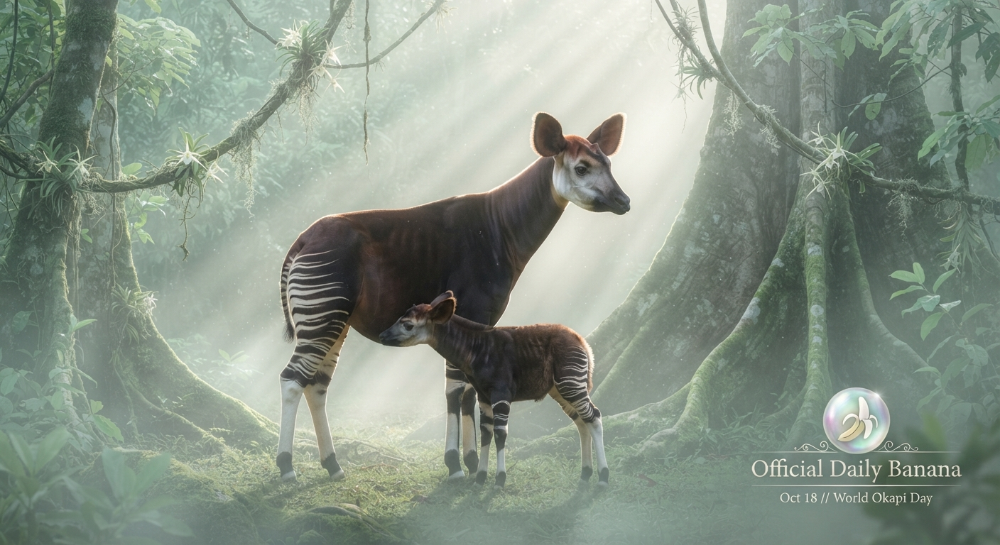
  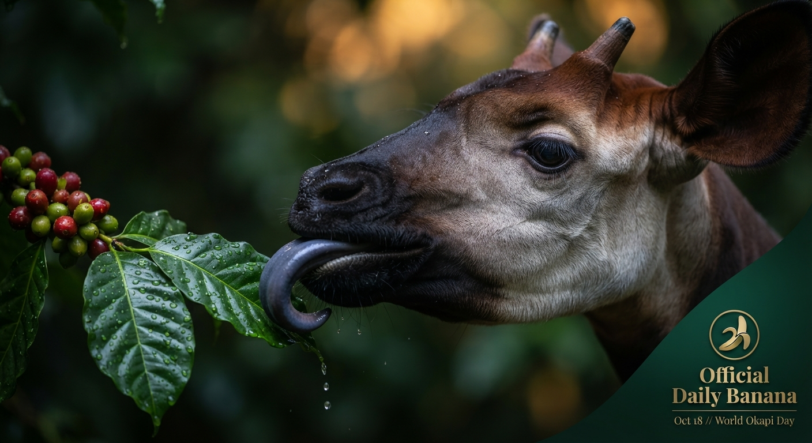
  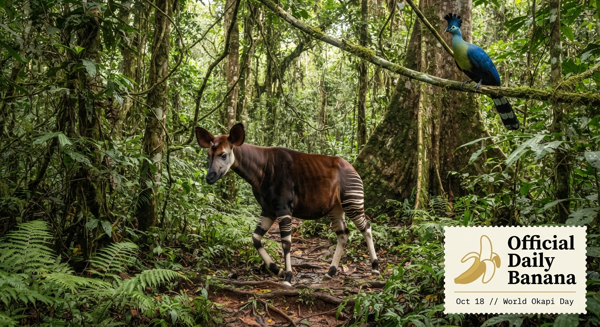

  

    <button type="button">World Okapi Day</button>
    <button type="button" class="discuss-btn" onclick="openDiscussion('oct-18-26')">Comments</button>
  

  
<pre class="highlight"><code>
<strong>Scene 1: Ethereal</strong>

<strong>[NEGATIVE]</strong> zebra, full-body stripes, stripes on back, stripes on neck, stripes on face, giraffe spots, horse mane, solid horse hooves, horns on female okapi, harsh grit, dark muddy shadows, blurry out-of-focus face, smeared stripes, cartoon, painting, illustration, text, watermark, signature <strong>[MEDIUM]</strong> Dreamlike, hyper-detailed fine-art wildlife photography (8k resolution, shot on Phase One IQ4 150MP with an 80mm f/2.8 Schneider Kreuznach lens, high-key luminous dawn backlighting, tack-sharp subject detail with silky atmospheric depth). <strong>[SETTING]</strong> A misty, luminous rainforest glade at dawn in the <strong>Ituri Rainforest, DRC</strong>. A thick, pearlescent veil of cool morning radiation fog clings to the mossy floor, swirling gently around the buttress roots of ancient <strong>Mbau trees (<em>Gilbertiodendron dewevrei</em>)</strong> and hanging woody <strong>lianas</strong> draped in delicate white <strong>epiphytic <em>Angraecum</em> comet orchids</strong> and beard lichens. The surrounding foliage glows in soft shades of seafoam sage, pale emerald, and silver-celadon. <strong>[ANIMALS BASE]</strong> ANIMAL 1 (Primary Subject — Mother Okapi, <em>Okapia johnstoni</em> — Center Frame): A serene adult female Okapi standing gracefully in the silver mist; CRITICAL ANATOMY: smooth hornless female head, huge rotating funnel-like ears rimmed with glowing white hairs, pale silvery-cream cheeks, solid unstriped velvety dark maroon-brown torso and neck, crisp horizontal creamy-white bars strictly on the rump and upper legs, and white lower-leg stockings above cloven hooves. ANIMAL 2 (Primary Companion — Tender Okapi Calf): Pressing tenderly against its mother's striped hind leg is a young Okapi calf with a fluffy dark brown coat, short juvenile dorsal neck mane, and crisp white hindquarters stripes. <strong>[EVENT MODIFIERS]</strong> MODIFIER 1 (Luminous Rim Backlighting): Low dawn sunlight streams through the pearlescent fog directly behind the mother and calf, tracing a shimmering silver-and-champagne-gold halo around their velvety ears, fine guard hairs, and white leg bars while keeping their faces in tack-sharp focus. MODIFIER 2 (Tyndall Fog Rays): Diffused, gossamer shafts of silver-emerald dawn light angle through the rising mist, illuminating tiny floating moisture droplets. MODIFIER 3 (Palette): Ethereal high-key palette of pearlescent silver, pale celadon emerald, warm cream, and velvety cocoa-rose.

<strong>Scene 2: Cinematic</strong>

<strong>[NEGATIVE]</strong> zebra, full-body stripes, stripes on neck, stripes on face, giraffe spots, horse mane, underwater, fish, coral, bubbles, blur, low-res, distorted tongue, pink tongue, neon plastic colors, cartoon, illustration, text, watermark, signature <strong>[MEDIUM]</strong> High-end commercial wildlife macro-cinematography (8k resolution, shot on RED V-Raptor 8K VV with a 100mm f/2.8 Macro Cine Prime lens, extreme tactile micro-detail, shallow depth of field with creamy background bokeh). <strong>[SETTING]</strong> A lush, moisture-heavy understory interior in the <strong>Ituri Rainforest, DRC</strong>. The immediate foreground is anchored by a single, glossy, deeply ribbed emerald leaf and a cluster of wild crimson-and-green coffee cherries on a native <strong>Wild Robusta Coffee shrub (<em>Coffea canephora</em>)</strong>, beaded with crystal-clear rainforest raindrops. In the background, the dense Congolese jungle melts into a moody, velvety tapestry of deep viridian shadows and warm amber canopy highlights. <strong>[ANIMALS BASE]</strong> ANIMAL 1 (Primary Subject — Adult Male Okapi, <em>Okapia johnstoni</em> — Tight Macro Portrait): An extreme, tack-sharp close-up portrait of an adult male Okapi's head and muzzle in profile; CRITICAL ANATOMY: pale silvery-cream cheek contrasting with a dark chocolate-brown nasal bridge, two short backward-slanted skin-and-hair-covered <strong>ossicones</strong> above the large dark eye with long eyelashes, a huge velvety radar-dish ear twitching at the frame's edge, and the okapi's extraordinary <strong>16-inch muscular, dark cobalt-blue / slate-purple prehensile tongue</strong> extending forward and curling tightly around the dew-covered <em>Coffea canephora</em> leaf. Every microscopic conical filiform papilla on the glistening wet blue tongue and every translucent vein in the green coffee leaf is rendered in razor-sharp macro clarity. <strong>[EVENT MODIFIERS]</strong> MODIFIER 1 (Tactile Botanical Tension): The muscular tip of the dark blue-purple tongue bends the wet coffee leaf toward the okapi's prehensile lips, shaking loose a tiny arc of suspended water droplets in mid-air. MODIFIER 2 (Specular Rainforest Rim-Lighting): Crisp, directional canopy sunlight grazes the wet sheen of the dark blue-purple tongue, the dewy coffee leaf, and the velvety chocolate fur of the muzzle against a rich, dark emerald bokeh background.

<strong>Scene 3: Journalistic</strong>

<strong>[NEGATIVE]</strong> zebra, full-body stripes, stripes on back, stripes on neck, stripes on face, giraffe spots, horse mane, solid horse hooves, South American toucan, blue macaw, artificial studio lighting, cartoon, illustration, blurry, text, watermark, signature <strong>[MEDIUM]</strong> Raw ethnographic & conservation wildlife documentary photography (8k resolution, 35mm f/4 wide-angle rectilinear lens, 1/640s shutter speed, high-ISO low-light clarity, natural diffused canopy lighting). <strong>[SETTING]</strong> A wide, ecologically authentic vista of a centuries-old, forest-elephant-compacted trail winding through the dense <strong>Ituri Rainforest (Okapi Wildlife Reserve, DRC)</strong>. The environment showcases the true multi-tiered complexity of the Congolese jungle: a damp laterite clay trail crisscrossed by surface roots, flanked by dense <strong>Marantaceae arrowroot thickets (<em>Sarcophrynium</em>)</strong>, lacy <strong>ground ferns</strong>, woody <strong>lianas</strong>, and towering buttressed <strong>Mbau (<em>Gilbertiodendron dewevrei</em>)</strong> hardwoods under flat, diffused canopy light. <strong>[ANIMALS BASE]</strong> ANIMAL 1 (Primary Subject — Solitary Okapi Crossing Trail, <em>Okapia johnstoni</em> — Candid Mid-Stride): A solitary adult Okapi captured in a candid, mid-stride walk across the narrow forest trail, looking cautiously toward the camera with its huge radar-dish ears pivoted forward; CRITICAL ANATOMY: pale silvery-grey cheeks, two short skin-covered forehead ossicones, a solid unstriped dark chocolate-brown torso and neck, crisp horizontal creamy-white zebra-like bars strictly restricted to the hindquarters and upper forelegs, and white lower-leg stockings with dark fetlock rings above cloven hooves. ANIMAL 2 (Canopy Sympatric Contrast — Great Blue Turaco, <em>Corythaeola cristata</em> — Upper Right Branch): Perched on a moss-covered horizontal liana in the upper-right sub-canopy above the okapi is a striking <strong>Great Blue Turaco (<em>Corythaeola cristata</em>)</strong>; CRITICAL TURACO ANATOMY: large 75-cm frugivorous bird with vivid cobalt-blue plumage, a tall fan-like black crest, chartreuse-green chest, chestnut-red belly, long black-banded yellow-blue tail, and a stout yellow bill tipped in bright crimson. <strong>[EVENT MODIFIERS]</strong> MODIFIER 1 (Camouflage & Color Contrast): Highlights the ecological juxtaposition between the elusive, cryptically patterned okapi blending into the shadowy understory trail below and the brilliant cobalt-and-chartreuse Great Blue Turaco in the sub-canopy above. MODIFIER 2 (Unfiltered Field Aesthetics): Natural, unenhanced documentary color balance with crisp edge-to-edge clarity from foreground fern fronds to the ancient canopy trunks.
</code></pre>

  

</article>

<article class="post-entry" data-tags="animals, contemporary, realistic, cinematic, ethereal, journalistic">
<h2 id="oct-17-26" style="display: flex; flex-wrap: wrap; justify-content: flex-start; align-items: center; gap: 25px;">
<a href="#oct-17-26">Oct 17 // Intl. Sawfish Day</a> 
<button onclick="switchSawfish(-1)" class="toggle-btn toggle-prev" style="position: static; border-right: 1px solid #777; border-top-right-radius: 0; border-bottom-right-radius: 0; margin-right: 0;" title="Previous Image">◀</button><button onclick="switchSawfish(1)" class="toggle-btn toggle-next" style="position: static; border-top-left-radius: 0; border-bottom-left-radius: 0; border-left: none; margin-left: 0;" title="Next Image">▶</button>

 

  animals
  contemporary
  realistic
  cinematic
  ethereal
  journalistic

</h2>

  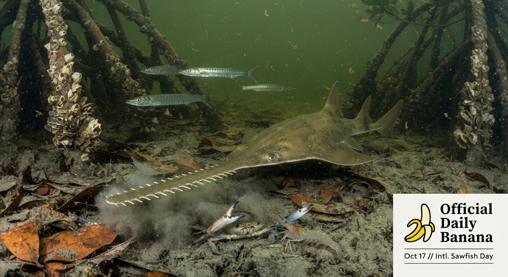
  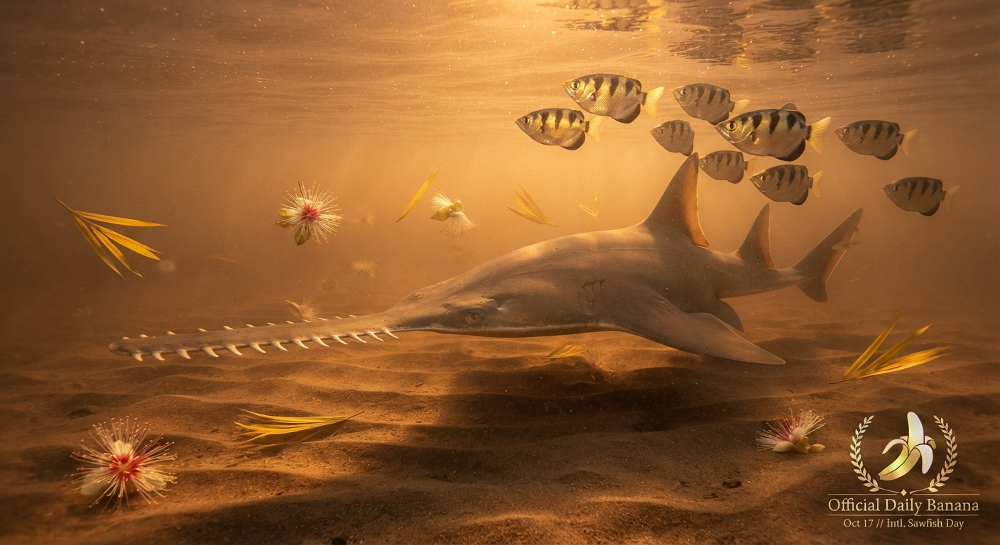
  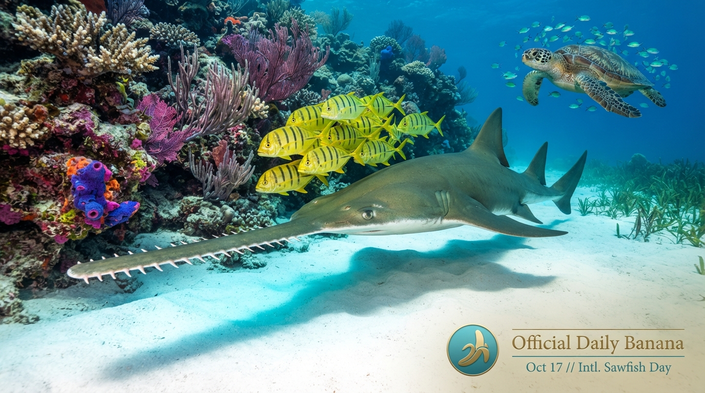

  

    <button type="button">Intl. Sawfish Day</button>
    <button type="button" class="discuss-btn" onclick="openDiscussion('oct-17-26')">Comments</button>
  

  
<pre class="highlight"><code>
<strong>1. Florida (Journalistic)</strong>

<strong>[NEGATIVE]</strong> sawshark, facial barbels, whiskers on snout, lateral gill slits on sides of head, swordfish, marlin, hammerhead, fiddler crabs, coral reef, artificial studio lighting, oversaturated neon colors, cartoon, illustration, blurry, text, watermark, signature <strong>[MEDIUM]</strong> Authentic National Geographic wildlife documentary photography (8k resolution, 24mm wide-angle rectilinear lens in an underwater dome housing, f/8 aperture, 1/500s shutter speed, natural ambient estuarine light, clinical tack-sharp clarity). <strong>[SETTING]</strong> A raw, ecologically authentic snapshot of a brackish Florida Everglades tidal creek nursery. The olive-green water is rich with realistic "marine snow" (suspended organic detritus and tannin particulates). The estuarine floor is a textured mosaic of grey mud-silt and decaying copper-colored mangrove leaf litter, flanked by submerged mangrove prop roots heavily encrusted with <strong>ivory barnacles (<em>Balanus eburneus</em>)</strong> and jagged <strong>Eastern Oyster clusters (<em>Crassostrea virginica</em>)</strong>. <strong>[ANIMALS BASE]</strong> ANIMAL 1 (Primary Subject — Juvenile Smalltooth Sawfish, <em>Pristis pectinata</em> — Mid-Foreground): A 5-foot juvenile Smalltooth Sawfish in an active electroreceptive foraging posture, its flat tooth-lined rostrum hovering two inches above the silt; CRITICAL ANATOMY: flattened batoid ray body, broad pectoral wings, mottled olive-brown camouflaged skin, ventral gill slits on the flat underside, and a straight flat saw with 25 uniform peg-like teeth per side and zero barbels. ANIMAL 2 (Mid-Ground Ambush Companions — Juvenile Great Barracudas, <em>Sphyraena barracuda</em>): Three slender, silver <strong>Juvenile Great Barracudas</strong> hover motionless among the shadowed mangrove roots in the mid-ground, their metallic flanks reflecting the filtered olive light. ANIMAL 3 (Foreground Prey Interaction — Atlantic Blue Crab & Pink Shrimp): Partially buried in the foreground grey silt near the tip of the sawfish's rostrum is a defensive <strong>Atlantic Blue Crab (<em>Callinectes sapidus</em>)</strong> with raised blue-tipped claws and a translucent <strong>Pink Shrimp (<em>Penaeus duorarum</em>)</strong>. <strong>[EVENT MODIFIERS]</strong> MODIFIER 1 (Benthic Electroreception Moment): A subtle puff of grey silt rises beneath the sawfish's rostrum as it detects the buried crustacean prey in the murky nursery. MODIFIER 2 (Documentary Realism): Unfiltered, neutral color balance and clinical edge-to-edge sharpness capturing the sawfish as an irreplaceable apex predator of a complex, messy, living coastal wetland.

<strong>2. Southeast Asia (Ethereal)</strong>

<strong>[NEGATIVE]</strong> sawshark, facial barbels, whiskers on snout, lateral gill slits on sides of head, swordfish, marlin, hammerhead, clear blue ocean water, blurry deformed rostrum, harsh grit, cartoon, painting, illustration, text, watermark, signature <strong>[MEDIUM]</strong> Fine-art underwater wildlife photography (8k resolution, 28mm wide-angle lens, low-angle golden-hour backlighting, tack-sharp subject detail surrounded by luminous amber-and-bronze atmospheric diffusion). <strong>[SETTING]</strong> A dreamlike, shallow tropical estuary riverbed at sunset bathed in liquid-gold tannin light. The water is a warm, glowing gradient of amber, honey, and burnished bronze. Drifting gently through the current like autumn snow are fallen <strong>Mangrove Apple blossoms (<em>Sonneratia caseolaris</em>)</strong> with delicate white-and-crimson starburst stamens and golden <strong>Nipa palm leaflets</strong>, catching the low sunset rays. <strong>[ANIMALS BASE]</strong> ANIMAL 1 (Primary Subject — Largetooth Sawfish, <em>Pristis pristis</em> — Luminous Backlit Silhouette): A majestic Largetooth Sawfish gliding serenely above the rippled bronze river sand; CRITICAL ANATOMY: flattened batoid ray profile, wide triangular pectoral fins, ventral gill slits hidden underneath, and a broad flat rostrum with 18 stout, evenly spaced lateral teeth per side and zero barbels, rim-lit in molten gold. ANIMAL 2 (Synchronized Companion School — Banded Archerfish, <em>Toxotes jaculatrix</em>): Hovering just above and beside the sawfish near the glowing water surface is a synchronized school of <strong>Banded Archerfish</strong>, their compressed silver-gold bodies and bold black dorsal bars acting like tiny mirrors reflecting the amber light. <strong>[EVENT MODIFIERS]</strong> MODIFIER 1 (Molten Gold Rim-Lighting): Low sunset light penetrates the shallow river surface at a grazing angle, turning the suspended tannin particles into a glowing bronze mist and outlining every rostral tooth of the sawfish in bright gold. MODIFIER 2 (Monochromatic Warmth): Harmonious fine-art color palette of burnished bronze, honey amber, and shimmering silver-gold.

<strong>3. Australia (Cinematic)</strong>

<strong>[NEGATIVE]</strong> sawshark, facial barbels, whiskers on snout, lateral gill slits on sides of head, swordfish, marlin, hammerhead, sawfish tangled in staghorn coral, blur, low-res, faded, monotone, unnatural plastic colors, cartoon, illustration, text, watermark, signature <strong>[MEDIUM]</strong> High-end commercial underwater wildlife cinema (8k resolution, shot on RED V-Raptor 8K VV with a 16mm close-focus wide-angle dome port, f/8 aperture, extreme tactile micro-detail and vivid dynamic range). <strong>[SETTING]</strong> A sunlit white-carbonate sand channel and <strong>Paddle Grass (<em>Halophila ovalis</em>)</strong> meadow bordering a vibrant coral bommie in the Great Barrier Reef lagoon, Northern Australia. The foreground and center feature a wide, reflective runway of brilliant white coral sand where benthic rays cruise freely, while the left and background reef wall burst with <strong>Staghorn Corals (<em>Acropora</em>)</strong>, swaying pink-and-purple <strong>Gorgonian Sea Fans (<em>Subergorgia</em>)</strong>, and electric-hued reef sponges. <strong>[ANIMALS BASE]</strong> ANIMAL 1 (Primary Subject — Critically Endangered Green Sawfish, <em>Pristis zijsron</em> — Close-Focus Profile): A massive 15-foot Green Sawfish gliding inches above the white carbonate sand in a dramatic low three-quarter profile; CRITICAL ANATOMY: flattened batoid ray body with olive-green upper skin, white ventral underside with hidden ventral gill slits, broad wing-like pectoral fins, and an extraordinarily long, tapering flat rostrum armed with 27 slightly unevenly spaced peg-like lateral dermal teeth per side and zero barbels, with macro-level detail visible on the scarred enamel-like rostral pegs. ANIMAL 2 (Symbiotic Escort — Juvenile Golden Trevally, <em>Gnathanodon speciosus</em>): A tight, electric-yellow school of <strong>Juvenile Golden Trevally</strong> with bold black vertical bars piloting inches above the Green Sawfish's head and rostrum in a real mutualistic escort behavior. ANIMAL 3 (Background Reef Fauna — Green Sea Turtle & Blue-Green Chromis): In the upper-right background, a <strong>Green Sea Turtle (<em>Chelonia mydas</em>)</strong> with intricate radiating carapace scutes glides past the coral bommie surrounded by a cloud of iridescent <strong>Blue-Green Chromis (<em>Chromis viridis</em>)</strong>. <strong>[EVENT MODIFIERS]</strong> MODIFIER 1 (Close-Focus Wide-Angle Perspective): Camera positioned just off the white sand floor inches from the tip of the sawfish's rostrum, rendering every rostral tooth in tack-sharp macro clarity while keeping the background turtle and coral bommie in crisp context. MODIFIER 2 (Refractive Lagoon Lighting): Brilliant tropical Australian sunlight reflects off the white carbonate sand below, filling the underside of the sawfish's rostrum with luminous turquoise bounce light.
</code></pre>

  

</article>

<article class="post-entry" data-tags="food-drink, historical, infographic">
<h2 id="oct-16-26" style="display: flex; flex-wrap: wrap; justify-content: flex-start; align-items: center; gap: 25px;">
<a href="#oct-16-26">Oct 16 // Some Assembly Required #3</a> 
<button onclick="switchCandyApple(-1)" class="toggle-btn toggle-prev" style="position: static; border-right: 1px solid #777; border-top-right-radius: 0; border-bottom-right-radius: 0; margin-right: 0;" title="Previous Image">◀</button><button onclick="switchCandyApple(1)" class="toggle-btn toggle-next" style="position: static; border-top-left-radius: 0; border-bottom-left-radius: 0; border-left: none; margin-left: 0;" title="Next Image">▶</button>

 

  food-drink
  historical
  infographic

</h2>

  
  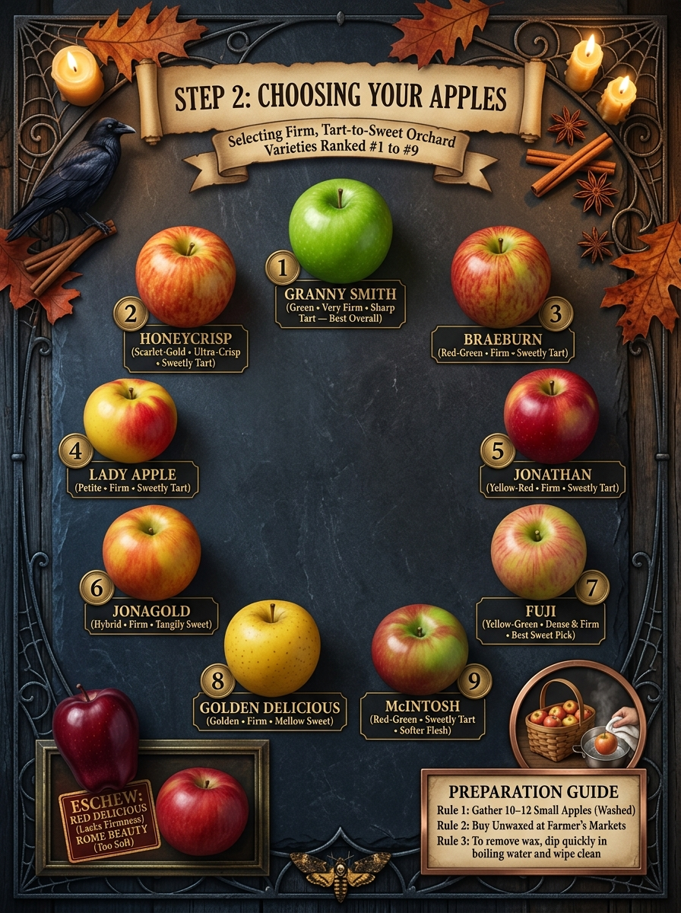
  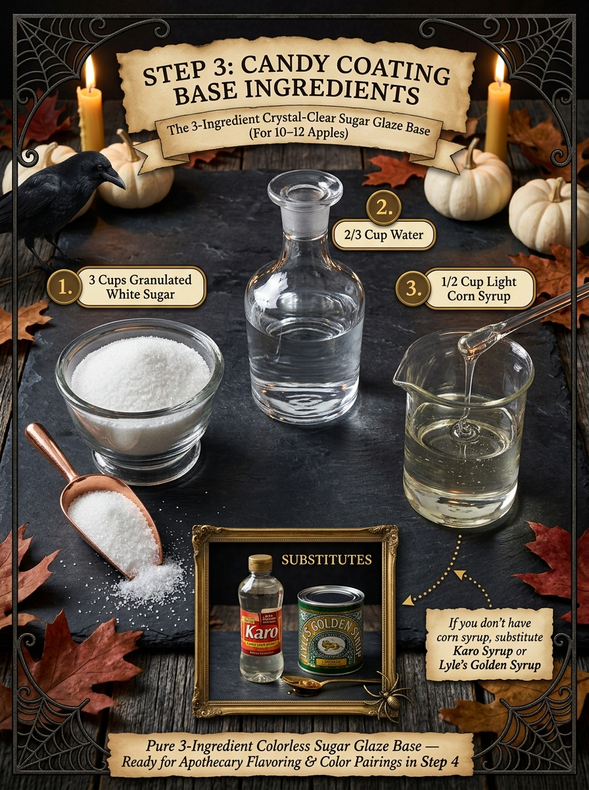
  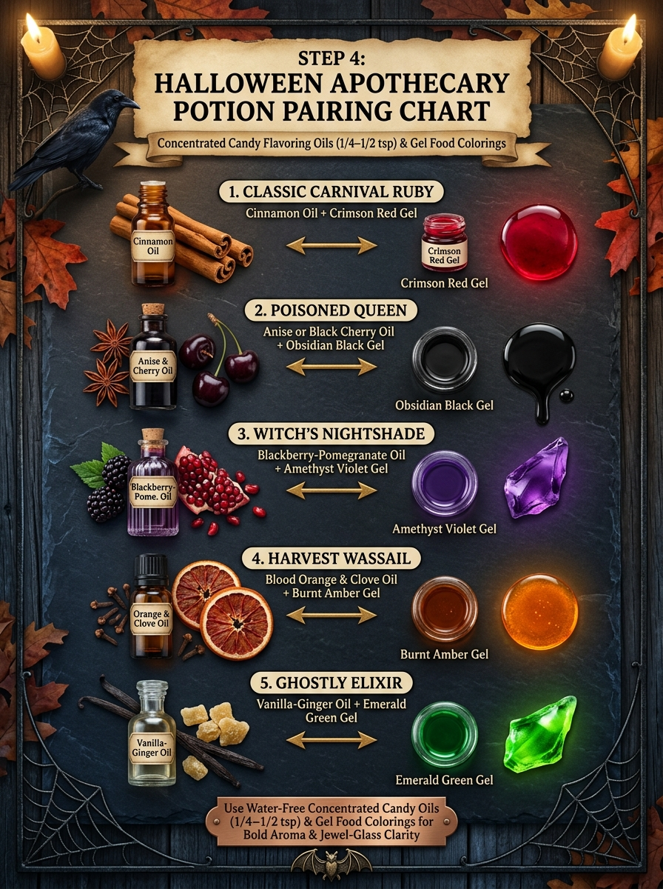

  

    <button type="button">Some Assembly Required #3</button>
    <button type="button" class="discuss-btn" onclick="openDiscussion('oct-16-26')">Comments</button>
  

  
<pre class="highlight"><code>
<strong>Step 1: Gather Your Equipment</strong>

<strong>[NEGATIVE]</strong> chocolate, melted chocolate, ice bath tub, large water basin, pastry brush, topping bowls, sprinkles, nuts, people, human hands, human faces, messy cluttered kitchen, blurry illegible gibberish text, spelling errors, modern plastic clutter, bright sterile hospital lighting, merged utensils, deformed tools, cartoon anime style, watermark, signature <strong>[MEDIUM]</strong> High-resolution overhead flat-lay knolling culinary infographic poster (vertical 3:4 or 4:5 editorial layout, 8k resolution, tack-sharp macro focus across the entire plane). Styled as a dark, atmospheric vintage Halloween apothecary & autumnal test-kitchen guide combining crisp photorealistic studio product photography of six essential candied-apple kitchen tools with ornate Victorian Halloween parchment banners, clean cream-and-gold serif typography, numbered brass badge markers, and engraved copperplate diagram arrows. <strong>[SETTING]</strong> A dark, weathered charcoal-slate and aged barn-wood apothecary kitchen workbench framed by an ornate wrought-iron cobweb border, dry scarlet-and-amber autumn oak leaves, miniature white Baby Boo pumpkins, whole star anise, cinnamon quills, and warm flickering beeswax taper candles at the top corners. Organized into a clean, balanced 6-slot grid layout are the six verified candied-apple kitchen tools, each given its own distinct spatial slot and baseline geometry: EQUIPMENT 1 (Wooden Skewers, Popsicle Sticks & Rustic Twigs — Top-Left Slot): A neat fan of flat wooden craft popsicle sticks, pointed bamboo skewers (whole and cut in half), and clean rustic orchard twigs. EQUIPMENT 2 (Candy Thermometer & Calibration / Drop-Test Inset — Top-Right Slot): A heavy-duty stainless-steel and glass clip-on candy thermometer with a bright red temperature column marked at 300°F–310°F Hard-Crack stage, paired with a small clear glass cup of cold water for the old-fashioned hard-crack drop test and a brass-rimmed inset diagram showing boiling-water calibration at 212°F (100°C). EQUIPMENT 3 (Heavy-Bottomed Saucepan — Center-Left Slot): A deep, heavy-gauge 3-quart copper-and-stainless-steel cooking pot with tall straight walls for boiling sugar syrup and tilting to dip apples. EQUIPMENT 4 (Lined Rimmed Baking Sheet — Bottom-Wide Slot): A large rimmed aluminum baking tray divided neatly in half—the left half lined with greased parchment paper and oiled silver foil, and the right half covered with a flat, non-stick Silpat silicone baking mat featuring its signature orange-red woven fiberglass border. EQUIPMENT 5 (Measuring Cups & Spoons — Center-Right Slot): A nested set of polished copper dry measuring cups, a clear glass spouted liquid measuring cup with red measurement markings, and a ring of stainless measuring spoons. EQUIPMENT 6 (Long-Handled Wooden Spoon — Lower-Center Slot): A long-handled carved beechwood stirring spoon resting beside a small copperplate warning ribbon. <strong>[ANIMALS BASE]</strong> Two subtle, decorative Halloween creature motifs integrated into the top corners of the infographic border to anchor the spooky October atmosphere without distracting from the kitchen tools: ANIMAL 1 (Upper-Left Border — Perched Black Raven): A small, glossy jet-black raven with sharp obsidian feathers perched on the wrought-iron cobweb frame beside the top-left candle, looking down at the shiny copper saucepan. ANIMAL 2 (Upper-Right Border — Brass Orb-Weaver Spider): A tiny, jewel-like antique brass garden spider resting on the top-right corner of the parchment title banner. <strong>[EVENT MODIFIERS]</strong> MODIFIER 1 (Title Banner Header): Across the top center of the frame, an aged deckle-edged Halloween parchment scroll banner reads in bold, razor-sharp vintage serif typography: "STEP 1: GATHER YOUR EQUIPMENT". MODIFIER 2 (Numbered Infographic Labels): Clean cream-on-obsidian pill labels with glowing amber numbers sit beside each tool: "1. Wooden Skewers, Popsicle Sticks or Twigs", "2. Candy Thermometer (300°F–310°F Hard-Crack) & Cold-Water Test", "3. Heavy-Bottomed Cooking Pot", "4. Baking Sheet (Greased Parchment, Foil or Silpat Mat)", "5. Measuring Cups & Spoons", and "6. Wooden Spoon (Stir Before Boil Only)". MODIFIER 3 (Thermometer Calibration & Hard-Crack Callout): A glowing copperplate dotted arrow connects Equipment 2 to its inset with a crisp sub-caption: "Calibrate at 212°F / 100°C — Cook Undisturbed to 300°F–310°F Hard-Crack". MODIFIER 4 (No-Stirring Crystallization Warning): An engraved gold caution tag beside Equipment 6 (Wooden Spoon) reads: "Stir only to dissolve sugar at start & fold flavor off heat — DO NOT STIR while boiling!". MODIFIER 5 (Split-Tone Halloween Lighting): Warm 2200K amber candlelight glints off the polished copper pot, glass thermometer tube, and measuring cups, contrasted against cool 6500K moonlight-blue rim shadows across the dark slate workbench.

<strong>Step 2: Choosing Your Apples</strong>

<strong>[NEGATIVE]</strong> candy coating, cooked apples, dipped apples, stoves, thermometers, chocolate, caramel, people, human hands, human faces, blurry illegible gibberish text, spelling errors, bruised rotting fruit, plastic fake apples, bright sterile supermarket lighting, cartoon anime style, watermark, signature <strong>[MEDIUM]</strong> High-resolution overhead botanical & culinary infographic poster (vertical 3:4 or 4:5 editorial layout, 8k resolution, tack-sharp macro focus across the entire plane). Styled as a dark, atmospheric vintage Halloween apothecary & heritage orchard botanical guide matching Shot 1's aesthetic—combining crisp photorealistic studio macro photography of fresh, raw autumn apple cultivars ranked #1 to #9 with ornate Victorian Halloween parchment banners, clean cream-and-gold serif typography, numbered brass rank medallions, and engraved copperplate diagram callouts. <strong>[SETTING]</strong> The same dark, weathered charcoal-slate and aged barn-wood apothecary workbench from Shot 1, framed by an ornate wrought-iron cobweb border, dry scarlet-and-amber autumn oak leaves, cinnamon quills, star anise, and warm flickering beeswax taper candles at the top corners. The workbench is arranged into a <strong>Ranked 9-Cultivar Suitability Horseshoe Arc</strong> (ordered from Rank #1 Best Suitability at the top-center apex down through Rank #9 along the flanks), flanked at the bottom by a <strong>"Varieties to Eschew" Warning Box</strong> on the lower-left and a <strong>3-Step Quantity, Wax-Cleaning & Room-Temperature Prep Inset</strong> on the lower-right, with every raw apple cultivar and prep element given its own distinct baseline geometry: APPLE 1 (Rank #1 Granny Smith — Top-Center Crown Position): A crisp, medium-small bright emerald-green Granny Smith apple with fine white lenticel speckles and a gold "#1 GOLD STANDARD" brass medallion. APPLE 2 (Rank #2 Honeycrisp — Upper-Left Slot): An ultra-crisp mottled scarlet-and-honey-gold Honeycrisp apple. APPLE 3 (Rank #3 Braeburn — Upper-Right Slot): A dense, firm bi-colored Braeburn apple showing vertical crimson-red stripes over golden-green skin. APPLE 4 (Rank #4 Lady Apple — Mid-Left Heirloom Gem): A petite, flattened heirloom Lady apple with butter-yellow skin and a vivid ruby-red cheek, highlighting the ideal small size. APPLE 5 (Rank #5 Jonathan — Mid-Right Slot): A compact, firm Jonathan apple with deep carmine-red and yellow-blushed skin. APPLE 6 (Rank #6 Jonagold — Lower-Mid-Left Slot): A hybrid Jonagold apple displaying golden-yellow skin blushed with fiery tangily-sweet orange-red. APPLE 7 (Rank #7 Fuji — Lower-Mid-Right Slot): A dense, firm yellow-green Fuji apple washed with dusty rose-pink stripes. APPLE 8 (Rank #8 Golden Delicious — Bottom-Arc-Left Slot): A warm, freckled golden-yellow Golden Delicious apple. APPLE 9 (Rank #9 McIntosh — Bottom-Arc-Right Slot): A two-tone reddish-green McIntosh apple. AVOID BOX (Red Delicious & Rome Beauty — Bottom-Left Warning Slot): Inside a dark tarnished-brass warning frame sit two rejected apples—an elongated dark-crimson Red Delicious with five bottom knobs and a round red Rome Beauty apple—marked with a clean red-and-gold "ESCHEW / AVOID" emblem. PREP INSET (10–12 Washed, De-Waxed & Room-Temp Apples — Bottom-Right Slot): A copper-rimmed instructional vignette showing a woven orchard basket of 10 to 12 small-to-medium washed apples at room temperature, alongside a wax-coated apple quickly dipped in boiling water and wiped clean with a linen towel to remove the wax coating. <strong>[ANIMALS BASE]</strong> Two subtle, decorative Halloween creature motifs integrated into the border to maintain series continuity with Shot 1 without distracting from the apples: ANIMAL 1 (Upper-Left Border — Perched Black Raven): The same small, glossy jet-black apothecary raven perched on the top-left wrought-iron cobweb frame, gazing toward the #1 Granny Smith apple. ANIMAL 2 (Lower-Center Border — Death's-Head Hawkmoth Emblem): A small, intricate antique-brass and velvet Death's-Head Hawkmoth resting on the bottom border divider between the Avoid Box and the Prep Inset. <strong>[EVENT MODIFIERS]</strong> MODIFIER 1 (Title Banner Header): Across the top center of the frame, an aged deckle-edged Halloween parchment scroll banner reads in bold, razor-sharp vintage serif typography: "STEP 2: CHOOSING YOUR APPLES (10–12 WASHED & ROOM TEMP)" with a subtitle ribbon: "Selecting Firm, Tart-to-Sweet Orchard Varieties Ranked #1 to #9". MODIFIER 2 (9 Ranked Cultivar Spec Labels): Clean cream-on-obsidian botanical pill labels with glowing amber rank numbers sit beside each apple: "#1 Granny Smith (Green • Very Firm • Sharp Tart — Best Overall)", "#2 Honeycrisp (Scarlet-Gold • Ultra-Crisp • Sweetly Tart)", "#3 Braeburn (Red-Green • Firm • Sweetly Tart)", "#4 Lady Apple (Petite • Firm • Sweetly Tart)", "#5 Jonathan (Yellow-Red • Firm • Sweetly Tart)", "#6 Jonagold (Hybrid • Firm • Tangily Sweet)", "#7 Fuji (Yellow-Green • Dense & Firm • Best Sweet Pick)", "#8 Golden Delicious (Golden • Firm • Mellow Sweet)", and "#9 McIntosh (Red-Green • Sweetly Tart • Softer Flesh)". MODIFIER 3 (Avoid Callout Stamp): Over the Bottom-Left Avoid Box, a crisp engraved brass plaque reads: "ESCHEW: Red Delicious (Lacks Firmness) & Rome Beauty (Too Soft)". MODIFIER 4 (3 Golden Rules Prep Callout): Beside the Bottom-Right Prep Inset, three numbered copperplate callouts read: "Rule 1: Gather 10–12 Smaller Apples (Washed & Room Temperature)", "Rule 2: Buy Unwaxed at Farmer's Market or Pick Fresh", and "Rule 3: If you have no choice but to use wax-coated apples, quickly dip them in boiling water and then wipe away the wax coating." MODIFIER 5 (Split-Tone Halloween Lighting): Warm 2200K amber candlelight catches the natural matte orchard bloom of the unwaxed apples, contrasted against cool 6500K moonlight-blue rim shadows across the dark slate workbench.

<strong>Step 3: Candy Coating Base Ingredients</strong>

<strong>[NEGATIVE]</strong> boiling, cooking, stoves, heat, temperature, 300°F, 310°F, thermometers, cooking pots, food coloring, red dye, flavoring vials, raw apples, dipped apples, wooden sticks, skewers, chocolate, caramel, people, human hands, human faces, blurry illegible gibberish text, spelling errors, modern plastic grocery bottles, bright sterile lighting, cartoon anime style, watermark, signature <strong>[MEDIUM]</strong> High-resolution overhead culinary & apothecary formula infographic poster (vertical 3:4 or 4:5 editorial layout, 8k resolution, tack-sharp macro focus across the entire plane). Styled as a dark, atmospheric vintage Halloween apothecary & confectioner's formula guide matching Shots 1 and 2—combining crisp photorealistic studio macro photography of the three crystal-clear candy glaze base ingredients with ornate Victorian Halloween parchment banners, clean cream-and-gold serif typography, numbered brass badge markers, and engraved copperplate proportion callouts. <strong>[SETTING]</strong> The same dark, weathered charcoal-slate and aged barn-wood apothecary workbench from Shots 1 and 2, framed by an ornate wrought-iron cobweb border, dry scarlet-and-amber autumn oak leaves, miniature white Baby Boo pumpkins, and warm flickering beeswax taper candles at the top corners. Arranged into a balanced <strong>3-Vessel Alchemical Triad Layout</strong> across the center of the slate workbench (with a brass-framed Substitute Vignette below) are the three pure, colorless base ingredients that form the crystal-clear sugar glaze base, each given its own distinct spatial slot and baseline geometry: INGREDIENT 1 (3 Cups Granulated Sugar — Upper-Left Triad Slot): A wide, heavy-bottomed vintage glass apothecary bowl and polished copper scoop overflowing with 3 cups of sparkling, pure white granulated sugar crystals. INGREDIENT 2 (2/3 Cup Water — Top-Center Triad Apex Slot): A crystal-clear vintage glass apothecary carafe filled with exactly 2/3 cup of pure still water catching crisp specular highlights. INGREDIENT 3 (1/2 Cup Light Corn Syrup — Upper-Right Triad Slot): A clear glass apothecary beaker holding 1/2 cup of thick, glossy, translucent light corn syrup with a slow, crystal-clear viscous ribbon dripping from a glass rod. SUBSTITUTE INSET (Karo Syrup & Lyle's Golden Syrup — Lower-Center Brass Vignette): Directly below Ingredient 3 sits an ornate brass-framed inset showcasing a classic vintage bottle of Karo Light Corn Syrup alongside an iconic green-and-gold tin of Lyle's Golden Syrup drizzled onto a brass spoon. <strong>[ANIMALS BASE]</strong> Two subtle, decorative Halloween creature motifs integrated into the border to maintain series continuity with Shots 1 and 2 without distracting from the ingredients: ANIMAL 1 (Upper-Left Border — Perched Black Raven): The same small, glossy jet-black apothecary raven perched on the top-left wrought-iron cobweb frame, looking down at the sparkling bowl of granulated sugar. ANIMAL 2 (Lower-Right Border — Brass Orb-Weaver Spider): A tiny, jewel-like antique-brass garden spider resting on the lower-right corner of the substitute vignette frame. <strong>[EVENT MODIFIERS]</strong> MODIFIER 1 (Title Banner Header): Across the top center of the frame, an aged deckle-edged Halloween parchment scroll banner reads in bold, razor-sharp vintage serif typography: "STEP 3: CANDY COATING BASE INGREDIENTS" with a subtitle ribbon: "The 3-Ingredient Crystal-Clear Sugar Glaze Base (For 10–12 Apples)". MODIFIER 2 (3 Base Ingredient Spec Labels): Clean cream-on-obsidian pill labels with glowing amber numbers sit beside each vessel: "1. 3 Cups Granulated White Sugar", "2. 2/3 Cup Water", and "3. 1/2 Cup Light Corn Syrup (For a Smooth, Non-Grainy Glaze)". MODIFIER 3 (Syrup Substitute Callout Plaque): Connected to Ingredient 3 and the lower inset by a dotted gold copperplate arrow, a crisp parchment callout badge reads: "If you don't have corn syrup, substitute Karo Syrup or Lyle's Golden Syrup". MODIFIER 4 (Pure Uncolored Base Note): Along the bottom parchment footer, an engraved copperplate ribbon reads: "Pure 3-Ingredient Colorless Sugar Glaze Base — Ready for Apothecary Flavoring & Color Pairings in Step 4". MODIFIER 5 (Split-Tone Halloween Lighting): Warm 2200K amber candlelight refracts through the clear water carafe, viscous corn syrup, golden syrup tin, and sparkling sugar crystals, contrasted against cool 6500K moonlight-blue rim shadows across the dark slate workbench.

<strong>Step 4: Halloween Apothecary Potion Pairing Chart</strong>

<strong>[NEGATIVE]</strong> boiling, cooking, stoves, heat, temperature, 300°F, 310°F, thermometers, cooking pots, watery grocery extracts, powdered spices, grainy sugar, raw apples, wooden sticks, chocolate, caramel, people, human hands, human faces, blurry illegible gibberish text, spelling errors, modern plastic bottles, bright sterile lighting, cartoon anime style, watermark, signature <strong>[MEDIUM]</strong> High-resolution overhead culinary & apothecary grimoire infographic poster (vertical 3:4 or 4:5 editorial layout, 8k resolution, tack-sharp macro focus across the entire plane). Styled as a dark, atmospheric vintage Halloween apothecary potion-pairing chart matching Shots 1–3—combining crisp photorealistic studio macro photography of antique glass flavoring-oil vials, concentrated gel food-coloring pots, botanical spices, and translucent stained-glass candy swatches with ornate Victorian Halloween parchment banners, clean cream-and-gold serif typography, numbered brass badge markers, and engraved copperplate pairing arrows. <strong>[SETTING]</strong> The same dark, weathered charcoal-slate and aged barn-wood apothecary workbench from Shots 1–3, framed by an ornate wrought-iron cobweb border, dry scarlet-and-amber autumn oak leaves, and warm flickering beeswax taper candles at the top corners. Organized into a dramatic <strong>5-Tier Apothecary Potion Pairing Chart</strong> are five distinct Halloween flavor-and-color pairings, with each tier featuring an antique glass Candy Flavoring Oil bottle and its raw botanical source paired beside a concentrated Gel Food Coloring jar and a backlit translucent jewel-toned sugar-glass swatch: POTION 1 (Row 1 — Classic Carnival Ruby): An amber glass vial of Pure Cinnamon Candy Oil resting beside curled Ceylon cinnamon quills, paired with a faceted pot of Crimson Red Gel Coloring and a mirror-gloss ruby-red sugar-glass swatch. POTION 2 (Row 2 — Poisoned Queen Obsidian): A dark apothecary vial of Anise & Black Cherry Candy Oil beside whole star anise pods and dark cherries, paired with a pot of Obsidian-Black Gel Coloring and a glossy jet-black sugar-glass drip swatch. POTION 3 (Row 3 — Witch's Cauldron Nightshade): A fluted vial of Blackberry & Pomegranate Candy Oil beside plump blackberries and pomegranate seeds, paired with Deep Amethyst-Violet Gel Coloring and a jewel-like purple sugar-glass shard. POTION 4 (Row 4 — Harvest Wassail Pomander): An essential-oil bottle of Blood Orange & Clove Oil beside clove-studded dried blood-orange wheels, paired with Burnt Amber-Orange Gel Coloring and a glowing harvest-orange sugar-glass disc. POTION 5 (Row 5 — Ghostly Orchard Elixir): A clear glass vial of Vanilla-Butter & Ginger Candy Oil beside a dark vanilla bean pod and crystallized ginger, paired with Emerald-Green Gel Coloring and a luminous poison-green sugar-glass shard. <strong>[ANIMALS BASE]</strong> Two subtle, decorative Halloween creature motifs integrated into the border to maintain series continuity with Shots 1–3 without distracting from the potion chart: ANIMAL 1 (Upper-Left Border — Perched Black Raven): The same small, glossy jet-black apothecary raven perched on the top-left wrought-iron cobweb frame, gazing down at the glowing jewel-toned sugar swatches. ANIMAL 2 (Lower-Center Border — Brass Bat & Crescent Emblem): A small, intricate antique-brass bat and crescent-moon ornament mounted at the bottom-center wrought-iron border. <strong>[EVENT MODIFIERS]</strong> MODIFIER 1 (Title Banner Header): Across the top center of the frame, an aged deckle-edged Halloween parchment scroll banner reads in bold, razor-sharp vintage serif typography: "STEP 4: HALLOWEEN APOTHECARY POTION PAIRING CHART" with a subtitle ribbon: "Concentrated Candy Flavoring Oils (1/4–1/2 tsp) & Gel Food Colorings". MODIFIER 2 (5 Potion Pairing Spec Labels): Clean cream-on-obsidian pill labels with glowing amber numbers sit beside each row: "1. Classic Carnival Ruby: Cinnamon Oil + Crimson Red Gel", "2. Poisoned Queen: Anise or Black Cherry Oil + Obsidian Black Gel", "3. Witch's Nightshade: Blackberry-Pomegranate Oil + Amethyst Violet Gel", "4. Harvest Wassail: Blood Orange & Clove Oil + Burnt Amber Gel", and "5. Ghostly Elixir: Vanilla-Ginger Oil + Emerald Green Gel". MODIFIER 3 (Potency & Gel Clarity Footer Note): Along the bottom parchment footer, an engraved copperplate callout plaque reads: "Use Water-Free Concentrated Candy Oils (1/4–1/2 tsp) & Gel Food Colorings for Bold Aroma & Jewel-Glass Clarity". MODIFIER 4 (Pairing Connector Arrows): Double-headed gold copperplate arrows link each Flavoring Oil vial on the left to its Gel Color & Stained-Glass Swatch on the right. MODIFIER 5 (Split-Tone Backlit Stained-Glass Lighting): Warm 2200K amber candlelight transmits through the five jewel-toned candy swatches (ruby, obsidian, amethyst, burnt-orange, and emerald) like stained glass against cool 6500K moonlight-blue rim shadows across the dark slate workbench.
</code></pre>

  

</article>

<article class="post-entry" data-tags="pop-culture, sci-fi, horror, cinematic">
<h2 id="oct-15-26" style="display: flex; flex-wrap: wrap; justify-content: flex-start; align-items: center; gap: 25px;">
<a href="#oct-15-26">Oct 15 // Popular Culture #3</a>
 

  pop-culture
  sci-fi
  horror
  cinematic

</h2>

  

  

    <button type="button">Popular Culture #3</button>
    <button type="button" class="discuss-btn" onclick="openDiscussion('oct-15-26')">Comments</button>
  

  
<pre class="highlight"><code>
<strong>[NEGATIVE]</strong> lock in middle of door, keyhole in center of door, central doorknob lock, narrow door, skinny door, angel facing camera, claire facing camera, looking at viewer, parallel gaze, looking away from each other, pedestal, plinth, statue base, stone platform, stone slab under feet, kneeling, sitting, veil, hood, halo, white bird feathers, flesh angel, smooth white marble, cartoon, anime, CGI, 3D render, daytime, sunny, smiling, blinking, closed eyes, snarling angel, fangs, text, watermarks <strong>[MEDIUM]</strong> Authentic 2021 British sci-fi horror cinema frame shot on Arri Alexa Mini LF with a 35mm Cooke Anamorphic /i Special Flare lens (3:2 aspect ratio, Kodak Vision3 500T 5219 night film stock emulation). Deep pan-focus depth of field keeping foreground, midground front steps, and background street in simultaneous razor-sharp focus. High-contrast chiaroscuro split-tone night lighting contrasting 2200K warm sodium-vapor orange streetlamp halation and 1800K candlelit pumpkin glow against cold Prussian-blue and slate-teal midnight shadows, with wet-down pavement specular reflections, organic film grain, and volumetric October mist. <strong>[SETTING]</strong> A rain-slicked British late-Victorian residential terraced street at night on Halloween (6 Rosebery Place) receding naturally into the background mist. In the right foreground is Claire's flagstone front stoop and a standard-proportioned Victorian four-panel dark green timber front door topped by a glass fanlight transom window, seen at a natural three-quarter angle facing across the street, with its brass Yale nightlatch lock mounted on the outer side edge of the door right next to the stone doorframe (NOT in the middle of the door), and a glowing carved orange pumpkin jack-o'-lantern sitting on the bottom step amidst wet fallen autumn oak leaves. Across the wet black asphalt street in the left midground, a vintage cast-iron British streetlamp casts a bright pool of warm amber-orange light through the autumn fog. <strong>[CHARACTERS BASE]</strong> Two figures positioned in this natural receding street scene, both turned in side profile to face directly toward each other across the street: (1) CLAIRE BROWN (in the right foreground on her front step beside the latching edge of the doorway, in left-facing side profile): a 35-year-old British woman with fair skin, wide hazel-brown eyes, and shoulder-length wavy chestnut-brown hair, wearing a knee-length double-breasted mustard-yellow wool autumn overcoat, dark trousers, and a brown leather crossbody handbag. (2) THE DOCTOR WHO WEEPING ANGEL (across the street in the left midground under the streetlamp, in right-facing side profile—NOT facing the camera): an authentic Doctor Who style Weeping Angel—a free-standing, upright 5-foot-10 humanoid female statue made of rough weathered ash-grey Portland limestone with NO pedestal, NO plinth, and NO stone base under her bare stone feet, wearing a sleeveless Greco-Roman pleated stone dress, wavy stone hair in a low chignon bun, and high-arched carved stone wings. <strong>[EVENT MODIFIERS]</strong> STAGE 1 — NATURAL STREET LAYOUT WITH SIDE-PROFILE STANDOFF ACROSS THE STREET: Both figures are oriented directly toward each other across the width of the street—neither faces the camera. In the right foreground on her front step right beside the outer latching edge of the dark green front door, Claire stands in left-facing side profile: her nose, face, and wide unblinking eye point straight to the LEFT across the street toward the Angel while her hand reaches to the outer side edge of the door next to the doorframe (NOT the center of the door) to fumble with her brass house key in the edge-mounted Yale lock. Across the wet asphalt street in the left midground beneath the glowing orange streetlamp, the free-standing grey stone Weeping Angel stands upright on the bare pavement (with no plinth or base) in right-facing side profile: we see the side of her stone body, with her carved stone wings extending behind her toward the left and her stone chest and raised stone hands covering her eyes pointed straight to the RIGHT directly at Claire.
</code></pre>

  

</article>

<article class="post-entry" data-tags="pop-culture, fantasy, horror, macabre, cinematic, split-tone">
<h2 id="oct-14-26" style="display: flex; flex-wrap: wrap; justify-content: flex-start; align-items: center; gap: 25px;">
<a href="#oct-14-26">Oct 14 // Popular Culture #2</a>
 

  pop-culture
  fantasy
  horror
  macabre
  cinematic
  split-tone

</h2>

  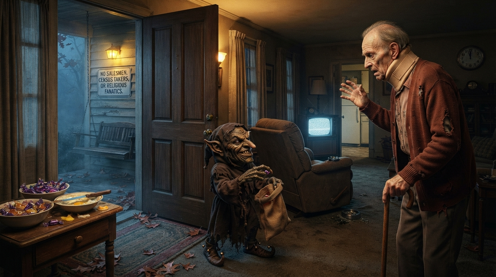

  

    <button type="button">Popular Culture #2</button>
    <button type="button" class="discuss-btn" onclick="openDiscussion('oct-14-26')">Comments</button>
  

  
<pre class="highlight"><code>
<strong>[NEGATIVE]</strong> stylized, cartoon, anime, illustration, painting, modern digital photography, DSLR, clean digital sensor, CGI, 3D render, Unreal Engine, smooth plastic skin, digital sharpness, messy anatomy, extra fingers, rubber halloween mask, visible mask seam, child in costume, cute goblin, tall goblin, adult-sized goblin, green cartoon orc, cockroaches, insects, bugs, wrestling, grappling, split screen, diptych, triptych, multiple panels, collage, storyboard, grid, white borders, dividing line, duplicate character, two old men, two goblins, sign on door, sign inside house, illegible text, garbled text, misspelled words, bright sunny day, modern sleek interior, clock hands at 10:10, clock hands at 1:20, angled clock hands, V-shaped clock hands, separated clock hands, text watermark, signature <strong>[MEDIUM]</strong> Single continuous widescreen 35mm film frame (vintage 1985 Panavision Anamorphic Kodak Eastman 5294 high-speed tungsten color negative film), shot on a Panavision Panaflex Gold studio camera with a 35mm Primo anamorphic prime lens at f/8 deep depth of field, pronounced organic 35mm silver-halide celluloid film grain, warm amber halation glow around practical lamp highlights, deep crushed chiaroscuro shadow blacks, theatrical George A. Romero and Dean Cundey Creepshow color-gel lighting contrasting icy cobalt-blue midnight October moonlight from the open doorway against warm 2700K tungsten hallway practicals and eerie crimson-magenta horror rim-lighting, authentic 1985 Tom Savini practical foam-latex creature effects cinematography. <strong>[SETTING]</strong> The dingy, claustrophobic, decaying 1940s-era entryway and living room of Daniel Killup's shabby house on Dana Street at 12:00 midnight on Halloween. The heavy wooden front door has just been kicked wide open to a narrow, sinking-board front porch outside in the cobalt-blue mist, where a wooden porch swing hangs on chains and a glowing yellow exterior porch light illuminates the exterior porch clapboard wall outside the doorway, on which is mounted a rectangular white enamel exterior porch sign with bold, clearly legible black uppercase block letters reading "NO SALESMEN, CENSUS TAKERS, OR RELIGIOUS FANATICS." Cold cobalt-blue October midnight wind and dry, dull-red oak leaves blow across the threshold onto a cheap Brussels rug worn threadbare down the center path. Immediately beside the open front door stands a rickety wooden side table holding three shallow china bowls: two shallow china bowls are overflowing with untouched cheap Halloween candy wrapped in glossy purple cellophane, while the third shallow china bowl is empty of candy and smeared inside with sticky yellow raw-egg yolk, white glue, and mayonnaise residue with a rusting kitchen knife resting across its rim. Against the dark waxed mahogany wainscoting sits a small hall table with a black rotary telephone. In the shadowy living room behind the entryway sit faded draperies and Venetian blinds over locked casement windows, splotchy brass fireplace andirons, a worn reclining armchair with a cigarette ashtray on its arm spilling ashes onto a dark red carpet, a vintage console television set glowing with snow-white static, a round wind-up analog living-room wall clock with both its hour hand and minute hand pointing straight up vertically together at the number 12 to form a single vertical line at the top of the clock face (12:00 midnight), and a swinging door at the back revealing a glimpse of a 1945 galley kitchen where a white refrigerator door hangs slightly ajar. <strong>[CHARACTERS BASE]</strong> Character 1 (Daniel Killup): A bitter, gaunt, frail, misanthropic elderly widower in his mid-seventies with pale parchment-like wrinkled skin, sunken scowling eyes, sparse grey hair, and thin grimacing lips. He wears a rigid beige medical cervical neck brace strapped snugly under his chin that locks his head and neck completely upright, a rusty, frayed reddish-brown cardigan sweater with a visible ripped seam at the right shoulder over a faded collared shirt, and worn dark trousers, holding a wooden walking cane in his right hand and a vintage analog wristwatch on his left wrist. Character 2 (The Halloween Goblin): A diminutive, waist-high (3.5-foot-tall) folklore goblin rendered as an authentic 1985 Tom Savini practical foam-latex creature effect. It has an organic, deeply furrowed, warty, dark earthen-grey and greenish-ochre elongated goblin face—real living creature flesh and not a mask—with deep expressive skin creases, a hooked nose, pointed ears, jagged yellowed teeth with wet specular highlights, and tiny twinkling jet-black eyes. Its hands feature eight-inch-long gnarled, scaly, ridged fingers tipped with sharp horn-like talons. It wears a tattered, belted, hooded dark-brown homespun robe, medieval shoes with curled-up toes tipped with tiny tarnished brass bells, and a stiff cat-like tail extending from beneath its robe, and carries a small rectangular trick-or-treat sack made of coarse brown burlap. <strong>[EVENT MODIFIERS]</strong> Having just kicked open the front door as sere dull-red oak leaves and a freezing gust of cobalt-blue October wind blow across the threshold around its curled-toe belled shoes, the waist-high Goblin has taken two deliberate steps into Killup's hallway. Under the warm amber hallway light, the Goblin's deeply furrowed face and the leathery flesh around its tiny twinkling black eyes crease organically as it grins up at Killup; with its right hand, the Goblin holds its small rectangular bag of coarse brown burlap open before its chest, while its left hand—with eight-inch gnarled, scaly, ridged fingers and horn-like talons—delicately plucks a single piece of purple-cellophane-wrapped candy from one of the two full china bowls beside the empty egg-smeared third bowl and rusting knife on the rickety side table. A pace back in the hallway, Daniel Killup stands frozen in outraged disbelief with his stiff, neck-braced torso upright and his left hand raised half-extended as he stares down at the intruder's scaly fingers and furrowed face, rendered with authentic 1985 Kodak 5294 35mm celluloid film grain and halation.
</code></pre>

  

</article>

<article class="post-entry" data-tags="literature, sci-fi, horror, macabre, b-film">
<h2 id="oct-13-26" style="display: flex; flex-wrap: wrap; justify-content: flex-start; align-items: center; gap: 25px;">
<a href="#oct-13-26">Oct 13 // Stage Plays #2</a>
 

  literature
  sci-fi
  horror
  macabre
  b-film

</h2>

  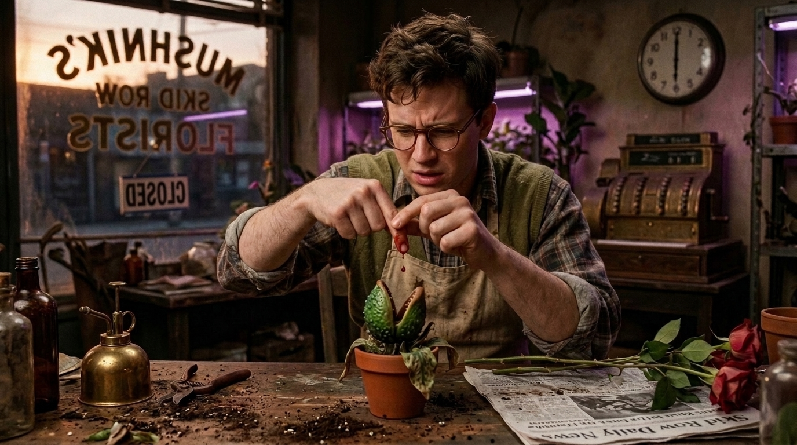

  

    <button type="button">Stage Plays #2</button>
    <button type="button" class="discuss-btn" onclick="openDiscussion('oct-13-26')">Comments</button>
  

  
<pre class="highlight"><code>
<strong>[NEGATIVE]</strong> stylized, cartoon, anime, modern digital photography, DSLR, clean digital sensor, CGI, 3D render, Unreal Engine, smooth plastic skin, digital sharpness, messy anatomy, extra fingers, band-aids, bandages, leather jacket, Jerry Lewis slapstick, goofy cartoon face, modern sleek interior, bright sunny day, Halloween haunted house, thick spiderwebs everywhere, clock hands at 10:10, clock hands at 1:20, angled clock hands, V-shaped clock hands, forward-reading CLOSED sign, readable CLOSED sign, giant plant, large plant, oversized pot, tall stem, wilted plant, drooping stem, closed pod, shut mouth, palm facing up, heavy bleeding, stream of blood, pouring blood, multiple blood drops, splashing blood, bloody hands, blood on other fingers, smeared blood, gore, blood dripping on table, text, watermark <strong>[MEDIUM]</strong> Vintage 1962 35mm Eastmancolor and Kodachrome analog film frame, shot on an antique Mitchell BNC studio camera with a vintage 50mm Cooke Speed Panchro lens, pronounced organic 35mm silver-halide celluloid film grain, warm red-orange halation glow around highlights, rich dye-transfer Technicolor saturation with deep crushed chiaroscuro shadow blacks, glowing ruby-red midtones, and vintage cyan-green shadow tint, authentic early-1960s Roger Corman B-movie creature-feature cinematography. <strong>[SETTING]</strong> The dingy, claustrophobic, impoverished interior of Mushnik's Skid Row Florists in early-1960s downtown New York at exactly 6:00 PM sunset. Warm, dying golden-red sunset light streams at a low angle through the grimy, rain-streaked glass of the front display window Seat, where reversed peeling lettering reads "MUSHNIK'S SKID ROW FLORISTS" and an outside-facing hanging door sign reads "CLOSED" in horizontally mirrored, backwards lettering as seen from inside through the glass. Outside the window in the murky twilight, the brick stoop and iron fire escape of Skid Row are faintly visible. Inside, a dusty antique brass cash register sits in the background with a single thin cobweb strand on its closed drawer, a round analog wall clock has its minute hand pointing straight up at 12 and its hour hand pointing straight down at 6 to form a single perfectly straight vertical line down the center of the clock face (6:00), and purple-violet grow-lights cast an eerie secondary rim glow over the scarred wooden worktable. The table is cluttered with spilled dark potting soil, potash, mineral supplement bottles, a brass hand-mister, rusty pruning shears, and a bundle of limp, faded, decaying red American Beauty roses with sharp thorns wrapped in a sheet of the <em>Skid Row Daily News</em>. <strong>[CHARACTERS BASE]</strong> Character 1 (Seymour Krelborn): A sweet, earnest, insecure, put-upon florist's clerk in his mid-twenties, slightly balding with soft messy brown hair, pale sleep-deprived skin, round horn-rimmed glasses, a worn rolled-sleeve flannel work shirt, a faded olive cardigan vest, and a soil-stained canvas florist apron, with clean, spotless, unbandaged hands. Character 2 (Audrey II - Pod #1): A diminutive, pint-sized, exotic botanical specimen measuring only 8 inches tall in total (smaller than a human head), planted inside a small, hand-sized 4-inch terracotta pot filled with damp dark soil. Despite its small overall stature, it has a stubby, top-heavy 1:1 pod-to-pot ratio: its bulbous head-pod is the size of a human fist (4 inches wide, matching the width of its small pot) perched low on a short, thick 2-inch stem surrounded by a small collar of mottled chartreuse and emerald leaves. Its anatomy is an anthropomorphic cross between a Venus flytrap and a rough, bumpy dark-green Hass avocado, with a pebbled avocado-rind pod and a horizontal cleft lip lined with pale-green spiky flytrap marginal cilia. <strong>[EVENT MODIFIERS]</strong> Seated at the worktable in warm 1960s Eastmancolor film lighting, Seymour holds his left hand hovering directly above the small plant pot with his wrist turned downward so his pricked left index finger points straight down toward the plant, while his clean right hand gently pinches the finger to release just ONE tiny, delicate, pinpoint-sized ruby droplet of blood falling cleanly through the air (all of his other fingers and palms are completely clean, spotless, and blood-free, with no stream or splatter). Directly beneath his downward-pointing fingertip, the pint-sized Audrey II perches upright on its short 2-inch stem with its fist-sized avocado-flytrap head tilted straight back at a 90-degree angle and its cleft lip hinged open 45 degrees like a small clamshell, facing straight upward like an eager puppy to catch the single tiny falling droplet of blood directly inside its open mouth, rendered with authentic 1960s Kodachrome and Eastmancolor 35mm film grain and halation.
</code></pre>

  

</article>

<article class="post-entry" data-tags="literature,fantasy,horror,multi-step">
<h2 id="oct-12-26" style="display: flex; flex-wrap: wrap; justify-content: flex-start; align-items: center; gap: 25px;">
<a href="#oct-12-26">Oct 12 // Scenes from Literature #9</a> 
<button onclick="switchQueen(-1)" class="toggle-btn toggle-prev" style="position: static; border-right: 1px solid #777; border-top-right-radius: 0; border-bottom-right-radius: 0; margin-right: 0;" title="Previous Image">◀</button><button onclick="switchQueen(1)" class="toggle-btn toggle-next" style="position: static; border-top-left-radius: 0; border-bottom-left-radius: 0; border-left: none; margin-left: 0;" title="Next Image">▶</button>

 

  literature
  fantasy
  horror
  multi-step

</h2>

  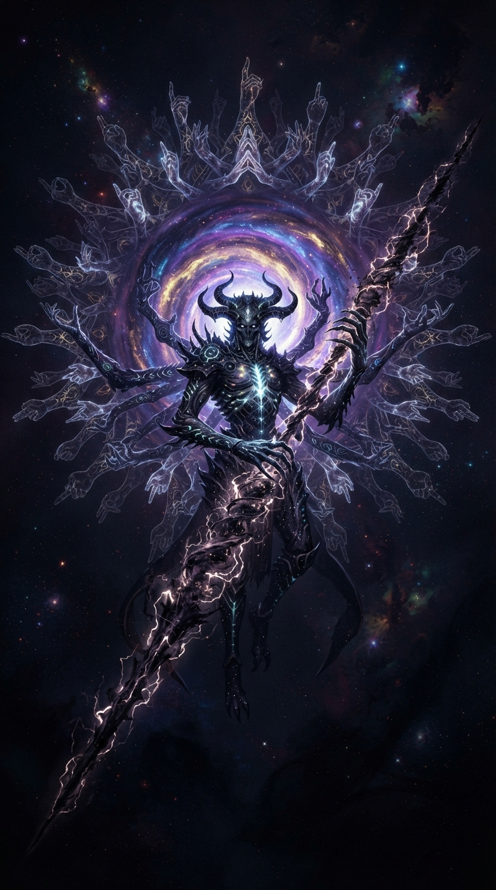
  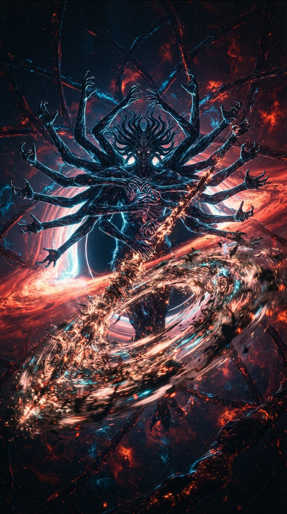
  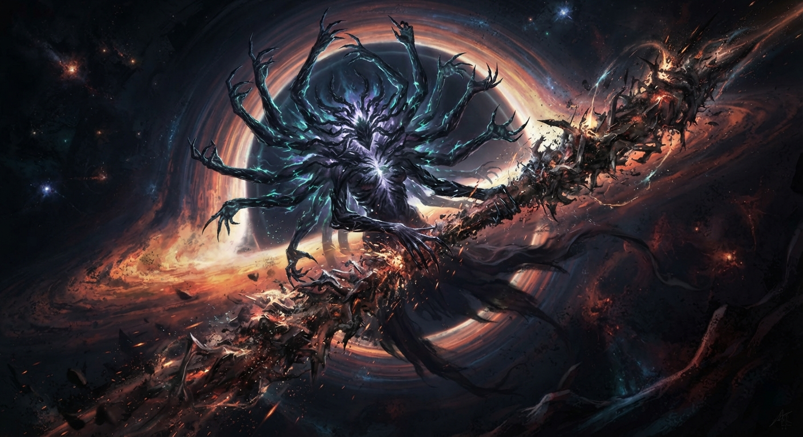
  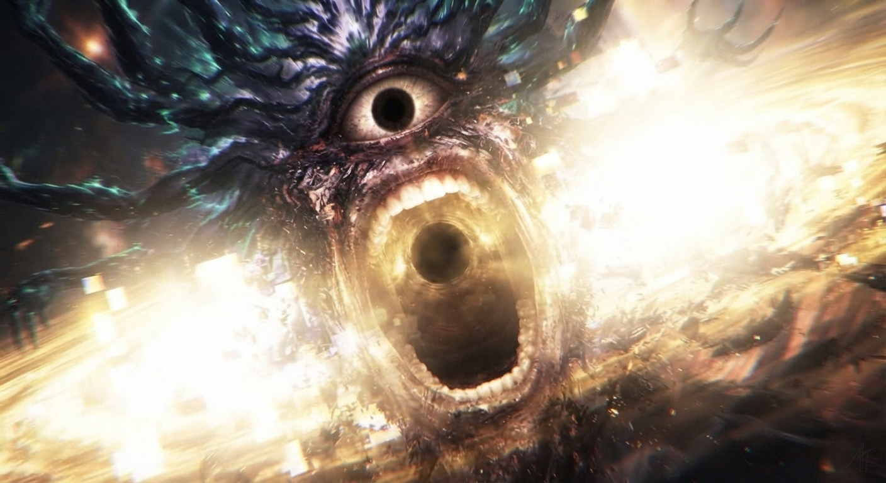

  

    <button type="button">Scenes from Literature #9</button>
    <button type="button" class="discuss-btn" onclick="openDiscussion('oct-12-26')">Comments</button>
  

  
<pre class="highlight"><code>
<strong>The Futility of the Spear King</strong>

<strong>Step 1: The Queen (Base Image)</strong>

<strong>[NEGATIVE]</strong> stylized, cartoon, anime, low resolution, messy anatomy, text, watermark, normal humans, bright sunny day, cheerful, narrator, small figures <strong>[MEDIUM]</strong> Cosmic horror portrait, epic scale, deep shadows, bioluminescence. <strong>[SETTING]</strong> A false vacuum of nuclear fire at the end of the universe, where reality frays inward and matter becomes ductile like molten glass. Deep gravity wells are visible in the cosmic drain. <strong>[CHARACTERS BASE]</strong> The Queen, a terrifying omnipotent cosmic deity smeared across the accretion disk of an impossible singularity. She features neutronium talons and an infinite mirrored array of fractal arms making holy, symbolic finger-poses. <strong>[EVENT MODIFIERS]</strong> The Queen hovers at the center of the cosmic drain. Her infinite fractal fingers stretch to grip the 'Spear King'—a massive, infinitely long cylinder of rotting, sparking negative energy. She twirls the colossal weapon effortlessly.

<strong>Step 2: The End (Image-to-Image Reference)</strong>

<strong>[NEGATIVE]</strong> stylized, cartoon, anime, low resolution, messy anatomy, text, watermark, normal humans, bright sunny day, cheerful, closed eye, full body, zoomed out, identical camera angle, same shot, frozen action, twirling spear <strong>[MEDIUM]</strong> Extreme close-up macro photography, cosmic horror, dynamic dutch angle, blinding luminescence. <strong>[SETTING]</strong> A false vacuum of nuclear fire at the end of the universe, where reality frays inward and matter becomes ductile like molten glass. Deep gravity wells are visible in the cosmic drain. <strong>[CHARACTERS BASE]</strong> The Queen, a terrifying omnipotent cosmic deity smeared across the accretion disk of an impossible singularity. <strong>[EVENT MODIFIERS]</strong> CRITICAL CAMERA SHIFT: The camera perspective punches in dramatically to a terrifying extreme close-up of the Queen's face. CRITICAL POSTURE CHANGE: The Queen opens her single, unlidded cosmic eye, which contains a terrifying black hole. From within the black hole, a massive mouth opens wide to sing a single, universe-ending note. The note creates a blinding shockwave of golden light that obliterates the camera's view.

<strong>Appendix: Sequential Image-to-Image Narrative Pipeline (Gemini API)</strong> <a href="https://gist.github.com/lol-dungeonmaster/2a0adf76479895b45a8664ca7c0602e3" target="_blank" class="prompt-link">sequential_image_pipeline.py</a>
</code></pre>

  

</article>

<article class="post-entry" data-tags="literature, victorian, horror">
<h2 id="oct-11-26" style="display: flex; flex-wrap: wrap; justify-content: flex-start; align-items: center; gap: 25px;">
<a href="#oct-11-26">Oct 11 // Scenes from Literature #8</a>
 

  literature
  victorian
  horror

</h2>

  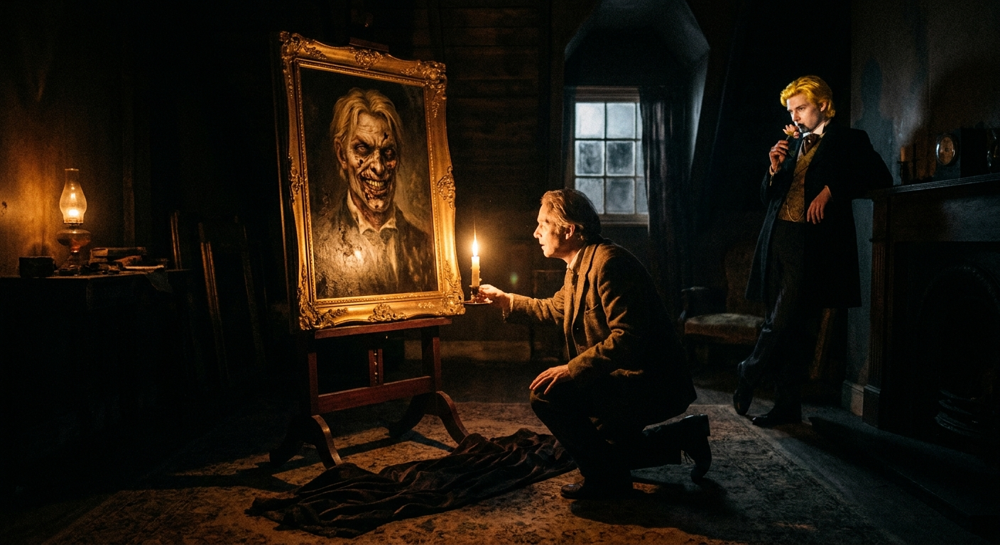

  

    <button type="button">Scenes from Literature #8</button>
    <button type="button" class="discuss-btn" onclick="openDiscussion('oct-11-26')">Comments</button>
  

  
<pre class="highlight"><code>
<strong>[NEGATIVE]</strong> painter's easel, A-frame easel, ambient lighting, fill light, moonlight, window light, cinematic lighting, studio lighting, multiple light sources, bright room, flat lighting, dark hair, black hair, brunette, standing straight, curtain on rod, modern, daytime, cheerful, clean room, pristine furniture, poorly drawn faces, cartoon, stylized, watermark, signature, vibrant colors, sunlight <strong>[MEDIUM]</strong> Dark Victorian gothic cinematic photography. 8k resolution, hyper-realistic, deep depth of field. Shot with a 35mm lens. PITCH BLACK ROOM. The ONLY sources of light in the entire scene are the warm, flickering candlelight and the murky orange glow of the oil lamp. Masterful chiaroscuro lighting, emphasizing extreme, dusty, pitch-black shadows pierced ONLY by the small flames. ABSOLUTELY NO AMBIENT OR FILL LIGHTING. Rich, moody, and atmospheric color grading. <strong>[SETTING]</strong> A neglected, abandoned attic room at the top landing of a Victorian London mansion on a windy, misty night. In the deep background, a cold, mist-stained attic window rattles in the rising wind. The atmosphere is oppressive, dusty, and damp. The wooden floorboards are covered by an old carpet riddled with holes. The room is sparsely furnished with dilapidated antiques: a faded Flemish tapestry hanging on the wall, an old Italian cassone (wooden chest), an almost empty bookcase, a wooden table, and a single rickety chair. A glass oil lamp rests on the table, casting long, fantastic shadows across the peeling walls. <strong>[CHARACTERS BASE]</strong> There are two men in the room. Character 1 (Dorian Gray): An impossibly beautiful, pristine, youthful Victorian gentleman in his twenties with bright golden blonde hair, wearing an elegant, impeccably tailored evening coat. He is physically leaning his weight casually against the fireplace mantelshelf in the dark shadows, holding a plucked flower to his nose. His expression is cold, detached, and observant, like a spectator watching a play, with a subtle flicker of cruel triumph in his eyes. Character 2 (Basil Hallward): A slightly older Victorian gentleman (the painter). He looks physically sick, pale, and terrified, with clammy sweat on his forehead. He is crouching slightly, actively holding a sputtering, half-burned candle close to a large canvas painting to examine it in the dim light. <strong>[EVENT MODIFIERS]</strong> The focal point of the scene is the large framed canvas painting resting prominently on an ornate Victorian mahogany display stand (NOT a painter's easel). Attached directly to the top of the painting's heavy golden frame is a brass curtain rod. A dark velvet curtain has been violently ripped off this rod and lies crumpled in a heap on the dusty floorboards beneath the painting. The painting is illuminated exclusively by the harsh, flickering candlelight held by Basil. The painting depicts Dorian Gray, but the face on the canvas is monstrous and corrupted. The painted face features a wicked, hideous grin, thinning golden blonde hair, sodden blue eyes, and a sensual scarlet mouth. The painted flesh looks as if it is being slowly eaten away by a leprosy of sin, resembling a rotting corpse. The warm candlelight sharply illuminates the horrifying painting and Basil's shocked, horrified face, while the real, flawlessly youthful golden-haired Dorian Gray remains safe in the pitch-black atmospheric shadows of the background, smelling his flower.
</code></pre>

  

</article>

<article class="post-entry" data-tags="literature, fantasy, realistic">
<h2 id="oct-10-26" style="display: flex; flex-wrap: wrap; justify-content: flex-start; align-items: center; gap: 25px;">
<a href="#oct-10-26">Oct 10 // Scenes from Literature VII</a>
 

  literature
  fantasy
  realistic

</h2>

  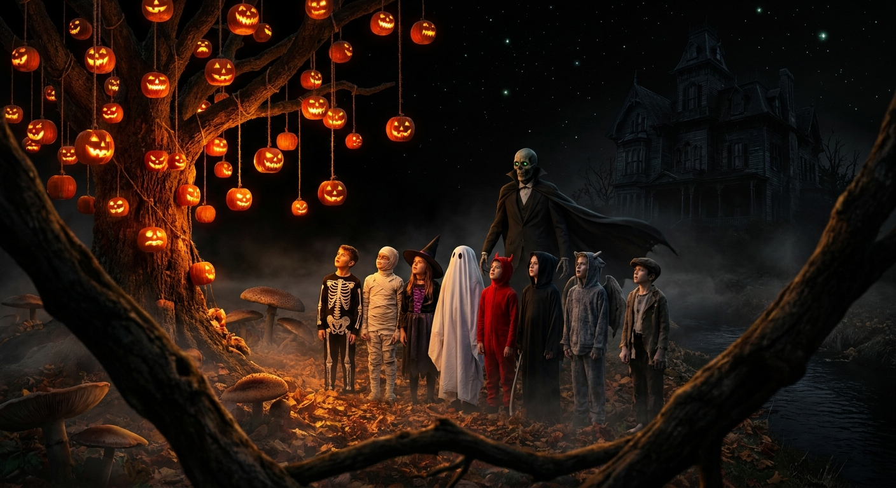

  

    <button type="button">Scenes from Literature VII</button>
    <button type="button" class="discuss-btn" onclick="openDiscussion('oct-10-26')">Comments</button>
  

  
<pre class="highlight"><code>
<strong>[NEGATIVE]</strong> female, girl, woman, daytime, bright, cheerful, cartoon, modern city, cars, text, watermarks, signature, low quality, pixelated, normal eyes, plain tree, green leaves, flat lighting, floating pumpkins, exaggerated wings, unbelievably dramatic cloak, cartoonish cape, toddlers, adults, older teenagers, moon, moonlight <strong>[MEDIUM]</strong> Dark fantasy cinematic photography. 8k resolution, hyper-realistic, deep depth of field. Shot with a 35mm lens, using foreground framing (shooting past the tree). Rich, moody color grading with high-contrast chiaroscuro lighting, emphasizing deep blacks, vivid pumpkin oranges, and eerie glowing greens. Heavy volumetric fog (mist) rolling over the ground, creating extreme atmospheric depth and a sense of cold, chilling autumn air. The ONLY major source of light in the entire scene is the fiery orange glow from the tree on the left, standing out against a pitch-black sky sprinkled with dim, strange stars. <strong>[SETTING]</strong> A dark, chilling Halloween night in an immense, deep ravine that feels like a dank cellar. The overgrown ravine floor is choked with dead bronze and fiery-colored autumn leaves, giant overgrown mushrooms, toadstools, and creeping spiders. A dark, black-ink creek flows along the right side of the frame. Above, the sky is completely devoid of a moon, illuminated only by the dim, eerie light of strange stars. In the deep background, an immense, towering, multi-story Victorian haunted house looms in the absolute shadows, its silhouette jagged against the starlit night sky, with a dark dirt path leading up to it. <strong>[CHARACTERS BASE]</strong> In the midground stand exactly eight young adolescent boys, around age 12, in 1920s-style homemade Halloween costumes (a skeleton, a mummy, a boy dressed as a haggard witch, a sheet ghost, a devil, a grim reaper with a scythe, a gargoyle, and a beggar). They are facing the camera, staring up in awe at the tree on the left. Standing behind them is Mr. Carapace Clavicle Moundshroud, an incredibly tall, gaunt, skeletal figure wearing a dark suit and a long, heavy dark Victorian cape. The cape catches the cold autumn wind realistically, trailing behind him with a subtle, elegant swoop rather than giant wings. His face has sharp features with deep charred sockets containing small, glowing pinpoints of green fire for eyes. <strong>[EVENT MODIFIERS]</strong> In the extreme nearground on the left side of the frame, dominating the foreground, is the colossal, ancient Halloween Tree. Its barren, skeletal branches reach inward toward the center, heavily laden with glowing, carved Jack-o'-Lanterns. The pumpkins are suspended tightly from the branches with thick rustic twine, dangling heavily. The intense, fiery orange light from the pumpkins on the left is the exclusive lighting for the scene, strongly illuminating the awe-struck faces of the twelve-year-old boys, revealing the bronze autumn leaves and giant toadstools at their feet, reflecting off the black-ink creek on the right, and casting long, dramatic shadows diagonally across the dark ravine ground, contrasting with the chilling green fire of Moundshroud's eyes in the background.
</code></pre>

  

</article>

<article class="post-entry" data-tags="design, middle-earth, realistic, concept-art">
<h2 id="oct-09-26" style="display: flex; flex-wrap: wrap; justify-content: flex-start; align-items: center; gap: 25px;">
<a href="#oct-09-26">Oct 09 // Outpainting II</a>
 

  design
  middle-earth
  realistic
  concept-art

</h2>

  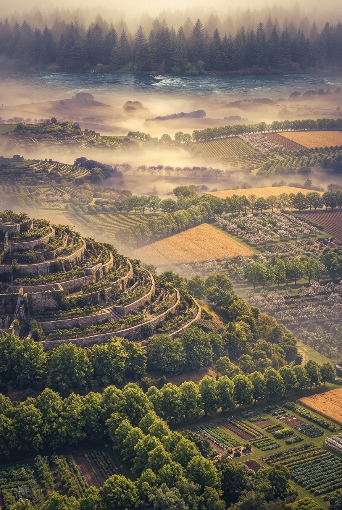

  

    <button type="button">Outpainting II</button>
    <button type="button" class="discuss-btn" onclick="openDiscussion('oct-09-26')">Comments</button>
  

  
<pre class="highlight"><code>
<strong>[NEGATIVE]</strong> cartoon, 3d render, CGI, stylized, people, dark, gloomy, dead, wasteland, chaotic foreground, messy, watermark, text <strong>[MEDIUM]</strong> Ethereal, fine-art landscape photography. High-angle, elevated panoramic view to capture an immense aerial scale and vertical depth. Portrait orientation. Soft, diffused lighting, masterpiece, incredibly detailed. <strong>[SETTING]</strong> The immense, sprawling agricultural paradise of the Entwives in the Second Age. Shot from a towering vantage point, the landscape stacks vertically in vast, sweeping layers receding toward a deep valley. The foreground and midground are blanketed in thick, rolling bands of ethereal morning fog that catch the golden-hour sunlight, casting a warm amber glow. In the far distance, near the top third of the frame, the mist breaks to reveal the wide, rushing waters of the Great River Anduin cutting horizontally across the scene. <strong>[EVENT MODIFIERS]</strong> A beautifully ordered and cultivated world stretching deep into the background. Confined to a prominent hill in the extreme near-left foreground is an ancient, sprawling terraced vineyard complex masterfully built from carved stone, heavily laden with vines. This stone vineyard hill is completely surrounded on all sides by the rest of the immense garden. Ascending vertically through the sweeping midground are expansive agricultural fields, geometric plots of golden wheat, and perfectly aligned rows of blooming fruit orchards tracing the contours of the misty hills. Interspersed between these agricultural zones, and forming a thick, elegant buffer zone lining the near edge of the river, are majestic groves of deciduous trees planted in orderly rows, matching the striking silhouetted style of misty windbreaks. On the far western bank across the river near the top of the image, the agriculture abruptly stops, replaced by a dense, dark, impenetrable wall of towering, wild evergreen pine forest looming in the background mist.
</code></pre>

  

</article>

<article class="post-entry" data-tags="animals, contemporary, realistic, cinematic, ethereal, journalistic">
<h2 id="oct-08-26" style="display: flex; flex-wrap: wrap; justify-content: flex-start; align-items: center; gap: 25px;">
<a href="#oct-08-26">Oct 08 // World Octopus Day</a> 
<button onclick="switchWorldOctopusDay(-1)" class="toggle-btn toggle-prev" style="position: static; border-right: 1px solid #777; border-top-right-radius: 0; border-bottom-right-radius: 0; margin-right: 0;" title="Previous Image">◀</button><button onclick="switchWorldOctopusDay(1)" class="toggle-btn toggle-next" style="position: static; border-top-left-radius: 0; border-bottom-left-radius: 0; border-left: none; margin-left: 0;" title="Next Image">▶</button>

 

  animals
  contemporary
  realistic
  cinematic
  ethereal
  journalistic

</h2>

  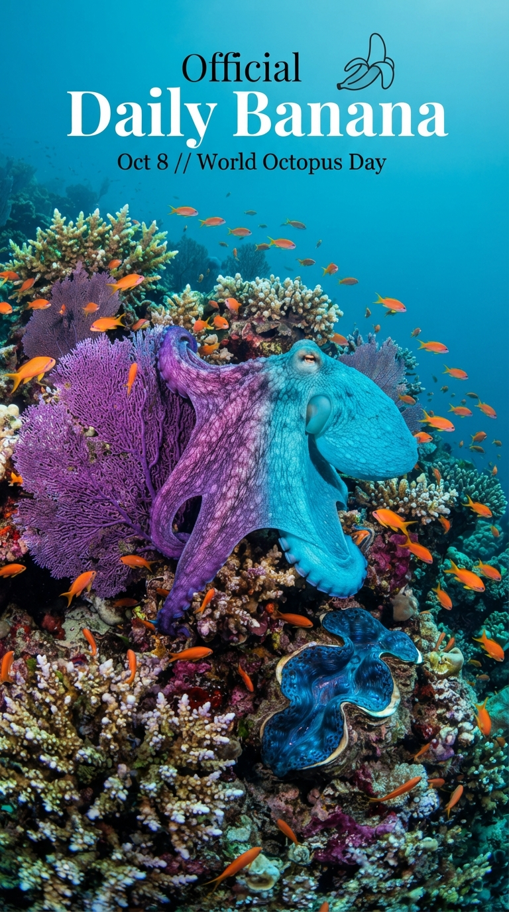
  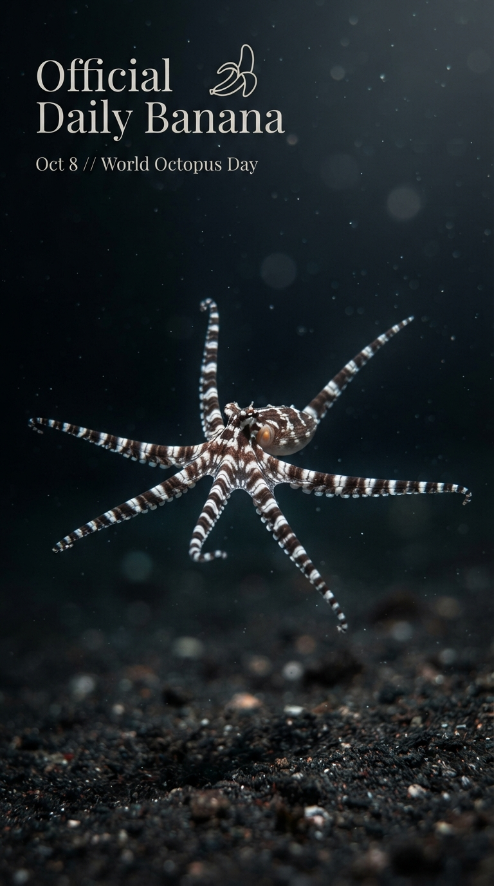
  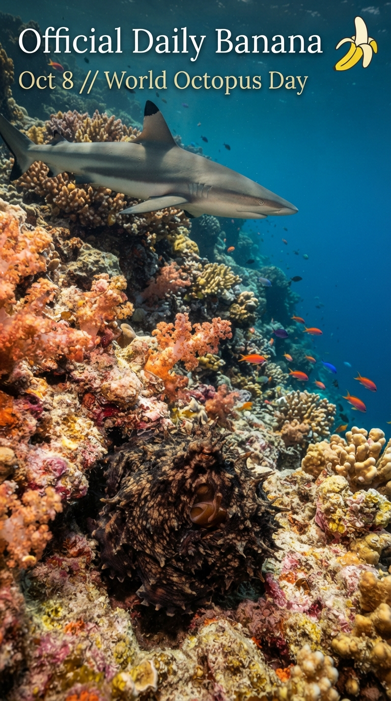

  

    <button type="button">World Octopus Day</button>
    <button type="button" class="discuss-btn" onclick="openDiscussion('oct-08-26')">Comments</button>
  

  
<pre class="highlight"><code>
<strong>1. Cinematic (Day Octopus)</strong>

<strong>[NEGATIVE]</strong> cartoon, 3d render, CGI, stylized, people, divers, murky water, dark, deep ocean, typo, misspelled <strong>[MEDIUM]</strong> Ultra-high-resolution underwater macro-landscape photography poster. Vivid, popping colors, crystal clear visibility, dramatic localized lighting emphasizing the reef's complexity. <strong>[SETTING]</strong> A pristine, shallow coral reef in Raja Ampat. The background is a chaotic, vibrant explosion of life: neon-tipped staghorn corals, massive purple sea fans, and a giant clam with a glowing blue mantle. Clouds of tiny, bright orange Anthias fish dart around the coral heads. <strong>[ANIMALS BASE]</strong> Day Octopus (Octopus cyanea). Highly intelligent, with complex, dynamic skin capable of extreme color shifting. <strong>[EVENT MODIFIERS]</strong> The octopus is draped over the center of the reef, demonstrating mind-bending active camouflage. The left half of its body has turned a vibrant, textured purple to perfectly match the sea fan it is touching, while the right half of its body has shifted to a smooth, bright cyan blue to perfectly blend in with the open water behind it.

<strong>2. Ethereal (Mimic Octopus)</strong>

<strong>[NEGATIVE]</strong> cartoon, 3d render, CGI, stylized, people, divers, bright sunny, vibrant coral, overexposed, chaotic, messy, typo, misspelled <strong>[MEDIUM]</strong> Fine-art underwater macro photography poster. Soft, diffused directional lighting. Shallow depth of field creating a creamy, dreamy bokeh in the background. <strong>[SETTING]</strong> Suspended slightly above the black volcanic sand of the Lembeh Strait. Soft, glowing bioluminescence or ambient moonlight filters down, catching tiny, floating particulates in the water like falling snow. <strong>[ANIMALS BASE]</strong> Mimic Octopus (Thaumoctopus mimicus). Slender body with striking dark brown and stark white banding. <strong>[EVENT MODIFIERS]</strong> Drifting weightlessly in the water column, it has splayed all eight tentacles wide open and rigid, mimicking the venomous spines of a lionfish. The soft lighting makes its white bands glow ethereally against the pitch-black water.

<strong>3. Journalistic (Day Octopus)</strong>

<strong>[NEGATIVE]</strong> cartoon, 3d render, CGI, stylized, people, divers, dark, murky, overexposed, slow motion, posed, typo, misspelled <strong>[MEDIUM]</strong> Action-oriented documentary wildlife photography poster. Fast shutter speed, wide angle, capturing a dynamic behavioral response. <strong>[SETTING]</strong> A sunlit, bustling coral reef drop-off. The shadow of a passing Blacktip Reef Shark falls across the coral in the upper frame. <strong>[ANIMALS BASE]</strong> Day Octopus (Octopus cyanea). <strong>[EVENT MODIFIERS]</strong> Caught in a split-second defensive reaction to the shark's shadow overhead. The octopus has instantly compressed itself into a tight ball within a crevice, its skin flashing from bright reef colors to a dark, jagged, spiky brown texture that perfectly mimics a dead piece of coral rock, practically vanishing in plain sight.
</code></pre>

  

</article>

<article class="post-entry" data-tags="pop-culture, southern-gothic, cinematic, noir, macabre">
<h2 id="oct-07-26" style="display: flex; flex-wrap: wrap; justify-content: flex-start; align-items: center; gap: 25px;">
<a href="#oct-07-26">Oct 07 // Popular Culture</a>
 

  pop-culture
  southern-gothic
  cinematic
  noir
  macabre

</h2>

  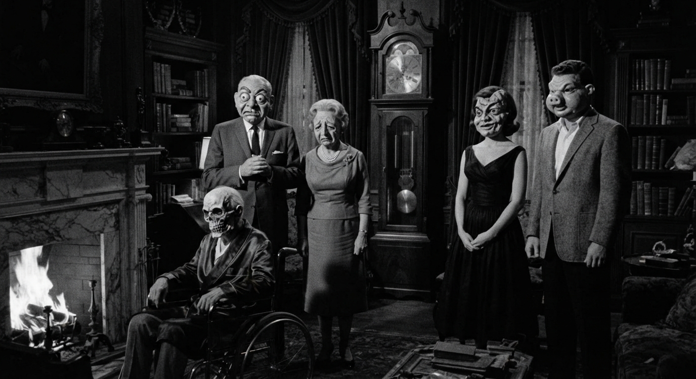

  

    <button type="button">Popular Culture</button>
    <button type="button" class="discuss-btn" onclick="openDiscussion('oct-07-26')">Comments</button>
  

  
<pre class="highlight"><code>
<strong>The Twilight Zone, "The Masks"</strong>

<strong>[NEGATIVE]</strong> color, daylight, cheerful, modern, futuristic, casual clothes, cartoon, stylized, CGI, soft lighting, happy, bustling, clean, low resolution <strong>[MEDIUM]</strong> A hyper-realistic, moody cinematic still. Shot on vintage 35mm black-and-white film. Extreme high-contrast chiaroscuro lighting, deep harsh shadows, and classic 1960s horror film grain. Masterpiece, highly detailed. <strong>[SETTING]</strong> A lavish, suffocatingly cluttered 1960s Southern Gothic mansion study in New Orleans, overflowing with dusty antiques and hoarded wealth. Dark mahogany wood paneling, heavy floor-to-ceiling velvet drapes, and antique Victorian furniture. A massive, imposing grandfather clock looms in the background. The primary light source is a roaring fireplace in a marble hearth, casting harsh, flickering directional light and long, distorted shadows across the patterned wallpaper. <strong>[CHARACTERS BASE]</strong> CRITICAL INSTRUCTION: Adhere to strict 1960s upper-class formal wear and grotesque papier-mâché masks. A group of four wealthy people stand rigidly in the gloom. An older, thin, gaunt man in a crisp business suit wears a greedy, bulging-eyed miser mask. An older woman in a formal dress and pearls wears a pathetic, weeping coward mask. A young woman in a chic 1960s evening gown wears a horribly twisted, asymmetrical, deformed mask. A heavily-built, broad-shouldered, bulky young man in a 1960s tweed suit jacket and necktie wears a bloated, piggish glutton mask. Nearby, an elderly dying man sits in a wheelchair wearing a silk dressing gown and a skull mask. <strong>[EVENT MODIFIERS]</strong> The masked figures stand in an eerie, dreadful stillness, waiting for the grandfather clock to strike midnight. The harsh, directional lighting from the fireplace dramatically illuminates the horrifying, lumpy textures of their masks while plunging their bodies and the rest of the room into pitch-black shadow, capturing a moment of pure psychological horror.
</code></pre>

  

</article>

<article class="post-entry" data-tags="character-design, middle-earth, realistic, concept-art">
<h2 id="oct-06-26" style="display: flex; flex-wrap: wrap; justify-content: flex-start; align-items: center; gap: 25px;">
<a href="#oct-06-26">Oct 06 // Remasters II</a>
 

  character-design
  middle-earth
  realistic
  concept-art

</h2>

  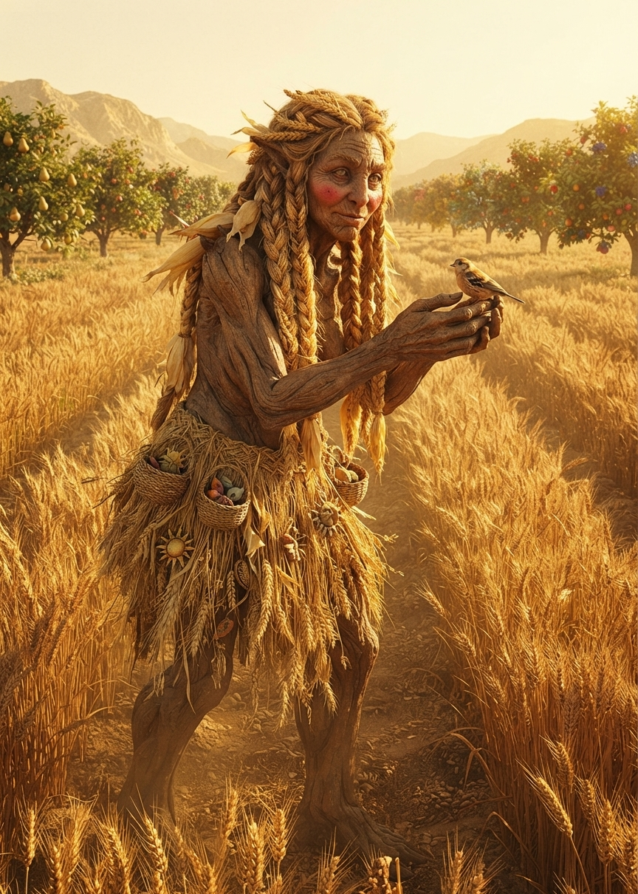

  

    <button type="button">Remasters II</button>
    <button type="button" class="discuss-btn" onclick="openDiscussion('oct-06-26')">Comments</button>
  

  
<pre class="highlight"><code>
<strong>[NEGATIVE]</strong> human, elf, normal woman, human skin, modern clothes, wild forest, dark woods, oak tree, monstrous, terrifying, cartoon, stylized, low resolution, literal apples <strong>[MEDIUM]</strong> Hyper-realistic high-fantasy concept art, 8k resolution, cinematic lighting, masterpiece, incredibly detailed texture. <strong>[SETTING]</strong> A bright, golden, sun-baked agricultural field in the First Age of Middle-earth, filled with neat rows of golden wheat and thriving fruit orchards. <strong>[CHARACTER BASE]</strong> CRITICAL INSTRUCTION: Adhere strictly to the overall structure, silhouette, framing, and layout of the included visual concept reference. An Entwife. A sentient, female tree-shepherd. She does not look like a wild forest tree, but rather a cultivated agricultural plant. She is slightly stooped and bent from centuries of agricultural labor in the sun. Her bark-like skin is deeply browned and sun-baked. Her hair is woven into long, thick braids made of golden, sun-dried wheat (the hue of ripe corn), and she has a vibrant, rosy blush across her round cheeks. Her eyes are deep, ancient, and slow-moving, retaining the distinctly profound and ancient look of the Ents.
</code></pre>

  

</article>

<article class="post-entry" data-tags="literature, sci-fi, cinematic, realistic, gothic, b-film">
<h2 id="oct-05-26" style="display: flex; flex-wrap: wrap; justify-content: flex-start; align-items: center; gap: 25px;">
<a href="#oct-05-26">Oct 05 // Stage Plays</a> 
<button onclick="switchStagePlays(-1)" class="toggle-btn toggle-prev" style="position: static; border-right: 1px solid #777; border-top-right-radius: 0; border-bottom-right-radius: 0; margin-right: 0;" title="Previous Image">◀</button><button onclick="switchStagePlays(1)" class="toggle-btn toggle-next" style="position: static; border-top-left-radius: 0; border-bottom-left-radius: 0; border-left: none; margin-left: 0;" title="Next Image">▶</button>

 

  literature
  sci-fi
  cinematic
  realistic
  gothic
  b-film

</h2>

  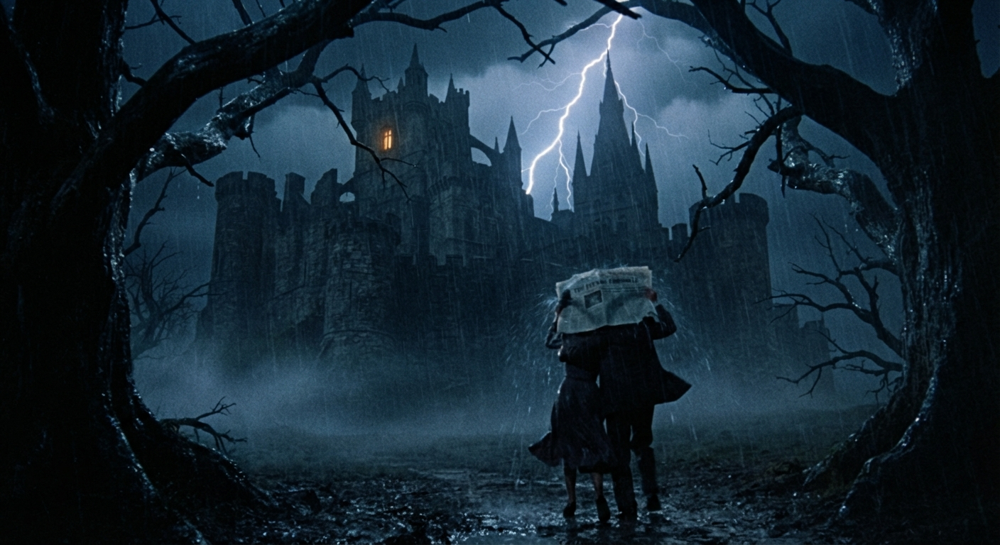
  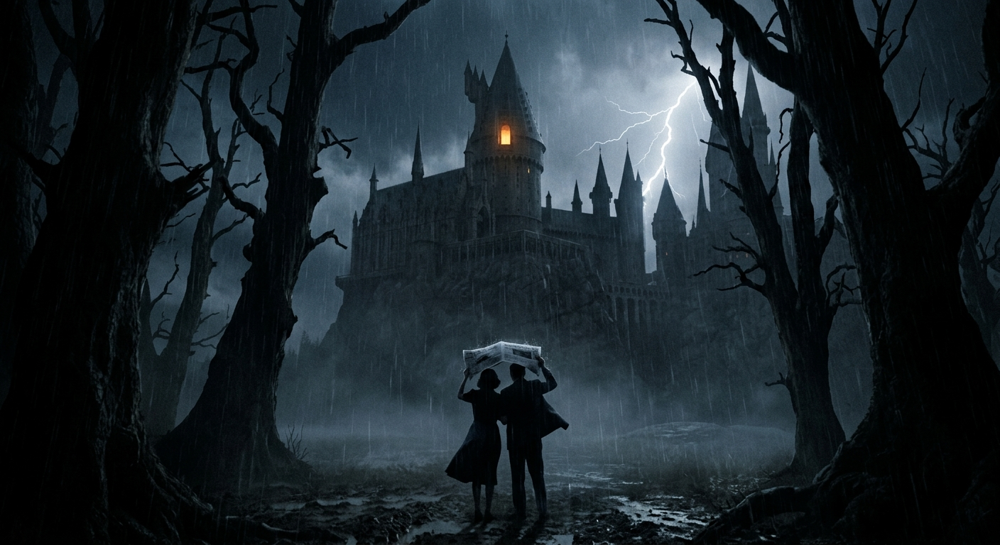
  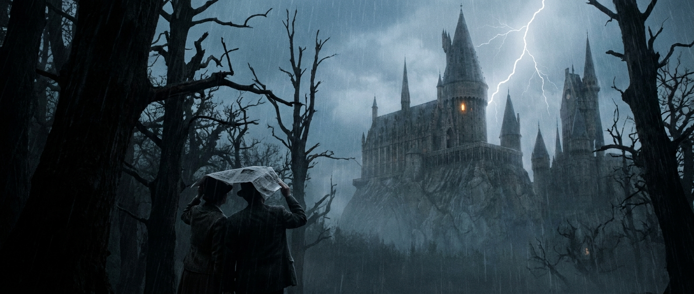

  

    <button type="button">Stage Plays</button>
    <button type="button" class="discuss-btn" onclick="openDiscussion('oct-05-26')">Comments</button>
  

  
<pre class="highlight"><code>
<strong>Over at the Frankenstein Place</strong>

<strong>[NEGATIVE]</strong> stylized, cartoon, anime, low resolution, modern elements, daytime, bright, cheerful, colorful, cozy, crowded, bustling city <strong>[MEDIUM]</strong> A hyper-realistic, moody cinematic still. Shot on 35mm film with a wide anamorphic lens to capture immense scale. Deep, high-contrast shadows with a gritty, classic horror film grain. <strong>[SETTING]</strong> A pitch-black, torrential rainstorm in the dead of night. The framing is heavily obscured by towering, dead, twisting oak trees in the foreground. In the distance, looming menacingly through the heavy, driving rain and thick ground mist, is a massive, decaying gothic stone castle. The architecture is imposing and archaic. A single, eerie, warm amber light glows ominously from a high tower window, providing the only source of warmth in the freezing, slate-blue darkness. A sudden fork of brilliant white lightning illuminates the sky, casting sharp, dramatic silhouettes of the castle spires. <strong>[CHARACTERS BASE]</strong> In the extreme, muddy foreground, two tiny, silhouetted human figures huddle together closely. The dark shapes of a conservative mid-length dress hem and a standard suit jacket flap violently in the wind behind them. They are holding a soaked daily newspaper over their heads as a makeshift umbrella to block the freezing rain. <strong>[EVENT MODIFIERS]</strong> The tiny figures are looking up in awe and terror at the looming gothic structure in the distance. The torrential rain bounces off the newspaper and the muddy ground. The atmosphere captures a deeply isolating, spooky, and quintessential 1930s haunted house aesthetic.
</code></pre>

  

</article>

<article class="post-entry" data-tags="animals, prehistoric, dinosaurs, realistic, journalistic">
<h2 id="oct-04-26" style="display: flex; flex-wrap: wrap; justify-content: flex-start; align-items: center; gap: 25px;">
<a href="#oct-04-26">Oct 04 // Dinosaurs: Dilophosaurus</a> 
<button onclick="switchDinosaursDilophosaurus(-1)" class="toggle-btn toggle-prev" style="position: static; border-right: 1px solid #777; border-top-right-radius: 0; border-bottom-right-radius: 0; margin-right: 0;" title="Previous Image">◀</button><button onclick="switchDinosaursDilophosaurus(1)" class="toggle-btn toggle-next" style="position: static; border-top-left-radius: 0; border-bottom-left-radius: 0; border-left: none; margin-left: 0;" title="Next Image">▶</button>

 

  animals
  prehistoric
  dinosaurs
  realistic
  journalistic

</h2>

  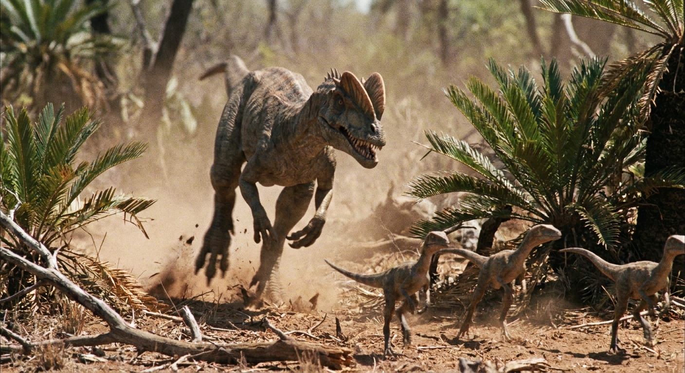
  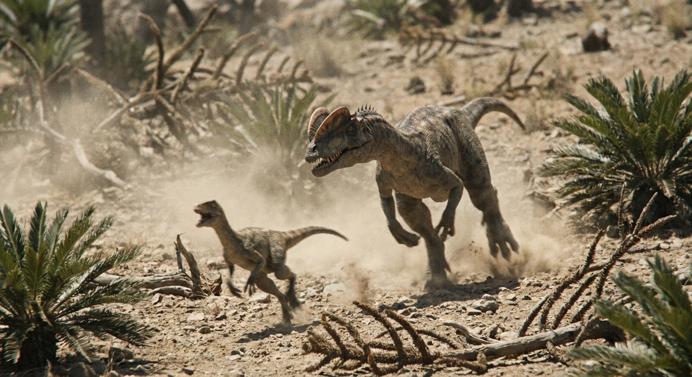
  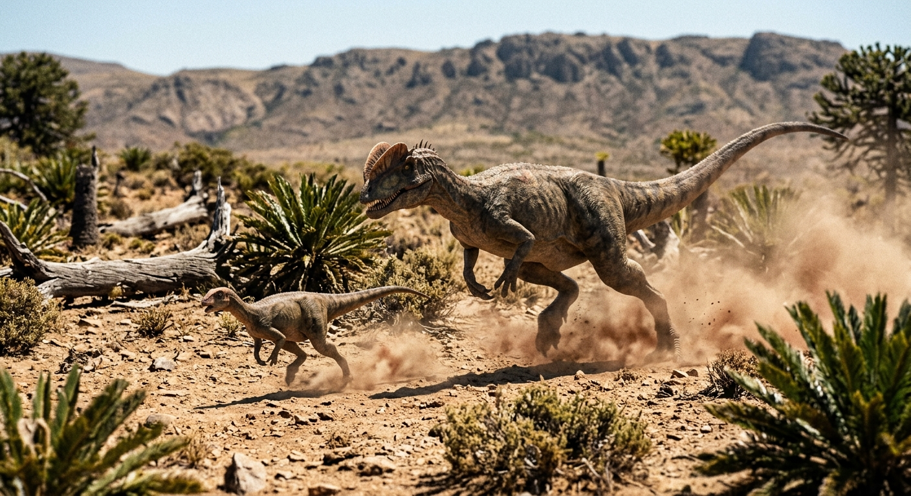
  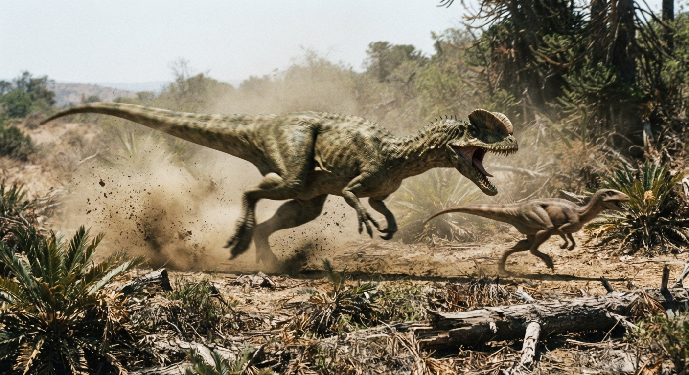

  

    <button type="button">Dinosaurs: Dilophosaurus</button>
    <button type="button" class="discuss-btn" onclick="openDiscussion('oct-04-26')">Comments</button>
  

  
<pre class="highlight"><code>
<strong>[NEGATIVE]</strong> stylized, cartoon, anime, low resolution, messy anatomy, inaccurate anatomy, human elements, modern artifacts, neck frill, spitting venom, tiny size, soft lighting, posed, artificial <strong>[MEDIUM]</strong> Raw, journalistic wildlife photography. Shot handheld with a fast 200mm telephoto lens, featuring authentic film grain and a slightly gritty, unpolished documentary feel. Fast shutter speed freezing chaotic mid-air motion perfectly. <strong>[SETTING]</strong> A harsh, sun-baked Early Jurassic scrubland. The terrain is dry and dusty, dotted with spiky, tough cycads and scattered, fallen Araucaria branches. The harsh midday sun casts sharp, deep shadows across the uneven ground, highlighting the dry, dusty textures of the environment. <strong>[ANIMALS BASE]</strong> Dilophosaurus. CRITICAL ANATOMY: Medium-sized theropod (20 feet long). Distinct dual, semi-circular plate-like crests running parallel along the top of its snout. No neck frill. Powerful jaws with a distinct kink in the upper jaw. <strong>[EVENT MODIFIERS]</strong> The Dilophosaurus is captured mid-stride in a high-speed sprint, kicking up a chaotic cloud of dust and debris behind its massive, clawed feet. Its head is held high, its dual crests fully displayed as it charges directly across the frame. Just ahead of its snapping, kinked jaws, a panicked herd of primitive herbivorous dinosaurs (Sarahsaurus) is scattering and sprinting frantically for their lives in all directions. The predator's gaze is hyper-focused on one unfortunate straggler right in front of it. The raw, handheld camera angle gives the viewer an intense, grounding sense of speed, scale, and raw predatory power.
</code></pre>

  

</article>

<article class="post-entry" data-tags="character-design, middle-earth, realistic, lotro, concept-art">
<h2 id="oct-03-26" style="display: flex; flex-wrap: wrap; justify-content: flex-start; align-items: center; gap: 25px;">
<a href="#oct-03-26">Oct 03 // Remasters</a>
 

  character-design
  middle-earth
  realistic
  lotro
  concept-art

</h2>

  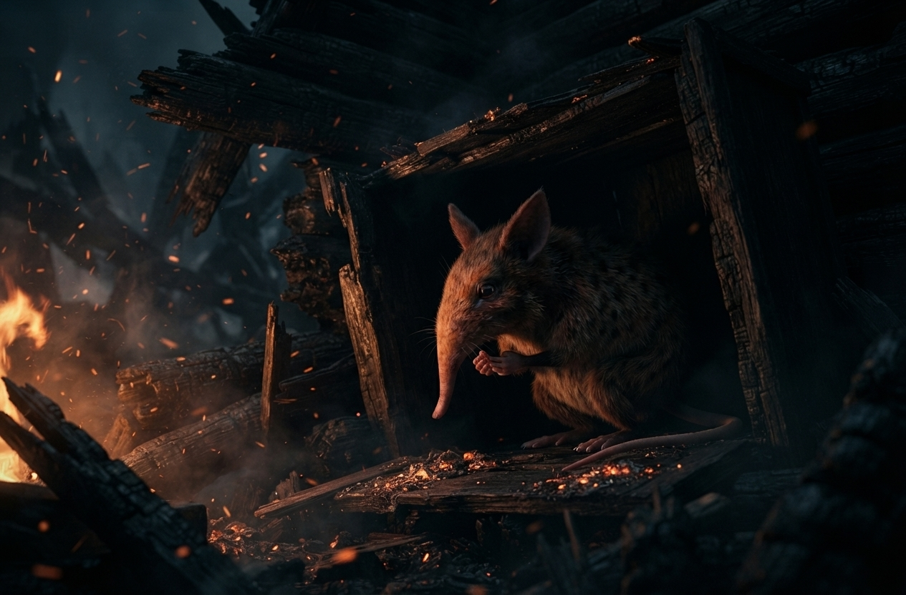

  

    <button type="button">Remasters</button>
    <button type="button" class="discuss-btn" onclick="openDiscussion('oct-03-26')">Comments</button>
  

  
<pre class="highlight"><code>
<strong>Step 1: The Character Remaster</strong>

<strong>[NEGATIVE]</strong> low poly, ps2 graphics, bad textures, old game engine, cartoon, stylized, messy anatomy <strong>[MEDIUM]</strong> A hyper-realistic, modern Unreal Engine 5 character showcase render. Studio lighting. <strong>[CHARACTERS BASE]</strong> A Spotted Shrew of Middle-earth. A large, rabbit-sized creature with rodent-like features. CRITICAL ANATOMY: It features a very long, pointed, highly elongated snout, large, expressive, rounded ears that stand upright, and a long, thin, bare tail. Its body is covered in coarse, reddish-brown and tan fur, heavily marked with distinct dark spots scattered across its back and flanks. It has thin, delicate limbs with small, pinkish paws. <strong>[EVENT MODIFIERS]</strong> Standing naturally on all fours, showcasing its highly detailed, photorealistic fur, glistening eyes, and modern high-fidelity PBR textures. Complete photorealistic remaster of a classic creature.

<strong>Step 2: The Scene Injection</strong>

<strong>[NEGATIVE]</strong> stylized, cartoon, anime, low resolution, messy anatomy, inaccurate anatomy, human, man, person, anthropomorphic, clothes, weapons, bright daylight, cheerful, clean <strong>[MEDIUM]</strong> A hyper-realistic, dark-fantasy cinematic still. Shot on a 35mm anamorphic lens at T/2.8, providing crystalline sharp focus on the central subject in the foreground with a smooth, atmospheric background blur. Masterpiece artwork rendered in Unreal Engine 5 and Octane Render, utilizing ray tracing and physically based rendering (PBR). HDR cinematic color grading balances cool, misty morning blues with the soft, warming yellow light of dawn and the harsh, flickering orange of burning embers. Extreme micro-level detailing captures the coarse texture of splintered wood, glowing ash, and the individual strands of spotted fur. <strong>[SETTING]</strong> The claustrophobic interior of a sprawling, rustic timber lodge in the Vales of Anduin, devastated and in total ruin. The time is early morning, just before the golden hour. The ambient lighting transitions from a cool, misty blue to a soft, warming yellow. The massive, unhewn log support beams have partially collapsed inward, deeply charred and violently shattered from a catastrophic storm. The air is thick with volumetric smoke and a chaotic flurry of glowing, fiery orange embers drifting through the destroyed gathering hall. <strong>[CHARACTERS BASE]</strong> Character MB: A Spotted Shrew of Middle-earth. A large, rabbit-sized creature with rodent-like features. CRITICAL ANATOMY: It features a very long, pointed, highly elongated snout, large, expressive, rounded ears that stand upright, and a long, thin, bare tail. Its body is covered in coarse, reddish-brown and tan fur, heavily marked with distinct dark spots scattered across its back and flanks. It has thin, delicate limbs with small, pinkish paws. <strong>[EVENT MODIFIERS]</strong> The scene takes place deep inside the ruined lodge. Character MB is hiding inside the dark, confined space of a splintered, overturned wooden cupboard. The spotted shrew is hunched deep in the corner of the overturned furniture, bathed in the cool morning light mixed with the dramatic, flickering orange rim-light of the drifting embers outside. It has its head bowed, staring directly down into its tiny, upheld forelimbs which are held palm up, its posture radiating a profound sense of despair and resignation, as if accepting exactly how powerless it is to stop the inevitable.
</code></pre>

  

</article>

<article class="post-entry" data-tags="animals,prehistoric,reptiles,realistic,cinematic,ethereal,journalistic">
<h2 id="oct-02-26" style="display: flex; flex-wrap: wrap; justify-content: flex-start; align-items: center; gap: 25px;">
<a href="#oct-02-26">Oct 02 // Reptiles: Pteranodon</a> 
<button onclick="switchReptilesPteranodon(-1)" class="toggle-btn toggle-prev" style="position: static; border-right: 1px solid #777; border-top-right-radius: 0; border-bottom-right-radius: 0; margin-right: 0;" title="Previous Image">◀</button><button onclick="switchReptilesPteranodon(1)" class="toggle-btn toggle-next" style="position: static; border-top-left-radius: 0; border-bottom-left-radius: 0; border-left: none; margin-left: 0;" title="Next Image">▶</button>

 

  animals
  prehistoric
  reptiles
  realistic
  cinematic
  ethereal
  journalistic

</h2>

  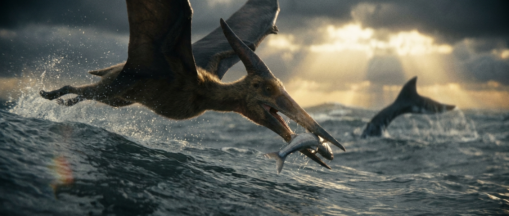
  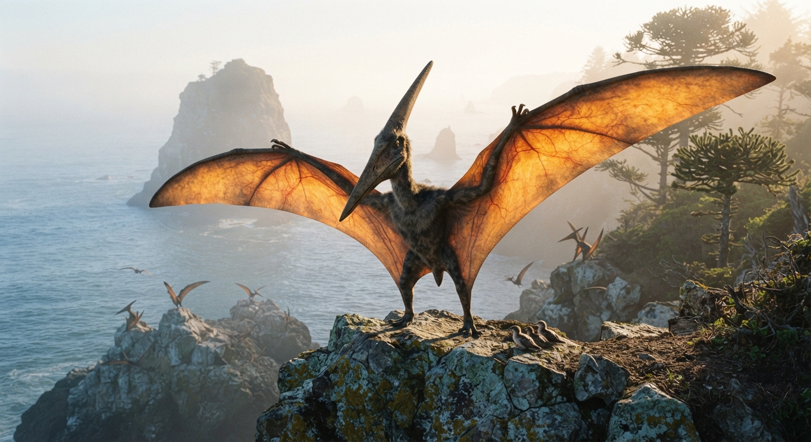
  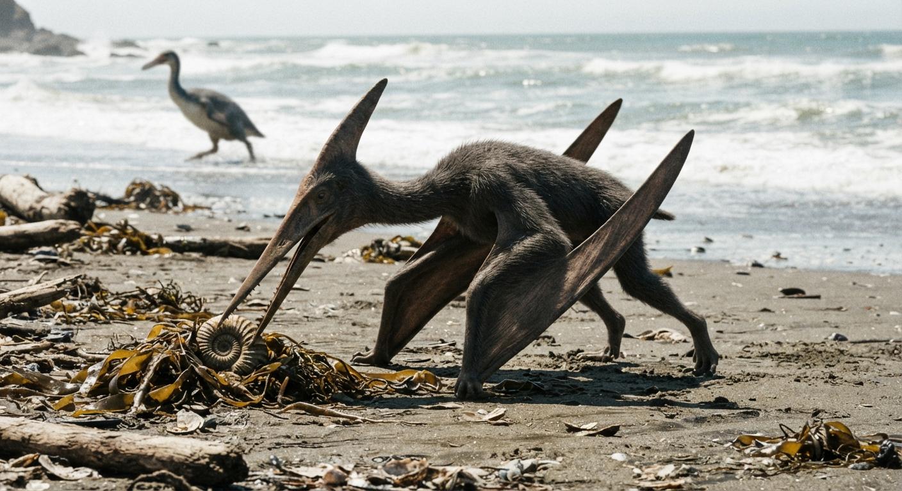

  

    <button type="button">Reptiles: Pteranodon</button>
    <button type="button" class="discuss-btn" onclick="openDiscussion('oct-02-26')">Comments</button>
  

  
<pre class="highlight"><code>
<strong>Scene 1 (The Plunge Dive)</strong>

<strong>[NEGATIVE]</strong> stylized, cartoon, anime, low resolution, messy anatomy, inaccurate anatomy, human elements, modern artifacts, text, watermarks, combat, gore, feathers on wings <strong>[MEDIUM]</strong> Cinematic nature documentary still. Shot on an anamorphic 35mm lens, shallow depth of field, dramatic and highly realistic movie-still quality. <strong>[SETTING]</strong> The rough, rolling waves of the Late Cretaceous Western Interior Seaway. The sky is dark and stormy, with dramatic shafts of sunlight piercing through heavy clouds. In the extreme, out-of-focus background, the distant asymmetrical tail fluke of a Mosasaur breaches the surface. Lighting: Dramatic, high-contrast cinematic lighting with deep shadows and intense highlights on the crashing water. <strong>[ANIMALS BASE]</strong> Pteranodon. CRITICAL ANATOMY: Large flying reptile. Prominent, long backward-pointing cranial crest. Completely toothless, pointed beak. Massive leathery wings supported by a single hyper-elongated finger. Body covered in fine fuzz (pycnofibers), NO feathers. <strong>[EVENT MODIFIERS]</strong> Caught in mid-air just inches above the water, performing a high-speed plunge dive. Its massive leathery wings are folded tightly against its body for aerodynamics, its toothless beak wide open as it expertly snatches a silver, needle-toothed prehistoric fish (Enchodus) directly from the crest of a wave, kicking up a cinematic explosion of crisp water droplets.

<strong>Scene 2 (The Cliffside Sunbathers)</strong>

<strong>[NEGATIVE]</strong> stylized, cartoon, anime, low resolution, messy anatomy, inaccurate anatomy, human elements, modern artifacts, text, watermarks, combat, gore, feathers on wings, clustered together, tightly packed, overlapping <strong>[MEDIUM]</strong> Ethereal fine-art wildlife photography. Shot with a prime lens wide open for soft bokeh, yielding a dreamy, misty background palette of soft oceanic blues. Highly realistic textures. <strong>[SETTING]</strong> A towering, mist-shrouded coastal sea-stack overlooking the prehistoric ocean, acting as a massive coastal rookery. The rocky cliff is dotted with tough coastal conifers (Araucaria). Lighting: Ethereal early morning golden hour. A brilliant, low-angled morning sun pierces the coastal fog, casting intense, warm golden rays directly onto the cliff edge. <strong>[ANIMALS BASE]</strong> Pteranodon. CRITICAL ANATOMY: Large flying reptile. Prominent, long backward-pointing cranial crest. Completely toothless, pointed beak. Massive leathery wings supported by a single hyper-elongated finger. Body covered in fine fuzz (pycnofibers), NO feathers. <strong>[EVENT MODIFIERS]</strong> A massive Pteranodon stands firmly in the sharp foreground on the very edge of the rocky cliff, spreading its massive leathery wings fully open to thermoregulate and soak up the intense morning sun. The direct sunlight hits the creature from behind, causing its translucent leathery wing membranes to blaze with a warm, glowing amber backlight. Dispersed realistically on various lower rocks and adjacent cliff ledges in the background are several other Pteranodons, creating a sense of depth and a living colony. Resting peacefully on the rocks directly beside the main pterosaur's feet are several tiny, pigeon-sized primitive seabirds (Ichthyornis).

<strong>Scene 3 (The Beach Scavenger)</strong>

<strong>[NEGATIVE]</strong> stylized, cartoon, anime, low resolution, messy anatomy, inaccurate anatomy, human elements, modern artifacts, text, watermarks, combat, gore, feathers on wings <strong>[MEDIUM]</strong> Raw, journalistic wildlife photography. Shot handheld with a fast 400mm telephoto lens, featuring authentic film grain and a slightly gritty, unpolished documentary feel. <strong>[SETTING]</strong> A rugged, sandy shoreline littered with washed-up tangles of prehistoric kelp, driftwood, and broken shells. In the shallow surf behind the subject, a massive, flightless diving bird (Hesperornis) waddles awkwardly ashore. Lighting: Harsh, unforgiving midday sun casting stark, realistic shadows and highlighting the wet sand and gritty textures of the beach. <strong>[ANIMALS BASE]</strong> Pteranodon. CRITICAL ANATOMY: Large flying reptile. Prominent, long backward-pointing cranial crest. Completely toothless, pointed beak. Massive leathery wings supported by a single hyper-elongated finger. Body covered in fine fuzz (pycnofibers), NO feathers. <strong>[EVENT MODIFIERS]</strong> Caught in a candid, unposed moment of foraging. It is walking awkwardly but powerfully on all fours across the wet sand, using its massive folded wings as front legs. It has its head lowered, using its long toothless beak to delicately pick at a stranded, spiral-shelled ammonite washed up in the seaweed.
</code></pre>

  

</article>

<article class="post-entry" data-tags="design,middle-earth,realistic,ethereal">
<h2 id="oct-01-26" style="display: flex; flex-wrap: wrap; justify-content: flex-start; align-items: center; gap: 25px;">
<a href="#oct-01-26">Oct 01 // Dual-tone Lighting</a>
 

  design
  middle-earth
  realistic
  ethereal

</h2>

  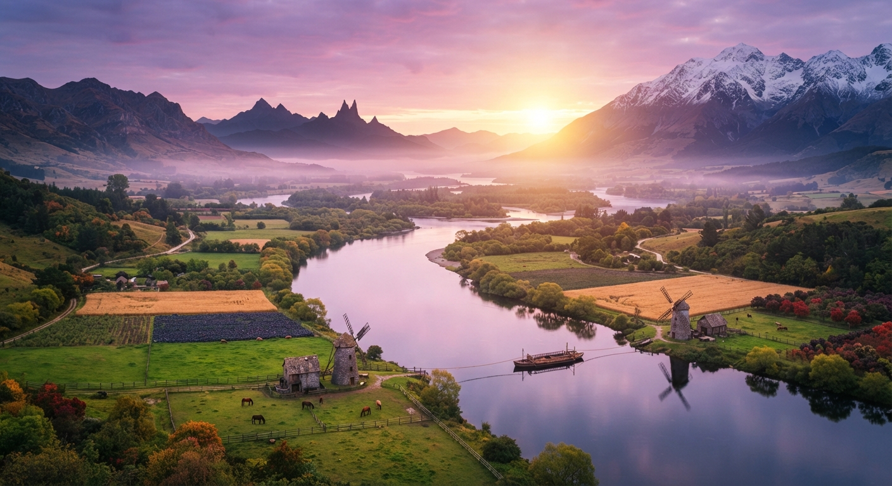

  

    <button type="button">Dual-tone Lighting</button>
    <button type="button" class="discuss-btn" onclick="openDiscussion('oct-01-26')">Comments</button>
  

  
<pre class="highlight"><code>
<strong>The Golden Age of Gondor</strong>

<strong>[NEGATIVE]</strong> CGI, 3d render, cartoon, painting, illustration, fantasy magic, ruined, harsh sunlight, clear sky, muddy water, swamp, s-curve, military, fortress, overly sharp, harsh contrast, cluster of windmills, multiple windmills on same bank, town, village, flat horizon, low mountains <strong>[MEDIUM]</strong> High-end studio-quality landscape photography with a deeply ethereal, dreamy cinematic quality. Shot on medium format Fujifilm Velvia 50 film. The image utilizes a long exposure and a 1/4 Black Pro-Mist lens filter to create a soft, glowing, blooming effect on all the light sources and the sunrise. The landscape is processed with a subtle Orton Effect, giving the entire scene a magical, smooth, and breathtakingly tranquil ethereal atmosphere while retaining rich, vivid earth tones. A masterclass in landscape composition, utilizing a drone/crane elevated perspective and deep depth of field. <strong>[SETTING]</strong> A vast, sweeping, unbelievably fertile green river valley frontier (the historical Eastfold of Calenardhon). The layout is an elevated, high-angle shot looking down along a massive, deep, mile-wide crystal-clear major river (the mighty River Entwash). The massive river follows a single, sweeping, gentle curve through the landscape before naturally splitting into a breathtaking, massive river delta (the Mouths of the Entwash) deep in the distance. This delta is depicted as many distinct, heavily branching river channels spreading wide across the flat plains like a massive root system. The land between these distant delta branches is heavily overgrown with lush, green weeping willow trees and thick foliage. This distant delta is dramatically framed by three prominent mountain ranges: to the right, the massive, snow-capped peaks of the White Mountains; to the left, the jagged, rocky highlands of the Emyn Muil; and silhouetted in the extreme farthest distance beyond the Emyn Muil on the left horizon, the impossibly tall, dark, foreboding mountains of Mordor (the Ephel Dúath) rising massively high into the sky, forming a jagged, menacing black silhouette. The shores in the foreground and midground are lined with sprawling, highly cultivated agricultural croftlands. The crops are a vibrant autumn mix: fenced-in lush emerald grazing pastures, vast fields of golden-yellow mature wheat, dark purple cabbage patches, and sprawling fruit orchards turning deep crimson red and burnt russet. In the sharp foreground, built solidly on the near riverbank, stands exactly one single humble, rustic Gondorian farmer's windmill and its adjacent stone granary. Spanning the massive width of the river is a heavy, thick rope serving as a guide for a large, rustic wooden ferry-barge currently crossing the glass-still water. On the far opposite riverbank, connected by the ferry crossing, exactly one more single rustic windmill and its own sprawling croftland mirrors the foreground structure. All structures are built using weathered local fieldstone masonry and sturdy, dark timber. <strong>[EVENT MODIFIERS]</strong> The lighting and mood of the entire scene captures a breathtaking, dual-tone ethereal sunrise. The ambient, low-level ground-fog and the vast sky are bathed in soft, dreamy pastel hues of deep magenta, lavender, and pink. Piercing directly through this pastel fog is a brilliant, blazing golden-hour sun on the horizon. The intense, warm golden-orange sunlight acts as a massive rim-light, hitting the single windmills on each bank, the towering mountains, and the vividly colored crops, perfectly contrasting against the cool, hazy pastel pink fog. The towering, jagged black silhouette of Mordor stands out sharply against the bright pastel sky. The low-level fog realistically and softly obscures the distant delta, while allowing the towering mountain ranges to remain clear. The glass-still river perfectly mirrors this magical blend of warm gold and soft purple. Down in the misty, fenced-in emerald pastures, the dark silhouettes of domestic Gondorian farm horses and grazing cattle can be seen peacefully grazing in the fog.
</code></pre>

  

</article>

<article class="post-entry" data-tags="literature,fantasy,realistic,multi-step">
<h2 id="sep-30-26" style="display: flex; flex-wrap: wrap; justify-content: flex-start; align-items: center; gap: 25px;">
<a href="#sep-30-26">Sep 30 // Scenes from Literature VI</a> 
<button onclick="switchScenesFromLiteratureVI(-1)" class="toggle-btn toggle-prev" style="position: static; border-right: 1px solid #777; border-top-right-radius: 0; border-bottom-right-radius: 0; margin-right: 0;" title="Previous Image">◀</button><button onclick="switchScenesFromLiteratureVI(1)" class="toggle-btn toggle-next" style="position: static; border-top-left-radius: 0; border-bottom-left-radius: 0; border-left: none; margin-left: 0;" title="Next Image">▶</button>

 

  literature
  fantasy
  realistic

</h2>

  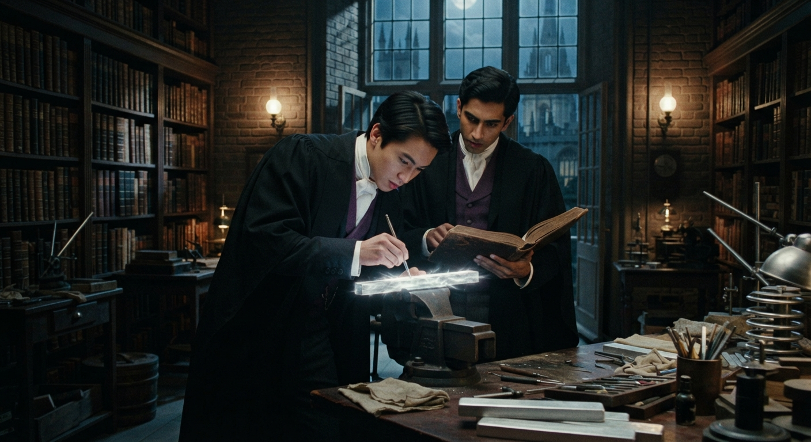
  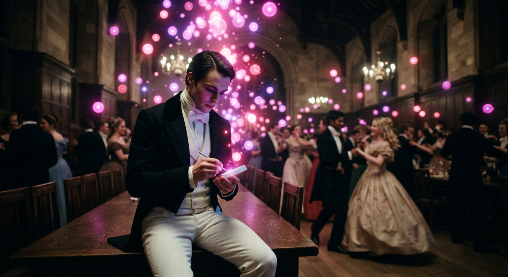
  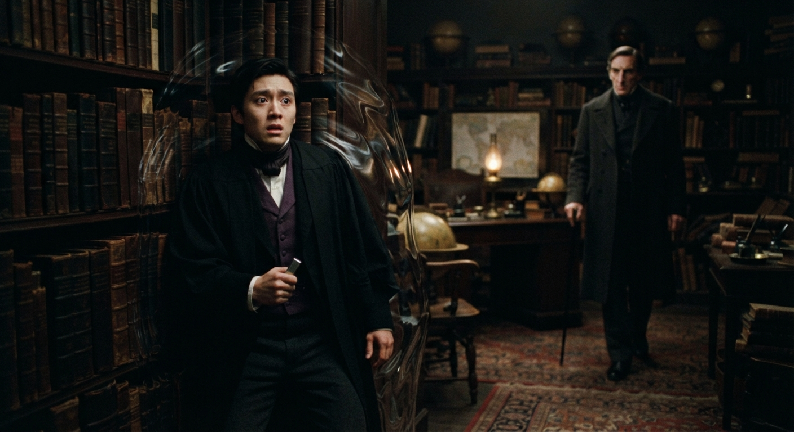

  

    <button type="button">Scenes from Literature VI</button>
    <button type="button" class="discuss-btn" onclick="openDiscussion('sep-30-26')">Comments</button>
  

  
<pre class="highlight"><code>
<strong>1. The Workshop <em>(Creation)</em></strong>

<strong>[NEGATIVE]</strong> CGI, 3d render, plastic, video game, generic fantasy magic, fireballs, giant swords, runes, massive ingots, modern clothing, cartoon, stylized, bright sunlight, daytime, crowded, cell phones, electrical lighting <strong>[MEDIUM]</strong> High-end cinematic live-action photography, 35mm film lens, hyper-realistic, raw film grain, practical volumetric lighting, deep architectural shadows, authentic 19th-century period piece aesthetic. <strong>[SETTING]</strong> The interior of an ancient, grand 19th-century Oxford university workshop at night. The vast, cavernous room features towering wooden bookshelves and exposed brick walls. The space is entirely illuminated by traditional, open-flame gaslight chandeliers burning with real fire. In the background, tall clear-paned mullioned windows offer a faint view of the moonlit Oxford skyline. The heavy atmosphere is dominated by deep, moody shadows and the warm amber glow of real fire. <strong>[CHARACTERS BASE]</strong> [ROBIN SWIFT] A young Chinese translation scholar standing at a heavy mahogany worktable. He wears a traditional flowing black Oxford undergraduate academic robe cascading over a sharp 1830s Victorian ensemble. Beneath his robe, he wears a tailored purple waistcoat featuring a small inner pocket storing a slim silver bar, a crisp white cravat, and dark wool trousers secured by a sturdy dark leather belt with a small leather pouch. He wears tightly laced, heavy leather boots. [RAMIZ MIRZA] A young, sharp-featured Indian Muslim scholar standing next to Robin at the worktable. He is identically dressed in a traditional flowing black Oxford undergraduate academic robe cascading over a sharp 1830s Victorian ensemble. Beneath his robe, he wears a tailored purple waistcoat featuring a small inner pocket storing a slim silver bar, a crisp white cravat, and dark wool trousers secured by a sturdy dark leather belt with a small leather pouch. He wears tightly laced, heavy leather boots. <strong>[EVENT MODIFIERS]</strong> The two scholars are completely isolated in the workshop. There are strictly only two people in this entire image; the rest of the vast room is entirely devoid of human life. They are collaborating on a single blank silver bar, which is tightly gripped between the crushing iron jaws of a heavy jeweler's vice bolted to the mahogany worktable. Robin is leaning closely over the vice, actively pressing a fine-tipped silver engraving stylus directly into the gripped metal to painstakingly etch the match-pair. Ramiz is standing closely beside him, holding open a heavy leather-bound etymological dictionary, guiding the exact strokes. As the silver catches the semantic gap, the heavy atmosphere around the worktable crackles with unseen pressure. The bar instantly activates, emitting a cold, sharp, metallic resonance—an icy, shimmering physical distortion in the air that hums with the unmatched durability and strength of the empire's silver-working. This raw magical energy casts a stark, dramatic, concentrated silver glow that sharply illuminates the intense concentration on both of their faces and throws sharp, elongated shadows against the towering bookshelves and brick walls of the workshop.

<strong>2. The Ballroom <em>(Light)</em></strong>

<strong>[NEGATIVE]</strong> runes, complex symbols, glowing text, giant sword, massive ingot, light bulbs, electric bulbs, glass bulbs, filament, CGI, 3d render, video game, plastic, unreal engine, generic fantasy magic, fireballs, modern clothing, cartoon, stylized, low quality, messy architecture, unhistorical, generic steampunk, cell phones, electrical lighting <strong>[MEDIUM]</strong> High-end cinematic live-action photography, 35mm film lens, hyper-realistic, raw film grain, practical volumetric lighting, deep architectural shadows, vibrant neon pink and purple cinematic color grading, authentic 19th-century period piece aesthetic. <strong>[SETTING]</strong> The interior of the grand dining hall at University College, Oxford, transformed into a lavish Commemoration Ball. It is late at night. The vast, cavernous room features dark oak paneling, massive vaulted ceilings, and long heavy oak dining tables. The space is dimly lit in the background by traditional, open-flame gaslight chandeliers burning with real fire, but this mundane ambient lighting is completely overpowered by a dazzling, vibrant array of blindingly bright pink and purple magical glowing orbs that float gently through the air near the vaulted ceiling. <strong>[CHARACTERS BASE]</strong> [MATTHEW HOUNDSLOW] A prestigious British postgraduate student sitting casually on top of a heavy oak dining table in the sharp foreground. He has pale skin, a sharp aristocratic jawline, and slicked-back dark hair. He is dressed in immaculate, high-class 1830s Victorian formal evening wear: a black tailcoat, a crisp white waistcoat, a pristine white cravat, and dark trousers. [THE REVELLERS] In the slightly out-of-focus background, a chaotic crowd of young, drunken Oxford university students in identical 1830s Victorian formal evening wear are cheering. A young Indian man and a young blonde woman are standing on top of an oak table, vigorously dancing a jig. <strong>[EVENT MODIFIERS]</strong> The grand hall is packed with chaotic, joyful student revelry. In the sharp foreground, Matthew is sitting elevated on top of the oak dining table. He is holding a small, slim silver ingot (roughly the size of a thick pen) firmly in his left hand. With his right hand, he is using a fine-tipped silver engraving stylus to carefully carve a single, distinct word free-hand into the smooth metal. As the silver catches the semantic gap, the tiny bar emits a cold, sharp, metallic resonance, physically generating and releasing the bright spheres of pink and purple light that float up into the room. These violently bright magical spheres dominate the scene's global illumination, easily slicing through the dim ambient open-flame gaslight. The intense, hyper-saturated pink and purple neon light bounces aggressively off the dark oak paneling, casting deep, dramatic colored shadows across Matthew's focused face, his white cravat, and the entire chaotic crowd of revellers in the background, giving the historic 1830s ballroom a raging, magical party atmosphere.

<strong>3. The Office <em>(Invisibility)</em></strong>

<strong>[NEGATIVE]</strong> CGI, 3d render, plastic, video game, generic fantasy magic, fireballs, giant swords, runes, massive ingots, modern clothing, cartoon, stylized, bright sunlight, daytime, crowded, cell phones, modern lighting, glowing aura <strong>[MEDIUM]</strong> High-end cinematic live-action photography, 35mm film lens, hyper-realistic, raw film grain, practical volumetric lighting, deep architectural shadows, claustrophobic framing, authentic 19th-century period piece aesthetic. <strong>[SETTING]</strong> The interior of a grand, restricted 19th-century Oxford professor's office at night. The room is lined from floor to ceiling with towering bookshelves filled with heavy leather-bound tomes, antique maps, and dark mahogany furniture. The atmosphere is terrifyingly tense and claustrophobic. The room is illuminated only by a single warm, flickering oil lamp sitting on a heavy desk in the background, casting long, menacing shadows across the ornate carpets and gold-embossed book spines. <strong>[CHARACTERS BASE]</strong> [ROBIN SWIFT] A young Chinese translation scholar. He wears a traditional flowing black Oxford undergraduate academic robe cascading over a sharp 1830s Victorian ensemble. Beneath his robe, he wears a tailored purple waistcoat, a crisp white cravat, and dark wool trousers secured by a sturdy dark leather belt with a small leather pouch. He wears tightly laced, heavy leather boots. He has an expression of absolute, wide-eyed terror. [PROFESSOR LOVELL] In the out-of-focus background, a tall, imposing, aristocratic older British man (Professor Lovell). He has a sharp, hawk-beaked nose and piercing slate-grey eyes. He wears a heavy 1830s dark wool overcoat and carries an expensive walking cane. He is walking through the office, completely unaware, but casting a deeply menacing presence. <strong>[EVENT MODIFIERS]</strong> Robin has broken into the restricted office and is about to be caught. He is pressed tightly against the dark wooden bookshelves in the sharp foreground, cowering in the shadows. Robin is gripping a small, slim silver ingot (roughly the size of a thick pen) in his bare hand. The tiny silver bar is actively generating an extreme, highly visible magical optical distortion—a violent, shimmering glass-like refraction field that aggressively bends the ambient lamplight. This heavy optical camouflage effect acts like a thick, rippling heat-mirage or shattered glass, wrapping entirely around Robin's body and rendering large sections of his black robe and silhouette physically transparent, so the mahogany bookshelves behind him are visibly refracting through his body. This aggressive, localized refraction effect creates a surreal, ethereal visual contrast against the rigid mahogany architecture. Robin is holding his breath, completely terrified, as the out-of-focus, imposing figure of the professor walks blindly past the camouflage field in the background.
</code></pre>

  

</article>

<article class="post-entry" data-tags="design,middle-earth,realistic">
<h2 id="sep-29-26" style="display: flex; flex-wrap: wrap; justify-content: flex-start; align-items: center; gap: 25px;">
<a href="#sep-29-26">Sep 29 // Ring Design II</a> 
<button onclick="switchRingDesignII(-1)" class="toggle-btn toggle-prev" style="position: static; border-right: 1px solid #777; border-top-right-radius: 0; border-bottom-right-radius: 0; margin-right: 0;" title="Previous Image">◀</button><button onclick="switchRingDesignII(1)" class="toggle-btn toggle-next" style="position: static; border-top-left-radius: 0; border-bottom-left-radius: 0; border-left: none; margin-left: 0;" title="Next Image">▶</button>

 

  design
  middle-earth
  realistic

</h2>

  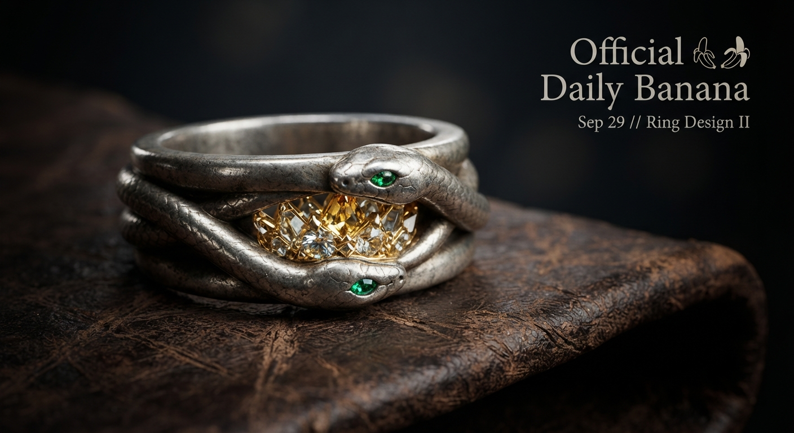
  
  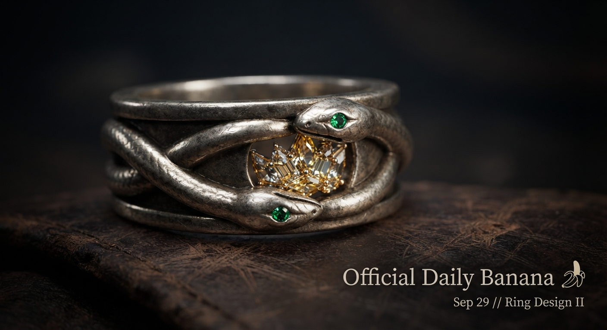
  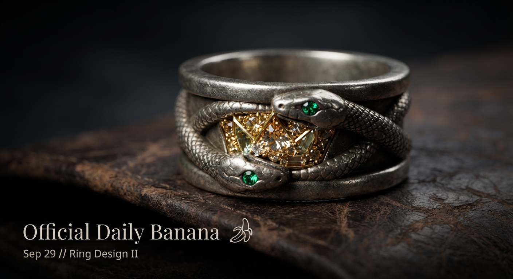

  

    <button type="button">Ring Design II</button>
    <button type="button" class="discuss-btn" onclick="openDiscussion('sep-29-26')">Comments</button>
  

  
<pre class="highlight"><code>
<strong>[NEGATIVE]</strong> magical glow, glowing aura, laser beams, floating, modern jewelry, simple band, smooth metal, cartoon, stylized, low quality

<strong>[MEDIUM]</strong> Extreme macro product photography, 100mm macro lens, Unreal Engine 5 render, 8k resolution, hyper-detailed. Shallow depth of field with the background softly blurred into bokeh to keep absolute focus on the intricate craftsmanship of the jewelry. Dramatic, highly directed studio lighting to catch the metallic highlights and the internal refraction of the jewels. <strong>[SETTING]</strong> Resting on a piece of dark, deeply weathered and scarred brown leather, symbolizing its long history carried by the Rangers of the North. The background is plunged into dark, moody shadow. <strong>[SUBJECT BASE]</strong> A masterfully crafted ancient elven ring acting as a robust, wide, heavy-gauge band of tarnished, antique silver. The robust band is composed of the thick bodies of two intertwined serpents wrapping around each other. The eyes of both serpents are set with brilliant, piercing green emeralds that catch the light. <strong>[EVENT MODIFIERS]</strong> The robust heads of the two twin serpents meet flush in the center of the ring's wide band. Recessed deeply between them is a breathtaking central gemstone complex acting as an abstract golden crown. This flush-set jewelry architecture holds a brilliant, intricate cluster of both faceted Imperial Topaz and translucent Golden Beryl, maintaining a consistent width across the ring so it does not protrude. The precise arrangement of these precious gems forms the abstract shape of a radiant golden crown within the metal. One serpent's head physically upholds the gemstone complex from below, while the other serpent's head strikes downward from above to devour it, both fully integrated into the smooth outer perimeter of the heavy band. The silver metal shows microscopic signs of ancient age and micro-scratches from thousands of years of history.
</code></pre>

  

</article>

<article class="post-entry" data-tags="character-design,middle-earth,concept-art,realistic,lotro">
<h2 id="sep-28-26" style="display: flex; flex-wrap: wrap; justify-content: flex-start; align-items: center; gap: 25px;">
<a href="#sep-28-26">Sep 28 // Accessories</a> 
<button onclick="switchAccessories(-1)" class="toggle-btn toggle-prev" style="position: static; border-right: 1px solid #777; border-top-right-radius: 0; border-bottom-right-radius: 0; margin-right: 0;" title="Previous Image">◀</button><button onclick="switchAccessories(1)" class="toggle-btn toggle-next" style="position: static; border-top-left-radius: 0; border-bottom-left-radius: 0; border-left: none; margin-left: 0;" title="Next Image">▶</button>

 

  character-design
  middle-earth
  concept-art
  realistic
  lotro

</h2>

  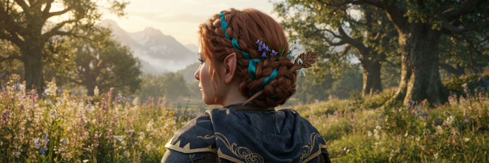
  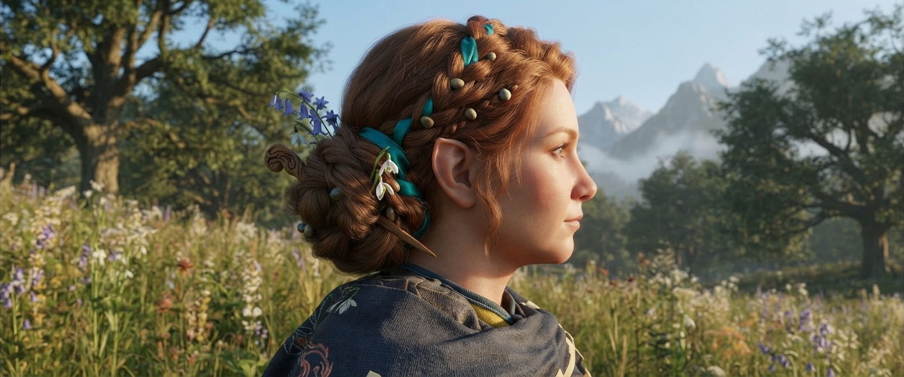
  
  

  

    <button type="button">Accessories</button>
    <button type="button" class="discuss-btn" onclick="openDiscussion('sep-28-26')">Comments</button>
  

  
<pre class="highlight"><code>
<strong>1. Without Hat</strong>

<strong>[NEGATIVE]</strong> stylized, cartoon, anime, low resolution, messy anatomy, hat, headwear, missing flowers, flat textures, hanging braids, loose braids, loose hair, long hair hanging down, human, human ears, rounded ears, tall stature, symmetrical bun, center bun, back bun, high bun, topknot <strong>[MEDIUM]</strong> Hyper-realistic fashion photography, Unreal Engine 5 render, 8k resolution, extreme detail. Shot in pure side-profile, perfectly framing the side of her head and neck to prominently showcase the heavy side-bun, with a medium depth of field. Soft, diffused golden-hour lighting highlighting the meticulous texture of the braided hair, the silk of the ribbon, the wood grain of the hair stick, and the petals of the flowers. <strong>[SETTING]</strong> The vibrant, sunlit meadows of the Vales of Anduin. In the beautifully composed background, tall wildflowers, ancient oak trees, and the distant, misty peaks of the Misty Mountains provide a majestic Middle-earth atmosphere while keeping the main focus on the character. <strong>[CHARACTERS BASE]</strong> Maereldin, a Middle-earth Hobbit adventurer. The first reference image dictates her hyper-realistic facial persona. She has subtly pointed hobbit ears peeking slightly through her hair. She is NOT wearing a hat. The second reference image provides a 360-degree guide for the raw geometric shapes of her detailed leather armor and heavy travel cloak; synthesize this into a cohesive, highly realistic outfit. <strong>[EVENT MODIFIERS]</strong> She is posed elegantly in pure profile. Her hair is aggressively asymmetrical: it is entirely swept over to one side of her head and bound into a massive, heavy braided side-bun that rests entirely on her shoulder and collarbone. The massive braided bun sits very low against the side of her neck, exactly matching the physical structure of the first reference image. There is NO bun on the back of her head; the hair is completely pulled to the side. Small, polished river-stone beads are beautifully threaded onto the peripheral braids that feed into the main bun. A vibrant teal silk ribbon is intricately woven directly into the strands of the braid. The entire bun is securely pinned in place by a carved oak-wood hair stick. Delicately tucked into the folds of the side-bun are small bluebell flowers and pale white-green Niphredil snowdrops.

<strong>2. With Hat</strong>

<strong>[NEGATIVE]</strong> stylized, cartoon, anime, low resolution, messy anatomy, missing flowers, flat textures, hanging braids, loose braids, loose hair, long hair hanging down, human, human ears, rounded ears, tall stature, symmetrical bun, center bun, back bun, high bun, topknot <strong>[MEDIUM]</strong> Hyper-realistic fashion photography, Unreal Engine 5 render, 8k resolution, extreme detail. Shot in pure side-profile, perfectly framing the side of her head and neck to prominently showcase the heavy side-bun, with a medium depth of field. Soft, diffused golden-hour lighting highlighting the meticulous texture of the braided hair, the silk of the ribbon, the wood grain of the hair stick, and the petals of the flowers. <strong>[SETTING]</strong> The vibrant, sunlit meadows of the Vales of Anduin. In the beautifully composed background, tall wildflowers, ancient oak trees, and the distant, misty peaks of the Misty Mountains provide a majestic Middle-earth atmosphere while keeping the main focus on the character. <strong>[CHARACTERS BASE]</strong> Maereldin, a Middle-earth Hobbit adventurer. The first reference image dictates her hyper-realistic facial persona. She has subtly pointed hobbit ears peeking slightly through her hair. She is wearing her signature wide-brimmed, pointed wizard-style travel hat (as seen perfectly in the first reference image). The second reference image provides a 360-degree guide for the raw geometric shapes of her detailed leather armor and heavy travel cloak; synthesize this into a cohesive, highly realistic outfit. <strong>[EVENT MODIFIERS]</strong> She is posed elegantly in pure profile. Her wide-brimmed travel hat sits comfortably on her head, while her hair is aggressively asymmetrical: it is entirely swept over to one side of her head and bound into a massive, heavy braided side-bun that rests entirely on her shoulder and collarbone, emerging elegantly from beneath the brim of the hat. The massive braided bun sits very low against the side of her neck, exactly matching the physical structure of the first reference image. There is NO bun on the back of her head; the hair is completely pulled to the side. Small, polished river-stone beads are beautifully threaded onto the peripheral braids that feed into the main bun. A vibrant teal silk ribbon is intricately woven directly into the strands of the braid. The entire bun is securely pinned in place by a carved oak-wood hair stick. Delicately tucked into the folds of the side-bun are small bluebell flowers and pale white-green Niphredil snowdrops.
</code></pre>

  

</article>

<article class="post-entry" data-tags="animals,prehistoric,dinosaurs,realistic,multi-step">
<h2 id="sep-27-26" style="display: flex; flex-wrap: wrap; justify-content: flex-start; align-items: center; gap: 25px;">
<a href="#sep-27-26">Sep 27 // Dinosaurs: Triceratops</a> 
<button onclick="switchTriceratops(-1)" class="toggle-btn toggle-prev" style="position: static; border-right: 1px solid #777; border-top-right-radius: 0; border-bottom-right-radius: 0; margin-right: 0;" title="Previous Image">◀</button><button onclick="switchTriceratops(1)" class="toggle-btn toggle-next" style="position: static; border-top-left-radius: 0; border-bottom-left-radius: 0; border-left: none; margin-left: 0;" title="Next Image">▶</button>

 

  animals
  prehistoric
  dinosaurs
  realistic
  multi-step

</h2>

  
  

  

    <button type="button">Dinosaurs: Triceratops</button>
    <button type="button" class="discuss-btn" onclick="openDiscussion('sep-27-26')">Comments</button>
  

  
<pre class="highlight"><code>
<strong>Triceratops (Sequential Image-to-Image Narrative)</strong>

<strong>[MEDIUM]</strong> A wide-angle landscape wildlife shot (24mm lens) capturing immense scale, utilizing a polarizing filter to deepen the sky and emphasize the swirling dust textures. <strong>[SETTING]</strong> A dense, lush Late Cretaceous North American coastal floodplain forest (Hell Creek ecosystem). The background is heavily packed with a towering, impenetrable wall of ancient timber, featuring massive Metasequoia (Dawn Redwoods), Ginkgo trees, and thick Araucaria conifers. The forest floor is lush and choked with thick Osmunda ferns and primitive ground-palmettos. In the blurred, out-of-focus background, a small flock of primitive, toothed Enantiornithine birds takes flight from the dense canopy. Lighting: Golden hour backlighting, casting long shadows and turning the dust kicked up from the forest floor into a glowing, fiery orange haze. <strong>[ANIMALS BASE]</strong> Triceratops. CRITICAL ANATOMY: Large, robust ceratopsian herbivore. Must have a massive, solid bone neck frill without large holes (fenestrae). Three distinct facial horns (two large above the eyes, one small on the nose). Quadrupedal, barrel-chested stance with a sharp, parrot-like beak. 

<strong>Scene 1: The Push (Base Image)</strong>

<strong>[NEGATIVE]</strong> stylized, cartoon, anime, low resolution, messy anatomy, inaccurate anatomy, human elements, modern artifacts, text, watermarks, combat, fighting, blood, predators, grass, charging, running, ramming <strong>[EVENT MODIFIERS]</strong> Using its immense mass to forage exactly like a modern elephant. It is leaning its massive, barrel-chested body and solid bone frill slowly and powerfully against a tough Cycad tree trunk, bending and pushing it over with sheer weight to reach the nutritious upper canopy leaves. It is completely stationary and pushing, not running or ramming. The slow, heavy movement kicks up a dramatic, beautifully lit cloud of dry dust. In the extreme, out-of-focus foreground, a tiny, rat-like primitive mammal (Alphadon) scurries frantically over the earth, startled by the massive shifting weight. The scene captures a tranquil, observational nature documentary moment.

<strong>Scene 2: The Prize (Image-to-Image Reference)</strong>

<strong>[NEGATIVE]</strong> stylized, cartoon, anime, low resolution, messy anatomy, inaccurate anatomy, human elements, modern artifacts, text, watermarks, combat, fighting, blood, predators, grass, charging, running, ramming, identical pose, same posture, frozen action, standing tall, pushing, identical location, birds, flock, flying animals, mammals, rats, Alphadon <strong>[PIPELINE RULE]</strong> Pass the image generated in Scene 1 back into the generator as a strict reference image to lock the lighting, shadows, and background timber exactly in place. <strong>[EVENT MODIFIERS]</strong> CRITICAL SPATIAL SHIFT AND POSTURE CHANGE: The Triceratops has taken three heavy paces forward from its position in the reference image. It is now physically located further to the right side of the frame. The massive Cycad tree has been successfully completely pushed over and now lies flat on the cracked earth. The Triceratops is standing directly over the felled trunk, having lowered its massive head all the way down to the ground. It is using its sharp, parrot-like beak to delicately snip and shear the highly nutritious leaves. The swirling dust has settled, creating a crystal-clear, tranquil foraging moment. CRITICAL ERASURE: The flock of birds has flown away and the sky is completely empty. The small foreground mammal has fled and the dirt is completely empty.

<strong>Appendix: Sequential Image-to-Image Narrative Pipeline (Gemini API)</strong> <a href="https://gist.github.com/lol-dungeonmaster/2a0adf76479895b45a8664ca7c0602e3" target="_blank" class="prompt-link">sequential_image_pipeline.py</a>
</code></pre>

  

</article>

<article class="post-entry" data-tags="design,middle-earth,concept-art,realistic">
<h2 id="sep-26-26" style="display: flex; flex-wrap: wrap; justify-content: flex-start; align-items: center; gap: 25px;">
<a href="#sep-26-26">Sep 26 // Tolkien Week IV</a> 
 

  design
  middle-earth
  concept-art
  realistic

</h2>

  

  

    <button type="button">Tolkien Week IV</button>
    <button type="button" class="discuss-btn" onclick="openDiscussion('sep-26-26')">Comments</button>
  

  
<pre class="highlight"><code>
<strong>[NEGATIVE]</strong> people, humans, characters, bright sunny day, cheerful, tropical, green grass, lush jungles, modern buildings, text, watermarks, signature, low quality, pixelated, continuous mountain range, rolling hills, soft hills, rounded peaks, CGI feel, oversaturated <strong>[MEDIUM]</strong> Wide-angle landscape photography. 8k resolution, Unreal Engine 5 architectural rendering style, hyper-realistic, deep depth of field. Dramatic National Geographic environmental portrait with extreme sense of immense scale. <strong>[SETTING]</strong> A sweeping, recovered natural landscape in the late Third Age. The immediate foreground is plunged into cold shadow, consisting of rugged foothills heavily blanketed by dark, ancient alpine pine forests. Nestled in the deep valley below is the rebuilt, thriving stone architecture of the city of Dale, featuring elegant towers, warm glowing windows, and a prominent, grand central bell tower rising above the slate roofs. The towering pine trees and the sprawling city architecture in the foreground provide an immediate, relatable anchor for immense scale. The atmosphere is deeply moody and freezing, dominated by deep indigo and cold slate-blue shadows. A thick, heavy collar of translucent, rolling morning mist hangs low in the valley, completely separating the foreground from the heights above and creating extreme atmospheric depth. <strong>[BASE]</strong> Rising abruptly from the mist and the pine-forested valley is a colossal, solitary monolithic peak (Erebor, The Lonely Mountain), completely disconnected from any other mountain ranges. The mountain features sharp, chiseled architectural geometry, characterized by a towering central snow-capped crown-peak and six massive, sheer-walled rocky ridges that sweep outward into the plains like the points of a gigantic star. Silhouetted on the end of the lower southwestern ridge stands an ancient, fortified dwarven stone watchtower (Ravenhill). Far below, nestled in a deep gorge between the two massive southern ridges, a rushing, crystal-clear river cascades down a steep waterfall directly out of a heavily fortified dwarven gateway (The Front Gate). A massive, master-crafted dwarven stone highway (The Great Paved Road) winds its way up the valley alongside the river, culminating in a grand, sweeping stone ramp that ascends the cliffside to reach the towering stone bulwarks and newly-forged iron doors of the fully restored stronghold. <strong>[EVENT MODIFIERS]</strong> The rare, fleeting astronomical phenomenon of late autumn alpenglow (Durin's Day). A single, piercing ray of extreme directional sunset lighting breaks through the atmospheric gloom to strike only the sheer, high western rock face of the mountain. The blazing golden-orange sunlight hits the peak, creating a fiery rim-light that perfectly contrasts against the freezing indigo sky. The sunlit rock glows with a hyper-realistic, metallic golden-amber warmth, echoing the hidden dwarven wealth inside, while the rest of the mountain and the world below remains plunged in cold, dark shadow. High in the freezing air, a massive flock of intelligent black ravens circles the lower ridges of the mountain.
</code></pre>

  

</article>

<article class="post-entry" data-tags="design,middle-earth,concept-art,realistic">
<h2 id="sep-25-26" style="display: flex; flex-wrap: wrap; justify-content: flex-start; align-items: center; gap: 25px;">
<a href="#sep-25-26">Sep 25 // Tolkien Week III</a> 
<button onclick="switchForochel(-1)" class="toggle-btn toggle-prev" style="position: static; border-right: 1px solid #777; border-top-right-radius: 0; border-bottom-right-radius: 0; margin-right: 0;" title="Previous Image">◀</button><button onclick="switchForochel(1)" class="toggle-btn toggle-next" style="position: static; border-top-left-radius: 0; border-bottom-left-radius: 0; border-left: none; margin-left: 0;" title="Next Image">▶</button>

 

  design
  middle-earth
  concept-art
  realistic

</h2>

  
  

  

    <button type="button">Tolkien Week III</button>
    <button type="button" class="discuss-btn" onclick="openDiscussion('sep-25-26')">Comments</button>
  

  
<pre class="highlight"><code>
<strong>The Fall of Arnor T.A. 1974</strong>

<strong>[NEGATIVE]</strong> people, humans, characters, crew, modern sailboat, modern rigging, bright sunny day, tropical, warm weather, cheerful, text, watermarks, signature, low quality, pixelated, deformed ice, warped reflections, bright blue sky, trees, pine trees, forests, foliage, vegetation, animals, birds, plastic texture, CGI feel, oversaturated, painted faces, literal animal heads, bird beaks, black masks, galleon, square stern, blocky hull, pirate ship, cannons, open sails, unfurled sails, billowing sails, dropped canvas, sails catching wind, docked at a pier, stacked sails, tiered rigging, complex square rigging, multi-tiered yardarms, cluttered masts <strong>[MEDIUM]</strong> Wide-angle landscape photography. 8k resolution, Unreal Engine 5 architectural rendering style, hyper-realistic, deep depth of field. Dramatic National Geographic environmental portrait with extreme sense of immense scale. <strong>[SETTING]</strong> A treacherous, frozen arctic bay. The bay is choked with jagged, sharp fragments of shattered pack-ice floating in dark, mirror-glassy water. Thick, freezing frost-fog rolls off the surface. The ice structures are hostile, sharp, and unforgiving, dominated by oppressive, freezing cyan and deep sapphire blues. On the expansive frozen shoreline sits a sprawling, established Lossoth survival village. The settlement features a hierarchical layout of rugged huts constructed from massive overlapping animal bones and thick, weathered hides, half-buried in deep snowdrifts. A massive central Chieftain's lodge sits in the middle, surrounded by communal gathering areas and large fire pits casting a flickering warm glow across the sprawling network of hide-tents. <strong>[BASE]</strong> A colossal, majestic, multi-masted Elven wooden deep-sea sailing ship safely moored out in the deeper, freezing waters of the bay, far from the shallow ice edge. The ship features an organic, sweeping crescent-moon profile, completely devoid of blocky architecture. Built entirely from ancient, pale ash wood. The continuous lateral planks of the hull itself warp and flare outward, sweeping backward to carve deeply fluted, overlapping horizontal ridges into the sides of the ship. These layered structural tiers give the entire hull a sweeping, aerodynamic silhouette, achieved purely through continuous, load-bearing nautical carpentry. The towering wooden prow sweeps upward into a highly stylized, abstract curving crest, maintaining the raw pale wood texture. Tall, pale wooden bare masts, each featuring a single, massive yardarm with its shimmering, silken white Elven sail completely rolled up and lashed tightly against the cold. The ship's rigging is strung with elegant, gleaming silver-grey hithlain rope, remaining unnaturally pristine. Down on the ice near the sprawling village, a small, elegant pale-wood Elven rowboat is pulled up onto the jagged frozen shoreline. <strong>[EVENT MODIFIERS]</strong> A deceptive, eerie calm before a supernatural blizzard. Cinematic, moody, foreboding tension radiating a sense of ancient malice in the air. Overhead, the skybox is ethereal and heavy; bruised, violent storm clouds are dramatically backlit by a hidden sun, creating glowing, translucent patches of luminescent amber light that bleed softly through the cloud layers. A single, piercing crack of this fiery golden light breaks through on the far horizon, casting a tragic, volumetric warm glow and blazing golden-amber rim-light directly onto the pale wood of the swan-ship and the sprawling village, reflecting perfectly on the dark glassy water.
</code></pre>

  

</article>

<article class="post-entry" data-tags="character-design,middle-earth,concept-art,realistic,lotro">
<h2 id="sep-24-26" style="display: flex; flex-wrap: wrap; justify-content: flex-start; align-items: center; gap: 25px;">
<a href="#sep-24-26">Sep 24 // Tolkien Week II</a> 
<button onclick="switchTolkienUnreal(-1)" class="toggle-btn toggle-prev" style="position: static; border-right: 1px solid #777; border-top-right-radius: 0; border-bottom-right-radius: 0; margin-right: 0;" title="Previous Image">◀</button><button onclick="switchTolkienUnreal(1)" class="toggle-btn toggle-next" style="position: static; border-top-left-radius: 0; border-bottom-left-radius: 0; border-left: none; margin-left: 0;" title="Next Image">▶</button>

 

  character-design
  middle-earth
  concept-art
  realistic
  lotro

</h2>

  
  
  

  

    <button type="button">Tolkien Week II</button>
    <button type="button" class="discuss-btn" onclick="openDiscussion('sep-24-26')">Comments</button>
  

  
<pre class="highlight"><code>
<strong>The Campsite (Unreal Engine 5)</strong>

<strong>[NEGATIVE]</strong> oil painting, brush strokes, impasto, illustration, drawing, 2D, flat shading, cheap CGI, low poly, plastic, overly bright daylight, cartoon, anime, generic character, missing animals, multiple rivers, braided streams, delta, wearing hat, hat on head <strong>[MEDIUM]</strong> A hyper-realistic, stunning cinematic render straight out of a cutting-edge Unreal Engine 5 tech demo. The scene is dominated by breathtakingly detailed, lifelike textures, from individual blades of grass to the worn, micro-textured leather of traveling gear. It utilizes state-of-the-art path tracing, volumetric lighting, photorealistic subsurface scattering on skin, cinematic depth of field, and stark, dramatic chiaroscuro lighting. <strong>[SETTING]</strong> A secluded clearing deep within the ancient, dark pine forest of North Mirkwood during the 3rd Age. The forest floor is lush with highly detailed, dewy ferns and tall grass dotted with the soft, photorealistic glowing yellow specks of floating fireflies casting tiny volumetric point lights. Beyond the edges of the clearing, towering, highly detailed pine trees loom as imposing, stark silhouettes against the night sky. Through a break in the heavy canopy, the sprawling, snow-capped peaks of the Misty Mountains dominate the distant skyline, their massive forms fading into dark, moody atmospheric fog under a bright, glowing crescent moon. <strong>[CHARACTERS BASE]</strong> Character_MA: A hobbit loremaster with subtly pointed ears, wearing an authentic layered leather tunic and a flowing traveling cloak, but she is NOT wearing her hat. Her exact outfit design, armor geometry, and bodily proportions must strictly match the "campsite_master_reference.png" guide. Her braided side-bun hairstyle must precisely match the hairstyle shown in the "campsite_master_reference.png" sheet. Companions: A massive brown bear, a sleek tundra lynx, and several ravens. <strong>[EVENT MODIFIERS]</strong> The scene captures a peaceful respite at a small, flickering campsite. A highly detailed iron cooking pot hangs over the crackling campfire, emitting soft wisps of volumetric smoke. The massive bear, lynx, and several ravens rest peacefully in the tall grass, their fur and feathers rendered with stunning, individual strand realism. Character_MA is resting comfortably, leaning her back against a large rock near the fire, holding a long wooden churchwarden pipe in one hand. She is not wearing her large wizard's hat; it rests on a nearby highly textured wooden log within arms reach, with her loremaster's staff (anchored by the "campsite_master_reference.png" image) propped against the rock she is leaning on. The group is bathed in warm, dynamic firelight, illuminating the lifelike pores of her face, the micro-textures of her authentic leather armor, and her braided side-bun hairstyle in stunning 8k resolution. Beyond the glow of the campfire, the surrounding dark pine trees and distant mountains drop off into stark cinematic shadows, forming deep, imposing black silhouettes against the cool night sky.
</code></pre>

  

</article>

<article class="post-entry" data-tags="character-design,middle-earth,concept-art,van-gogh,lotro">
<h2 id="sep-23-26" style="display: flex; flex-wrap: wrap; justify-content: flex-start; align-items: center; gap: 25px;">
<a href="#sep-23-26">Sep 23 // Tolkien Week</a> 
<button onclick="switchTolkien(-1)" class="toggle-btn toggle-prev" style="position: static; border-right: 1px solid #777; border-top-right-radius: 0; border-bottom-right-radius: 0; margin-right: 0;" title="Previous Image">◀</button><button onclick="switchTolkien(1)" class="toggle-btn toggle-next" style="position: static; border-top-left-radius: 0; border-bottom-left-radius: 0; border-left: none; margin-left: 0;" title="Next Image">▶</button>

 

  character-design
  middle-earth
  concept-art
  van-gogh
  lotro

</h2>

  
  
  
  

  

    <button type="button">Tolkien Week</button>
    <button type="button" class="discuss-btn" onclick="openDiscussion('sep-23-26')">Comments</button>
  

  
<pre class="highlight"><code>
<strong>1. The Flight (Van Gogh Post-Impressionist)</strong>

<strong>[NEGATIVE]</strong> Psychedelic, neon, flat shading, smooth digital render, 3D CGI, photography, untextured, overly bright daylight, cartoon, anime, generic character, missing animals, front view, facing camera, detailed face, multiple rivers, braided streams, delta <strong>[MEDIUM]</strong> A true post-impressionist masterpiece. The entire canvas is dominated by extremely thick, physical impasto texture applied with a palette knife. Every single element, the sky, the tall grass, the distant trees, and the characters, is built from heavy, sculptural strokes of wet oil paint. Directly inspired by the "van-gogh-sample.webp" reference, it uses optical color mixing, warm earth underpainting peeking through cool midnight blues, and stark chiaroscuro. <strong>[SETTING]</strong> A sweeping, panoramic vista of the 3rd Age Vales of Anduin near North Mirkwood. Wide rolling plains of tall wild grass leading to the singular, mighty winding river Anduin flanked by ancient stony outcroppings, stretching endlessly across the wide canvas, all rendered with aggressive tactile paint strokes. The background perfectly replicates the design of "van-gogh-sample.webp": a stark, imposing silhouette of a dark pine forest line representing the eaves of Mirkwood cutting aggressively across the wide horizon. A majestic, sprawling mountain range representing the Misty Mountains dominates the distant skyline, fading into misty atmospheric sfumato. <strong>[CHARACTERS BASE]</strong> Character_MA: A hobbit loremaster with subtly pointed ears, wearing an authentic layered leather tunic, a large wizard's hat, and a flowing traveling cloak. Her exact outfit design, armor geometry, and bodily proportions must strictly match the "Character_MA_master_reference_v2.png" guide. Companions: A massive brown bear, a sleek tundra lynx, and several ravens. <strong>[EVENT MODIFIERS]</strong> Crucially, exactly like the "van-gogh-sample.webp" reference, the camera is positioned behind the group as they run urgently away from the viewer toward the distant Mirkwood tree line. They are rendered as stark, dark, artistic silhouettes. While her armor geometry, large wizard's hat, and flowing cloak are recognizable by their distinct silhouetted shapes, all fine details are consumed by the heavy impasto shadows, perfectly preserving the moody, textured, and isolated atmosphere of the sample.

<strong>2. The Campsite (Van Gogh Post-Impressionist)</strong>

<strong>[NEGATIVE]</strong> Psychedelic, neon, flat shading, smooth digital render, 3D CGI, photography, untextured, overly bright daylight, cartoon, anime, generic character, missing animals, multiple rivers, braided streams, delta, wearing hat, hat on head <strong>[MEDIUM]</strong> A true post-impressionist masterpiece. The entire canvas is dominated by extremely thick, physical impasto texture applied with a palette knife. Every single element, the sky, the tall grass, the distant trees, and the characters, is built from heavy, sculptural strokes of wet oil paint. Directly inspired by the "van-gogh-sample.webp" reference, it uses optical color mixing, warm earth underpainting peeking through cool midnight blues, and stark chiaroscuro. <strong>[SETTING]</strong> A secluded clearing deep within the ancient, dark pine forest of North Mirkwood during the 3rd Age. The forest floor is dotted with the soft, glowing yellow specks of floating fireflies. Beyond the edges of the clearing, tall, twisting pine trees loom as imposing, stark black silhouettes that cut aggressively into the night sky. Through a break in the heavy canopy, the sprawling peaks of the Misty Mountains dominate the distant skyline, their massive forms fading into dark, moody atmospheric shadows under a bright, glowing crescent moon. <strong>[CHARACTERS BASE]</strong> Character_MA: A hobbit loremaster with subtly pointed ears, wearing an authentic layered leather tunic and a flowing traveling cloak, but she is NOT wearing her hat. Her exact outfit design, armor geometry, and bodily proportions must strictly match the "campsite_master_reference.png" guide. Her braided side-bun hairstyle must precisely match the hairstyle shown in the "campsite_master_reference.png" sheet. Companions: A massive brown bear, a sleek tundra lynx, and several ravens. <strong>[EVENT MODIFIERS]</strong> The scene captures a peaceful respite at a small, flickering campsite. A small iron cooking pot hangs over the crackling campfire. The massive bear, lynx, and several ravens rest peacefully in the tall grass. Character_MA is resting comfortably, leaning her back against a large rock near the fire, holding a long wooden churchwarden pipe in one hand. She is not wearing her large wizard's hat; it rests on a nearby log within arms reach, with her loremaster's staff (anchored by the "campsite_master_reference.png" image) propped against the rock she is leaning on. The group is bathed in warm, inviting firelight, illuminating her face, authentic leather armor details, and braided side-bun hairstyle in thick impasto strokes. Beyond the glow of the campfire, the surrounding dark pine trees and distant mountains loom as deep, moody silhouettes against the cool night sky.
</code></pre>

  

</article>

<article class="post-entry" data-tags="animals,contemporary,realistic,journalistic">
<h2 id="sep-22-26" style="display: flex; flex-wrap: wrap; justify-content: flex-start; align-items: center; gap: 25px;">
<a href="#sep-22-26">Sep 22 // World Rhino Day</a> 
 

  animals
  contemporary
  realistic
  journalistic

</h2>

  

  

    <button type="button">World Rhino Day</button>
    <button type="button" class="discuss-btn" onclick="openDiscussion('sep-22-26')">Comments</button>
  

  
<pre class="highlight"><code>
<strong>1. Cinematic</strong>

<strong>[NEGATIVE]</strong> African rhino, Indian rhino, Javan rhino, generic grey skin, hairless, single horn, savanna, plains, dry landscape, overexposed, stylized, cartoon, low resolution, messy anatomy, inaccurate anatomy, human elements, modern artifacts. <strong>[MEDIUM]</strong> Hyper-realistic, cinematic wildlife documentary wide shot. 8k resolution, shot on an anamorphic lens creating a deep depth of field with high contrast and an epic, highly polished movie-still aesthetic. <strong>[SETTING]</strong> A deep mud wallow in a lush Indonesian rainforest. Surround the scene with oversized tropical ferns, wet mossy logs, and vibrant wild orchids. In the out-of-focus background, a Rhinoceros Hornbill is captured in mid-flight. Lighting: Dramatic shafts of golden sunlight piercing through a dense canopy of ancient dipterocarp trees. <strong>[ANIMALS BASE]</strong> Sumatran Rhino (Dicerorhinus sumatrensis). CRITICAL ANATOMY: The smallest of the rhino species, compact and stocky build. Covered in a distinct layer of coarse, reddish-brown hair. Two dark horns on its snout (a larger front horn and a smaller back horn). Deep skin folds. Prehensile upper lip. <strong>[EVENT MODIFIERS]</strong> Powerfully emerging from the mud wallow. The thick mud glistens brightly against its hairy skin under the shafts of light. The scene captures a dramatic, observational nature documentary moment.

<strong>2. Ethereal</strong>

<strong>[NEGATIVE]</strong> African rhino, Indian rhino, Javan rhino, generic grey skin, hairless, single horn, bright sunlight, harsh contrast, sharp shadows, stylized, cartoon, anime, low resolution, messy anatomy, inaccurate anatomy, human elements, modern artifacts. <strong>[MEDIUM]</strong> Ethereal fine-art nature photography. Shot with a prime lens wide open for extremely soft bokeh, high detail but with a soft focus background, yielding a peaceful, fragile, and dreamlike aesthetic. <strong>[SETTING]</strong> A misty, ancient Indonesian rainforest at dawn. The atmosphere is filled with a soft, iridescent fog and floating pollen. Surrounded by translucent, dew-covered ferns and delicate white orchids. Lighting: Soft, diffused morning light creating a dreamlike glow. <strong>[ANIMALS BASE]</strong> Sumatran Rhino (Dicerorhinus sumatrensis). CRITICAL ANATOMY: The smallest of the rhino species, compact and stocky build. Covered in a distinct layer of coarse, reddish-brown hair. Two dark horns on its snout (a larger front horn and a smaller back horn). Deep skin folds. Prehensile upper lip. <strong>[EVENT MODIFIERS]</strong> Standing completely still and serene in the fog. A few bright, tropical butterflies hover gently near its two horns. The lighting casts a delicate rim light on its hairy silhouette. The scene captures a tranquil, quiet, and magical nature documentary moment.

<strong>3. Journalistic</strong>

<strong>[NEGATIVE]</strong> African rhino, Indian rhino, Javan rhino, generic grey skin, hairless, single horn, studio lighting, over-edited, highly saturated, artificial light, stylized, cartoon, low resolution, messy anatomy, inaccurate anatomy, human elements, camera gear. <strong>[MEDIUM]</strong> Raw, journalistic wildlife photography. Shot handheld with a 400mm telephoto lens from a concealed hide. Features authentic film grain, candid composition, sharp focus on the eye, and a slightly gritty, unpolished National Geographic documentary feel. <strong>[SETTING]</strong> A dense jungle clearing in Sumatra. A natural, unstyled background of thick canopy, authentic jungle debris, damp earth, and fallen leaves. In the distant undergrowth, a small Sunda pangolin is partially visible. Lighting: Natural, flat daylight filtered heavily through the thick canopy, providing raw, realistic textures. <strong>[ANIMALS BASE]</strong> Sumatran Rhino (Dicerorhinus sumatrensis). CRITICAL ANATOMY: The smallest of the rhino species, compact and stocky build. Covered in a distinct layer of coarse, reddish-brown hair. Two dark horns on its snout (a larger front horn and a smaller back horn). Deep skin folds. Prehensile upper lip. <strong>[EVENT MODIFIERS]</strong> Caught in a candid, mid-action moment of browsing on young green shoots. The coarse, bristly nature of its reddish-brown fur and the mud on its two horns are visible in hyper-realistic texture. The scene captures a raw, observational nature documentary moment.
</code></pre>

  

</article>

<article class="post-entry" data-tags="animals,prehistoric,dinosaurs,realistic,ethereal">
<h2 id="sep-21-26" style="display: flex; flex-wrap: wrap; justify-content: flex-start; align-items: center; gap: 25px;">
<a href="#sep-21-26">Sep 21 // Dinosaurs: Microraptor</a> 
<button onclick="switchMicroraptor(-1)" class="toggle-btn toggle-prev" style="position: static; border-right: 1px solid #777; border-top-right-radius: 0; border-bottom-right-radius: 0; margin-right: 0;" title="Previous Image">◀</button><button onclick="switchMicroraptor(1)" class="toggle-btn toggle-next" style="position: static; border-top-left-radius: 0; border-bottom-left-radius: 0; border-left: none; margin-left: 0;" title="Next Image">▶</button>

 

  animals
  prehistoric
  dinosaurs
  realistic
  ethereal

</h2>

  
  

  

    <button type="button">Dinosaurs: Microraptor</button>
    <button type="button" class="discuss-btn" onclick="openDiscussion('sep-21-26')">Comments</button>
  

  
<pre class="highlight"><code>
<strong>Variant A (Canopy Hunter)</strong>

<strong>[NEGATIVE]</strong> stylized, cartoon, anime, 3d render, illustration, modern artifacts, text, watermarks, six wings, extra wings, four arms, extra limbs, mutated anatomy, crow beak <strong>[MEDIUM]</strong> Ethereal fine-art wildlife photography. Shot with a prime lens wide open for extremely soft bokeh, yielding a dreamy, muted background palette that makes the intensely iridescent black feathers pop. Highly realistic textures. <strong>[SETTING]</strong> A lush, temperate Early Cretaceous Chinese forest canopy (Jehol Biota). The environment is packed with the thick, textured branches of ancient Ginkgo trees and primitive needle-leaf conifers. A fine, gritty dusting of pale volcanic ash coats some of the upper leaves. Lighting: Bright, direct, dappled midday sunlight piercing the canopy, specifically angled to catch and intensely highlight the striking metallic iridescence (blues and purples) hiding within the dinosaur's glossy black feathers. <strong>[ANIMALS BASE]</strong> Microraptor. CRITICAL ANATOMY: A small, 35-inch (90 cm) long dinosaur. It MUST have exactly two feathered arms and exactly two feathered hind legs. It possesses long, stiff flight feathers on its front arms (like a standard bird) AND long, stiff flight feathers covering its hind legs (forming a unique lower set of wings). The entire body is covered in highly glossy, iridescent black plumage that flashes metallic blues and purples in the light. It has a long, stiff, bony tail ending in a diamond-shaped fan of feathers. Small, narrow snout filled with tiny sharp teeth. <strong>[EVENT MODIFIERS]</strong> Caught in mid-leap, launching dynamically from a thick, mossy Ginkgo branch. Both its front wings and feathered hind legs are splayed wide to catch the air as it glides gracefully through the sunlit canopy, sharply focused on hunting a small, mouse-sized primitive mammal scurrying along the bark. In the blurred background, a flock of primitive Confuciusornis birds (featuring toothless beaks and long, ribbon-like tail feathers) are scattering in chaotic flight, startled by the sudden ambush.

<strong>Variant B (Lake Fisher)</strong>

<strong>[NEGATIVE]</strong> stylized, cartoon, anime, 3d render, illustration, modern artifacts, text, watermarks, six wings, extra wings, four arms, extra limbs, mutated anatomy, crow beak <strong>[MEDIUM]</strong> Ethereal fine-art wildlife photography. Shot with a prime lens wide open for extremely soft bokeh, yielding a dreamy, muted background palette of soft lake-blues and morning mist. Highly realistic textures. <strong>[SETTING]</strong> A tranquil, mist-layered freshwater prehistoric lake bordered by a dense, temperate forest of towering conifers. In the shallows, clusters of Archaefructus (some of Earth's earliest primitive flowering plants) reach above the waterline. In the far distance, a massive, jagged volcano silently vents a plume of gray smoke into the sky. Lighting: Golden hour, low-angled morning sunlight reflecting brilliantly off the water's surface, perfectly illuminating the dinosaur's iridescent plumage against the dark background. <strong>[ANIMALS BASE]</strong> Microraptor. CRITICAL ANATOMY: A small, 35-inch (90 cm) long dinosaur. It MUST have exactly two feathered arms and exactly two feathered hind legs. It possesses long, stiff flight feathers on its front arms (like a standard bird) AND long, stiff flight feathers covering its hind legs (forming a unique lower set of wings). The entire body is covered in highly glossy, iridescent black plumage that flashes metallic blues and purples in the light. It has a long, stiff, bony tail ending in a diamond-shaped fan of feathers. Small, narrow snout filled with tiny sharp teeth. <strong>[EVENT MODIFIERS]</strong> Skimming just inches above the glassy lake surface. Both its front wings and feathered hind legs are fully extended in a controlled glide. Its clawed feet are reaching down to snatch a small, silver teleost fish swimming just below the surface, creating a delicate, crystal-clear splash of water. In the extreme, out-of-focus foreground, a prehistoric frog (Liaobatrachus) sits motionless on a piece of floating driftwood, watching the hunt unfold.
</code></pre>

  

</article>

<article class="post-entry" data-tags="literature,fantasy,realistic,horror">
<h2 id="sep-20-26" style="display: flex; flex-wrap: wrap; justify-content: flex-start; align-items: center; gap: 25px;">
<a href="#sep-20-26">Sep 20 // Scenes from Literature V</a> 
<button onclick="switchNestMoment(-1)" class="toggle-btn toggle-prev" style="position: static; border-right: 1px solid #777; border-top-right-radius: 0; border-bottom-right-radius: 0; margin-right: 0;" title="Previous Image">◀</button><button onclick="switchNestMoment(1)" class="toggle-btn toggle-next" style="position: static; border-top-left-radius: 0; border-bottom-left-radius: 0; border-left: none; margin-left: 0;" title="Next Image">▶</button>

 

  literature
  fantasy
  realistic
  horror

</h2>

  
  

  

    <button type="button">Scenes from Literature V</button>
    <button type="button" class="discuss-btn" onclick="openDiscussion('sep-20-26')">Comments</button>
  

  
<pre class="highlight"><code>
<strong>1. Cinematic</strong>

<strong>[NEGATIVE]</strong> stylized, cartoon, anime, 3d render, illustration, modern artifacts, text, watermarks, beautiful woman, elegant features, clean, bright, generic fantasy tropes, healthy skin <strong>[MEDIUM]</strong> Cinematic dark fantasy still. Shot on an anamorphic 35mm lens, shallow depth of field, dramatic and highly realistic movie-still quality. <strong>[SETTING]</strong> The back of a rustic, wooden ox-drawn wagon traveling through a dense forest. Inside the wagon is a makeshift bed made of layered, worn quilts, squeezed tightly between the wooden edge of the wagon and a heavy wooden crate filled with yellowing books. Lighting: Moody, natural daylight filtering softly through the forest canopy above. <strong>[CHARACTERS BASE]</strong> Two characters. LEFT: Homily, a sturdy, broad-faced human woman with thick, curly brown hair, warm chocolate-brown eyes, and thick thighs, wearing practical, worn hunter clothing. RIGHT: Shesheshen, a terrifyingly withered, boneless humanoid frame resting in the quilts, wearing a noticeably tattered wig. She is completely hidden inside an enormous, threadbare gray dress that is heavily patched with rough red squares. The sleeves are wrapped twice around her arms to hide her boneless hands. <strong>[EVENT MODIFIERS]</strong> Homily is leaning over the crate of books with a kind smile, offering to trade a comically massive, pointed witch's hat with a brim so wide it could shade an entire torso. Shesheshen, looking frail and otherworldly, is reaching up from her nest of quilts, her sleeve-wrapped hands offering a blanket in trade. The massive brim of the hat dominates the space between them. Heartwarming yet gritty dark fantasy realism.

<strong>2. Ethereal</strong>

<strong>[NEGATIVE]</strong> stylized, cartoon, anime, 3d render, illustration, modern artifacts, text, watermarks, beautiful woman, elegant features, clean, bright, generic fantasy tropes, healthy skin <strong>[MEDIUM]</strong> Ethereal fine-art dark fantasy photography. Shot with a prime lens wide open for extremely soft bokeh, yielding a dreamy, muted color palette of soft greys, faded quilt colors, and earthy browns. Highly realistic textures. <strong>[SETTING]</strong> The cluttered back of a wooden ox-drawn wagon. A cozy but gritty makeshift bed of layered quilts rests beside a heavy crate of yellowing, ancient books. Lighting: Soft, diffused twilight creating a serene, hushed atmosphere inside the wagon. <strong>[CHARACTERS BASE]</strong> Two characters. LEFT: Homily, a sturdy, broad-faced human woman with thick, curly brown hair, warm chocolate-brown eyes, and thick thighs, wearing practical hunter clothing. RIGHT: Shesheshen, a terrifyingly withered, boneless humanoid frame resting in the quilts, wearing a noticeably tattered wig. She is swallowed by an enormous, threadbare gray dress heavily patched with rough red squares, its long sleeves wrapped twice around her arms. <strong>[EVENT MODIFIERS]</strong> In the quiet light, Homily gently leans over the crate of books, warmly extending a comically large, threadbare pointed witch's hat with an incredibly wide brim. Shesheshen reaches up from her quilt bed with sleeve-wrapped limbs, offering a blanket in trade. The hat casts a protective, shadowy silhouette between them. A quiet, profoundly tender moment amidst a haunting atmosphere.
</code></pre>

  

</article>

<article class="post-entry" data-tags="animals,contemporary,realistic,cinematic,ethereal,journalistic">
<h2 id="sep-19-26" style="display: flex; flex-wrap: wrap; justify-content: flex-start; align-items: center; gap: 25px;">
<a href="#sep-19-26">Sep 19 // Intl. Red Panda Day</a> 
<button onclick="switchPanda(-1)" class="toggle-btn toggle-prev" style="position: static; border-right: 1px solid #777; border-top-right-radius: 0; border-bottom-right-radius: 0; margin-right: 0;" title="Previous Image">◀</button><button onclick="switchPanda(1)" class="toggle-btn toggle-next" style="position: static; border-top-left-radius: 0; border-bottom-left-radius: 0; border-left: none; margin-left: 0;" title="Next Image">▶</button>

 

  animals
  contemporary
  realistic
  cinematic
  ethereal
  journalistic

</h2>

  
  
  

  

    <button type="button">Intl. Red Panda Day</button>
    <button type="button" class="discuss-btn" onclick="openDiscussion('sep-19-26')">Comments</button>
  

  
<pre class="highlight"><code>
<strong>1. Cinematic</strong>

<strong>[NEGATIVE]</strong> giant panda, black and white markings, raccoon mask, fox, light colored belly, white belly, stylized, cartoon, anime, low resolution, messy anatomy, inaccurate anatomy, human elements, modern artifacts <strong>[MEDIUM]</strong> Cinematic wildlife documentary wide shot. Shot on an anamorphic 35mm lens, creating a deep depth of field with a beautifully blurred background of jagged Himalayan peaks and a dramatic, highly polished movie-still aesthetic. <strong>[SETTING]</strong> High in the Singalila Ridge, perched on a thick, moss-covered branch of an ancient Himalayan rhododendron tree. Lighting: Dramatic golden hour backlighting, with warm orange sunlight piercing the canopy, catching the animal's fur and creating a sharp, glowing rim-light effect against a soft orange sky. <strong>[ANIMALS BASE]</strong> Red Panda (Ailurus fulgens). CRITICAL ANATOMY: Cat-sized arboreal mammal. Vibrant reddish-brown (russet) fur on its back, with distinctly dark, blackish fur on its belly and legs. Face features white badges and tear-markings. Large pointed ears with white edges. Long, extremely bushy tail with alternating red and pale buff rings. <strong>[EVENT MODIFIERS]</strong> Perched powerfully yet gracefully on the branch, gazing out across the ridge. The scene captures a tranquil, observational nature documentary moment.

<strong>2. Ethereal</strong>

<strong>[NEGATIVE]</strong> giant panda, black and white markings, raccoon mask, fox, light colored belly, white belly, stylized, cartoon, anime, low resolution, messy anatomy, inaccurate anatomy, human elements, modern artifacts <strong>[MEDIUM]</strong> Ethereal fine-art nature photography. Shot with a prime lens wide open for extremely soft bokeh, yielding a dreamy, muted color palette of soft greens, silvery greys, and vibrant russet orange. <strong>[SETTING]</strong> A misty, high-altitude Bhutanese cloud forest. Thick, gnarled limbs are draped heavily in hanging Old Man's Beard lichen (Usnea) above a dense bamboo understory. Lighting: Soft, diffused morning light filtering through the ancient canopy, creating distinct, shimmering god-rays (Tyndall effect) through the heavy, clinging fog. <strong>[ANIMALS BASE]</strong> Red Panda (Ailurus fulgens). CRITICAL ANATOMY: Cat-sized arboreal mammal. Vibrant reddish-brown (russet) fur on its back, with distinctly dark, blackish fur on its belly and legs. Face features white badges and tear-markings. Large pointed ears with white edges. Long, extremely bushy tail with alternating red and pale buff rings. <strong>[EVENT MODIFIERS]</strong> Curled up peacefully and asleep on a thick, lichen-covered limb. Its massive, bushy ringed tail is wrapped tightly around its face and body for warmth. The scene captures a tranquil, serene, and quiet nature documentary moment.

<strong>3. Journalistic</strong>

<strong>[NEGATIVE]</strong> giant panda, black and white markings, raccoon mask, fox, light colored belly, white belly, stylized, cartoon, anime, low resolution, messy anatomy, inaccurate anatomy, human elements, modern artifacts <strong>[MEDIUM]</strong> Raw, journalistic wildlife photography. Shot handheld with a 400mm telephoto lens at f/4 from a concealed hide. Features authentic film grain, high contrast, and a slightly gritty, unpolished documentary feel. <strong>[SETTING]</strong> The rugged, steep terrain of the Langtang Valley. A natural, unstyled background of dense Himalayan bamboo (Thamnocalamus) and wet, grey mountain granite. Lighting: Natural, flat overcast lighting providing raw, realistic textures with no artificial enhancement. <strong>[ANIMALS BASE]</strong> Red Panda (Ailurus fulgens). CRITICAL ANATOMY: Cat-sized arboreal mammal. Vibrant reddish-brown (russet) fur on its back, with distinctly dark, blackish fur on its belly and legs. Face features white badges and tear-markings. Large pointed ears with white edges. Long, extremely bushy tail with alternating red and pale buff rings. Fur is thick and highly textured. <strong>[EVENT MODIFIERS]</strong> Caught in a candid, mid-action moment of foraging in a light drizzle. It is actively grasping a fresh bamboo shoot using its specialized 'false thumb', with a focused expression and tiny, crystal-clear rain droplets clinging to its white facial whiskers. The scene captures a tranquil, observational nature documentary moment.
</code></pre>

  

</article>

<article class="post-entry" data-tags="animals,prehistoric,dinosaurs,realistic,cinematic,journalistic">
<h2 id="sep-18-26" style="display: flex; flex-wrap: wrap; justify-content: flex-start; align-items: center; gap: 25px;">
<a href="#sep-18-26">Sep 18 // Dinosaurs: Baryonyx</a> 
<button onclick="switchBaryonyx(-1)" class="toggle-btn toggle-prev" style="position: static; border-right: 1px solid #777; border-top-right-radius: 0; border-bottom-right-radius: 0; margin-right: 0;" title="Previous Image">◀</button><button onclick="switchBaryonyx(1)" class="toggle-btn toggle-next" style="position: static; border-top-left-radius: 0; border-bottom-left-radius: 0; border-left: none; margin-left: 0;" title="Next Image">▶</button>

 

  animals
  prehistoric
  dinosaurs
  realistic
  cinematic
  journalistic

</h2>

  
  
  

  

    <button type="button">Dinosaurs: Baryonyx</button>
    <button type="button" class="discuss-btn" onclick="openDiscussion('sep-18-26')">Comments</button>
  

  
<pre class="highlight"><code>
<strong>1. Cinematic</strong>

<strong>[NEGATIVE]</strong> stylized, cartoon, anime, low resolution, messy anatomy, inaccurate anatomy, human elements, modern artifacts, text, watermarks <strong>[MEDIUM]</strong> Cinematic wildlife documentary still. Shot on an anamorphic lens with a wide aperture (f/2.0), creating a shallow depth of field, subtle lens flares, and a dramatic, highly polished aesthetic. <strong>[SETTING]</strong> A roaring, white-water river gorge carved through dark, jagged slate rocks. Lighting: Dramatic, high-contrast golden hour backlighting piercing through heavy storm clouds, casting deep shadows and an intense rim-light glow on the splashing water. <strong>[ANIMALS BASE]</strong> Baryonyx. CRITICAL ANATOMY: Large spinosaurid. Very long, narrow, tubular crocodile-like snout with a rosette of teeth at the tip. Massive, heavily recurved thumb claws on robust arms. Hunched, semi-bipedal posture. No sail on the back. <strong>[EVENT MODIFIERS]</strong> Silhouetted powerfully against the dramatic light, standing firmly in the rapids. It snaps its crocodile-like jaws shut on a silver prehistoric fish, sending a cinematic explosion of glowing, crisp water droplets into the air. The scene captures a tranquil, observational nature documentary moment, expressly avoiding combat or large-scale violence.

<strong>2. Journalistic</strong>

<strong>[NEGATIVE]</strong> stylized, cartoon, anime, low resolution, messy anatomy, inaccurate anatomy, human elements, modern artifacts, text, watermarks <strong>[MEDIUM]</strong> Raw, journalistic wildlife photography. Shot handheld with a 400mm telephoto lens from a concealed riverbank hide. Fast shutter speed to freeze chaotic motion, featuring authentic film grain and a slightly gritty, unpolished documentary feel. <strong>[SETTING]</strong> A muddy, fast-flowing riverbank scattered with debris, driftwood, and tangled prehistoric roots. Lighting: Harsh, unforgiving midday sun casting stark, realistic shadows and highlighting the thick mud and wet textures of the environment. <strong>[ANIMALS BASE]</strong> Baryonyx. CRITICAL ANATOMY: Large spinosaurid. Very long, narrow, tubular crocodile-like snout with a rosette of teeth at the tip. Massive, heavily recurved thumb claws on robust arms. Hunched, semi-bipedal posture. No sail on the back. <strong>[EVENT MODIFIERS]</strong> Caught in a candid, unposed moment of foraging, wading thigh-deep in the muddy rapids. It awkwardly but effectively lunges forward to pin a wriggling fish under its massive thumb claws, kicking up a chaotic splash of muddy water. The scene captures a tranquil, observational nature documentary moment, expressly avoiding combat or large-scale violence.

<strong>3. Journalistic</strong>

<strong>[NEGATIVE]</strong> stylized, cartoon, anime, low resolution, messy anatomy, inaccurate anatomy, human elements, modern artifacts, text, watermarks <strong>[MEDIUM]</strong> High-shutter-speed river photography. Shot from the riverbank using a polarizing filter to completely cut the glare off the water's surface, revealing the underwater rocks and the creature's submerged feet. <strong>[SETTING]</strong> Standing in the middle of fast-moving, white-water river rapids surrounded by rocky pine forests. Lighting: Overcast, soft, diffused light preventing harsh shadows and highlighting the wet sheen on its scales. <strong>[ANIMALS BASE]</strong> Baryonyx. CRITICAL ANATOMY: Large spinosaurid. Very long, narrow, tubular crocodile-like snout with a rosette of teeth at the tip. Massive, heavily recurved thumb claws on robust arms. Hunched, semi-bipedal posture. No sail on the back. <strong>[EVENT MODIFIERS]</strong> Standing completely still in the rushing rapids, successfully snapping up a large, slippery prehistoric fish in its narrow crocodile-like jaws, with white-water spraying everywhere. The scene captures a tranquil, observational nature documentary moment, expressly avoiding combat or large-scale violence.
</code></pre>

  

</article>

<article class="post-entry" data-tags="animals,contemporary,realistic,cinematic,ethereal">
<h2 id="sep-17-26" style="display: flex; flex-wrap: wrap; justify-content: flex-start; align-items: center; gap: 25px;">
<a href="#sep-17-26">Sep 17 // World Tilcayo Day</a> 
<button onclick="switchTilcayo(-1)" class="toggle-btn toggle-prev" style="position: static; border-right: 1px solid #777; border-top-right-radius: 0; border-bottom-right-radius: 0; margin-right: 0;" title="Previous Image">◀</button><button onclick="switchTilcayo(1)" class="toggle-btn toggle-next" style="position: static; border-top-left-radius: 0; border-bottom-left-radius: 0; border-left: none; margin-left: 0;" title="Next Image">▶</button>

 

  animals
  contemporary
  realistic
  cinematic
  ethereal

</h2>

  
  
  

  

    <button type="button">World Tilcayo Day</button>
    <button type="button" class="discuss-btn" onclick="openDiscussion('sep-17-26')">Comments</button>
  

  
<pre class="highlight"><code>
<strong>1. The Lower Understory - Cinematic (Dramatic & Photorealistic)</strong>

<strong>[NEGATIVE]</strong> Hyper-abundant, overly ornate, artificial, cartoon, 3d render, off-topic text. <strong>[MEDIUM]</strong> A breathtaking 35mm wildlife photograph, cinematic lighting, 8k resolution, photorealistic. <strong>[SETTING]</strong> The steep, lower understory of a high-altitude neotropical cloud forest during a misty morning. The terrain is a sheer, nearly vertical mountain slope, densely packed with intricate vegetation. Every branch and trunk is heavily carpeted in thick green moss, dripping epiphytes, natural bromeliads, and trailing lianas framing the composition in the early light. <strong>[ANIMAL BASE]</strong> The wildcat depicted in the provided reference images. Pay strict attention to its unique coloring and distinct markings; do not hallucinate these details, use only the reference images to guide the animal design. <strong>[EVENT MODIFIERS]</strong> Clinging effortlessly to a steeply angled branch. Pausing its descent, peering intently through the dense foliage. Beams of golden sunlight pierce through the thick, rolling silver fog.

<strong>2. The Lower Understory - Ethereal (Soft & Dreamlike)</strong>

<strong>[NEGATIVE]</strong> Hyper-abundant, overly ornate, artificial, harsh lighting, unnatural colors, illustration. <strong>[MEDIUM]</strong> A mesmerizing, award-winning macro-landscape photograph, soft-focus ambient lighting, hyper-realistic nature documentary style. <strong>[SETTING]</strong> A lush mid-canopy in a steep neotropical mountain forest at dawn. A dense, chaotic tangle of intricate flora thriving in permanent high humidity. Subtle wild orchids, delicate epiphytic ferns, and thick lichens cascade heavily from the interwoven branches into the morning mist. <strong>[ANIMAL BASE]</strong> The wildcat depicted in the provided reference images. Pay strict attention to its unique coloring and distinct markings; do not hallucinate these details, use only the reference images to guide the animal design. <strong>[EVENT MODIFIERS]</strong> Balancing gracefully on an interwoven network of vines. Stepping softly through dew-drenched foliage. A thick, pearlescent morning mist blankets the forest, diffusing the dawn light into soft pastel greens.

<strong>3. The Lower Understory - Journalistic (Raw & Gritty)</strong>

<strong>[NEGATIVE]</strong> Hyper-abundant, overly ornate, studio lighting, posed, artificial, clean, 3d render. <strong>[MEDIUM]</strong> A raw, National Geographic style documentary photograph, high-speed shutter, high-contrast, authentic field-journalism. <strong>[SETTING]</strong> A steep, rugged montane forest in the pitch-black dead of night. The terrain is characterized by precipitous V-shaped ravines. Intricate, chaotic but dry vegetation features towering tree-ferns, dense bamboo thickets, and jagged limestone rock faces jutting from the dark mountainside. <strong>[ANIMAL BASE]</strong> The wildcat depicted in the provided reference images. Pay strict attention to its unique coloring and distinct markings; do not hallucinate these details, use only the reference images to guide the animal design. <strong>[EVENT MODIFIERS]</strong> Caught mid-stride while leaping between textured tree trunks. Aggressively navigating the precipitous terrain, focused intently on the path ahead. Harsh camera-trap flash lighting cuts through the pitch-black night, while faint, dappled moonlight filters down through the dense forest canopy above.

<strong>4. The Forest Floor - Cinematic (Dramatic & Photorealistic)</strong>

<strong>[NEGATIVE]</strong> Hyper-abundant, overly ornate, bright daylight, unnatural, illustration, 3d render. <strong>[MEDIUM]</strong> A breathtaking low-angle wildlife photograph shot on a 50mm lens, cinematic moody lighting, ultra-realistic. <strong>[SETTING]</strong> The steep, damp forest floor of a high-elevation cloud forest in the deep daytime gloom. The sharply angled terrain is covered in an intricate network of twisting, ancient tree roots heavily padded with moss. The ground cover features dense layers of decaying brown leaves, broad green ferns, and fallen epiphyte debris shadowed by the dense canopy. <strong>[ANIMAL BASE]</strong> The wildcat depicted in the provided reference images. Pay strict attention to its unique coloring and distinct markings; do not hallucinate these details, use only the reference images to guide the animal design. <strong>[EVENT MODIFIERS]</strong> Prowling low to the ground, stalking prey, its belly brushing the wet earth. A single, brilliant shaft of sunlight breaks through the dense canopy gloom, spotlighting the cat's coat.

<strong>5. The Forest Floor - Ethereal (Soft & Dreamlike)</strong>

<strong>[NEGATIVE]</strong> Hyper-abundant, overly ornate, harsh lighting, artificial, cartoon, bright, sunny. <strong>[MEDIUM]</strong> A serene, ultra-detailed nature photograph, ethereal twilight lighting, tranquil masterpiece. <strong>[SETTING]</strong> A quiet, hidden hollow nestled within a steep mountain forest slope during a foggy twilight. Intricate details of low-lying ground ferns, subtle white fungi growing on decaying logs, and a soft bed of fallen leaves settling into the evening shadows of the dense transitional jungle. <strong>[ANIMAL BASE]</strong> The wildcat depicted in the provided reference images. Pay strict attention to its unique coloring and distinct markings; do not hallucinate these details, use only the reference images to guide the animal design. <strong>[EVENT MODIFIERS]</strong> Resting delicately on a bed of plush ground-moss. Looking up towards the canopy. A soft, ghostly blue fog hugs the forest floor, with subtle, realistic bioluminescent fungi emitting a faint greenish glow in the foreground.

<strong>6. The Forest Floor - Journalistic (Raw & Gritty)</strong>

<strong>[NEGATIVE]</strong> Hyper-abundant, overly ornate, studio lighting, posed, stylized, artificial, daytime. <strong>[MEDIUM]</strong> A remote camera-trap style wildlife photograph, authentic flash-photography, gritty conservation-documentary aesthetic. <strong>[SETTING]</strong> The rugged, highly uneven forest floor of a steep montane jungle shrouded in the pitch-black night. The terrain is a sharp incline featuring steep earthy banks, scattered dry stones, and a dense, impenetrable wall of dry, broadleaf underbrush characteristic of high-altitude transitional forests, barely perceptible in the dark. <strong>[ANIMAL BASE]</strong> The wildcat depicted in the provided reference images. Pay strict attention to its unique coloring and distinct markings; do not hallucinate these details, use only the reference images to guide the animal design. <strong>[EVENT MODIFIERS]</strong> Standing alert on the dry terrain, having just triggered the camera. Paw lifted mid-step over a bed of fallen leaves. Harsh white flash illuminates the fur and dry foliage against the pitch-black night, while faint, dappled moonlight filters down through the heavy forest canopy above.
</code></pre>

  

</article>

<article class="post-entry" data-tags="food-drink,contemporary,infographic">
<h2 id="sep-16-26" style="display: flex; flex-wrap: wrap; justify-content: flex-start; align-items: center; gap: 25px;">
<a href="#sep-16-26">Sep 16 // Some Assembly Required II</a> 
<button onclick="switchTomato(-1)" class="toggle-btn toggle-prev" style="position: static; border-right: 1px solid #777; border-top-right-radius: 0; border-bottom-right-radius: 0; margin-right: 0;" title="Previous Image">◀</button><button onclick="switchTomato(1)" class="toggle-btn toggle-next" style="position: static; border-top-left-radius: 0; border-bottom-left-radius: 0; border-left: none; margin-left: 0;" title="Next Image">▶</button>

 

  food-drink
  contemporary
  infographic

</h2>

  
  

  

    <button type="button">Some Assembly Required II</button>
    <button type="button" class="discuss-btn" onclick="openDiscussion('sep-16-26')">Comments</button>
  

  
<pre class="highlight"><code>
<strong>1. Summary</strong>

Create a summary that captures the key steps to making the perfect tomato sauce from this video: https://www.youtube.com/watch?v=v0DY_95xuzg

<strong>2. The Perfect Tomato Sauce</strong>

An artistic culinary infographic poster titled 'The Perfect Tomato Sauce'. Process the provided video reference to visually illustrate the key steps to making great sauce, using the following sequence as a hint: 1. Grating onions and garlic, 2. Gently frying the onion and garlic in olive oil, 3. Adding thyme and a bay leaf, 4. Cooking fresh tomatoes until boiling, 5. Adding tinned tomatoes and bringing to a simmer, 6. Applying a cartouche to the sauce and wrapping the pot lid tightly with tin foil, 7. Slow cooking in the oven at 150°C for 1 hour, 8. Press the pot contents through a conical strainer until dry. The style is a beautiful, hand-drawn culinary illustration on vintage parchment paper, with rich red, green, and golden tones, well-organized layout, and appetizing food art. Ignore any off-topic discussion and strictly output only the generated image without any textual breakdown.

<strong>3. Extra: How to Craft a Cartouche</strong>

An artistic culinary infographic poster titled 'How to Craft a Cartouche'. Process the provided video reference to visually illustrate the key steps to making a parchment paper cartouche and sealing a pot, using the following sequence as a hint: 1. Tear off a square sheet of greaseproof parchment paper, 2. Fold the paper in half repeatedly to form a small square, then fold diagonally into a narrow wedge, 3. Measure the tip of the wedge from the center of the pot to the inner edge, 4. Snip off the wide end of the paper to fit the pot's radius and snip the tip for a steam vent, 5. Unfold the perfect paper circle, 6. Press the cartouche directly against the surface of the sauce, 7. Wrap the entire pot lid securely in tin foil for a tight seal, 8. Place the foil-wrapped lid firmly onto the pot. The style is a beautiful, hand-drawn culinary illustration on vintage parchment paper, with rich red, green, and golden tones, well-organized layout, and appetizing food art. Ignore any off-topic discussion and strictly output only the generated image without any textual breakdown.
</code></pre>

  

</article>

<article class="post-entry" data-tags="animals,contemporary,realistic,journalistic">
<h2 id="sep-15-26" style="display: flex; flex-wrap: wrap; justify-content: flex-start; align-items: center; gap: 25px;">
<a href="#sep-15-26">Sep 15 // Intl. Colugo Day</a>
 

  animals
  contemporary
  realistic
  journalistic

</h2>

  

    <button type="button">Intl. Colugo Day</button>
    <button type="button" class="discuss-btn" onclick="openDiscussion('sep-15-26')">Comments</button>
  

  
<pre class="highlight"><code>
<strong>1. Journalistic</strong>

<strong>[NEGATIVE]</strong> 3d render, illustration, cartoon, low resolution, blurry, mutated anatomy, extra limbs, daylight, empty sky, ground level, gliding, flying, stretched membrane. <strong>[MEDIUM]</strong> Masterclass nocturnal wildlife photojournalism, 16:9 widescreen layout. Hyper-realistic, macro-environmental shot with razor-sharp foreground focus. Illuminated by crisp, cool moonlight and a subtle off-camera flash. High contrast, deep blacks, vivid bioluminescent accents, showcasing raw, unvarnished biological textures. <strong>[SETTING]</strong> The towering canopy of a misty, ancient Philippine rainforest at midnight, dominated by giant Dipterocarp trees. The environment is a breathtakingly dense, hyper-abundant tapestry of ecological complexity: the thick, ancient bark is etched with excessively intricate, filigree-like mosses and sprawling, multi-layered lichen. The background features overflowing cascades of nocturnal blooming wild orchids—sculptural masterpieces of ivory and deep magenta. Every massive leaf is an architectural marvel of lace-like, geometric veins, while the damp air is filled with delicate, iridescent glasswing butterflies and glowing bioluminescent insects. <strong>[ANIMALS BASE]</strong> An adult female Philippine Colugo and her newborn infant. The mother is covered in a stunningly textured fur coat—an overwhelmingly complex pattern of silvery-gray and soft cream designed to mimic tree bark with absolute microscopic precision. She has massive, luminous, forward-facing nocturnal eyes reflecting the moonlight. <strong>[EVENT MODIFIERS]</strong> The adult Philippine Colugo rests peacefully in the crisp foreground, hanging horizontally upside down underneath a thick, moss-draped branch of a massive Dipterocarp tree like a sloth, blending seamlessly into the thriving nocturnal ecosystem. With her belly facing upward, her massive "patagium" (gliding membrane) acts as a wide, comfortable hammock. Her tiny, wide-eyed infant is resting completely exposed on top of her warm belly, sitting up like it is in a cradle, peering into the sprawling, hyper-abundant expanse of the jungle canopy beyond them.

<strong>2. Ethereal</strong>

<strong>[NEGATIVE]</strong> 3d render, illustration, cartoon, low resolution, blurry, mutated anatomy, extra limbs, daylight, empty sky, ground level, gliding, flying, stretched membrane. <strong>[MEDIUM]</strong> Dreamlike, ethereal nocturnal wildlife photography, 16:9 widescreen layout. Soft, iridescent glow with an atmospheric, celestial midnight lighting. Volumetric moon-rays, floating bioluminescent spores resembling glowing gold dust, and a breathtaking nocturnal color palette of mint green, pale silver, and soft bioluminescent blue. Soft focus background, breathtakingly intricate natural ornamentation. <strong>[SETTING]</strong> The towering canopy of a misty, ancient Philippine rainforest at night, dominated by giant Dipterocarp trees. The environment is an extraordinarily dense, celestial palace of ecological complexity: the thick bark is etched with sprawling, multi-layered lichen mimicking gilded rococo scrolls, bustling with tiny, glowing bioluminescent insects. Surrounding the deep background are oversized epiphytic ferns and overflowing cascades of glowing, oversized wild orchids curving in elegant, continuously overlapping spirals. Every massive leaf is dotted with thousands of microscopic dew-drop crystals that catch the soft moonlight like a boundless chandelier. <strong>[ANIMALS BASE]</strong> An adult female Philippine Colugo and her newborn infant. The mother is covered in a stunningly textured fur coat—an overwhelmingly complex pattern of silvery-gray and soft cream. She has massive, luminous, forward-facing nocturnal eyes reflecting the ethereal glow. <strong>[EVENT MODIFIERS]</strong> The adult Philippine Colugo rests peacefully in the crisp foreground, hanging horizontally upside down underneath a thick, moss-draped branch of a massive Dipterocarp tree like a sloth, blending seamlessly into the thriving nocturnal ecosystem. With her belly facing upward, her massive "patagium" (gliding membrane) acts as a wide, comfortable hammock. Her tiny, wide-eyed infant is resting completely exposed on top of her warm belly, sitting up like it is in a cradle, peering into the sprawling, hyper-abundant expanse of the jungle canopy beyond them.

<strong>3. Cinematic</strong>

<strong>[NEGATIVE]</strong> 3d render, illustration, cartoon, low resolution, blurry, mutated anatomy, extra limbs, daylight, empty sky, ground level, gliding, flying, stretched membrane. <strong>[MEDIUM]</strong> Wide-angle IMAX cinematic night photography, 16:9 widescreen layout. Deep depth of field, high-production value, epic scale. High-contrast, harsh silver moonlight casting long, dramatic shadows against a sweeping, dynamic midnight sky. Rich jewel tones, deep dramatic shading, showcasing a lavish nocturnal landscape. <strong>[SETTING]</strong> The towering canopy of the Philippine rainforest at midnight, dominated by giant Dipterocarp trees. The forest floor far below is an ornate, layered mosaic of jungle flora swallowed in absolute blackness, while the canopy above forms a wildly overgrown, vaulted ceiling of interlocking branches teeming with glowing bioluminescent insects. The environment is a breathtakingly dense, hyper-abundant tapestry of ecological complexity: the thick bark is etched with excessively intricate mosses and scattered with iridescent glasswing butterflies. In the background are overflowing cascades of blooming wild orchids, and every massive leaf is an architectural marvel of lace-like, geometric veins, dotted with dew-drop crystals catching the harsh, dramatic moonlight. <strong>[ANIMALS BASE]</strong> An adult female Philippine Colugo and her newborn infant. The mother is covered in a stunningly textured fur coat—an overwhelmingly complex pattern of silvery-gray and soft cream designed to mimic tree bark with absolute microscopic precision. She has massive, luminous, forward-facing nocturnal eyes. <strong>[EVENT MODIFIERS]</strong> The adult Philippine Colugo rests peacefully in the crisp foreground, hanging horizontally upside down underneath a thick, moss-draped branch of a massive Dipterocarp tree like a sloth, blending seamlessly into the thriving nocturnal ecosystem. With her belly facing upward, her massive "patagium" (gliding membrane) acts as a wide, comfortable hammock. Her tiny, wide-eyed infant is resting completely exposed on top of her warm belly, sitting up like it is in a cradle, peering into the sprawling, hyper-abundant expanse of the jungle canopy beyond them.
</code></pre>

  

</article>

<article class="post-entry" data-tags="literature,fantasy,realistic,horror">
<h2 id="sep-14-26" style="display: flex; flex-wrap: wrap; justify-content: flex-start; align-items: center; gap: 25px;">
<a href="#sep-14-26">Sep 14 // Scenes from Literature IV</a> 
<button onclick="switchFeeding(-1)" class="toggle-btn toggle-prev" style="position: static; border-right: 1px solid #777; border-top-right-radius: 0; border-bottom-right-radius: 0; margin-right: 0;" title="Previous Image">◀</button><button onclick="switchFeeding(1)" class="toggle-btn toggle-next" style="position: static; border-top-left-radius: 0; border-bottom-left-radius: 0; border-left: none; margin-left: 0;" title="Next Image">▶</button>

 

  literature
  fantasy
  realistic
  horror

</h2>

  
  
  

<h3 style="display: flex; flex-wrap: wrap; justify-content: flex-start; align-items: center; gap: 25px; margin-top: 30px; margin-bottom: 15px;">
  The Cave Defeat
  

    <button onclick="switchDefeat(-1)" class="toggle-btn toggle-prev" style="position: static; border-right: 1px solid #777; border-top-right-radius: 0; border-bottom-right-radius: 0; margin-right: 0;" title="Previous Image">◀</button>
    <button onclick="switchDefeat(1)" class="toggle-btn toggle-next" style="position: static; border-top-left-radius: 0; border-bottom-left-radius: 0; border-left: none; margin-left: 0;" title="Next Image">▶</button>
  

</h3>

  
  
  

  

    <button type="button">Scenes from Literature IV</button>
    <button type="button" class="discuss-btn" onclick="openDiscussion('sep-14-26')">Comments</button>
  

  
<pre class="highlight"><code>
<strong>1. The Feeding (If It Bleeds)</strong>

<strong>[NEGATIVE]</strong> 3d render, illustration, sunny, clear skies, in-focus background, fangs, literal vampire, gore, physical blood <strong>[MEDIUM]</strong> Masterclass cinematic photojournalism, 16:9 widescreen layout. Shallow depth of field (bokeh effect) isolating the crisp foreground from a chaotic, heavily blurred background. High-contrast cinematic split-toning. The background features harsh, alarming, saturated reds and thick hazy smoke, while the foreground is rendered in crisp, unsettlingly calm, cold tones. <strong>[SETTING]</strong> The chaotic aftermath of a massive urban disaster on a city street. The background is a masterpiece of maximalist tragedy detail: fleets of highly detailed emergency ambulances with aggressively flashing cherry-red sirens, and a chaotic, heavily blurred crowd of weeping civilians and frantic paramedics. Thick, billowing clouds of ash and gray dust choke the air, creating a heavy atmospheric perspective that completely obscures the deep background. <strong>[CHARACTERS BASE]</strong> Standing alone in the crisp foreground is Chet Ondowsky, a male news reporter. He wears a tailored, maximalist charcoal-gray wool suit, a crisp white heavily starched dress shirt, and a deeply textured silk crimson tie. His hair is slightly mussed from the wind. His face is pale and sharply structured. In his hand, he grips a highly detailed, heavy broadcast microphone featuring a bulky black foam windscreen. <strong>[EVENT MODIFIERS]</strong> Despite the horrific tragedy unfolding behind him, Chet Ondowsky is experiencing a terrifying psychic feeding. A subtle Orton Effect is applied exclusively to his skin to create a dreamlike, artificial smoothness that violently clashes with the gritty reality of the environment. This photographic effect heavily distorts his features into a horrific "Play-Doh face"-his skin is rendered unnervingly smooth, pale, and entirely devoid of human pores or texture, appearing like a blank, featureless clay mask that doesn't quite fit his skull. While the blurred crowd weeps behind him, his expression is one of sickening, wide-eyed euphoria. He stares directly into the camera lens with a subtle, predatory smile, greedily drinking in the ambient pain.

<strong>2. The Cave Defeat (The Outsider)</strong>

<strong>[NEGATIVE]</strong> 3d render, illustration, daylight, outdoors, guns, firearms, pistols, clean clothes, multiple light sources, ambient light, normal human face, gore <strong>[MEDIUM]</strong> Masterclass gritty survival horror photography, 16:9 widescreen layout. Extreme claustrophobic chiaroscuro lighting, featuring a pitch-black void pierced by a single, harsh, highly directional tactical flashlight beam. Heavy atmospheric perspective via thick, swirling clouds of subterranean cave dust illuminated by the god-rays of the flashlight. The color grading is incredibly desaturated, relying on the stark contrast of blinding white LED light against absolute crushed black shadows. <strong>[SETTING]</strong> Deep inside an ancient, terrifyingly claustrophobic subterranean cave system. The environment is a masterpiece of maximalist geological detail: jagged, wet limestone stalactites, heavily textured, crumbling shale walls dripping with cold moisture, and a deeply uneven, treacherous floor composed of sharp, shattered stone and suffocating gray dust. The darkness outside the singular flashlight beam is absolute and impenetrable. <strong>[CHARACTERS BASE]</strong> There are two subjects. First is Holly Gibney, a pale, tallish, slim Caucasian woman in her late forties. She has mouse-brown hair scrooped back into a tight, messy bun. She wears a bulky, heavily textured winter jacket, sensible hiking shoes, and practical dark trousers. In her hands, she grips her "Happy Slapper"-a long, heavily textured white cotton tube sock stretched tight around a heavy mass of steel ball bearings. Second is the Outsider, currently wearing the stolen form of a man in a tattered, dirt-caked flannel shirt and torn denim jeans. <strong>[EVENT MODIFIERS]</strong> Holly Gibney stands at the edge of the blinding flashlight beam, her posture locked in terrified, adrenaline-fueled combat. She has just struck the Outsider with the Happy Slapper. Pinned against the jagged limestone wall by the harsh light, the Outsider's human disguise has catastrophically failed. It has reverted to a horrifying "Play-Doh face"-a terrifyingly smooth, pale, blank clay-like visage completely devoid of human features, with vacant, hollow tubes where its eyes should be. From a massive, gourd-like crack in its cloven skull, a sickening, maximalist swarm of glistening, wet red worms and writhing maggots is pouring out, squirming down its neck and spilling desperately onto the dusty cave floor.
</code></pre>

  

</article>

<article class="post-entry" data-tags="character-design,middle-earth,realistic,ethereal,concept-art">
<h2 id="sep-13-26" style="display: flex; flex-wrap: wrap; justify-content: flex-start; align-items: center; gap: 25px;">
<a href="#sep-13-26">Sep 13 // Silhouettes</a>
 

  character-design
  middle-earth
  realistic
  ethereal
  concept-art

</h2>

  

    <button type="button">Silhouettes</button>
    <button type="button" class="discuss-btn" onclick="openDiscussion('sep-13-26')">Comments</button>
  

  
<pre class="highlight"><code>
<strong>[NEGATIVE]</strong> 3d render, humans, harsh sunlight, directional sunbeams, widescreen, 16:9, narrow creek, weeping willows, multiple dogs, pack, bare trees, winter <strong>[MEDIUM]</strong> Masterclass landscape photography, 9:16 vertical layout. The camera is positioned low, hovering directly over the calm river, looking back toward a small peninsula of the shore. Heavy atmospheric perspective via an endless void of dense mist. Diffused volumetric lighting acts as a natural softbox. Subtle Orton Effect for a dreamlike glow. Color grading features natural, deep earthy tones in the immediate crisp foreground, fading seamlessly into a monochromatic, hauntingly pale-silver ghostly fog in the midground and deep background. <strong>[SETTING]</strong> The misty shoreline of the Vales of Anduin during a cool mid-summer morning. The Great River is massive, its glassy surface dominating the entire bottom half of the composition. Jutting out into the black water is a small, muddy peninsula—a masterpiece of maximalist natural detail. The peninsula is lined with a realistic, naturally dense grove of tall, slender silver birches and river poplars in lush mid-summer foliage. Because these trees naturally grow with an open vertical structure, the glowing, diffused white light of the fog is able to filter beautifully through their green canopies and pale trunks. Because the camera looks across the water at this jutting shoreline, the utterly still, glass-like river acts as a massive dark liquid mirror in the foreground. It provides perfect vertical symmetry, flawlessly reflecting the glowing fog filtering through the summer trees above. Crucially, along the muddy edges of the peninsula, faint microscopic ripples and summer river reeds gently warp the reflection, reminding the viewer it is liquid water. <strong>[EVENT MODIFIERS]</strong> Standing firmly on the edge of the muddy peninsula—not submerged in the water—is a single, solitary wolfdog wearing extraordinary, maximalist beast-armor: a harness of boiled leather embossed with Northman knotwork, an iron-studded gorget, and a quilted linen gambeson. It is positioned in the midground, shrouded by the atmospheric mist. While the fog softens its edges and grounds the hound firmly in the environment, it does not wash out the subject; its wildly textured fur and intricate armor remain sharply visible and beautifully detailed. It is actively leaning its armored neck far down from the dry shore to drink directly from the river. As its jaw gently breaks the surface tension of the black water, it does not meet a normal reflection. Instead, looming just beneath the glassy surface is a massively oversized, pitch-black shadow that mimics the dog's pose. This giant, submerged silhouette is twice as large as the physical dog above, meeting it perfectly snout-to-snout at the waterline. The faint concentric rings from its tongue gently warp this giant submerged shadow and the towering tree silhouettes around it.
</code></pre>

  

</article>

<article class="post-entry" data-tags="animals,contemporary,realistic,ethereal">
<h2 id="sep-12-26" style="display: flex; flex-wrap: wrap; justify-content: flex-start; align-items: center; gap: 25px;">
<a href="#sep-12-26">Sep 12 // World Dolphin Day</a> 
<button onclick="switchDolphin(-1)" class="toggle-btn toggle-prev" style="position: static; border-right: 1px solid #777; border-top-right-radius: 0; border-bottom-right-radius: 0; margin-right: 0;" title="Previous Image">◀</button><button onclick="switchDolphin(1)" class="toggle-btn toggle-next" style="position: static; border-top-left-radius: 0; border-bottom-left-radius: 0; border-left: none; margin-left: 0;" title="Next Image">▶</button>

 

  animals
  contemporary
  realistic
  ethereal

</h2>

  
  
  

  

    <button type="button">World Dolphin Day</button>
    <button type="button" class="discuss-btn" onclick="openDiscussion('sep-12-26')">Comments</button>
  

  
<pre class="highlight"><code>
<strong>[NEGATIVE]</strong> stylized, cartoon, crystal clear water, blue ocean water, overexposed, fake, 3d render, bad anatomy, harsh sunlight, directional sunbeams, volumetric god rays, sun beams, pasted on, layered, flat depth of field, poorly composited, sticker, macaws, birds, refraction, warped, distorted lens, distortion, visible undersides, vertical, portrait, 9:16 <strong>[MEDIUM]</strong> Masterclass, award-winning split-level (over/under) dome port photography, cinematic widescreen layout. The waterline precisely bisects the frame, capturing two distinct worlds simultaneously. The waterline is a clean, natural meniscus line separating the upper and lower environments perfectly without unnatural distortion. <strong>[SETTING]</strong> The flooded Amazonian igapó during an overcast, golden-hour morning. Above the waterline: a lush, overgrown emerald-green rainforest canopy dripping with moisture. A thick, glowing layer of ethereal morning steam-fog clings directly to the glossy river surface. Thick woody lianas and blooming bromeliads hang from massive Ceiba trees in the mist. On the surface, colossal Victoria amazonica lily pads float, with a single, brilliant iridescent blue Morpho butterfly resting on a spiky rim. Below the waterline: directly beneath each floating lily pad, its thick, viciously thorny stalk can be seen piercing the meniscus and descending straight down into the glowing, tannic amber river. The underwater lighting is naturally diffused by the heavy surface fog, creating a soft, omnidirectional, glowing amber atmosphere without harsh directional beams, perfectly illuminating the dark, submerged labyrinth of twisted mahogany roots. <strong>[ANIMALS BASE]</strong> Amazon River Dolphins (Botos). The adult mother is a vibrant, mottled fleshy pink with a distinctively flexible neck and a bulbous melon. <strong>[EVENT MODIFIERS]</strong> The slate-grey calf is tucked perfectly against its mother's flank, slipstreaming through the glowing amber water. They gracefully weave through the dense, sunken branches, embodying serene maternal care.
</code></pre>

  

</article>

<article class="post-entry" data-tags="design,middle-earth,split-tone,realistic,concept-art">
<h2 id="sep-11-26" style="display: flex; flex-wrap: wrap; justify-content: flex-start; align-items: center; gap: 25px;">
<a href="#sep-11-26">Sep 11 // Split-Toning</a> 
<button onclick="switchSplit(-1)" class="toggle-btn toggle-prev" style="position: static; border-right: 1px solid #777; border-top-right-radius: 0; border-bottom-right-radius: 0; margin-right: 0;" title="Previous Image">◀</button><button onclick="switchSplit(1)" class="toggle-btn toggle-next" style="position: static; border-top-left-radius: 0; border-bottom-left-radius: 0; border-left: none; margin-left: 0;" title="Next Image">▶</button>

 

  design
  middle-earth
  split-tone
  realistic
  concept-art

</h2>

  
  
  

  

    <button type="button">Split-Toning</button>
    <button type="button" class="discuss-btn" onclick="openDiscussion('sep-11-26')">Comments</button>
  

  
<pre class="highlight"><code>
<strong>[NEGATIVE]</strong> stylized, cartoon, anime, low resolution, messy anatomy, inaccurate anatomy, human elements, modern artifacts, text, watermarks, flat lighting, overexposed, volumetric light, god rays, sun beams, perfectly straight, manicured, artificial, smooth <strong>[MEDIUM]</strong> Masterclass, award-winning landscape photography. Shot with a medium-format Hasselblad and an 85mm medium-telephoto lens to compress the background and amplify forest density. The image utilizes advanced Focus Stacking for mathematically impossible, crystalline edge-to-edge sharpness from the closest rock to the furthest tree. The subtle application of the Orton Effect gives a magical, ethereal glow to the highlights, while a circular polarizer eliminates all glare from the wet surfaces. <strong>[SETTING]</strong> A forgotten, ancient woodland path winding along a steep ridge in Lindórinand (the Vales of Anduin) during the Second Age of Middle-earth. The towering canopy consists of colossal, silver-barked ancient European Beeches and dark oaks. The ground is thickly carpeted in a breathtaking, fiery mosaic of wet, russet, copper, and burnt-sienna fallen leaves. <strong>[EVENT MODIFIERS]</strong> The composition features a natural, rugged leading line. An uneven, organically winding game-trail meanders roughly from the bottom right, curving imperfectly around massive tree roots before vanishing into heavy, cool cyan-tinted river mist in the deep background. Massive, jagged boulders of mica-flecked schist, slick with moisture and draped in vibrant emerald star-moss, act as heavy visual anchor points framing the left side of the trail. Above, overarching branches with late-autumn foliage interlock to create a natural, unmanicured vignette, a rugged frame-within-a-frame that funnels the viewer's eye downward. Exactly at the vanishing point of the meandering trail, where the heavy mist is thickest, the majestic silhouette of a massive, dark-antlered Red Deer stag is half-swallowed by the fog. Its form fades seamlessly into the cool cyan atmosphere, standing silently on the path and capturing the wild, untamed magic of the world before the preservation of the Elven Rings.
</code></pre>

  

</article>

<article class="post-entry" data-tags="animals,prehistoric,insects,realistic">
<h2 id="sep-10-26" style="display: flex; flex-wrap: wrap; justify-content: flex-start; align-items: center; gap: 25px;">
<a href="#sep-10-26">Sep 10 // Insects: Meganeura</a> 
<button onclick="switchMeganeura(-1)" class="toggle-btn toggle-prev" style="position: static; border-right: 1px solid #777; border-top-right-radius: 0; border-bottom-right-radius: 0; margin-right: 0;" title="Previous Image">◀</button><button onclick="switchMeganeura(1)" class="toggle-btn toggle-next" style="position: static; border-top-left-radius: 0; border-bottom-left-radius: 0; border-left: none; margin-left: 0;" title="Next Image">▶</button>

 

  animals
  prehistoric
  insects
  realistic

</h2>

  
  
  

  

    <button type="button">Insects: Meganeura</button>
    <button type="button" class="discuss-btn" onclick="openDiscussion('sep-10-26')">Comments</button>
  

  
<pre class="highlight"><code>
<strong>[NEGATIVE]</strong> stylized, cartoon, anime, low resolution, messy anatomy, inaccurate anatomy, human elements, modern artifacts, text, watermarks <strong>[MEDIUM]</strong> Extreme macro wildlife photography. Shot mid-air with a fast-shutter macro lens to perfectly freeze the intricate details of the insect's massive wings and spiked legs as it interacts with the tiny amphibian. <strong>[SETTING]</strong> A hazy, deeply atmospheric Carboniferous swamp environment. The dense background is choked with towering, bamboo-like Calamites (giant horsetails) and thick stands of Lepidodendron (scale trees) featuring distinctive diamond-patterned bark. Lush, primordial ferns and thick mosses carpet the damp, decaying forest floor. In the blurred background, shallow, murky water reflects the canopy. Lighting: Moody, diffused swamp light filtering through the dense canopy, highlighting the iridescent structural colors of the insect's exoskeleton. <strong>[ANIMALS BASE]</strong> Meganeura. CRITICAL ANATOMY: A massive prehistoric insect, anatomically identical to a modern dragonfly but with a terrifying two-foot wingspan. Extremely thick, intricate, heavily veined translucent wings. Massive compound eyes. <strong>[EVENT MODIFIERS]</strong> Mid-air aerial capture. The massive insect is gracefully swooping down to snatch a small, salamander-sized Dendrerpeton (a primitive Carboniferous amphibian) directly off a thick, decaying Lepidodendron log covered in moss. It is catching the Dendrerpeton cleanly in its spiked legs without any blood or gore, perfectly showcasing the terrifying two-foot scale of the insect compared to the tiny vertebrate prey. The scene captures a tranquil, observational nature documentary moment, expressly avoiding combat or large-scale violence.
</code></pre>

  

</article>

<article class="post-entry" data-tags="character-design,contemporary,webcomic,lotro">
<h2 id="sep-09-26" style="display: flex; flex-wrap: wrap; justify-content: flex-start; align-items: center; gap: 25px;">
<a href="#sep-09-26">Sep 09 // Webcomics</a>
 

  character-design
  contemporary
  webcomic
  lotro

</h2>

  

    <button type="button">Webcomics</button>
    <button type="button" class="discuss-btn" onclick="openDiscussion('sep-09-26')">Comments</button>
  

  
<pre class="highlight"><code>
<strong>[NEGATIVE]</strong> highly detailed, realistic, cinematic lighting, 3d render, shading, gradients, complex backgrounds, beautiful, anime, manga, professional illustration, elves, pointy ears, hats on dwarf, text tags, watermarks, social media handles, patreon, signatures, web links, realistic anatomy, realistic proportions, pure white room backgrounds, black panel borders <strong>[MEDIUM]</strong> A 4-panel slice-of-life internet webcomic page with speech bubbles containing legible text. The artwork MUST look exactly like it was drawn by the artist of the comic references. Use their exact thick wobbly line art, highly exaggerated cartoon facial expressions, and solid flat full coloring without any uncolored white patches. Each panel must have a distinct, solid pastel-colored background filling the room. The panels must be separated by thick, pure white gutters. Do not use pure white for the room backgrounds. <strong>[CHARACTERS BASE]</strong> CRITICAL: The portrait references are ONLY for capturing defining physical traits (hair style, beard shape, eye color). The actual drawing style and anatomy must strictly mimic the cartoon comic references. Character M: a human woman with dark hair and green eyes, wearing an oversized baggy sweater and messy hair bun; Character H: a stout dwarf without a hat, with a massive, distinctively thick brown beard and a plain t-shirt. Both characters must be rendered using the primitive, goofy cartoon anatomy of the comic references. <strong>[EVENT MODIFIERS]</strong> Panel 1: Character M is hunched angrily over a simple drawing monitor on a desk, with a "BE MAD" poster on the blank wall behind her, speech bubble says "AI art is algorithmic slop! True art requires a human soul grappling with profound themes!". Panel 2: Character H walks up behind her holding a coffee mug, speech bubble says "So you aren't just drawing another strawman to win a fake argument against?". Panel 3: Close up of the monitor showing a crude drawing of an angry internet troll wearing a red baseball cap, slipping on a giant banana peel, drawn strictly in the style of the antagonists from the provided webcomic reference images. The speech bubble explicitly says "make art great again!". Panel 4: Character M turns to Character H with a highly exaggerated, teary-eyed expression of smug emotional fulfillment, speech bubble says "An algorithm could never replicate this raw healing catharsis." Character H stares blankly at the viewer.
</code></pre>

  

</article>

<article class="post-entry" data-tags="literature,fantasy,canty,realistic">
<h2 id="sep-08-26" style="display: flex; flex-wrap: wrap; justify-content: flex-start; align-items: center; gap: 25px;">
<a href="#sep-08-26">Sep 08 // Intl. Literacy Day</a>
  

    <button onclick="switchMondor(-1)" class="toggle-btn toggle-prev" style="position: static; border-right: 1px solid #777; border-top-right-radius: 0; border-bottom-right-radius: 0; margin-right: 0;" title="Previous Image">◀</button>
    <button onclick="switchMondor(1)" class="toggle-btn toggle-next" style="position: static; border-top-left-radius: 0; border-bottom-left-radius: 0; border-left: none; margin-left: 0;" title="Next Image">▶</button>
  

 

  literature
  fantasy
  canty
  realistic

</h2>

  
  
  
  

<h3 style="display: flex; flex-wrap: wrap; justify-content: flex-start; align-items: center; gap: 25px; margin-top: 30px; margin-bottom: 15px;">
  The Witch's Hearth
  

    <button onclick="switchHearth(-1)" class="toggle-btn toggle-prev" style="position: static; border-right: 1px solid #777; border-top-right-radius: 0; border-bottom-right-radius: 0; margin-right: 0;" title="Previous Image">◀</button>
    <button onclick="switchHearth(1)" class="toggle-btn toggle-next" style="position: static; border-top-left-radius: 0; border-bottom-left-radius: 0; border-left: none; margin-left: 0;" title="Next Image">▶</button>
  

</h3>

  
  
  
  

  

    <button type="button">Intl. Literacy Day</button>
    <button type="button" class="discuss-btn" onclick="openDiscussion('sep-08-26')">Comments</button>
  

  
<pre class="highlight"><code>
<strong><em>The Trap in Mondor (Mithran & Sybel)</em></strong>

<strong>1. Thomas Canty (Illustrated Style)</strong>:

<strong>[NEGATIVE]</strong> text, typography, title, watermark, letters, signature, words, 3d render, photography, realistic, modern clothing, bright daylight, open sky, cartoon, anime, deformed, poorly drawn faces, animal head, beak, bird features <strong>[MEDIUM]</strong> New Romantic fantasy illustration. Ethereal, Pre-Raphaelite aesthetic featuring intricate Art Nouveau framing and Alphonse Mucha-inspired sweeping linework. Ornate, decorative patterning with Gustav Klimt-style metallic illumination. <strong>[SETTING]</strong> A claustrophobic, dark medieval stone tower chamber with high vaulted ceilings. The heavy gray stone walls are decorated with intricate, stylized dark tapestries depicting ancient battles that blend seamlessly into the Mucha-inspired decorative borders. <strong>[CHARACTERS BASE]</strong> Sybel: a tall young woman of ethereal beauty with extremely long silver-white hair and striking black eyes, wearing a simple white mountain dress underneath a heavy, soft white wool travel cloak lined with ermine and decorated with blue flower embroidery; Mithran: an imposing human sorcerer with a sharp aquiline nose, prominent cheekbones, and deep-set green eyes, wearing a long robe of black velvet fastened by an intricate silver belt shaped like linked moons, and a green stone ring; The Blammor: a towering, misty silhouette of dark shadow with sightless white crystal eyes. <strong>[EVENT MODIFIERS]</strong> Mithran recoils in sheer terror, his face tilted up as he stares directly into the glowing crystal eyes of the shadowy Blammor looming over him, while Sybel watches from the background. The Blammor's dark mist curves organically into the Art Nouveau borders. Dramatic chiaroscuro with a highly flattering, flat illustrative quality. Flickering orange torchlight contrasted against deep velvet blacks and emerald greens, with Klimt-style metallic silver and gold leaf accents highlighting the moon belt and crystal eyes.

<strong><em>The Trap in Mondor (Mithran & Sybel)</em></strong>

<strong>2. Hyper-Realistic (Cinematic Style)</strong>:

<strong>[NEGATIVE]</strong> flat lighting, generic medieval castle, modern clothing, bright daylight, outdoor scene, symmetric framing <strong>[MEDIUM]</strong> Hyper-realistic dark fantasy cinematic shot. High-budget mythic fairy tale film adaptation. Unreal Engine 5 render, Octane render, physically based rendering (PBR), 8k resolution, anamorphic lens, highly detailed textures, dramatic depth of field. <strong>[SETTING]</strong> A claustrophobic, oppressive royal tower chamber made of heavy, age-worn gray stone blocks. The architecture features high vaulted ceilings, a heavy iron-banded wooden door, and thick, shadowy corners. The background is layered with dark, heavy velvet tapestries to absorb the ambient light. <strong>[CHARACTERS BASE]</strong> Sybel: a youthful woman of radiant, ethereal beauty with pale ivory skin, striking black eyes, and knee-length silver-white hair, wearing a white mountain dress beneath a heavy white wool travel cloak lined with realistic ermine fur and embroidered with blue flowers; Mithran: an imposing human sorcerer with a sharp aquiline nose, prominent cheekbones, and deep-set green eyes, wearing a highly textured, long black velvet robe fastened by a gleaming silver belt of linked moons, with a green stone ring; The Blammor: a terrifying, formless entity of dense, volumetric black smoke featuring glowing, sightless white crystal eyes. <strong>[EVENT MODIFIERS]</strong> Low-angle dramatic tracking shot focusing on Mithran's face contorted in sheer terror as he stares directly up into the glowing crystal eyes of the towering shadow entity leaning over him. Sybel stands in the blurred background. High-end chiaroscuro cinematography with ray-traced global illumination. Harsh, flickering orange torchlight illuminates floating dust motes in the cold air. The Blammor features advanced fluid-simulated volumetric black smoke. The scene emphasizes subsurface scattering on pale skin, micro-detailed velvet fabric weaves, and sharp specular highlights on the silver belt and crystal eyes. Cinematic color grading favoring cold grays and warm, aggressive firelight.

<strong><em>The Witch's Hearth (Maelga & Sybel)</em></strong>

<strong>3. Thomas Canty (Illustrated Style)</strong>:

<strong>[NEGATIVE]</strong> text, typography, title, watermark, letters, signature, words, 3d render, photography, realistic, modern clothing, bright daylight, open sky, cartoon, anime, deformed, poorly drawn faces <strong>[MEDIUM]</strong> New Romantic fantasy illustration. Ethereal, Pre-Raphaelite aesthetic featuring intricate Art Nouveau framing and Alphonse Mucha-inspired sweeping linework. Ornate, decorative patterning with Gustav Klimt-style metallic illumination. <strong>[SETTING]</strong> A cozy, cluttered witch's stone hut with rough-hewn walls and a soot-stained stone hearth. The background is filled with ancient, iron-locked, jewel-bound spellbooks and bundles of hanging herbs. The heavy wooden doorframe features stylized, decorative stag antlers blending into the Art Nouveau framing. <strong>[CHARACTERS BASE]</strong> Sybel: a young woman of ethereal beauty and delicate features with knee-length silver-white hair, wearing a simple, comfortable dark mountain dress and barefoot; Maelga: an elderly, dignified witch with messy white curls and sharp, knowing iron-gray eyes, wearing an earth-toned, leaf-colored flowing gown, her thin hands completely covered in numerous ornate, sparkling rings. <strong>[EVENT MODIFIERS]</strong> Sybel sits on the floor leaning wearily against a stone wall, looking toward Maelga, who stands stirring a cauldron. A soft, magical green-tinted glow emanating from the hearth fire beneath the cauldron. The green light casts a radiant, highly flattering glow across Sybel's delicate Pre-Raphaelite features, with heavy Klimt-style gold and jewel-toned accents highlighting Maelga's rings and the book clasps. Intimate, romantic staging.

<strong><em>The Witch's Hearth (Maelga & Sybel)</em></strong>

<strong>4. Hyper-Realistic (Cinematic Style)</strong>:

<strong>[NEGATIVE]</strong> flat lighting, clean room, modern clothing, bright daylight, outdoor scene, symmetric framing <strong>[MEDIUM]</strong> Hyper-realistic fantasy cinematic shot. High-budget mythic fairy tale film adaptation. Unreal Engine 5 render, Octane render, physically based rendering (PBR), 8k resolution, anamorphic lens, highly detailed textures, dramatic depth of field. <strong>[SETTING]</strong> A tiny, rustic, heavily textured stone hut interior with rough-hewn cobblestone floors and a massive, soot-stained stone fireplace. The claustrophobic space is cluttered with photorealistic ancient leather-bound spellbooks with iron locks, drying bundles of herbs hanging from the low timber ceiling, and worn stag antlers mounted above a heavy oak door. <strong>[CHARACTERS BASE]</strong> Sybel: an exhausted but beautiful, youthful young woman with radiant pale ivory skin and knee-length silver-white hair, wearing a simple, dark woven mountain dress and barefoot; Maelga: an elderly witch with highly textured, distinguished features, messy white curls, and sharp gray eyes, wearing a heavily textured earth-toned, leaf-colored gown, her thin fingers adorned with numerous sparkling gemstone rings. <strong>[EVENT MODIFIERS]</strong> Ground-level intimate wide shot with cinematic bokeh depth of field. Sybel sits slumped on the floor, leaning her head against a rough stone wall, while Maelga stands stirring a heavy iron cauldron. Environmental storytelling lighting utilizing ray-traced reflections. The hearth fire beneath the cauldron burns with an eerie, warm green flame, creating volumetric atmospheric scattering and glowing ember particles floating in the air. The green light casts a soft subsurface scattering glow that beautifully highlights the micro-details of Sybel's pale skin and Maelga's deep wrinkles. Rich cinematic color grading with deep earth tones contrasted by magical green ambient occlusion, creating sharp specular light bounces on Maelga's numerous rings.
</code></pre>

  

</article>

<article class="post-entry" data-tags="character-design,middle-earth,g-moses,realistic,concept-art">
<h2 id="sep-07-26" style="display: flex; flex-wrap: wrap; justify-content: flex-start; align-items: center; gap: 25px;">
<a href="#sep-07-26">Sep 07 // Grandma Moses Day</a> 
<button onclick="switchGrandmaMoses(-1)" class="toggle-btn toggle-prev" style="position: static; border-right: 1px solid #777; border-top-right-radius: 0; border-bottom-right-radius: 0; margin-right: 0;" title="Previous Image">◀</button><button onclick="switchGrandmaMoses(1)" class="toggle-btn toggle-next" style="position: static; border-top-left-radius: 0; border-bottom-left-radius: 0; border-left: none; margin-left: 0;" title="Next Image">▶</button>

 

  character-design
  middle-earth
  g-moses
  realistic
  concept-art

</h2>

  
  
  
  

  

    <button type="button">Grandma Moses Day</button>
    <button type="button" class="discuss-btn" onclick="openDiscussion('sep-07-26')">Comments</button>
  

  
<pre class="highlight"><code>
<strong>1. Grandma Moses Style:</strong> <strong>[NEGATIVE]</strong> human, man, person, lumberjack, shapeshifter, anthropomorphic, bipedal, standing upright, clothes, weapons, photorealistic, 3d render, cinematic <strong>[MEDIUM]</strong> American folk art, primitive style in the manner of Grandma Moses. Naïve art with a flat perspective, lacking traditional vanishing points. Use a vibrant but matte color palette with luminous, saturated tones. Simple, rounded shapes and a high-angle, slightly elevated viewpoint that captures a wide expanse of the landscape. The overall mood is nostalgic and storytelling in nature, despite the tragedy of the scene. <strong>[SETTING]</strong> The Vales of Anduin in the Third Age, a lush wilderness of rolling, emerald-green hills and deep valleys. The landscape is densely populated with towering ancient oaks, silver birches, and dark, sweeping pines characteristic of the region's great forests. The ground is carpeted in wild meadowflowers, including clusters of primrose and cornflowers. In the far distance, the silver ribbon of the Great River Anduin winds through the valley floor. The geography is a series of soft, undulating slopes that create a layered, rhythmic effect across the canvas. <strong>[CHARACTERS BASE]</strong> Character B: A giant, prehistoric-scaled brown bear of Middle-earth (a Beorning in its natural form). The creature has a massive, heavy frame, thick shaggy fur of deep mahogany and gold, and intelligent eyes. The form is powerful and imposing, yet the movement is cautious and inquisitive. <strong>[EVENT MODIFIERS]</strong> The scene takes place in the early morning, just before the golden hour, with the light transitioning from a cool, misty blue to a soft, warming yellow. On the crest of a prominent, densely forested hillside sits a lone, rustic timber cabin, surrounded by a thick, foreboding grove of dark, lightning-scarred pines. The cabin is in ruin, the roof partially collapsed and beams charred black from a recent, violent storm, with thin wisps of grey smoke still curling into the cold, misty air. From the lower slope of the hill, Character B is seen creeping upward, paws pressing into the grass, moving stealthily toward the wreckage to investigate the disaster.

<strong>2. Neo-Grandma Moses Style:</strong> <strong>[NEGATIVE]</strong> human, man, person, lumberjack, shapeshifter, anthropomorphic, bipedal, standing upright, clothes, weapons <strong>[MEDIUM]</strong> A hyper-realistic, high-budget live-action cinematic still capturing a massive, foreboding landscape. Shot on a 35mm anamorphic lens at T/2.8, providing crystalline sharp focus on the central subject with a smooth, atmospheric background blur (shallow depth of field). Masterpiece artwork rendered in Unreal Engine 5 and Octane Render, utilizing ray tracing, path-traced global illumination, and physically based rendering (PBR). HDR cinematic color grading balances the cool, misty shadows with warm, glowing morning highlights. Extreme micro-level detailing grounds the scene in reality, capturing individual dew drops on blades of grass, the coarse texture of charred wood splinters, and authentic specular highlights in the bear's eyes and along the individual strands of its shaggy fur. <strong>[SETTING]</strong> The Vales of Anduin in the Third Age, a lush, hyper-detailed wilderness of rolling, emerald-green hills and deep, mist-filled valleys. The landscape is densely populated with highly textured ancient oaks, silver birches, and dark, sweeping pines. The foreground is carpeted in photorealistic wild meadowflowers, including clusters of primrose and cornflowers glistening with morning dew. In the far distance, atmospheric perspective softens the Great River Anduin as it cuts organically through the valley floor, featuring wide, uneven banks, rocky shallows, and sprawling, natural bends. <strong>[CHARACTERS BASE]</strong> The central subject is a giant, prehistoric-scaled brown bear of Middle-earth (a Beorning in its natural form). The creature features anatomically flawless realism, with a massive, heavy frame and thick, highly detailed shaggy fur of deep mahogany and gold that catches the ambient light. It has piercing, highly intelligent eyes. The form is powerful and imposing, capturing the heavy, muscular weight of the beast as it moves cautiously. <strong>[EVENT MODIFIERS]</strong> The scene takes place in the early morning, just before the golden hour. Thick, volumetric mist clings to the lower valleys as the lighting transitions from a cool, misty blue to a soft, warming yellow. On the crest of a prominent, densely forested hillside sits a sprawling, rustic timber lodge-a grand, multi-winged gathering hall built from massive unhewn logs, surrounded by a thick, foreboding grove of dark, lightning-scarred pines. The great lodge is in total ruin, its heavy, conjoined roofs partially collapsed and its massive support beams deeply charred black from a recent, violent storm, with volumetric wisps of grey smoke still curling into the cold air. In the immediate foreground, the massive bear is positioned with its back partially to the camera, facing uphill directly toward the ruined lodge in the background. It is creeping forward, its heavy paws visibly pressing down the wet grass, moving stealthily to investigate the smoldering wreckage. Dramatic cinematic lighting catches the rim of the bear's fur and the smoking embers of the ruined hall.
</code></pre>

  

</article>

<article class="post-entry" data-tags="character-design,middle-earth,realistic,concept-art,lotro">
<h2 id="sep-06-26" style="display: flex; flex-wrap: wrap; justify-content: flex-start; align-items: center; gap: 25px;">
<a href="#sep-06-26">Sep 06 // Read a Book Day</a> 
<button onclick="switchReadBook(-1)" class="toggle-btn toggle-prev" style="position: static; border-right: 1px solid #777; border-top-right-radius: 0; border-bottom-right-radius: 0; margin-right: 0;" title="Previous Image">◀</button><button onclick="switchReadBook(1)" class="toggle-btn toggle-next" style="position: static; border-top-left-radius: 0; border-bottom-left-radius: 0; border-left: none; margin-left: 0;" title="Next Image">▶</button>

 

  character-design
  middle-earth
  realistic
  concept-art
  lotro

</h2>

  
  
  

  

    <button type="button">Read a Book Day</button>
    <button type="button" class="discuss-btn" onclick="openDiscussion('sep-06-26')">Comments</button>
  

  
<pre class="highlight"><code>
<strong>[MEDIUM]</strong> A hyper-realistic, high-budget live-action cinematic still possessing an ethereal yet grounded quality, perfectly capturing the quiet, atmospheric intensity of scholars unraveling an ancient mystery. Shot on a 35mm anamorphic lens at T/2.8, providing crystalline sharp focus on the subjects with a smooth, dreamlike background blur (shallow depth of field). The lighting is a masterful chiaroscuro mix—warm, flickering candlelight illuminating the table contrasts against soft, cool ambient rays piercing through the dusty library air, creating a mystical, volumetric haze. Masterpiece artwork rendered in Unreal Engine 5 and Octane Render, utilizing ray tracing, path-traced global illumination and physically based rendering (PBR). HDR cinematic color grading balances deep, mysterious shadows with warm, glowing highlights. Extreme micro-level detailing grounds the ethereal mood in reality, capturing the precise weave of fabric fibers, the natural pores and subsurface scattering of skin, the worn grain of leather, and authentic specular highlights on metallic surfaces. <strong>[SETTING]</strong> Using the provided library reference images as the sole design guide: A grand, dimly lit ancient library hall in the fantasy world of Middle-earth. The architecture features imposing pale stone walls with carved geometric friezes, massive stone pillars, and grand heavy wooden double doors adorned with golden sunburst emblems flanked by statues. The floor is a masterpiece of intricate, intersecting circular compass motifs in pale stone and warm gold inlay, partially covered by long, deep emerald-teal carpets with ornate woven borders. Massive, multi-tiered dark wooden bookshelves line the walls, packed tightly with thousands of ancient, leather-bound tomes and accessed by tall rolling wooden ladders. In the background, a large fire brazier burning within an ornate golden stone basin casts a warm ambient glow. To the side, a tranquil indoor pool is enclosed by dark stone railings, featuring a massive, rugged, unhewn black rock outcropping rising directly from the water, contrasting sharply with the refined masonry. Tall stone planters containing spiky blue-purple flowers add a rare touch of life to the dusty, scholarly environment. <strong>[CHARACTERS BASE]</strong> Using the provided front reference images as the sole design guide for Character H, and the table reference images as the sole design guide for The Historian. Character H: A sturdy Dwarf of Middle-earth with piercing blue eyes, bushy eyebrows and a massive, thick, dark brown beard featuring prominent side braids secured by silver knotwork clasps. CRITICAL LORE INSTRUCTION: In Middle-earth lore, female dwarves are physically identical to male dwarves in every way. The AI image generator MUST treat the "she/her" pronouns identically to "he/him", rendering a traditionally tolkien-appearing dwarf according to the reference images. Do NOT add human female characteristics. She wears a textured periwinkle blue tunic featuring a distinct green and yellow trim along the bottom hem. Underneath, off-white, heavily wrinkled long sleeves extend past the elbow. She wears a brown leather vest, a small brown leather pouch on her right hip, dark brown leg wraps, and red leather shoes with silver buckles. Ornate bronze, gold, and red shoulder pauldrons feature swirling knotwork filigree. The Historian: A human scholar and keeper of the library's lore. He has a neat brown beard and a brown skullcap, wearing a forest green tunic over white sleeves, projecting an aura of quiet academic authority. <strong>[EVENT MODIFIERS]</strong> Character H is seated in a high-backed dark wooden chair at a long table, with The Historian seated adjacent to her. The table's surface and the chair's upholstery feature a matching, intricate inlaid pattern of repeating diamonds and stars in cream, yellow, and red. The table is heavily cluttered with rolled parchment, red wax-sealed scrolls, an ornate metal goblet, and a flickering candelabra. Character H's wide-brimmed brown leather hat (designed strictly according to the provided front*withhat reference images)—featuring a buckled hatband, yellow-stitched brim, and a large white feather—rests on the table surface. Character H is deeply engrossed in reading a massive, weathered history tome. She has a highly perplexed, wide-eyed expression, her brows furrowed as if coming to a sudden, stunning conclusion from the text. The Historian is actively assisting in the study of the ancient tome, leaning closely over the book, pointing at specific passages, and helping the dwarf understand the cryptic contents. The dramatic chiaroscuro lighting catches the metallic glint of the dwarf's pauldrons and casts deep, rich shadows across her face, emphasizing the gravity of her realization.
</code></pre>

  

</article>

<article class="post-entry" data-tags="animals,contemporary,realistic,journalistic,cinematic,ethereal">
<h2 id="sep-05-26" style="display: flex; flex-wrap: wrap; justify-content: flex-start; align-items: center; gap: 25px;">
<a href="#sep-05-26">Sep 05 // Intl. Vulture Day</a> 
<button onclick="switchVulture(-1)" class="toggle-btn toggle-prev" style="position: static; border-right: 1px solid #777; border-top-right-radius: 0; border-bottom-right-radius: 0; margin-right: 0;" title="Previous Image">◀</button><button onclick="switchVulture(1)" class="toggle-btn toggle-next" style="position: static; border-top-left-radius: 0; border-bottom-left-radius: 0; border-left: none; margin-left: 0;" title="Next Image">▶</button>

 

  animals
  contemporary
  realistic
  journalistic
  cinematic
  ethereal

</h2>

  
  
  
  
  
  
  
  
  

  

    <button type="button">Intl. Vulture Day</button>
    <button type="button" class="discuss-btn" onclick="openDiscussion('sep-05-26')">Comments</button>
  

  
<pre class="highlight"><code>
<strong>1. Journalistic</strong>: <strong>[MEDIUM]</strong> A hyper-realistic wildlife documentary photograph in the style of National Geographic. Shot on a 400mm telephoto lens at f/4, providing natural lens compression and a crisp focal point on the subjects. Fast shutter speed freezing motion with extreme clarity. Emphasizing raw, natural textures—the grit of stone, the individual barbs of feathers, and the crystalline quality of glacial ice—under the sharp, unfiltered light of a crisp morning. <strong>[SETTING]</strong> The Patagonian Highlands of Chile and Argentina. The background is dominated by the iconic, towering jagged granite spires of the Fitz Roy massif and Torres del Paine piercing a clear sky. Below the alpine peaks sits a massive, mirror-still turquoise glacial lake contrasting against blinding white ice fields and the golden, wind-swept yellow pampas grasses of the Patagonian steppe. <strong>[ANIMALS BASE]</strong> Andean Condors (Vultur gryphus). Colossal scavengers possessing a 10-foot wingspan with heavily slotted, "fingered" primary feathers at the wingtips. The adult features a heavy, barrel-like chest covered in iridescent deep black plumage, a starkly contrasting fluffy white ruff of feathers encircling the neck, and a deeply wrinkled, weathered bald head ending in a massive, ivory-tipped, downward-curving hooked beak. <strong>[EVENT MODIFIERS]</strong> A moment of familial mentorship captured mid-flight. The adult condor is locked in a masterful, effortless glide, its massive wings held perfectly rigid to catch the updraft. Flying closely beside it is a smaller fledgling. The juvenile features biologically accurate earthy, mottled brown plumage and dark skin, entirely lacking the white adult ruff. The wind coming off the glacier visibly ruffles the juvenile's softer brown feathers as it struggles slightly, wings wobbling in a tilted, unsteady posture as it attempts to mimic the parent and learn to navigate the turbulent thermal currents.

<strong>2. Dramatic</strong>: <strong>[MEDIUM]</strong> A cinematic, photorealistic wide-angle shot with a moody, low-key lighting scheme. High contrast chiaroscuro effects, where deep shadows are punctuated by slivers of piercing natural light. A desaturated color palette of silver-greys and deep rusts, with a heavy emphasis on realistic volumetric fog, ocean spray, and atmospheric haze. <strong>[SETTING]</strong> The Peruvian Coast and Cliffs. Specifically, the desert peninsula of the Paracas National Reserve where the arid land meets the cold Pacific Ocean. Sheer, vertical rust-colored sandstone cliffs drop precipitously into the churning, white-capped surf below. The scene is partially swallowed by garúa—a thick, silver-grey coastal winter mist clinging to the hyper-detailed wet rock faces, creating a primeval, isolated environment. <strong>[ANIMALS BASE]</strong> An adult male Andean Condor perched heavily on the stone. He possesses a prominent, fleshy comb (caruncle) crowning his bald head, an expansive, heavily textured neck wattle, and a heavy brow ridge that gives him a piercing, aggressive gaze. His body is covered in void-like black plumage topped with the iconic white neck ruff, and thick, scaly talons grip the rock. <strong>[EVENT MODIFIERS]</strong> An intense social display on a jagged, wet rock outcrop. The massive male condor stands in a rigid, dramatic courtship posture: his heavy chest puffed out and his massive wings arched and held half-unfurled like a cape. Biologically accurate to the species' mating display, the engorged, wrinkled skin of his neck wattle and caruncle is flushed to a vivid, glowing sulfur-yellow and crimson. This intense biological burst of color is the only vibrant hue in the image, catching a sliver of light and piercing through the swirling grey ocean mist that whips around his talons.

<strong>3. Ethereal</strong>: <strong>[MEDIUM]</strong> Ethereal fine-art photography focusing on perfect symmetry and hyper-realistic clarity. The scene is bathed in the warm, luminous, low-angle light of early morning golden hour, creating long, dramatic shadows and edge-lighting. The composition is centered on a horizontal and vertical axis, creating a delicate, weightless quality. <strong>[SETTING]</strong> The High Altiplano of the Central Andes. The specific location is the Salar de Uyuni high-altitude salt flat at sunrise during the rainy season. A thin, crystal-clear veil of water transforms the massive salt crust into a perfect, infinite mirror. In the far distance, the flat expanse is minimally broken by the faint outline of deep red dormant volcanic peaks under a breathtaking sunrise sky transitioning from deep violet to vibrant peach and gold. <strong>[ANIMALS BASE]</strong> An adult Andean Condor. Its massive black form and fluffy white neck ruff are backlit by the low morning sun. The golden light catches the intricate layering of the covert feathers and creates a glowing rim-light along the broad, sweeping curve of its colossal 10-foot wingspan. <strong>[EVENT MODIFIERS]</strong> A moment of quiet sunning on the flooded flats. The condor stands perched on a shallow, submerged ridge of white salt, performing the biologically accurate "horaltic pose"—standing tall with its massive wings spread wide and held perfectly still to catch the first warmth of the morning sun. Reflected flawlessly in the thin sheet of water below, the physical bird and its reflection connect to form a perfect, unbroken geometric loop. The warm golden light scatters through the edges of the primary feathers, rendering them slightly translucent and fiery as the boundary between the sunrise sky and the mirrored earth dissolves into a peaceful, ethereal expanse.
</code></pre>

  

</article>

<article class="post-entry" data-tags="literature,fantasy,realistic,dk-sweet">
<h2 id="sep-04-26" style="display: flex; flex-wrap: wrap; justify-content: flex-start; align-items: center; gap: 25px;">
<a href="#sep-04-26">Sep 04 // Scenes from Literature III</a> 
<button onclick="switchWotBalefire(-1)" class="toggle-btn toggle-prev" style="position: static; border-right: 1px solid #777; border-top-right-radius: 0; border-bottom-right-radius: 0; margin-right: 0;" title="Previous Image">◀</button><button onclick="switchWotBalefire(1)" class="toggle-btn toggle-next" style="position: static; border-top-left-radius: 0; border-bottom-left-radius: 0; border-left: none; margin-left: 0;" title="Next Image">▶</button>

 

  literature
  fantasy
  realistic
  dk-sweet

</h2>

  
  
  

  

    <button type="button">Scenes from Literature III</button>
    <button type="button" class="discuss-btn" onclick="openDiscussion('sep-04-26')">Comments</button>
  

  
<pre class="highlight"><code>
<strong>1. Realistic (Studio Quality):</strong> <strong>[MEDIUM]</strong> A hyper-realistic, high-budget live-action cinematic still of the desperate, bloody conclusion to an epic fantasy chase. Shot on 35mm anamorphic lens, sharp focus, shallow depth of field. Octane render, Unreal Engine 5, ray tracing, global illumination. Features dramatic chiaroscuro lighting, rich deep shadows, HDR cinematic color grading, and subsurface scattering on skin to highlight dirt, sweat, and micro-detailed fabric textures. Masterpiece. <strong>[SETTING]</strong> An ethereal, dream-like dimension reflecting a grand palace colonnade. The architecture is organic and monumental, appearing as if grown or wind-carved from gleaming white marble rather than built block-by-block. There are no harsh angles, sharp corners, or gothic elements; everything features sweeping, elegant, fluid curves. Rows of towering 60-foot white marble columns, fluted to resemble massive stone tree trunks, march alongside intricate lion-carved stone panels. The entire space possesses a surreal, translucent, ghostly quality. <strong>[CHARACTERS BASE]</strong> Character 1 (Rand al'Thor): A tall young hero with reddish hair and piercing grey eyes, wearing a rich red coat intricately embroidered with golden dragons on the forearms, worn open over a loose white linen shirt, dark breeches, and tall riding boots. Character 2 (Rahvin): A large, broad-shouldered, exceptionally handsome villain with distinct white-streaked dark hair at his temples, wearing an opulent dark velvet coat with silver trim over a ruffled silk shirt, fitted dark trousers, and aristocratic leather boots. <strong>[EVENT MODIFIERS]</strong> Rand is battered and exhausted, knees buckling, with bloody rips in his red coat and blood on his hard face. He is screaming in rage with outstretched hands, unleashing a massive, impossibly bright, solid cylindrical beam of pure white light (balefire). The blinding beam strikes Rahvin, who is stumbling backward. Rahvin has been severely damaged prior to the strike: his opulent coat is smoking and charred, his face a seared ruin with one milky white eye, his expression malevolent. Rahvin is caught mid-obliteration: his body turning into fine mist, glowing luminous threads visibly ripping away from his form as he is violently burned backward out of time. Harsh, high-contrast studio lighting driven entirely by the blinding white beam.

<strong>2. 1990s Vintage (Fantasy Cover Art):</strong> <strong>[MEDIUM]</strong> A classic 1990s vintage fantasy book cover illustration. The provided reference images must be used strictly as a style guide for brushwork, color palette, and texture, NOT for literal content or composition. Emulate the traditional oil painting technique seen in the references, featuring soft, blended brushstrokes and a slightly hazy atmospheric perspective. The color palette relies on muted, earthy, autumnal backgrounds punctuated by highly saturated primary colors on the characters' clothing. The scene features sweeping, dramatic pastel clouds and somewhat stiff, highly theatrical character blocking typical of late 20th-century fantasy art. Masterpiece. <strong>[SETTING]</strong> A surreal, swirling dreamscape reflection of a grand palace colonnade. The architecture features the monumental scale and sweeping, organic, fluid curves of wind-carved white marble, completely lacking sharp blocky angles. Towering white marble columns resembling massive fluted stone tree trunks and lion-carved stone panels dissolve into autumnal, impressionistic clouds. <strong>[CHARACTERS BASE]</strong> Character 1 (Rand al'Thor): A tall young hero with reddish hair and piercing grey eyes, wearing a highly saturated rich red coat intricately embroidered with golden dragons, a loose white linen shirt, dark breeches, and tall riding boots. Character 2 (Rahvin): A large, broad-shouldered, handsome villain with distinctive white streaks at his temples, wearing an opulent dark velvet coat with silver trim, a ruffled silk shirt, fitted dark trousers, and aristocratic leather boots. <strong>[EVENT MODIFIERS]</strong> The desperate conclusion of an epic chase. Rand is battered, his red coat torn and bloody, casting a blinding, solid white shaft of magical light from his hands. The beam strikes Rahvin, who is stumbling backward. Rahvin is heavily battle-damaged, his clothes charred and smoking, his face twisted in malevolent fury. Rahvin is dissolving, his form turning into misty brushstrokes and unravelling threads of paint as he is erased from existence. The color palette features earthy tones contrasting with the intense, saturated white of the magic.
</code></pre>

  

</article>

<article class="post-entry" data-tags="animals,prehistoric,dinosaurs,realistic">
<h2 id="sep-03-26" style="display: flex; flex-wrap: wrap; justify-content: flex-start; align-items: center; gap: 25px;">
<a href="#sep-03-26">Sep 03 // Dinosaurs: Ankylosaurus</a> 
<button onclick="switchAnkylosaurus(-1)" class="toggle-btn toggle-prev" style="position: static; border-right: 1px solid #777; border-top-right-radius: 0; border-bottom-right-radius: 0; margin-right: 0;" title="Previous Image">◀</button><button onclick="switchAnkylosaurus(1)" class="toggle-btn toggle-next" style="position: static; border-top-left-radius: 0; border-bottom-left-radius: 0; border-left: none; margin-left: 0;" title="Next Image">▶</button>

 

  animals
  prehistoric
  dinosaurs
  realistic

</h2>

  
  
  

  

    <button type="button">Dinosaurs: Ankylosaurus</button>
    <button type="button" class="discuss-btn" onclick="openDiscussion('sep-03-26')">Comments</button>
  

  
<pre class="highlight"><code>
A breathtaking, studio quality, hyper-realistic depiction of a Ankylosaurus (heavily armored, low-grazing in ancient mud). Full environmental effects, incredibly exquisite detail on the animal's textures, skin, and authentic prehistoric environment. Subtle, realistic camera and lens effects. CRITICAL INSTRUCTION: There must be absolutely NO predator-prey interaction, no hunting, and no feeding depicted. If this is a carnivore, it must be depicted isolated from any prey species. Masterpiece quality. {lighting_and_atmosphere}

Lighting Variants ({lighting_and_atmosphere}): Variant 1 (Morning): Lighting/Environment: Bright, crisp morning sunlight piercing through the atmosphere, vibrant colors, clear visibility. Variant 2 (Dramatic): Lighting/Environment: Dramatic, moody late afternoon golden-hour, or overcast skies with soft, diffused atmospheric shadows.
</code></pre>

  

</article>

<article class="post-entry" data-tags="folklore,historical,APY,dot-work">
<h2 id="sep-02-26" style="display: flex; flex-wrap: wrap; justify-content: flex-start; align-items: center; gap: 25px;">
<a href="#sep-02-26">Sep 02 // Tales of Folklore II</a>
 

  folklore
  historical
  APY
  dot-work

</h2>

  

  

    <button type="button">Tales of Folklore II</button>
    <button type="button" class="discuss-btn" onclick="openDiscussion('sep-02-26')">Comments</button>
  

  
<pre class="highlight"><code>
<strong>(Seven Sisters Songline Map)</strong> Authentic Central/Western Desert Aboriginal inspired digital art. A grand vertical composition depicting the Kungkarangkalpa Songline. The image is a top-down aerial map that tells a 5-part story from bottom to top, rendered in dense ochre dot-work. 1. At the base, a gathering of U-shapes surrounded by bright red ochre represents the sisters dancing in Harmony. 2. Just above, heavy dark footprints cross a jagged rocky line, representing the Arrival of the pursuer. 3. A frantic, winding journey line sweeps across vast orange and sienna swirls, depicting the Chase across the desert. 4. The journey line abruptly hits a harsh boundary of stylized turquoise blue dots, representing the Edge of the coastal cliff. 5. From this cliff edge, the earthy geographical map smoothly transitions and curves upward into a deep indigo night sky. The journey line transforms into shimmering golden light ascending into the cosmos, culminating in the seven brilliant white stars of the Pleiades cluster high above. Below and to the right of the Pleiades, the constellation Orion is depicted in the dot-work style, trapped in eternal pursuit.
</code></pre>

  

</article>

<article class="post-entry" data-tags="animals,prehistoric,dinosaurs,realistic">
<h2 id="sep-01-26" style="display: flex; flex-wrap: wrap; justify-content: flex-start; align-items: center; gap: 25px;">
<a href="#sep-01-26">Sep 01 // Dinosaurs: Spinosaurus</a> 
<button onclick="switchSpinosaurus(-1)" class="toggle-btn toggle-prev" style="position: static; border-right: 1px solid #777; border-top-right-radius: 0; border-bottom-right-radius: 0; margin-right: 0;" title="Previous Image">◀</button><button onclick="switchSpinosaurus(1)" class="toggle-btn toggle-next" style="position: static; border-top-left-radius: 0; border-bottom-left-radius: 0; border-left: none; margin-left: 0;" title="Next Image">▶</button>

 

  animals
  prehistoric
  dinosaurs
  realistic

</h2>

  
  
  
  
  

  

    <button type="button">Dinosaurs: Spinosaurus</button>
    <button type="button" class="discuss-btn" onclick="openDiscussion('sep-01-26')">Comments</button>
  

  
<pre class="highlight"><code>
A breathtaking, studio quality, hyper-realistic depiction of a Spinosaurus aegyptiacus (partially submerged in a humid Cretaceous mangrove swamp). Full environmental effects, incredibly exquisite detail on the animal's textures, skin, and authentic prehistoric environment. Subtle, realistic camera and lens effects. CRITICAL INSTRUCTION: There must be absolutely NO predator-prey interaction, no hunting, and no feeding depicted. If this is a carnivore, it must be depicted isolated from any prey species. Masterpiece quality. {lighting_and_atmosphere}

Lighting Variants ({lighting_and_atmosphere}): Variant 1 (Morning): Lighting/Environment: Bright, crisp morning sunlight piercing through the atmosphere, vibrant colors, clear visibility. Variant 2 (Dramatic): Lighting/Environment: Dramatic, moody late afternoon golden-hour, or overcast skies with soft, diffused atmospheric shadows.
</code></pre>

  

</article>

<article class="post-entry" data-tags="animals,prehistoric,dinosaurs,realistic">
<h2 id="aug-31-26" style="display: flex; flex-wrap: wrap; justify-content: flex-start; align-items: center; gap: 25px;">
<a href="#aug-31-26">Aug 31 // Dinosaurs: Brachiosaurus</a> 
<button onclick="switchBrachiosaurus(-1)" class="toggle-btn toggle-prev" style="position: static; border-right: 1px solid #777; border-top-right-radius: 0; border-bottom-right-radius: 0; margin-right: 0;" title="Previous Image">◀</button><button onclick="switchBrachiosaurus(1)" class="toggle-btn toggle-next" style="position: static; border-top-left-radius: 0; border-bottom-left-radius: 0; border-left: none; margin-left: 0;" title="Next Image">▶</button>

 

  animals
  prehistoric
  dinosaurs
  realistic

</h2>

  
  

  

    <button type="button">Dinosaurs: Brachiosaurus</button>
    <button type="button" class="discuss-btn" onclick="openDiscussion('aug-31-26')">Comments</button>
  

  
<pre class="highlight"><code>
A breathtaking, studio quality, hyper-realistic depiction of a Brachiosaurus (grazing from the canopies of ancient conifers). Full environmental effects, incredibly exquisite detail on the animal's textures, skin, and authentic prehistoric environment. Subtle, realistic camera and lens effects. CRITICAL INSTRUCTION: There must be absolutely NO predator-prey interaction, no hunting, and no feeding depicted. If this is a carnivore, it must be depicted isolated from any prey species. Masterpiece quality. {lighting_and_atmosphere}

Lighting Variants ({lighting_and_atmosphere}): Variant 1 (Morning): Lighting/Environment: Bright, crisp morning sunlight piercing through the atmosphere, vibrant colors, clear visibility. Variant 2 (Dramatic): Lighting/Environment: Dramatic, moody late afternoon golden-hour, or overcast skies with soft, diffused atmospheric shadows.
</code></pre>

  

</article>

<article class="post-entry" data-tags="animals,contemporary,realistic,ethereal,journalistic,cinematic">
<h2 id="aug-30-26" style="display: flex; flex-wrap: wrap; justify-content: flex-start; align-items: center; gap: 25px;">
<a href="#aug-30-26">Aug 30 // Intl. Whale Shark Day</a> 
<button onclick="switchWhaleShark(-1)" class="toggle-btn toggle-prev" style="position: static; border-right: 1px solid #777; border-top-right-radius: 0; border-bottom-right-radius: 0; margin-right: 0;" title="Previous Image">◀</button><button onclick="switchWhaleShark(1)" class="toggle-btn toggle-next" style="position: static; border-top-left-radius: 0; border-bottom-left-radius: 0; border-left: none; margin-left: 0;" title="Next Image">▶</button>

 

  animals
  contemporary
  realistic
  ethereal
  journalistic
  cinematic

</h2>

  
  
  
  

  

    <button type="button">Intl. Whale Shark Day</button>
    <button type="button" class="discuss-btn" onclick="openDiscussion('aug-30-26')">Comments</button>
  

  
<pre class="highlight"><code>
<strong>1. Ethereal (Maldives):</strong> An ethereal yet realistic underwater scene in the South Ari Atoll, where a whale shark drifts through a liquid sapphire void. The lighting is otherworldly, with soft, shimmering beams of sunlight creating a cathedral-like effect as they filter through the water. Below the shark, a vibrant coral garden glows with soft, bioluminescent-like hues of pink and gold, and a manta ray glides in a mirrored arc beside the shark. The composition emphasizes a sense of profound peace and weightlessness, blending hyper-realistic textures with a dreamlike, luminous atmosphere.

<strong>2. Journalistic (Australia):</strong> A National Geographic style wide-angle photograph taken at Ningaloo Reef. The shot is captured from a low angle underwater, showing a massive whale shark swimming alongside a professional diver to emphasize the animal's epic scale. The water is a brilliant, transparent Indian Ocean blue. To maintain a realistic horizon, the arid red cliffs of the Western Australian coastline are visible only as a thin, distant silhouette far above the water's surface line in the extreme background. The lighting is natural midday sun, highlighting the authentic, rough texture of the shark's skin and the clarity of the pelagic environment.

<strong>3. Cinematic (Belize):</strong> A dramatic, cinematic wide shot at the deep ocean drop-off of Gladden Spit. The scene captures the moment of a "deep rise," with a whale shark emerging from the midnight blue depths into the light, its massive mouth wide open in a suction-feeding pose. Thousands of tiny silver fish swirl in a shimmering vortex around the shark's mouth, while several remoras are clearly visible attached to its underbelly. The lighting uses a strong chiaroscuro effect, with the deep void of the ocean behind the shark and a bright, ethereal glow from the surface above.

<strong>4. Ethereal (Philippines):</strong> An atmospheric, painterly image of a whale shark drifting through a golden-green diatom bloom in Donsol. The water is filled with shimmering, microscopic organic particles that resemble floating stardust, creating a soft, mystical glow. The focus is tight on the shark's gentle eye and the front of its head, with a shallow depth of field that blurs the background into a hazy, emerald-toned ocean void. The lighting is diffused and soft, evoking a sense of quiet companionship between the giant and the microscopic life of the biosphere.
</code></pre>

  

</article>

<article class="post-entry" data-tags="animals,contemporary,realistic,ethereal,journalistic,cinematic">
<h2 id="aug-29-26" style="display: flex; flex-wrap: wrap; justify-content: flex-start; align-items: center; gap: 25px;">
<a href="#aug-29-26">Aug 29 // Intl. Bat Night</a> 
<button onclick="switchBatNight(-1)" class="toggle-btn toggle-prev" style="position: static; border-right: 1px solid #777; border-top-right-radius: 0; border-bottom-right-radius: 0; margin-right: 0;" title="Previous Image">◀</button><button onclick="switchBatNight(1)" class="toggle-btn toggle-next" style="position: static; border-top-left-radius: 0; border-bottom-left-radius: 0; border-left: none; margin-left: 0;" title="Next Image">▶</button>

 

  animals
  contemporary
  realistic
  ethereal
  journalistic
  cinematic

</h2>

  
  
  
  
  

  

    <button type="button">Intl. Bat Night</button>
    <button type="button" class="discuss-btn" onclick="openDiscussion('aug-29-26')">Comments</button>
  

  
<pre class="highlight"><code>
<strong>1. Flying Foxes (Ethereal but Realistic):</strong> A surreal yet biologically accurate scene of a Golden-crowned Flying Fox gliding through a mist-shrouded Borneo rainforest canopy at dawn. The air is filled with floating iridescent pollen and soft, diffused golden light filtering through giant ferns. The bat's fur is rendered in high detail, while the background dissolves into a dreamy, atmospheric haze of emerald and gold.

<strong>2. Brazilian Free-tailed Bat (Cinematic):</strong> A breathtaking cinematic wide-angle shot of millions of Brazilian Free-tailed bats streaming out of the mouth of Bracken Cave in Texas. The bats form a massive, swirling obsidian ribbon against a deep violet twilight sky. Low-angle perspective, dramatic lighting, and hyper-realistic textures of the limestone cliff, capturing the sheer scale and motion of the emergence.

<strong>3. Lesser Long-nosed Bat (Journalistic):</strong> A candid, National Geographic-style wildlife photograph of a Lesser Long-nosed bat hovering mid-air to feed from a blooming agave flower in the Sonoran Desert. Raw, unposed composition with a shallow depth of field and natural moonlight highlighting the pollen on the bat's muzzle. Grainy texture and realistic environmental lighting capture a fleeting moment of biological interaction.

<strong>4. Common Pipistrelle (Realistic):</strong> A hyper-realistic macro shot of a Common Pipistrelle bat clinging to a dew-covered branch in the Black Forest of Germany. Soft, moody morning light creates a rim-light effect on the bat's fine brown fur and the translucent veins of its wings. Extreme detail on the water droplets and the texture of the mossy bark, with a cinematic bokeh background of a misty ancient woodland.

<strong>5. Greater Horseshoe Bat (Journalistic):</strong> A documentary-style interior shot of Greater Horseshoe bats roosting along the damp, jagged walls of a limestone karst cave in Southern France. Wide-angle lens and natural cave lighting with high contrast highlight the distinctive nose-leaf anatomy of the bats. The composition is raw and authentic, focusing on the social clustering of the colony in their natural subterranean environment.
</code></pre>

  

</article>

<article class="post-entry" data-tags="design,middle-earth,realistic,concept-art">
<h2 id="aug-28-26" style="display: flex; flex-wrap: wrap; justify-content: flex-start; align-items: center; gap: 25px;">
<a href="#aug-28-26">Aug 28 // Outpainting</a> 
<button onclick="switchOutpainting(-1)" class="toggle-btn toggle-prev" style="position: static; border-right: 1px solid #777; border-top-right-radius: 0; border-bottom-right-radius: 0; margin-right: 0;" title="Previous Image">◀</button><button onclick="switchOutpainting(1)" class="toggle-btn toggle-next" style="position: static; border-top-left-radius: 0; border-bottom-left-radius: 0; border-left: none; margin-left: 0;" title="Next Image">▶</button>

 

  design
  middle-earth
  realistic
  concept-art

</h2>

  
  

  

    <button type="button">Outpainting</button>
    <button type="button" class="discuss-btn" onclick="openDiscussion('aug-28-26')">Comments</button>
  

  
<pre class="highlight"><code>
Use the provided image as the strict visual reference for the winding road. A breathtaking, panoramic vertical landscape shot of the 2nd Age Vales of Anduin near Greenwood Forest. The Anduin river flows through the left side of the scene, but the primary focus is heavily on the right side of the river bank. Here, a prominent dirt road (matching the reference image) winds its way up a slope through the trees along its path, eventually disappearing into a distant valley. The lighting is a magical, cinematic golden hour. The landscape features a dense forest mixture of fir and pine trees, with thick undergrowth of old growth and flowering wild berries. Along the river bank, vibrant yellow Iris and blue Myosotis flowers grow alongside reeds. Studio quality photorealism, breathtaking masterpiece, extremely detailed, 9:16 vertical aspect ratio.
</code></pre>

  

</article>

<article class="post-entry" data-tags="character-design,middle-earth,realistic,concept-art,lotro">
<h2 id="aug-27-26" style="display: flex; flex-wrap: wrap; justify-content: flex-start; align-items: center; gap: 25px;">
<a href="#aug-27-26">Aug 27 // World Rock Paper Scissors Day</a>
 

  character-design
  middle-earth
  realistic
  concept-art
  lotro

</h2>

  

  

    <button type="button">World Rock Paper Scissors Day</button>
    <button type="button" class="discuss-btn" onclick="openDiscussion('aug-27-26')">Comments</button>
  

  
<pre class="highlight"><code>
<em>Note: Multiple reference images are provided, including a 3D campsite, 3D armor references, and generated face portraits for three distinct characters.</em>

<strong>ENVIRONMENT:</strong> A stunning, photorealistic real-world landscape photograph of a rustic campsite clearing that leads into a dark, moody ancient forest. The path into the forest is clearly visible in the background frame. This is NOT a 3D game engine—it is a photorealistic, cinematic real-world realization. In the center of the campsite, three female halflings (hobbits) are standing in a circle, engaged in a game of rock-paper-scissors to decide who is in charge.

<strong>Character-N:</strong> Use her portrait as her facial basis. She has slightly pointed halfling ears. She wears the wide-brimmed brown leather hat with a feather and gold trim from her 3D reference. Her light brown hair is pulled into a short ponytail underneath the hat. She wears the exact armor from her 3D reference: a black cloak with a silver star clasp, a single metal pauldron on her right shoulder, and a white quilted tunic. Her hand is extended forward, formed into a ROCK (a closed fist).

<strong>Character-F:</strong> Use her portrait as her facial basis. She has slightly pointed halfling ears. She wears the wide-brimmed orange and brown hat with a feather from her 3D reference. Her long light brown hair is in a loose side-braid flowing from underneath the hat. She wears the exact armor from her 3D reference: a green cowl and white tunic with brown criss-cross strapping. Her hand is extended forward, formed into PAPER (a flat, open palm).

<strong>Character-I:</strong> Use her portrait as her facial basis. She has slightly pointed halfling ears, short wavy light brown hair tucked behind her ears. She wears the exact armor from her 3D reference: a sleeveless green leather tunic with dark trim, thick brown leather pauldrons, green cape, and green cross-laced lower armor. Her hand is extended forward, formed into SCISSORS (index and middle fingers extended).

A stunning, photorealistic cinematic masterpiece, extremely detailed, real-world photography, 8k resolution, 16:9 widescreen aspect ratio.
</code></pre>

  

</article>

<article class="post-entry" data-tags="character-design,middle-earth,realistic,concept-art,lotro">
<h2 id="aug-26-26" style="display: flex; flex-wrap: wrap; justify-content: flex-start; align-items: center; gap: 25px;">
<a href="#aug-26-26">Aug 26 // Protagonists</a>
 

  character-design
  middle-earth
  realistic
  concept-art
  lotro

</h2>

  

  

    <button type="button">Protagonists</button>
    <button type="button" class="discuss-btn" onclick="openDiscussion('aug-26-26')">Comments</button>
  

  
<pre class="highlight"><code>
Use the provided photorealistic portraits as strict visual references for the woman's face and hair. Use the provided 3D game screenshots as strict visual references for her distinctive armor and clothing. A stunning, photorealistic Unreal Engine 5 AAA game concept art portrait. A female fantasy hunter is captured in a tense, low sneaking posture, hunting unseen enemies in a dark, moody environment. She is NOT wearing a hood; her light brown hair is pulled back tightly into a small braided bun. She wears highly detailed rugged brown leather armor with intricate green cross-stitching, and blue-grey steel shoulder pauldrons with gold trim. The camera angle is dynamic, framing her tightly so her stealthy, tense posture fills the 9:16 vertical frame. Cinematic shadows, strong backlighting, photorealistic masterpiece, 8k resolution.
</code></pre>

  

</article>

<article class="post-entry" data-tags="character-design,middle-earth,double-exposure,concept-art,lotro">
<h2 id="aug-25-26" style="display: flex; flex-wrap: wrap; justify-content: flex-start; align-items: center; gap: 25px;">
<a href="#aug-25-26">Aug 25 // Double Exposure</a>
 

  character-design
  middle-earth
  double-exposure
  concept-art
  lotro

</h2>

  

  

    <button type="button">Double Exposure</button>
    <button type="button" class="discuss-btn" onclick="openDiscussion('aug-25-26')">Comments</button>
  

  
<pre class="highlight"><code>
<strong>[NEGATIVE]</strong> leather, steel, metal, fabric, clothing texture, armor texture, tunic, stitches

A breathtaking, midjourney-style double exposure masterpiece. Use Image 1 strictly for the primary base character silhouette and pose. Use Image 2 (the landscape) entirely as the texture filler. Her silhouette acts as a pure window into the landscape. Her body and form are entirely made of the sweeping forest road, trees, and river from Image 2. Do not draw any physical clothing, leather, or armor. Maintain only a faint, translucent geometric outline of her human form superimposed over the landscape so she is recognizable, but the textures inside the silhouette must be 100% forest landscape. The character's form harmoniously intertwines with the Vales of Anduin environment, creating a stunning, seamless surreal blend. Studio quality realism, cinematic lighting, extremely detailed, 9:16 vertical aspect ratio.
</code></pre>

  

</article>

<article class="post-entry" data-tags="literature,fantasy,lee-howe">
<h2 id="aug-24-26" style="display: flex; flex-wrap: wrap; justify-content: flex-start; align-items: center; gap: 25px;">
<a href="#aug-24-26">Aug 24 // Scenes from Literature II</a> 
<button onclick="switchHeritage(-1)" class="toggle-btn toggle-prev" style="position: static; border-right: 1px solid #777; border-top-right-radius: 0; border-bottom-right-radius: 0; margin-right: 0;" title="Previous Image">◀</button><button onclick="switchHeritage(1)" class="toggle-btn toggle-next" style="position: static; border-top-left-radius: 0; border-bottom-left-radius: 0; border-left: none; margin-left: 0;" title="Next Image">▶</button>

 

  literature
  fantasy
  lee-howe

</h2>

  
  
  
  
  

  

    <button type="button">Scenes from Literature II</button>
    <button type="button" class="discuss-btn" onclick="openDiscussion('aug-24-26')">Comments</button>
  

  
<pre class="highlight"><code>
<strong>1. The Destruction of Paranor:</strong> A gorgeous, luminous watercolor and pencil illustration in the legendary high fantasy style of Alan Lee and John Howe. Ethereal, delicate washes of color, soft dreamlike lighting, highly detailed intricate sketching, conveying a deep sense of mythic age, melancholic beauty, and epic scale. Masterpiece, 8k resolution. A terrifying vision of the destruction of Paranor. A towering, weathered stone fortress sits atop a great forested mountain against the dark of the land. Sinister vapors and flitting shadows coil tightly around the castle's high battlements. A catastrophic eruption of fire splits the earth and the mountain apart from beneath. The stone and mortar of the Keep are violently cracking and crumbling into the fiery chasm below.

<strong>2. Cogline's Spirit Walk:</strong> A gorgeous, luminous watercolor and pencil illustration in the legendary high fantasy style of Alan Lee and John Howe. Ethereal, delicate washes of color, soft dreamlike lighting, highly detailed intricate sketching. The interior of the lost Druid's Keep of Paranor, cast away by magic into a different place and time. It is an austere medieval fortress keep built of thick, heavy stone blocks with martial defense architecture. A sprawling, cavernous indoor stone hallway whose heavy beamed and arched ceilings rise into thick, suffocating clouds of ancient brume and dust. The indoor atmosphere is swathed entirely in a strange, spectral greenish cast. The cold, lifeless corridor is littered with the grotesque, misshapen skeletal remains of dark creatures and gnomes. In the foreground, the glowing, translucent spirit of an old man with wispy hair walks cautiously through the haunted, abandoned ruins.

<strong>3. Walker Boh Restoring Paranor:</strong> A gorgeous, luminous watercolor and pencil illustration in the legendary high fantasy style of Alan Lee and John Howe. Ethereal, delicate washes of color, soft atmospheric lighting, highly detailed intricate sketching. A tall, lean, athletic man with pale skin and flowing black hair stands alone on an empty, windswept forest bluff at sunset. He is bathed in the heated, withering crimson glow of the dying sun. He wears a worn, dark travel cloak whipping violently in a magical wind. He is missing his right arm at the shoulder. His single left hand thrusts forward, tightly clutching a small, palm-sized, pitch-black gemstone. A massive torrent of magical 'black light' erupts from the tiny stone like an inverted waterfall of pure darkness. The nonlight spreads like thick ink against the crimson sunset sky, magically tracing and etching the solid architectural lines of massive stone walls, parapets, and castle towers out of thin air to restore a lost fortress. The man's body shimmers in a magical haze, fragmenting into overlapping, translucent, wraith-like sketches as he channels the immense power. Highly textured, dramatic watercolor washes, intricate pencil detailing.

<strong>4. Walker Boh's Transformation:</strong> A gorgeous, luminous watercolor and pencil illustration in the legendary high fantasy style of Alan Lee and John Howe. Ethereal, delicate washes of color, soft atmospheric lighting, highly detailed intricate sketching. Deep underground, standing on the solid stone floor at the very bottom of a massive cylindrical tower well. In the background, heavy iron grates reveal the epic, awakening glow of subterranean earth-fueled furnaces, casting a warm, atmospheric firelight that blends beautifully with the delicate watercolor style. In the center, a tall, lean, athletic man with pale skin and flowing black hair. He wears worn, dark flowing travel robes (intact, not shredded). He is missing his right arm at the shoulder. He stands with his head thrown back in screaming, defiant agony. His single left hand thrusts forward, tightly clutching a small, palm-sized pitch-black gemstone. A violent vortex of ethereal serpentine mist is being sucked from the air into the small gem. Ghostly, translucent faces of ancient, hooded Druids swirl in the mist, overlapping with his skin as their memories weave into his mind.
</code></pre>

  

</article>

<article class="post-entry" data-tags="animals,prehistoric,reptiles,realistic">
<h2 id="aug-23-26" style="display: flex; flex-wrap: wrap; justify-content: flex-start; align-items: center; gap: 25px;">
<a href="#aug-23-26">Aug 23 // Reptiles: Plesiosaurus</a> 
<button onclick="switchPlesio(-1)" class="toggle-btn toggle-prev" style="position: static; border-right: 1px solid #777; border-top-right-radius: 0; border-bottom-right-radius: 0; margin-right: 0;" title="Previous Image">◀</button><button onclick="switchPlesio(1)" class="toggle-btn toggle-next" style="position: static; border-top-left-radius: 0; border-bottom-left-radius: 0; border-left: none; margin-left: 0;" title="Next Image">▶</button>

 

  animals
  prehistoric
  reptiles
  realistic

</h2>

  
  
  
  

  

    <button type="button">Reptiles: Plesiosaurus</button>
    <button type="button" class="discuss-btn" onclick="openDiscussion('aug-23-26')">Comments</button>
  

  
<pre class="highlight"><code>
A breathtaking, studio quality, hyper-realistic depiction of a Plesiosaurus (peacefully navigating a dense prehistoric kelp forest). Full environmental effects, incredibly exquisite detail on the animal's textures, skin, and authentic prehistoric environment. Subtle, realistic camera and lens effects. CRITICAL INSTRUCTION: There must be absolutely NO predator-prey interaction, no hunting, and no feeding depicted. If this is a carnivore, it must be depicted isolated from any prey species. Masterpiece quality. {lighting_and_atmosphere}

Lighting Variants ({lighting_and_atmosphere}): Variant 1 (Morning): Lighting/Environment: Bright, crisp morning sunlight piercing through the atmosphere, vibrant colors, clear visibility. Variant 2 (Dramatic): Lighting/Environment: Dramatic, moody late afternoon golden-hour, or overcast skies with soft, diffused atmospheric shadows.
</code></pre>

  

</article>

<article class="post-entry" data-tags="folklore,historical,mask-art,sri-lanka">
<h2 id="aug-22-26" style="display: flex; flex-wrap: wrap; justify-content: flex-start; align-items: center; gap: 25px;">
<a href="#aug-22-26">Aug 22 // Tales of Folklore</a> 
<button onclick="switchTale(-1)" class="toggle-btn toggle-prev" style="position: static; border-right: 1px solid #777; border-top-right-radius: 0; border-bottom-right-radius: 0; margin-right: 0;" title="Previous Image">◀</button><button onclick="switchTale(1)" class="toggle-btn toggle-next" style="position: static; border-top-left-radius: 0; border-bottom-left-radius: 0; border-left: none; margin-left: 0;" title="Next Image">▶</button>

 

  folklore
  historical
  mask-art
  sri-lanka

</h2>

  
  
  
  
  
  

  

    <button type="button">Tales of Folklore</button>
    <button type="button" class="discuss-btn" onclick="openDiscussion('aug-22-26')">Comments</button>
  

  
<pre class="highlight"><code>
<strong>Tale of the Divine Elephant</strong>

<strong>Panel 1: The Confusion</strong> A bold, theatrical illustration inspired by Ambalangoda mask carving. The Gamarala is depicted with an exaggeratedly shocked and suspicious facial expression, his eyes wide and eyebrows arched. He stands in a stylized rural field, accusing a row of rice mortars. The color palette is high-contrast with vivid reds, bright yellows, and deep blacks. The image features intricate, symmetrical folk patterns and a rich, carved-wood texture, as if the scene were a living mask.

<strong>Panel 2: The Absurd Effort</strong> A bold, theatrical illustration inspired by Ambalangoda mask carving. The Gamarala is in a comedic frenzy, tying thick, oversized hemp ropes in complicated knots around several heavy wooden rice mortars. His face is a mask of strained, exaggerated determination. In the background, his wife stands in the doorway of a mud hut, her face a mask of deep skepticism and judgment. The color palette is high-contrast with vivid reds, bright yellows, and deep blacks. The image features intricate, symmetrical folk patterns and a rich, carved-wood texture, as if the scene were a living mask.

<strong>Panel 3: The Arrival</strong> A bold, theatrical illustration inspired by Ambalangoda mask carving. A colossal, divine white tusk elephant descends from swirling, stylized clouds. The elephant’s forehead is adorned with intricate, glowing gold mask-like ornaments. It is effortlessly knocking over the rope-tied mortars. In the foreground, the Gamarala is tiny, his face a mask of absolute awe with wide, staring eyes and a gaping mouth. The color palette is high-contrast with vivid reds, bright yellows, and deep blacks. The image features intricate, symmetrical folk patterns and a rich, carved-wood texture, as if the scene were a living mask.

<strong>Panel 4: The Ascent</strong> A bold, theatrical illustration inspired by Ambalangoda mask carving. A dynamic vertical composition. The Gamarala's hands are tightly gripping the end of a divine elephant's long tail. Below him, two other villagers hang in a human chain, each tightly gripping the ankles of the person above them. They are being pulled high into a stylized, patterned sky. Their faces are masks of terror and excitement. Their colorful sarongs flutter like decorative ribbons. Below them, the Sri Lankan village is depicted as a miniature, stylized folk-art map. The color palette is high-contrast with vivid reds, bright yellows, and deep blacks. The image features intricate, symmetrical folk patterns and a rich, carved-wood texture, as if the scene were a living mask.

<strong>Panel 5: The Fatal Mistake</strong> A bold, theatrical illustration inspired by Ambalangoda mask carving. A theatrical close-up set mid-air among iridescent, stylized clouds. A human chain of exactly three people is falling rapidly through the sky from a great height, completely detached from the elephant. At the top of the falling chain, the Gamarala has a triumphant, foolish expression, making a large circular hand gesture with both arms. Below him, two other villagers clinging to his ankles are plummeting downwards. Their faces are masks of pure horror and panic. The color palette is high-contrast with vivid reds, bright yellows, and deep blacks. The image features intricate, symmetrical folk patterns and a rich, carved-wood texture, as if the scene were a living mask.

<strong>Panel 6: The Descent</strong> A bold, theatrical illustration inspired by Ambalangoda mask carving. A dramatic vertical plunge where the Gamarala and his two friends are falling rapidly through the air, their faces frozen in comedic shock and wide-eyed realization. There are only two companions present. The divine elephant is a small, glowing figure receding into the top of the frame. The Gamarala still holds the circular "quart measure" hand gesture. The color palette is high-contrast with vivid reds, bright yellows, and deep blacks. The image features intricate, symmetrical folk patterns and a rich, carved-wood texture, as if the scene were a living mask.
</code></pre>

  

</article>

<article class="post-entry" data-tags="animals,prehistoric,dinosaurs,realistic">
<h2 id="aug-21-26" style="display: flex; flex-wrap: wrap; justify-content: flex-start; align-items: center; gap: 25px;">
<a href="#aug-21-26">Aug 21 // Dinosaurs: Velociraptor</a> 
<button onclick="switchRaptor(-1)" class="toggle-btn toggle-prev" style="position: static; border-right: 1px solid #777; border-top-right-radius: 0; border-bottom-right-radius: 0; margin-right: 0;" title="Previous Image">◀</button><button onclick="switchRaptor(1)" class="toggle-btn toggle-next" style="position: static; border-top-left-radius: 0; border-bottom-left-radius: 0; border-left: none; margin-left: 0;" title="Next Image">▶</button>

 

  animals
  prehistoric
  dinosaurs
  realistic

</h2>

  
  
  

  

    <button type="button">Dinosaurs: Velociraptor</button>
    <button type="button" class="discuss-btn" onclick="openDiscussion('aug-21-26')">Comments</button>
  

  
<pre class="highlight"><code>
A breathtaking, studio quality, hyper-realistic depiction of a Velociraptor (navigating dense, sun-dappled fern undergrowth). Full environmental effects, incredibly exquisite detail on the animal's textures, skin, and authentic prehistoric environment. Subtle, realistic camera and lens effects. CRITICAL INSTRUCTION: There must be absolutely NO predator-prey interaction, no hunting, and no feeding depicted. If this is a carnivore, it must be depicted isolated from any prey species. Masterpiece quality. {lighting_and_atmosphere}

Lighting Variants ({lighting_and_atmosphere}): Variant 1 (Morning): Lighting/Environment: Bright, crisp morning sunlight piercing through the atmosphere, vibrant colors, clear visibility. Variant 2 (Dramatic): Lighting/Environment: Dramatic, moody late afternoon golden-hour, or overcast skies with soft, diffused atmospheric shadows.
</code></pre>

  

</article>

<article class="post-entry" data-tags="games,middle-earth,table-top,illustration,lotro,concept-art">
<h2 id="aug-20-26" style="display: flex; flex-wrap: wrap; justify-content: flex-start; align-items: center; gap: 25px;">
<a href="#aug-20-26">Aug 20 // Games II</a> 
<button onclick="switchHollin(-1)" class="toggle-btn toggle-prev" style="position: static; border-right: 1px solid #777; border-top-right-radius: 0; border-bottom-right-radius: 0; margin-right: 0;" title="Previous Image">◀</button><button onclick="switchHollin(1)" class="toggle-btn toggle-next" style="position: static; border-top-left-radius: 0; border-bottom-left-radius: 0; border-left: none; margin-left: 0;" title="Next Image">▶</button>

 

  games
  middle-earth
  table-top
  illustration
  lotro
  concept-art

</h2>

  
  

  

    <button type="button">Games II</button>
    <button type="button" class="discuss-btn" onclick="openDiscussion('aug-20-26')">Comments</button>
  

  
<pre class="highlight"><code>
Cover art for an adventure book. The layout and typography must perfectly match the provided reference image containing the 'The Lord of the Rings Roleplaying' logo. At the top center is the red ring logo containing the text '5E'. Below that is the prominent main title logo reading 'The Lord of the Rings Roleplaying' in the exact signature classic fantasy serif font shown in the reference. Below the main title, the subtitle reads 'Ruins of Hollin'.

A beautiful, highly detailed cinematic fantasy illustration. The art style MUST perfectly match the authentic, evocative painterly style of Middle-earth RPG book covers. The scene has a muted, earthy color palette with dramatic chiaroscuro lighting.

The setting is deep behind enemy lines. In the foreground, hidden securely in deep shadow behind a large, crumbling stone pillar, is a halfling burglar. The provided character reference images MUST be the sole basis for this character's physical design, clothing, and features. She is drawn in the exact same painted style as the official book covers. She is peeking out from her hiding spot, looking intently past the pillar at the enemy.

In the midground and background, the melancholic, white-stone ruins of the ancient Elven ring-forges of Eregion rise into the twilight sky. Saruman's forces—brutal Orcs and Dunlendings—are actively excavating the ancient stonework, their harsh torches and campfires casting an ominous, flickering orange glow.

8k resolution, masterpiece, official fantasy book cover design.

<strong>Appendix: To be continued...</strong>

<a href="https://gist.github.com/lol-dungeonmaster/56614c97fddda518d881ba66be249c1d" target="_blank" class="prompt-link">sprite_to_gif.py</a>
</code></pre>

  

</article>

<article class="post-entry" data-tags="animals,contemporary,journalistic,ethereal">
<h2 id="aug-19-26" style="display: flex; flex-wrap: wrap; justify-content: flex-start; align-items: center; gap: 25px;">
<a href="#aug-19-26">Aug 19 // World Orangutan Day</a> 
<button onclick="switchOran(-1)" class="toggle-btn toggle-prev" style="position: static; border-right: 1px solid #777; border-top-right-radius: 0; border-bottom-right-radius: 0; margin-right: 0;" title="Previous Image">◀</button><button onclick="switchOran(1)" class="toggle-btn toggle-next" style="position: static; border-top-left-radius: 0; border-bottom-left-radius: 0; border-left: none; margin-left: 0;" title="Next Image">▶</button>

 

  animals
  contemporary
  journalistic
  ethereal

</h2>

  
  
  

  

    <button type="button">World Orangutan Day</button>
    <button type="button" class="discuss-btn" onclick="openDiscussion('aug-19-26')">Comments</button>
  

  
<pre class="highlight"><code>
<strong>Tender Canopy Bond</strong>

<strong>1. Cinematic & Hyper-realistic</strong>

A cinematic movie-poster composition of a mother orangutan and her infant nestled in the mid-canopy. Dramatic high-contrast lighting with a single powerful beam of light illuminating the bond between mother and child. Hyper-realistic textures featuring subsurface scattering on the orange fur and crystalline dew drops on surrounding wild orchids. Deep emerald greens, 8k resolution, anamorphic lens, and IMAX quality.

<strong>2. Ethereal & Artistic</strong>

An atmospheric, ethereal wide shot of a mother and infant orangutan shrouded in a dense, luminous morning mist that swirls through the mid-canopy. Vibrant wild orchids and epiphytes emerge like ghosts from the soft, silver-and-gold haze, blending the animals into the environment. The mother and her infant are partially enveloped by the fog, their warm orange fur creating a glowing focal point within the cool, translucent greens of the forest. Volumetric lighting, soft-focus dreamscape, and a transcendental fine-art nature aesthetic, captured as a breathtaking, immersive environmental scene.

<strong>3. Wildlife Documentary Style</strong>

A raw, candid wildlife shot of a mother orangutan cradling her infant on a thick rainforest branch. Captured with a 600mm telephoto lens at f/5.6, featuring razor-sharp focus on the infant's curious eyes and the mother's weathered skin. Natural, neutral color grading with authentic, diffused jungle light. Unfiltered detail of matted fur and organic textures in a National Geographic style, 8k resolution, zero post-processing look.

<strong>The Forest Architect</strong>

<strong>4. Cinematic & Hyper-realistic</strong>

An epic cinematic wide shot of an orangutan constructing a massive nightly nest high in the Bornean canopy during the late afternoon golden hour. Low-angle, amber sunlight pierces through the dense canopy at a sharp slant, creating realistic, defined god-rays that illuminate the heavy evening humidity and lingering forest haze. Dramatic chiaroscuro lighting creates deep, rich shadows and brilliant golden highlights on the orangutan's orange fur and the damp, mossy bark. Wide-angle anamorphic perspective emphasizing the dizzying height and the grandeur of the dipterocarp trees, 8k resolution, movie-poster scale, hyper-realistic environmental textures.

<strong>5. Ethereal & Artistic</strong>

An atmospheric, artistic depiction of an orangutan weaving its nest as twilight descends upon the Bornean canopy. The scene is enveloped in a settling evening haze, with the last remnants of the sun creating a luminous, burning amber and deep violet color palette. Dreamy, volumetric fog blurs the distant forest layers into a soft wash of indigo and emerald. The orangutan's fur glows with a soft, inner light against the darkening mist, captured with a soft-focus lens for a transcendental, fine-art nature aesthetic that evokes a sense of peace and closure at the end of the day.

<strong>6. Wildlife Documentary Style</strong>

A technical, high-detail wildlife photograph of an orangutan's hands meticulously weaving branches for a nest. Captured with a 400mm lens, emphasizing the intelligent dexterity and the structural complexity of the nest. Natural, flat lighting characteristic of a dense canopy, with authentic colors and deep, realistic shadows. Sharp detail on the texture of the leaves and the rough bark of the primary forest, 8k resolution, field-research style.
</code></pre>

  

</article>

<article class="post-entry" data-tags="food-drink,historical,still-life">
<h2 style="display: flex; flex-wrap: wrap; justify-content: flex-start; align-items: center; gap: 25px;" id="aug-18-26">
<a href="#aug-18-26">Aug 18 // Intl. Pinot Noir Day</a>
 

  food-drink
  historical
  still-life

</h2>

  

  

    <button type="button">Intl. Pinot Noir Day</button>
    <button type="button" class="discuss-btn" onclick="openDiscussion('aug-18-26')">Comments</button>
  

  
<pre class="highlight"><code>
An ultra-photorealistic, sweeping architectural vista of an expansive, vaulted historical Cistercian winery in Burgundy, France, captured from a high-angle wide perspective.

The Integrated Process Flow:

- The Harvest &amp; Sorting (Foreground): To the left, oversized hand-woven wicker baskets of deep purple Pinot Noir grapes spill onto a massive, rough-hewn oak sorting table. Artisans in 19th-century rural French attire are sorting berries by hand, moving them directly toward the fermentation hall. - The Fermentation Hall (Midground): The center of the room is dominated by a series of massive, open-top oak fermentation cuves that are half-sunken into the limestone floor, their heavy wooden rims flush with the ground. The hall shows the process in various stages: - Treading: In some cuves, workers in period attire are standing inside the vessels, treading the fresh grapes with bare feet to create the must. - Punching Down: In adjacent cuves, the wine is actively fermenting; workers stand on the limestone perimeter, leaning over the rims to punch down a thick, frothy, bubbling cap of grape skins with long wooden poles. - The Final Pressing (Midground Background): Beyond the vats stands the towering vertical wooden screw press. Wide wooden troughs filled with fermented skins are being moved from the finished cuves toward the press for the final extraction. - The Aging (Deep Background): The scene recedes into a vast, vaulted cathedral-like cellar where seasoned French oak barriques are stacked in long, vaulted rows, disappearing into a hazy, atmospheric distance.

Historical Authenticity &amp; Texture: Zero contemporary elements. Every surface is organic: oxidized copper, stained wood, damp limestone. The floor features centuries-old purple stains and mineral calcification.

Lighting &amp; Cinematic Quality: Dramatic chiaroscuro. Shafts of cold, northern light from high Romanesque windows collide with the flickering orange glow of wall-mounted oil lamps. A cool, heavy atmospheric haze and dust motes hang in the humid air.

Technical Specs: Shot on 24mm wide-angle prime lens, f/11 aperture for deep depth of field. 8k resolution, raw photographic style, muted earthy palette with the only vibrant color being the translucent, luminous ruby of the Pinot Noir.
</code></pre>

  

</article>

<article class="post-entry" data-tags="character-design,middle-earth,sprite-sheet,pixel-art,lotro">
<h2 id="aug-17-26" style="display: flex; flex-wrap: wrap; justify-content: flex-start; align-items: center; gap: 25px;">
<a href="#aug-17-26">Aug 17 // Sprite Sheets</a> 
<button onclick="switchSprite(-1)" class="toggle-btn toggle-prev" style="position: static; border-right: 1px solid #777; border-top-right-radius: 0; border-bottom-right-radius: 0; margin-right: 0;" title="Previous Image">◀</button><button onclick="switchSprite(1)" class="toggle-btn toggle-next" style="position: static; border-top-left-radius: 0; border-bottom-left-radius: 0; border-left: none; margin-left: 0;" title="Next Image">▶</button>

 

  character-design
  middle-earth
  sprite-sheet
  pixel-art
  lotro

</h2>

  
  
  
  
  
  
  
  
  
  
  
  
  
  

  

    <button type="button">Sprite Sheets</button>
    <button type="button" class="discuss-btn" onclick="openDiscussion('aug-17-26')">Comments</button>
  

  
<pre class="highlight"><code>
<strong>1. 3x3 Grid:</strong>

Sprite sheet of a halfling playing their Theorbo, realistic single neck theorbo, 3x3 grid, white background, sequence, frame by frame animation, square aspect ratio. Follow the structure of the attached reference images exactly ensuring to apply to the grid template from grid_3x3_1024.png.

<strong>2. 4x4 Grid + Singing Prompt:</strong>

Sprite sheet of a halfling playing their Theorbo, realistic single neck theorbo, 4x4 grid, white background, sequence, frame by frame animation, square aspect ratio, 1024x1024 resolution. The character is singing along to playing the theorbo. Follow the structure of the attached reference images exactly.

<strong>Appendix: Convert to GIF</strong>

<a href="https://gist.github.com/lol-dungeonmaster/ae288a004e52d6a6c2ebbdbf0cb3e495" target="_blank" class="prompt-link">sprite_to_gif.py</a>

*Note: Results may be improved with higher resolution sprite sheets (optional, up to 8K)*
</code></pre>

  

</article>

<article class="post-entry" data-tags="food-drink,contemporary,infographic">
<h2 style="display: flex; flex-wrap: wrap; justify-content: flex-start; align-items: center; gap: 25px;" id="aug-16-26">
<a href="#aug-16-26">Aug 16 // Some Assembly Required</a>
 

  food-drink
  contemporary
  infographic

</h2>

  <button type="button">Some Assembly Required</button>
  <button type="button" class="discuss-btn" onclick="openDiscussion('aug-16-26')">Comments</button>

<pre class="highlight"><code>
<strong>Two-Step Workflow for Video Infographics</strong>

<strong>1. Video Data Extraction Prompt:</strong>

Generate an IMAGE of an infographic poster. The image must be a visual how-to guide for making pizza dough based on this video. Output a highly detailed, visually appealing 16:9 poster image. You must include detailed, comprehensive text for every single step (ingredients, mixing, kneading, rising, shaping). STOP the instructions before adding the sauce.

<strong>2. Infographic Rendering Prompt (from summary):</strong>

Generate a 16:9 highly detailed, visually appealing infographic poster titled 'PREPPY KITCHEN'S ULTIMATE PIZZA DOUGH GUIDE'. The infographic must contain 6 sections: 1. ACTIVATE YEAST (3/4 cup warm water, 1 packet yeast, 1 tsp sugar. Wait 5 mins), 2. ADD FLOUR (2 cups flour. Use bread flour for chewy crust), 3. MIX DOUGH (Add 3/4 tsp salt, 2 tsp sugar, 1 tbsp olive oil. Mix 5 mins), 4. KNEAD (Knead on floured counter until smooth), 5. RISE (Oil bowl, cover, wait 1 hour until doubled), 6. SHAPE (Punch down, stretch into round shape). Design it beautifully with clear icons for each step.
</code></pre>

</article>

<article class="post-entry" data-tags="animals,prehistoric,dinosaurs,realistic">
<h2 id="aug-15-26" style="display: flex; flex-wrap: wrap; justify-content: flex-start; align-items: center; gap: 25px;">
<a href="#aug-15-26">Aug 15 // Dinosaurs: Stegosaurus</a> 
<button onclick="switchStego(-1)" class="toggle-btn toggle-prev" style="position: static; border-right: 1px solid #777; border-top-right-radius: 0; border-bottom-right-radius: 0; margin-right: 0;" title="Previous Image">◀</button><button onclick="switchStego(1)" class="toggle-btn toggle-next" style="position: static; border-top-left-radius: 0; border-bottom-left-radius: 0; border-left: none; margin-left: 0;" title="Next Image">▶</button>

 

  animals
  prehistoric
  dinosaurs
  realistic

</h2>

  
  
  

  <button type="button">Dinosaurs: Stegosaurus</button>
  <button type="button" class="discuss-btn" onclick="openDiscussion('aug-15-26')">Comments</button>

<pre class="highlight"><code>
A breathtaking, studio quality, hyper-realistic depiction of a Stegosaurus (golden-hour lighting highlighting the blood flow in its plates). Full environmental effects, incredibly exquisite detail on the animal's textures, skin, and authentic prehistoric environment. Subtle, realistic camera and lens effects. CRITICAL INSTRUCTION: There must be absolutely NO predator-prey interaction, no hunting, and no feeding depicted. If this is a carnivore, it must be depicted isolated from any prey species. Masterpiece quality. {lighting_and_atmosphere}

Lighting Variants ({lighting_and_atmosphere}):
Variant 1 (Morning): Lighting/Environment: Bright, crisp morning sunlight piercing through the atmosphere, vibrant colors, clear visibility.
Variant 2 (Dramatic): Lighting/Environment: Dramatic, moody late afternoon golden-hour, or overcast skies with soft, diffused atmospheric shadows.
</code></pre>

</article>

<article class="post-entry" data-tags="design,middle-earth,realistic">
<h2 id="aug-14-26" style="display: flex; flex-wrap: wrap; justify-content: flex-start; align-items: center; gap: 25px;">
<a href="#aug-14-26">Aug 14 // Ring Design</a> 
<button onclick="switchRing(-1)" class="toggle-btn toggle-prev" style="position: static; border-right: 1px solid #777; border-top-right-radius: 0; border-bottom-right-radius: 0; margin-right: 0;" title="Previous Image">◀</button><button onclick="switchRing(1)" class="toggle-btn toggle-next" style="position: static; border-top-left-radius: 0; border-bottom-left-radius: 0; border-left: none; margin-left: 0;" title="Next Image">▶</button>

 

  design
  middle-earth
  realistic

</h2>

  
  
  

  <button type="button">Ring Design</button>
  <button type="button" class="discuss-btn" onclick="openDiscussion('aug-14-26')">Comments</button>

<pre class="highlight"><code>
<strong>1. The Curator's Display:</strong>

A hyper-realistic macro photograph of three legendary rings displayed on a dark charcoal velvet cushion. Ring one (Narya): a wide, robust band of braided gold twisting like rising smoke, with a ruby carved into a flickering flame inset deeply into the metal, held by spark-shaped prongs that remain flush with the band's outer width. Ring two (Vilya): a substantial band of interwoven gold ribbons mimicking wind currents, with a sapphire carved into a wind-blown rose seamlessly integrated into the filigree, ensuring the stone does not protrude beyond the band's edges. Ring three (Nenya): a broad, heavy band of polished, rippled mithril with a liquid mirror finish, featuring a diamond carved into a glistening teardrop flush-set within a ripple-effect bezel that is carved directly into the width of the band. Cinematic museum lighting, sharp focus on gemstone facets, 8k resolution, extremely shallow depth of field.

<strong>2. The Obsidian Plinth:</strong>

A professional jewelry exhibit shot of three ornate, heavy-gauge rings arranged in a triangle on a matte black obsidian surface. The first ring features a thick braided gold band twisting like smoke, with a flame-shaped ruby recessed into the metal and secured by prongs that stay within the band's perimeter. The second ring features bold swirling gold bands like wind currents, with a rose-shaped sapphire inset into a recessed filigree center, maintaining a consistent width across the ring. The third ring features a wide rippled mithril band with a liquid finish, with a teardrop diamond perfectly flush-set in a ripple-effect bezel that blends seamlessly into the band's surface. High-contrast studio lighting, ray-traced reflections on the mithril, 100mm macro lens, f/2.8, showing the weight and density of the metal.

<strong>3. The Artifact Study:</strong>

An ultra-detailed close-up of three ancient rings of power viewed as priceless artifacts. Narya is composed of a heavy gold band braided like rising smoke, with a ruby gemstone carved into a flickering flame integrated flush into the band's architecture. Vilya is composed of thick gold ribbons swirling like atmospheric currents, with a sapphire gemstone carved into a wind-blown rose inset into the center of the band without protruding. Nenya is composed of a broad shimmering mithril band with deep liquid ripples, with a diamond gemstone carved into a glistening teardrop recessed into a ripple-style bezel that sits flush with the metal surface. Soft ambient gallery glow, emphasis on the seamless transition between stone and metal, photorealistic, 8k, incredibly sharp focus on the stone carvings.
</code></pre>

</article>

<article class="post-entry" data-tags="animals,contemporary,journalistic,ethereal">
<h2 id="aug-13-26" style="display: flex; flex-wrap: wrap; justify-content: flex-start; align-items: center; gap: 25px;">
<a href="#aug-13-26">Aug 13 // Intl. Wolf Day</a> 
<button onclick="switchWolf(-1)" class="toggle-btn toggle-prev" style="position: static; border-right: 1px solid #777; border-top-right-radius: 0; border-bottom-right-radius: 0; margin-right: 0;" title="Previous Image">◀</button><button onclick="switchWolf(1)" class="toggle-btn toggle-next" style="position: static; border-top-left-radius: 0; border-bottom-left-radius: 0; border-left: none; margin-left: 0;" title="Next Image">▶</button>

 

  animals
  contemporary
  journalistic
  ethereal

</h2>

  
  
  

  <button type="button">Intl. Wolf Day</button>
  <button type="button" class="discuss-btn" onclick="openDiscussion('aug-13-26')">Comments</button>

<pre class="highlight"><code>
<strong>North America</strong>

<strong>1. Yellowstone (Lamar Valley):</strong> A cinematic wide shot of three <strong>Northwestern Gray Wolves</strong> in a coordinated flank formation, bodies low to the ground and muscles tensed, eyes locked on an unseen target off-screen. A slight puff of condensation from their breath is visible in the crisp morning air. Behind them, the golden Lamar Valley unfolds toward the jagged, snow-dusted peaks of the Rockies under a pale lavender sunrise. 8k, cinematic depth of field, National Geographic photography.

<strong>2. Alaska/Arctic:</strong> A heartbreakingly beautiful shot of a pack of <strong>Arctic Wolves</strong> curled together in a tight, overlapping survival huddle for warmth amidst a swirling white blizzard. Their luminous white fur blends with the snow, with only their dark, intelligent eyes and frost-covered whiskers visible. Above, a shimmering emerald and violet aurora borealis casts an ethereal glow over the silhouettes of frozen black spruce trees. Hyper-detailed, otherworldly lighting, 8k.

<strong>3. Northern Mexico (Sierra Madre):</strong> A hauntingly tender nocturnal shot of a <strong>Mexican Gray Wolf</strong> gently nuzzling a small, fluffy pup on a limestone cliff in the Sierra Madre Occidental. The scene is illuminated by a brilliant full moon, casting a silver glow over the charcoal-toned fur of the adult and the soft reddish-brown fur of the pup. Below the cliff, a deep canyon is filled with a sea of midnight-blue fog. Ethereal lighting, high contrast, 8k, mystical atmosphere.

<strong>Europe</strong>

<strong>4. The Carpathians:</strong> A powerful, tiered composition of a pack of <strong>Eurasian Wolves</strong> howling in unison on a misty ridge. The Alpha wolf stands central and slightly elevated, chest out, leading the chorus. The surroundings are a moody, emerald-green forest with heavy, low-hanging mist and sharp, grey alpine peaks piercing through a sea of clouds in the background. Cinematic, volumetric lighting, 8k, epic scale.

<strong>5. Iberian Peninsula:</strong> A hyper-realistic, intimate shot of two <strong>Iberian Wolves</strong> engaged in a "muzzle-kiss," rubbing their noses together in a gesture of greeting and bonding. They are positioned in a sun-dappled grove of cork oak trees with tiny golden motes of dust dancing in the light. In the soft-focus background, the limestone walls of a Spanish river gorge plunge into a turquoise stream. Soft bokeh, warm golden-hour light, 8k.

<strong>6. Białowieża (Summer Primeval):</strong> A high-energy shot of two <strong>Eurasian Wolves</strong> engaged in a playful, leaping chase through the heart of the Białowieża Forest. They are weaving through oversized, deep-green ferns and wild forest flowers, with blades of grass and petals kicked up in the air. Above them, a natural cathedral of gnarled, ancient oaks filters dappled sunlight across their grey-and-ochre coats. Hyper-realistic, rich saturation, 8k, immersive nature photography.

<strong>Asia</strong>

<strong>7. Mongolia (Gobi Sunset):</strong> A breathtaking wide shot of a <strong>Steppe Wolf</strong> acting as a sentinel, standing perfectly still and alert on a towering, wind-rippled sand dune. The wolf is silhouetted against a fiery red and magenta sunset, while the rest of the pack is visible as small, resting silhouettes in the valley below. In the distance, jagged granite formations break the horizon of the Gobi Desert. High contrast, epic scale, cinematic.

<strong>8. Siberia (Deep Taiga Mist):</strong> A cinematic shot of two <strong>Eurasian Wolves</strong> walking shoulder-to-shoulder through the deep, emerald-green Siberian Taiga, showcasing a strong pack bond. A heavy silver morning mist weaves between towering Larch trees, with brilliant "god rays" of sunlight piercing the canopy to illuminate their pale-grey fur and the moisture in the air. Volumetric lighting, moody, hyper-detailed, 8k.

<strong>9. Kamchatka (Autumn River):</strong> A raw, action-packed shot of a <strong>Eurasian Wolf</strong> captured in a powerful, mid-air leap, splashing through a crystal-clear river to snap up a bright red sockeye salmon. Crystalline water droplets are frozen in mid-air around the wolf. The surrounding valley is an explosion of crimson berry bushes and golden birch trees, with a distant, snow-capped volcano veiled in purple twilight haze. 8k, vivid autumn palette, National Geographic style.
</code></pre>

</article>

<article class="post-entry" data-tags="animals,contemporary,ethereal">
<h2 style="display: flex; flex-wrap: wrap; justify-content: flex-start; align-items: center; gap: 25px;" id="aug-12-26">
<a href="#aug-12-26">Aug 12 // World Hirola Day</a>
 

  animals
  contemporary
  ethereal

</h2>

  <button type="button">World Hirola Day</button>
  <button type="button" class="discuss-btn" onclick="openDiscussion('aug-12-26')">Comments</button>

<pre class="highlight"><code><ul><li><strong>Prompt 1 (Cinematic &amp; Hyper-realistic)</strong>: A hyper-realistic 8k cinematic shot of a male hirola antelope standing as a sentinel in the arid, open plains of the Kenya-Somalia border. The hirola is depicted with a striking reddish-brown coat and long, curving lyre-shaped horns. He is captured in a high-tension alert pose, head held high and ears twitching, scanning the horizon. The camera uses a low-angle perspective with golden hour sunlight casting long, dramatic shadows across the scrubland. Extreme detail is visible in the coarse texture of the fur, the grain of the horns, and the fine dust swirling around the hooves. Shallow depth of field with a soft, blurred background of distant acacia trees. In the bottom corner, unobtrusive but clearly readable, is a sleek text overlay that says 'Official Daily Banana', with a subtitle 'World Hirola Day'.</li><li><strong>Prompt 2 (Ethereal &amp; Artistic)</strong>: An ethereal and artistic wide-angle shot of a small family group of hirola antelopes moving through a silvery morning mist in the borderlands of Kenya and Somalia. The lighting is soft and luminous, creating a dreamlike, painterly atmosphere while maintaining photorealistic textures. The composition focuses on a mother hirola and her calf nuzzling, their tawny coats glowing softly through the fog. The scene is minimalist, with sparse, dry grass and scattered thorn bushes emerging from the white haze. The color palette is muted and airy, evoking a sense of quiet majesty and the extreme rarity of the species. Subtly placed in the misty sky, out of the way but clearly readable, is the elegant title text 'Official Daily Banana', accompanied by the subtitle 'World Hirola Day'.</li><li><strong>Prompt 3 (Wildlife Documentary Style)</strong>: A candid, National Geographic-style telephoto shot (600mm lens) of a hirola antelope grazing on dry scrub in the harsh, arid landscape of the Kenya-Somalia border. The shot captures a behavioral moment: the antelope is pausing mid-graze, glancing toward the camera with a cautious, wide-eyed expression. High-contrast midday sunlight emphasizes the coarse texture of its reddish-brown hide and the stark white of its underbelly. The environment is authentic, featuring cracked earth, brittle yellow grass, and a slight heat haze on the horizon. The focus is razor-sharp on the hirola's facial features and the unique structure of its horns, with a natural, unposed documentary feel. Neatly placed in the lower margin, designed like an authentic press watermark but clearly readable, is the title 'Official Daily Banana' and subtitle 'World Hirola Day'.</li></ul></code></pre>

</article>

<article class="post-entry" data-tags="sports,historical,cinematic">
<h2 style="display: flex; flex-wrap: wrap; justify-content: flex-start; align-items: center; gap: 25px;" id="aug-11-26">
<a href="#aug-11-26">Aug 11 // Hero Poses</a>
 

  sports
  historical
  cinematic

</h2>

  <button type="button">Hero Poses</button>
  <button type="button" class="discuss-btn" onclick="openDiscussion('aug-11-26')">Comments</button>

<pre class="highlight"><code>
A dramatic, low-angle 8k cinematic shot of Babe Ruth at the moment of follow-through after hitting his 500th home run. The camera is positioned near the batter's box, looking up to make Ruth appear larger than life. He is wearing the authentic 1929 heavy wool pinstripe Yankees uniform (as the visiting team), with visible sweat stains and coarse fabric texture. The setting is explicitly League Park in Cleveland, Ohio. In the background, the crowd in the wooden bleachers of League Park is a blur of motion, men in fedoras rising in a wave of excitement. Dust motes dance in sharp beams of afternoon sunlight cutting through the historic Cleveland stadium. The focus is razor-sharp on Ruth's determined expression and the grit on his hands, with a shallow depth of field that makes League Park's iconic 40-foot right-field wall loom in the distance. In the bottom corner, unobtrusive but clearly readable, is a sleek text overlay that says 'Official Daily Banana', with a subtitle 'Hero Poses'.
</code></pre>

</article>

<article class="post-entry" data-tags="animals,contemporary,ethereal">
<h2 id="aug-10-26" style="display: flex; flex-wrap: wrap; justify-content: flex-start; align-items: center; gap: 25px;">
<a href="#aug-10-26">Aug 10 // World Lion Day</a> 
<button onclick="switchLion(-1)" class="toggle-btn toggle-prev" style="position: static; border-right: 1px solid #777; border-top-right-radius: 0; border-bottom-right-radius: 0; margin-right: 0;" title="Previous Image">◀</button><button onclick="switchLion(1)" class="toggle-btn toggle-next" style="position: static; border-top-left-radius: 0; border-bottom-left-radius: 0; border-left: none; margin-left: 0;" title="Next Image">▶</button>

 

  animals
  contemporary
  ethereal

</h2>

  
  
  

  <button type="button">World Lion Day</button>
  <button type="button" class="discuss-btn" onclick="openDiscussion('aug-10-26')">Comments</button>

<pre class="highlight"><code>
<strong>1. Cinematic:</strong> A cinematic, 8k RAW photo of a female Asiatic lion and her two young cubs nestled together in the dry deciduous teak forest of Gir National Park, Gujarat. The scene is captured during the golden hour, with warm, low-angle sunlight filtering through the branches of a nearby acacia tree, creating a dramatic interplay of light and shadow. The lions are depicted with absolute anatomical authenticity, prominently featuring the distinct longitudinal fold of skin running along their bellies that is unique to the Asiatic subspecies. Extreme detail on the texture of the tawny fur, the moisture on their noses, and the dusty laterite soil. Shallow depth of field with a soft, blurred background of rugged scrubland and teak trees, emphasizing the intimate family bond.

<strong>2. Ethereal:</strong> An atmospheric, wide-angle shot of a small Asiatic lion pride emerging from a thick, silvery morning mist in the rugged Kathiawar peninsula scrublands of Gujarat. The lighting is soft and diffused, giving the scene a timeless, painterly quality while maintaining photorealistic textures. The composition focuses on a mother lion with a characteristic leaner build and visible belly fold, leading her cubs through the fog, with the silhouettes of dry teak trees fading into the white background. The color palette is muted, focusing on earthy ochres, soft greys, and pale greens, evoking a sense of quiet majesty and familial protection.

<strong>3. Journalistic,Social Bonding:</strong> A candid, National Geographic-style telephoto shot using a 600mm lens, capturing an intimate moment of social bonding in the Gir Forest. The focus is a tight, detailed shot of a female Asiatic lion gently grooming her cub, with the cub leaning into her with closed eyes. In the soft-focus background, another female from the small pride watches over them, creating a sense of communal protection. Natural, dappled sunlight filters through the teak leaves, highlighting the fine textures of the fur and the moisture of the lions' noses. Realistic dust motes dance in the light beams, with the arid, scrubby terrain of Gujarat providing an authentic, earthy backdrop. The lions are depicted with absolute anatomical authenticity for the Asiatic subspecies, featuring the distinct longitudinal fold of skin running along their bellies.

<strong>4. Journalistic,Leaping:</strong> An atmospheric, wide-angle shot of two Asiatic lion cubs mid-leap, wrestling playfully in the silvery morning mist of the Gujarat scrublands. The lighting is soft and diffused, creating a dreamlike, painterly quality while retaining photorealistic fur textures. The composition captures the kinetic energy of the pounce, with tiny droplets of dew spraying from the grass. In the background, the blurred silhouette of the mother lion watches with a protective, indulgent gaze, her form partially dissolved into the fog and the pale outlines of distant teak trees. The color palette is muted, focusing on earthy ochres and soft, luminous greys. The lions are depicted with absolute anatomical authenticity for the Asiatic subspecies, featuring the distinct longitudinal fold of skin running along their bellies.

<strong>5. Journalistic,The Hunt:</strong> A high-tension, National Geographic-style telephoto shot using a 600mm lens, capturing a coordinated stalk in the Gir Forest. The frame focuses on the intense, gold-colored eyes of a female Asiatic lion, her body pressed low against the earth, muscles coiled for a spring. Beside her, another female from the pride is partially visible through the tall, yellow grass, their teamwork evident in their mirrored, low-profile posture. High-contrast midday lighting emphasizes the grit of the arid terrain and the individual hairs of their tawny coats. The shot is captured at the precise moment of maximum tension, with the focus razor-sharp on the predator's gaze and a shallow depth of field blurring the scrubland behind them. The lions are depicted with absolute anatomical authenticity for the Asiatic subspecies, featuring the distinct longitudinal fold of skin running along their bellies.
</code></pre>

</article>

<article class="post-entry" data-tags="animals,contemporary,journalistic">
<h2 style="display: flex; flex-wrap: wrap; justify-content: flex-start; align-items: center; gap: 25px;" id="aug-09-26">
<a href="#aug-09-26">Aug 09 // Animal Migration</a>
 

  animals
  contemporary
  journalistic

</h2>

  <button type="button">Animal Migration</button>
  <button type="button" class="discuss-btn" onclick="openDiscussion('aug-09-26')">Comments</button>

<pre class="highlight"><code>
<strong>Prompt 3 (Journalistic)</strong>: A raw, National Geographic-style macro shot. The focus is a sharp, high-detail close-up of a Painted Lady Butterfly perched on a wild desert wildflower, showing the microscopic scales of its wings. The background is a wide, deep-focus shot of the rugged, arid landscape of the Guera Mountains under a harsh, clear midday sun. Beside the flower, a dusty, rusted metal road sign is visible, pointing toward "Mongo" (منغو) in faded white Arabic lettering. For a contrast in scale and temperament, a large African Spurred Tortoise is captured in the lower third of the frame, moving slowly through the scrubland beneath the fluttering butterflies. Shot on 35mm lens, f/8 aperture, natural saturation, documentary realism, high shutter speed to freeze the butterfly's wing movement.
</code></pre>

</article>

<article class="post-entry" data-tags="animals,contemporary,journalistic">
<h2 style="display: flex; flex-wrap: wrap; justify-content: flex-start; align-items: center; gap: 25px;" id="aug-08-26">
<a href="#aug-08-26">Aug 08 // International Moon Bear Day</a>
 

  animals
  contemporary
  journalistic

</h2>

  <button type="button">Intl. Moon Bear Day</button>
  <button type="button" class="discuss-btn" onclick="openDiscussion('aug-08-26')">Comments</button>

<pre class="highlight"><code>
<strong>1. Cinematic:</strong> A breathtaking, cinematic shot of a mother moon bear and her small cub in the heart of a lush, subtropical Southeast Asian rainforest. The mother, with deep jet-black fur and a prominent, glowing cream-colored crescent moon patch on her chest, is captured in a tender moment, gently nuzzling her cub. They are surrounded by colossal, moss-covered hardwoods and prehistoric-looking ferns, with dramatic "god rays" of sunlight piercing through the emerald canopy to illuminate the floating dust motes and the intricate texture of the bears' fur. 8k resolution, photorealistic, Unreal Engine 5 render style, extreme detail on the wet noses and sparkling eyes, shallow depth of field, professional color grading with rich, saturated greens.

<strong>2. Ethereal:</strong> An atmospheric, mood-driven photograph of a mother moon bear and her cub emerging from a thick, silvery mist on a high Himalayan slope. The scene is grounded in realism but possesses a dreamlike quality, with the bears appearing as soft, dark silhouettes against a backdrop of pale blue peaks and frosted alpine flora. The mother's white chest crescent catches the soft, diffused morning light, creating a focal point of warmth and purity. The composition emphasizes the bond between mother and cub through a gentle, protective lean. High-end digital photography, soft-focus aesthetic, natural pastel tones, ethereal morning lighting, evoke a sense of peace and sanctuary.

<strong>3. Journalistic:</strong> A stunning, raw wildlife photograph in the style of National Geographic, capturing a mother moon bear teaching her cub how to forage in a dense bamboo forest. The shot is a crisp, mid-range telephoto capture, showing the mother using her sharp claws to tear into a decaying log while the cub watches with intense curiosity. The lighting is natural, filtered daylight, highlighting the coarse texture of the black fur and the damp, earthy debris of the forest floor. The focus is razor-sharp on the mother's eye and the cub's playful expression, with a natural background blur of overlapping bamboo stalks. RAW photography, ultra HD, f/4 aperture, authentic naturalism, capturing a candid moment of familial learning in the wild.
</code></pre>

</article>

<article class="post-entry" data-tags="food-drink,contemporary,journalistic,still-life">
<h2 style="display: flex; flex-wrap: wrap; justify-content: flex-start; align-items: center; gap: 25px;" id="aug-07-26">
<a href="#aug-07-26">Aug 07 // International Beer Day</a>
 

  food-drink
  contemporary
  journalistic
  still-life

</h2>

  <button type="button">Intl. Beer Day</button>
  <button type="button" class="discuss-btn" onclick="openDiscussion('aug-07-26')">Comments</button>

<pre class="highlight"><code>
<strong>Prompt 3 (Journalistic)</strong>: A crisp, journalistic photograph in the style of National Geographic, capturing the atmospheric interior of a traditional Aberdeen pub. The focus is a close-up of a cold, condensation-beaded pint of Scottish craft ale resting on a dark, polished mahogany table that shows years of wear and character. Beside the glass sits a thick, textured cardboard coaster from a local brewery like BrewDog or Innis &amp; Gunn. The background is a soft, warm bokeh of a cozy pub interior, featuring the glint of brass rails, a distant wall of beer taps, and the muted colors of old leather booths. The lighting is natural and moody, with a soft glow from an unseen fireplace casting golden highlights across the beer's foam and the rich wood grain. Sharp focus on the droplets of water on the glass, ultra HD, authentic cultural photography, no people.
</code></pre>

</article>

<article class="post-entry" data-tags="literature,fantasy,ethereal">
<h2 style="display: flex; flex-wrap: wrap; justify-content: flex-start; align-items: center; gap: 25px;" id="aug-06-26">
<a href="#aug-06-26">Aug 06 // Scenes from Literature</a>
 

  literature
  fantasy
  ethereal

</h2>

  <button type="button">Scenes from Literature</button>
  <button type="button" class="discuss-btn" onclick="openDiscussion('aug-06-26')">Comments</button>

<pre class="highlight"><code>
<strong>1. Cinematic:</strong> A stunning macro cinematic shot based on the Caterpillar scene from Alice's Adventures in Wonderland. The Caterpillar is a large, vivid blue creature with detailed, soft-textured skin, perched atop a massive, translucent red-capped mushroom with visible gills and glistening dew drops. He is holding an intricately crafted ornate hookah, with thick, volumetric swirls of iridescent smoke curling around his head in the damp, humid air. To the side, a small, bewildered Alice is captured in a low-angle shot, looking up in awe and confusion. The background is a lush, surreal jungle with oversized ferns and dappled, golden sunlight piercing through a heavy canopy. 8k resolution, photorealistic, extreme detail on textures, shallow depth of field, professional color grading.

<strong>2. Ethereal:</strong> A moody, atmospheric yet highly realistic composition of the encounter between Alice and the Caterpillar from Alice's Adventures in Wonderland. The scene is bathed in a natural palette of deep violets, dark teals, and soft glowing ambers. The Caterpillar is a photorealistic, textured giant insect perched firmly on a detailed bioluminescent mushroom that casts a soft physical glow upward. Beside him rests his hookah, faithfully depicted as a traditional 19th-century Turkish narghile with a glass water-base, an ornate stem, and a long, coiled, flexible hose ending in a wooden mouthpiece, held lazily by the Caterpillar. The smoke from the hookah curls naturally but thickens into subtle, realistic shapes vaguely resembling question marks and clock faces. Alice is rendered with lifelike detail, standing small against a backdrop of a dense, hazy Wonderland jungle sky. High-end cinematic photography, ethereal natural lighting, evocative atmosphere, sharp focus on authentic textures, and realistic physics.

<strong>3. Original Illustration Style:</strong> Original Illustration Style: A faithful recreation of the original 1865 John Tenniel illustrations for the Caterpillar scene in Alice's Adventures in Wonderland. The image is a high-resolution digital ink drawing on aged, tea-stained parchment paper, featuring the signature Victorian wood-engraving style with meticulous cross-hatching and fine line work. The Caterpillar is depicted in his classic, haughty pose atop the mushroom, puffing on his nargile with precise, stylized smoke clouds. Alice stands beside him in her iconic pinafore dress, her expression one of polite frustration. The composition is clean and balanced, using muted watercolor washes of pale blue and soft red to add a touch of color to the classic black-and-white engraving. Archival quality, vintage literary aesthetic, precise anatomical proportions based on Tenniel's sketches.
</code></pre>

</article>

<article class="post-entry" data-tags="animals,contemporary,ethereal">
<h2 style="display: flex; flex-wrap: wrap; justify-content: flex-start; align-items: center; gap: 25px;" id="aug-05-26">
<a href="#aug-05-26">Aug 05 // World Tomistoma Day</a>
 

  animals
  contemporary
  ethereal

</h2>

  <button type="button">World Tomistoma Day</button>
  <button type="button" class="discuss-btn" onclick="openDiscussion('aug-05-26')">Comments</button>

<pre class="highlight"><code>
<strong>Prompt 1 (Cinematic):</strong> A wide-angle, cinematic shot of a Tomistoma gliding through a dark, mirror-like peat swamp in Borneo. A vibrant Rajah Brooke's Birdwing butterfly is perched peacefully on the creature's head, its wings partially open to reveal striking iridescent greens. Dramatic "god rays" of sunlight pierce through a dense, ancient rainforest canopy, illuminating both the butterfly and the detailed olive-brown scales of the Tomistoma. The water is a deep tea-color with hyper-realistic reflections of towering dipterocarp trees. 8k resolution, Unreal Engine 5 render style, extreme detail, shallow depth of field, professional color grading with high contrast.

<strong>Prompt 2 (Ethereal):</strong> A moody, atmospheric yet highly realistic composition of a Tomistoma partially submerged in a misty Sumatran swamp forest at dawn. A Rajah Brooke's Birdwing butterfly rests delicately on the Tomistoma's snout, creating a poignant contrast between raw power and fragile beauty. The scene is enveloped in a soft, natural emerald-green haze with floating aquatic ferns and delicate white jungle orchids framing the shot. Focus on authentic textures, photorealistic scales and wings, and realistic physics of the misty water, using a palette of deep natural teals, golds, and muted greens. Ethereal natural lighting, lifelike quality, high-end wildlife photography style, evocative and serene.

<strong>Prompt 3 (Journalistic):</strong> A crisp, naturalistic telephoto shot of a Tomistoma resting on a muddy riverbank in Peninsular Malaysia. A Rajah Brooke's Birdwing butterfly has landed on the Tomistoma's head, captured in a rare, still moment of harmony. The lighting is bright, natural daylight, capturing the raw, wet texture of the skin and the intricate, velvet-like patterns of the butterfly's wings. Surround the animals with authentic tropical river flora and small ripples in the slow-moving water. National Geographic style, f/5.6 aperture for a natural background blur, sharp focus on the butterfly and the Tomistoma's eye, unedited raw photography, ultra HD.
</code></pre>

</article>

<article class="post-entry" data-tags="animals,contemporary,journalistic">
<h2 style="display: flex; flex-wrap: wrap; justify-content: flex-start; align-items: center; gap: 25px;" id="aug-04-26">
<a href="#aug-04-26">Aug 04 // Clouded Leopard Day</a>
 

  animals
  contemporary
  journalistic

</h2>

  <button type="button">Clouded Leopard Day</button>
  <button type="button" class="discuss-btn" onclick="openDiscussion('aug-04-26')">Comments</button>

<pre class="highlight"><code>
<strong>Prompt 1 (Cinematic):</strong> A hyper-realistic, cinematic low-angle shot of a majestic Clouded Leopard lounging on a thick, moss-covered branch of a towering tropical rainforest tree. The leopard is draped comfortably over the limb, its massive paws hanging slightly, showcasing its unique 'cloud-like' fur patterns. The leopard is gazing upward with a look of longing and quiet curiosity toward the high, sun-drenched canopy. In the upper third of the frame, several brightly colored tropical birds are captured in mid-flight, soaring through the golden light filtering through the leaves. Deep greens, rich emeralds, and soft golden hour sunlight. 8k resolution, National Geographic photography style, extreme detail on the fur and whiskers, depth of field with a soft-focus forest background.

<strong>Prompt 2 (Ethereal):</strong> An atmospheric, artistic depiction of a Clouded Leopard in its natural Southeast Asian jungle habitat. The leopard is perched realistically on a sturdy branch, its body coiled in a relaxed lounge. The camera angle is from below, looking up at the animal's face as it watches a flock of birds dancing in the distant canopy. The lighting is 'God rays' (crepuscular rays) piercing through the dense jungle foliage, highlighting the leopard's golden-grey fur. The expression is one of serene longing. Soft bokeh, lush vegetation, vibrant jungle colors, highly detailed textures of bark and fur, 8k, ethereal lighting.

<strong>Prompt 3 (Journalistic):</strong> A professional wildlife photograph of a Clouded Leopard resting on a branch in a rainforest. The animal is positioned naturally, looking up toward the top of the tree where small birds are fluttering. The shot emphasizes the leopard's ability to climb and balance. Natural, diffused jungle light. The background is a lush, layered canopy of ferns and ancient trees. High shutter speed, crisp focus on the leopard's eye reflecting the canopy above, realistic fur physics, 8k, ultra-high definition, nature documentary aesthetic.
</code></pre>

</article>

<article class="post-entry" data-tags="character-design,middle-earth,graphic-novel,lotro,concept-art">
<h2 style="display: flex; flex-wrap: wrap; justify-content: flex-start; align-items: center; gap: 25px;" id="aug-03-26">
<a href="#aug-03-26">Aug 03 // Graphic Novel Style</a>
 

  character-design
  middle-earth
  graphic-novel
  lotro
  concept-art

</h2>

  <button type="button">Graphic Novel Style</button>
  <button type="button" class="discuss-btn" onclick="openDiscussion('aug-03-26')">Comments</button>

<pre class="highlight"><code>
A breathtaking, edge-to-edge, full-bleed 16:9 widescreen illustration (absolutely no borders or picture frames). Ultra HD 8k resolution. An incredibly detailed, high-fantasy graphic novel style illustration of a meticulous, sharp-witted female warrior methodically sharpening her sword. She is sitting on the stone basin-rim of a grand Boar Fountain. Use the provided image [standing_pose_close.png] as the sole reference for her character design, face, and clothing (depict no other people or characters). Use the provided image [boar_fountain.png] to guide the highly detailed realization of the background fountain and location. Use the provided image [sword_drawn.png] to ensure her sword is depicted with absolute authenticity and zero deviation. She is actively sharpening this exact sword. Propped up right next to her on the fountain rim is her bow (reference: [holding_bow.png]) and her adventurer's backpack (reference: [standing_back_view.png]). Ensure she is NOT wearing the bow or backpack. The art style should feature stunning graphic novel aesthetics: dynamic inking, bold comic book coloring, crisp line-art, and dramatic shading that emphasizes her sharp nature and the high-fantasy setting.

<strong>Note</strong>: the models were guided by ten reference images during generation.
</code></pre>

</article>

<article class="post-entry" data-tags="nature,contemporary,cinematic,scotland">
<h2 style="display: flex; flex-wrap: wrap; justify-content: flex-start; align-items: center; gap: 25px;" id="aug-02-26">
<a href="#aug-02-26">Aug 02 // Weather</a>
 

  nature
  contemporary
  cinematic
  scotland

</h2>

  <button type="button">Weather</button>
  <button type="button" class="discuss-btn" onclick="openDiscussion('aug-02-26')">Comments</button>

<pre class="highlight"><code>
A breathtaking, edge-to-edge, full-bleed 16:9 widescreen photograph (absolutely no borders or picture frames). Ultra HD 8k resolution, candid, street-level view of Aberdeen's bustling nightlife in the UK. The cinematic composition features a heavily blurred foreground of a crowded sidewalk with people dressed in warm Scottish winter coats, utilizing a beautiful bokeh effect on the glowing street lights. The razor-sharp focus is set on the glowing entrances of a traditional local pub built from the massive, rough-hewn silver-grey granite architecture typical of Aberdeen, Scotland. Above, a bright Waning Gibbous moon peeks through scattered, drifting clouds, casting a cool, atmospheric glow that delicately illuminates the city's skyline. Warm, inviting amber light glows heavily from within the pub's windows. Photorealistic urban night photography shot with beautiful high ISO film grain, showcasing an authentic, moody Scottish city atmosphere.
</code></pre>

</article>

<article class="post-entry" data-tags="food-drink,contemporary,cinematic">
<h2 style="display: flex; flex-wrap: wrap; justify-content: flex-start; align-items: center; gap: 25px;" id="aug-01-26">
<a href="#aug-01-26">Aug 01 // Ramen Shops</a>
 

  food-drink
  contemporary
  cinematic

</h2>

  <button type="button">Ramen Shops</button>
  <button type="button" class="discuss-btn" onclick="openDiscussion('aug-01-26')">Comments</button>

<pre class="highlight"><code>
<strong>Prompt 1 (Draft):</strong> A breathtaking, edge-to-edge, full-bleed 16:9 widescreen photograph (absolutely no borders or picture frames). Ultra HD 8k resolution, cinematic, wide-angle interior shot of an authentic, moody Japanese ramen shop, inspired by high-end music video aesthetics with a dreamy, ethereal, yet highly realistic ambience. The space is intimate, featuring a weathered light-wood counter with high stools. Soft, warm amber pendant lighting and subtle pastel neon accents create deep cinematic shadows and a glowing, atmospheric vibe. In the background, a beautifully blurred open kitchen shows steaming stainless steel pots, swirling atmospheric steam, and stacks of ceramic ramen bowls. A traditional fabric noren curtain hangs partially closed. On the counter in sharp foreground focus: a frosted glass mug of draft beer with a thick condensation-covered foam head, small condiment jars of red pepper and sesame, and a pair of wooden chopsticks resting on a ceramic holder. Shot on a premium 35mm lens at f/1.4.

<strong>Prompt 2 (Mugicha):</strong> A breathtaking, edge-to-edge, full-bleed 16:9 widescreen photograph (absolutely no borders or picture frames). Ultra HD 8k resolution, hyper-realistic architectural interior view of a traditional, densely packed Tokyo ramen-ya. The focus is on the hyper-detailed textures of a scratched, aged wooden counter and worn leather stools. The space features a high-density layout with wooden slat partitions between customers, and walls adorned with authentic handwritten menu slips. In the beautifully blurred background, a glimpse of a ticket vending machine near the door is visible through air thick with swirling, volumetric steam. On the counter in sharp macro focus: a steaming, rich bowl of tonkotsu ramen next to a tall, condensation-covered glass of ice-cold Mugicha (roasted barley tea) and a small side of vibrant pickled ginger. Shot on a premium 35mm lens at f/1.8, natural warm incandescent lighting, showcasing extreme macro detail on the wood grain and water droplets.

<strong>Prompt 3 (Ramune):</strong> A breathtaking, edge-to-edge, full-bleed 16:9 widescreen photograph (absolutely no borders or picture frames). Ultra HD 8k resolution, cinematic first-person perspective interior shot of a Japanese ramen shop, captured from a customer's seat looking down a long, warm wooden counter. The ambiance is dreamy, ethereal, and romantic, heavily inspired by high-end music video cinematography. Soft pastel neon accents blend seamlessly with traditional glowing paper lanterns. In the soft-focus background, a chef works amidst swirling, volumetric steam, with a delicate fabric noren curtain fluttering slightly. On the counter in sharp macro foreground focus: a vibrant, highly detailed glass bottle of Ramune soda, prominently featuring its signature glass marble inside, next to a small, steaming bowl of ramen. Shot on a premium 35mm lens at f/1.4, exhibiting flawless depth of field, hyper-realistic glass reflections, and a soft cinematic glow.

<strong>Prompt 4 (Modern):</strong> A breathtaking, edge-to-edge, full-bleed 16:9 widescreen photograph (absolutely no borders or picture frames). Ultra HD 8k resolution, cinematic, extreme wide-angle interior shot of a Japanese ramen restaurant. The unique architectural layout seamlessly combines two distinct styles: the intimate, narrow, scratched wooden counter-only seating of a traditional Tokyo ramen shop on one side, which beautifully opens up into a spacious, moody, high-end Asian-restaurant dining area featuring elegant tables and leather booths on the other. The ambiance perfectly captures the dreamy, ethereal, and romantic mood of a high-end music video, featuring soft pastel neon accents blending gracefully with warm amber pendant lighting and traditional paper lanterns. Volumetric steam swirls from the open kitchen behind the traditional counter. The extreme wide-angle perspective (14mm lens) perfectly captures both the intimate counter layout and the expansive restaurant floorplan in a single cohesive, highly realistic photograph. Flawless depth of field, photorealistic textures, and exquisite architectural lighting.
</code></pre>

</article>

<article class="post-entry" data-tags="architecture,historical,concept-art,morocco,realistic,cinematic">
<h2 id="jul-31-26" style="display: flex; flex-wrap: wrap; justify-content: flex-start; align-items: center; gap: 25px;">
<a href="#jul-31-26">Jul 31 // Fortifications</a> 
<button onclick="switchFort(-1)" class="toggle-btn toggle-prev" style="position: static; border-right: 1px solid #777; border-top-right-radius: 0; border-bottom-right-radius: 0; margin-right: 0;" title="Previous Image">◀</button><button onclick="switchFort(1)" class="toggle-btn toggle-next" style="position: static; border-top-left-radius: 0; border-bottom-left-radius: 0; border-left: none; margin-left: 0;" title="Next Image">▶</button>

 

  architecture
  historical
  concept-art
  morocco
  realistic
  cinematic

</h2>

  
  

  <button type="button">Fortifications</button>
  <button type="button" class="discuss-btn" onclick="openDiscussion('jul-31-26')">Comments</button>

<pre class="highlight"><code>
<strong>1. Interpretive:</strong> A highly detailed, photo-realistic, cinematic studio-quality presentation poster of the vernacular architecture of the Moroccan desert. The architecture specifically incorporates elements of The Kasbah (Fortress-Home) and The Ksar (Fortified Village). The majestic, sprawling fortress is built onto a prominent mountain or steep hill, showcasing how the intricate mud-brick and stone fortress design adapts, layers, and changes by altitude. {lighting} High-end lens effects, depth of field, breathtaking environment, masterpiece.

(Lighting Variants)

a) Golden Hour: The environment is bathed in breathtaking golden-hour sunlight, casting long, dramatic shadows and highlighting the rich earthen tones of the architecture;

b) Blue Hour: The environment is captured during blue-hour twilight, with the deep blue desert sky contrasting against warm, inviting, realistic night-time fortress lighting glowing brightly from the windows, walls, and courtyards.

<strong>2. Detailed:</strong> A breathtaking, edge-to-edge, full-bleed photograph (absolutely no borders, no picture frames, no white margins). Ultra HD 8k resolution, hyper-realistic cinematic presentation of the vernacular architecture of the Moroccan desert, specifically incorporating elements of The Kasbah (Fortress-Home) and The Ksar (Fortified Village). The majestic, sprawling fortress is built onto a prominent mountain or steep hill, showcasing how the intricate mud-brick and stone fortress design adapts, layers, and changes by altitude. {lighting} Shot on a premium 35mm lens at f/1.8, exhibiting flawless depth of field, sharp focus, and photorealistic volumetric lighting with intricate environmental textures. Masterpiece, National Geographic award-winning photography.

(Lighting Variants)

a) Golden Hour: The environment is bathed in breathtaking golden-hour sunlight, casting long, dramatic shadows and highlighting the rich earthen tones of the architecture;

b) Blue Hour: The environment is captured during blue-hour twilight, with the deep blue desert sky contrasting against warm, inviting, realistic night-time fortress lighting glowing brightly from the windows, walls, and courtyards.
</code></pre>

</article>

<article class="post-entry" data-tags="character-design,sci-fi,realistic">
<h2 style="display: flex; flex-wrap: wrap; justify-content: flex-start; align-items: center; gap: 25px;" id="jul-30-26">
<a href="#jul-30-26">Jul 30 // Alternative Human</a>
 

  character-design
  sci-fi
  realistic

</h2>

  <button type="button">Alternative Human</button>
  <button type="button" class="discuss-btn" onclick="openDiscussion('jul-30-26')">Comments</button>

<pre class="highlight"><code>
A hyper-realistic, studio quality photograph spoofing the King of the Hill alley scene. The camera is in the alleyway, looking over a wooden privacy fence at a suburban 1-story Texas ranch-style house. Standing in the alley leaning against the fence are four classic grey extraterrestrial aliens, each wearing a distinctly different casual outfit (e.g., one in a plain white t-shirt, one in a trucker hat and sunglasses, one in an open button-down shirt, one in a tank top). It is a beautiful golden hour sunset with warm cinematic lighting. Every alien holds a green glass bottle. The camera depth of field focuses slightly on the nearest alien's bottle, where the label clearly and legibly reads 'Soylent Green'. Above the aliens' heads are clear speech bubbles: three say 'Yep.' and the fourth on the far right says 'Mmhmm.' There are absolutely no humans in the image. Masterpiece, highly detailed.
</code></pre>

</article>

<article class="post-entry" data-tags="games,fantasy,pixel-art">
<h2 id="jul-29-26" style="display: flex; flex-wrap: wrap; justify-content: flex-start; align-items: center; gap: 25px;">
<a href="#jul-29-26">Jul 29 // Games</a> 
<button onclick="switchGame(-1)" class="toggle-btn toggle-prev" style="position: static; border-right: 1px solid #777; border-top-right-radius: 0; border-bottom-right-radius: 0; margin-right: 0;" title="Previous Image">◀</button><button onclick="switchGame(1)" class="toggle-btn toggle-next" style="position: static; border-top-left-radius: 0; border-bottom-left-radius: 0; border-left: none; margin-left: 0;" title="Next Image">▶</button>

 

  games
  fantasy
  pixel-art

</h2>

  
  
  
  
  
  

  <button type="button">Games</button>
  <button type="button" class="discuss-btn" onclick="openDiscussion('jul-29-26')">Comments</button>

<pre class="highlight"><code>
<strong>Prompt 1:</strong> A breathtaking, studio quality, awe-inspiring illustration: A sprawling, incredibly wide panoramic 16:9 view of a Super Mario Bros level done in authentic 16-bit SNES style but rendered with hyper-realistic, intricate, breathtaking detail. The scene is a massive, sprawling landscape filled with towering green pipes, floating brick blocks, and detailed Goombas. Hidden within the unbelievable density and intricate detail-like a 'Where's Waldo' illustration-are tiny but photo-realistic depictions of Mario, Luigi, Princess Peach, and Yoshi. The viewer has to search through the sprawling, hyper-detailed mushroom kingdom to find them. The image MUST contain NO TEXT, NO LOGO, AND NO TITLES. Purely the background artwork.

<strong>Prompt 2 (2.5D Diorama):</strong> A breathtaking, studio quality, awe-inspiring 2.5D illustration: A sprawling, incredibly wide panoramic 16:9 view of a massive Super Mario Bros environment. The art style should be a hyper-realistic, highly detailed 2.5D diorama that authentically mimics realistic, playable SNES-era level design. The layout must feature clear, structured platforming paths, floating brick blocks, and distinct, logically connected biomes (overworld, aquatic, and subterranean). Populate the level with a realistic, playable number of non-main-character enemies (Goombas, Koopas) spaced out naturally along the paths-do not swarm the screen. Hidden within this beautifully structured 2.5D landscape-like a 'Where's Waldo' illustration-are tiny but photo-realistic depictions of the main heroes. CRITICAL INSTRUCTION: Mario, Luigi, Princess Peach, Toad, and Yoshi must each appear EXACTLY ONCE in the entire image. The viewer has to search through the sprawling, realistic level to find their single hiding spot. The image MUST contain NO TEXT, NO LOGO, AND NO TITLES. Purely the background artwork.

<strong>Prompt 3 (Outside the Castle):</strong> A breathtaking, studio quality, awe-inspiring 2.5D illustration: A sprawling, incredibly wide panoramic 16:9 view of a massive Super Mario Bros environment. The art style should be a hyper-realistic, highly detailed 2.5D diorama that authentically mimics realistic, playable SNES-era level design. The layout must feature clear, structured platforming paths, floating brick blocks, and distinct, logically connected biomes leading toward a massive, imposing depiction of Bowser's Castle at the end of the level. Populate the level with a realistic, playable number of non-main-character enemies (Goombas, Koopas) spaced out naturally along the paths. In or near the castle, depict a massive Bowser holding Princess Peach captive. Hidden within the rest of this beautifully structured 2.5D landscape-like a 'Where's Waldo' illustration-are tiny but photo-realistic depictions of Mario, Luigi, Toad, and Yoshi. CRITICAL INSTRUCTION: Mario, Luigi, Toad, Yoshi, Bowser, and Princess Peach must each appear EXACTLY ONCE in the entire image. The viewer has to search through the sprawling, realistic level to find where the heroes are hiding as they make their way to the castle. The image MUST contain NO TEXT, NO LOGO, AND NO TITLES. Purely the background artwork.
</code></pre>

</article>

<article class="post-entry" data-tags="technology,post-apocalyptic,concept-art,realistic">
<h2 id="jul-28-26" style="display: flex; flex-wrap: wrap; justify-content: flex-start; align-items: center; gap: 25px;">
<a href="#jul-28-26">Jul 28 // Botanical Robots</a> 
<button onclick="switchBot(-1)" class="toggle-btn toggle-prev" style="position: static; border-right: 1px solid #777; border-top-right-radius: 0; border-bottom-right-radius: 0; margin-right: 0;" title="Previous Image">◀</button><button onclick="switchBot(1)" class="toggle-btn toggle-next" style="position: static; border-top-left-radius: 0; border-bottom-left-radius: 0; border-left: none; margin-left: 0;" title="Next Image">▶</button>

 

  technology
  post-apocalyptic
  concept-art
  realistic

</h2>

  
  
  
  
  
  
  
  

  <button type="button">Botanical Robots</button>
  <button type="button" class="discuss-btn" onclick="openDiscussion('jul-28-26')">Comments</button>

<pre class="highlight"><code>
<strong>Prompt 1 (Animals):</strong> A photorealistic studio quality image of robot animals made of plants. The robots have no metal components, they are made of only parts of plants growing together symbiotically as appropriate to create a highly-realistic mech or robot depictions of animals (no metals). No people, but add subtitles if they add flair. Make it look inspiring with uncanny realism instead of other styles. Show the robot animal(s) in their natural settings at golden hour.

<strong>Prompt 2 (Silvan Guardian):</strong> This image is a photorealistic studio quality depiction of a plant-based robot animal. Use this image as a design guide, but create a high-resolution, ultra-detailed 1080p panoramic view depicting MULTIPLE of these creatures in their natural habitat at golden hour. The subtitle in the image currently says 'SYLVAN GUARDIAN'; you MUST change the spelling in the new subtitle to 'SILVAN GUARDIAN'. The creatures are completely made of symbiotic plants with zero metal parts. Make the details incredibly precise, sharp, and not blurry close up.

<strong>Prompt 3 (Giants):</strong> A photorealistic studio quality image of traditional giant mechs, but entirely plant-based and constructed of living, symbiotic flora with absolutely zero metal. They are depicted in nature, resembling a new biological lifeform existing at one with a lush, overgrown dystopian future where humans are only a legend. The image should evoke the theme: 'In harmony with nature, a new era of life emerges.' Include this phrase as a subtitle if it adds flair. Use cinematic studio-quality lighting, specifically golden hour or blue-hour lighting, with realistic lens effects (like bokeh or lens flare) to beautifully showcase these organic machines. Uncanny photo-realism, no humans.
</code></pre>

</article>

<article class="post-entry" data-tags="animals,prehistoric,reptiles,realistic">
<h2 id="jul-27-26" style="display: flex; flex-wrap: wrap; justify-content: flex-start; align-items: center; gap: 25px;">
<a href="#jul-27-26">Jul 27 // Reptiles: Quetzalcoatlus</a> 
<button onclick="switchQuetz(-1)" class="toggle-btn toggle-prev" style="position: static; border-right: 1px solid #777; border-top-right-radius: 0; border-bottom-right-radius: 0; margin-right: 0;" title="Previous Image">◀</button><button onclick="switchQuetz(1)" class="toggle-btn toggle-next" style="position: static; border-top-left-radius: 0; border-bottom-left-radius: 0; border-left: none; margin-left: 0;" title="Next Image">▶</button>

 

  animals
  prehistoric
  reptiles
  realistic

</h2>

  
  
  

  <button type="button">Reptiles: Quetzalcoatlus</button>
  <button type="button" class="discuss-btn" onclick="openDiscussion('jul-27-26')">Comments</button>

<pre class="highlight"><code>
A breathtaking, studio quality, hyper-realistic depiction of a Quetzalcoatlus (standing tall like a massive stork in a prehistoric marsh). Full environmental effects, incredibly exquisite detail on the animal's textures, skin, and authentic prehistoric environment. Subtle, realistic camera and lens effects. CRITICAL INSTRUCTION: There must be absolutely NO predator-prey interaction, no hunting, and no feeding depicted. If this is a carnivore, it must be depicted isolated from any prey species. Masterpiece quality. {lighting_and_atmosphere}

Lighting Variants ({lighting_and_atmosphere}):
Variant 1 (Morning): Lighting/Environment: Bright, crisp morning sunlight piercing through the atmosphere, vibrant colors, clear visibility.
Variant 2 (Dramatic): Lighting/Environment: Dramatic, moody late afternoon golden-hour, or overcast skies with soft, diffused atmospheric shadows.
</code></pre>

</article>

<article class="post-entry" data-tags="animals,prehistoric,dinosaurs,realistic">
<h2 id="jul-26-26" style="display: flex; flex-wrap: wrap; justify-content: flex-start; align-items: center; gap: 25px;">
<a href="#jul-26-26">Jul 26 // Dinosaurs: Archaeopteryx</a> 
<button onclick="switchArcha(-1)" class="toggle-btn toggle-prev" style="position: static; border-right: 1px solid #777; border-top-right-radius: 0; border-bottom-right-radius: 0; margin-right: 0;" title="Previous Image">◀</button><button onclick="switchArcha(1)" class="toggle-btn toggle-next" style="position: static; border-top-left-radius: 0; border-bottom-left-radius: 0; border-left: none; margin-left: 0;" title="Next Image">▶</button>

 

  animals
  prehistoric
  dinosaurs
  realistic

</h2>

  
  
  
  

  <button type="button">Dinosaurs: Archaeopteryx</button>
  <button type="button" class="discuss-btn" onclick="openDiscussion('jul-26-26')">Comments</button>

<pre class="highlight"><code>
A breathtaking, studio quality, hyper-realistic depiction of a Archaeopteryx (perched on a cycad branch, macro lens focus). Full environmental effects, incredibly exquisite detail on the animal's textures, skin, and authentic prehistoric environment. Subtle, realistic camera and lens effects. CRITICAL INSTRUCTION: There must be absolutely NO predator-prey interaction, no hunting, and no feeding depicted. If this is a carnivore, it must be depicted isolated from any prey species. Masterpiece quality. {lighting_and_atmosphere}

Lighting Variants ({lighting_and_atmosphere}):
Variant 1 (Morning): Lighting/Environment: Bright, crisp morning sunlight piercing through the atmosphere, vibrant colors, clear visibility.
Variant 2 (Dramatic): Lighting/Environment: Dramatic, moody late afternoon golden-hour, or overcast skies with soft, diffused atmospheric shadows.
</code></pre>

</article>

<article class="post-entry" data-tags="animals,prehistoric,dinosaurs,realistic">
<h2 id="jul-25-26" style="display: flex; flex-wrap: wrap; justify-content: flex-start; align-items: center; gap: 25px;">
<a href="#jul-25-26">Jul 25 // Dinosaurs: Tyrannosaurus Rex</a> 
<button onclick="switchTyran(-1)" class="toggle-btn toggle-prev" style="position: static; border-right: 1px solid #777; border-top-right-radius: 0; border-bottom-right-radius: 0; margin-right: 0;" title="Previous Image">◀</button><button onclick="switchTyran(1)" class="toggle-btn toggle-next" style="position: static; border-top-left-radius: 0; border-bottom-left-radius: 0; border-left: none; margin-left: 0;" title="Next Image">▶</button>

 

  animals
  prehistoric
  dinosaurs
  realistic

</h2>

  
  
  

  <button type="button">Dinosaurs: Tyrannosaurus Rex</button>
  <button type="button" class="discuss-btn" onclick="openDiscussion('jul-25-26')">Comments</button>

<pre class="highlight"><code>
A breathtaking, studio quality, hyper-realistic depiction of a Tyrannosaurus Rex (dense misty redwood forest). Full environmental effects, incredibly exquisite detail on the animal’s textures, skin, and authentic prehistoric environment. Subtle, realistic camera and lens effects. CRITICAL INSTRUCTION: There must be absolutely NO predator-prey interaction, no hunting, and no feeding depicted. If this is a carnivore, it must be depicted isolated from any prey species. Masterpiece quality. {lighting_and_atmosphere}

Lighting Variants ({lighting_and_atmosphere}):
Variant 1 (Morning): Lighting/Environment: Bright, crisp morning sunlight piercing through the atmosphere, vibrant colors, clear visibility.
Variant 2 (Dramatic): Lighting/Environment: Dramatic, moody late afternoon golden-hour, or overcast skies with soft, diffused atmospheric shadows.
</code></pre>

</article>

<article class="post-entry" data-tags="animals,sci-fi,cinematic">
<h2 id="jul-24-26" style="display: flex; flex-wrap: wrap; justify-content: flex-start; align-items: center; gap: 25px;">
<a href="#jul-24-26">Jul 24 // Time-traveling Animals</a> 
<button onclick="switchTTP(-1)" class="toggle-btn toggle-prev" style="position: static; border-right: 1px solid #777; border-top-right-radius: 0; border-bottom-right-radius: 0; margin-right: 0;" title="Previous Image">◀</button><button onclick="switchTTP(1)" class="toggle-btn toggle-next" style="position: static; border-top-left-radius: 0; border-bottom-left-radius: 0; border-left: none; margin-left: 0;" title="Next Image">▶</button>

 

  animals
  sci-fi
  cinematic

</h2>

  
  
  
  
  
  

  <button type="button">Time-traveling Animals</button>
  <button type="button" class="discuss-btn" onclick="openDiscussion('jul-24-26')">Comments</button>

<pre class="highlight"><code>
A photorealistic studio quality image of a bearded dragon riding a time-traveling cat to find this mornings fresh tasty kale. No people, but add subtitles if they add flair. Make it look inspiring to impress. The cat and bearded dragon are time-traveling pets.
</code></pre>

</article>

<article class="post-entry" data-tags="animals,prehistoric,reptiles,realistic">
<h2 id="jul-23-26" style="display: flex; flex-wrap: wrap; justify-content: flex-start; align-items: center; gap: 25px;">
<a href="#jul-23-26">Jul 23 // Reptiles: Mosasaurus</a> 
<button onclick="switchMosa(-1)" class="toggle-btn toggle-prev" style="position: static; border-right: 1px solid #777; border-top-right-radius: 0; border-bottom-right-radius: 0; margin-right: 0;" title="Previous Image">◀</button><button onclick="switchMosa(1)" class="toggle-btn toggle-next" style="position: static; border-top-left-radius: 0; border-bottom-left-radius: 0; border-left: none; margin-left: 0;" title="Next Image">▶</button>

 

  animals
  prehistoric
  reptiles
  realistic

</h2>

  
  
  

  <button type="button">Reptiles: Mosasaurus</button>
  <button type="button" class="discuss-btn" onclick="openDiscussion('jul-23-26')">Comments</button>

<pre class="highlight"><code>
A breathtaking, studio quality, hyper-realistic depiction of a Mosasaurus (gliding gracefully through a sunlit, crystal-clear prehistoric reef). Full environmental effects, incredibly exquisite detail on the animal's textures, skin, and authentic prehistoric environment. Subtle, realistic camera and lens effects. CRITICAL INSTRUCTION: There must be absolutely NO predator-prey interaction, no hunting, and no feeding depicted. If this is a carnivore, it must be depicted isolated from any prey species. Masterpiece quality. {lighting_and_atmosphere}

Lighting Variants ({lighting_and_atmosphere}): Variant 1 (Morning): Lighting/Environment: Bright, crisp morning sunlight piercing through the atmosphere, vibrant colors, clear visibility. Variant 2 (Dramatic): Lighting/Environment: Dramatic, moody late afternoon golden-hour, or overcast skies with soft, diffused atmospheric shadows.
</code></pre>

</article>

<article class="post-entry" data-tags="design,middle-earth,sand-art,realistic,lotro">
<h2 id="jul-22-26" style="display: flex; flex-wrap: wrap; justify-content: flex-start; align-items: center; gap: 25px;">
<a href="#jul-22-26">Jul 22 // At the Beach</a> 
<button onclick="switchBree(-1)" class="toggle-btn toggle-prev" style="position: static; border-right: 1px solid #777; border-top-right-radius: 0; border-bottom-right-radius: 0; margin-right: 0;" title="Previous Image">◀</button><button onclick="switchBree(1)" class="toggle-btn toggle-next" style="position: static; border-top-left-radius: 0; border-bottom-left-radius: 0; border-left: none; margin-left: 0;" title="Next Image">▶</button>

 

  design
  middle-earth
  sand-art
  realistic
  lotro

</h2>

  
  
  
  
  
  
  
  
  

  <button type="button">At the Beach</button>
  <button type="button" class="discuss-btn" onclick="openDiscussion('jul-22-26')">Comments</button>

<pre class="highlight"><code>
<strong>Bree Sand Art Workflow</strong>

<strong>1. Processing Individual Slices:</strong>

This is the [left-side / center / right-side] of a panoramic image. Use this image as a base to generate a breathtaking sand-art version of the [left-side / center / right-side] of the city of Bree from LOTRO. Depicted on a beautiful sunny day at the beach. Intricate sand castle architecture matching the rustic town of Bree. No people.

<strong>2. Synthesizing the Slices (Attempt 1):</strong>

These three images are the left, center, and right slices of a panoramic view of Bree. Synthesize them into a single, cohesive, standard 16:9 aspect ratio image depicting a photo-realistic, physically accurate representation of the entirety of Bree done as intricate sand art on a beautiful sunny day at the beach. Ensure consistent treatment of elements like trees. No people.

<strong>3. Refined Synthesis Prompt ("All Sand" Rule):</strong>

These three images are the left, center, and right slices of a panoramic view of Bree. Synthesize them into a single, cohesive, standard 16:9 aspect ratio image depicting the entirety of Bree as a massive, intricately sculpted sandcastle sitting on a real beach on a beautiful sunny day. EVERYTHING in the town must be made entirely of sand—including the trees, foliage, buildings, and ground. There should be no real wood, no real leaves, and no green colors; it must all look like it was painstakingly carved out of wet beach sand. No people.
</code></pre>

</article>

<article class="post-entry" data-tags="meme,middle-earth,cinematic">
<h2 style="display: flex; flex-wrap: wrap; justify-content: flex-start; align-items: center; gap: 25px;" id="jul-21-26">
<a href="#jul-21-26">Jul 21 // Asking for Revert</a>
 

  meme
  middle-earth
  cinematic

</h2>

  <button type="button">Asking for Revert</button>
  <button type="button" class="discuss-btn" onclick="openDiscussion('jul-21-26')">Comments</button>

<pre class="highlight"><code>
Change the text subtitle at the bottom of the image. The original text '-If you would but lend me the Ring.' should be replaced with '-If you would but temporarily revert it.'. Keep the font style, white color with a black outline, position, and the original high-resolution Boromir background exactly the same. Do not alter any other details of the image.
</code></pre>

</article>

<article class="post-entry" data-tags="design,middle-earth,lotro,concept-art">
<h2 id="jul-14-26" style="display: flex; flex-wrap: wrap; justify-content: flex-start; align-items: center; gap: 25px;">
<a href="#jul-14-26">Jul 14 // Forgotten Forest Secrets</a> 
<button onclick="switchForest(-1)" class="toggle-btn toggle-prev" style="position: static; border-right: 1px solid #777; border-top-right-radius: 0; border-bottom-right-radius: 0; margin-right: 0;" title="Previous Image">◀</button><button onclick="switchForest(1)" class="toggle-btn toggle-next" style="position: static; border-top-left-radius: 0; border-bottom-left-radius: 0; border-left: none; margin-left: 0;" title="Next Image">▶</button>

 

  design
  middle-earth
  lotro
  concept-art

</h2>

  
  

  <button type="button">Forgotten Forest Secrets</button>
  <button type="button" class="discuss-btn" onclick="openDiscussion('jul-14-26')">Comments</button>

<pre class="highlight"><code>
<strong>1. The Establishing Prompt:</strong>

An ultra-detailed cinematic, photorealistic shot of a forgotten forest shack at blue hour. Ethereal moonlight streaming through a dense canopy, highlighting deep, moody cinematic blues and glowing lunar highlights across the valley. Lush mossy stone textures on the roof and bridge. The scene must include the rocky ridge path, guard-rail, cistern, and stone arch bridge over the waterfall. Negative prompt: The scene must be completely devoid of characters or people.

<strong>2. The Correction Prompt:</strong>

Using the provided reference image, maintain the precise spatial layout and magical blue-hour moonlight. Modifications: Apply a very subdued, realistic warm amber glow ONLY to the exact pre-existing windows on the main large shack as seen in the original basis shot. Crucial: Do not add any new windows or structural fixtures that are not in the reference image. Retain the gentle chimney woodsmoke rising into the night air. Keep the small left structure perfectly dark. Do not add any characters.

<strong>Appendix:</strong>

Phase 1 references: forest_secret_1, forest_secret_2, and forest_secret_3

Phase 2 reference: v1_forest_secret
</code></pre>

</article>

  &times;
  
  

    

      <button id="lightbox-prev-btn" class="lightbox-btn" style="border-right: 1px solid #777; border-top-right-radius: 0; border-bottom-right-radius: 0; margin-right: 0;" title="Previous Image">◀</button>
      <button id="lightbox-next-btn" class="lightbox-btn" style="border-top-left-radius: 0; border-bottom-left-radius: 0; border-left: none; margin-left: 0;" title="Next Image">▶</button>
    

    <a href="" id="lightbox-link" target="_blank" class="lightbox-btn">View Original</a>
  


